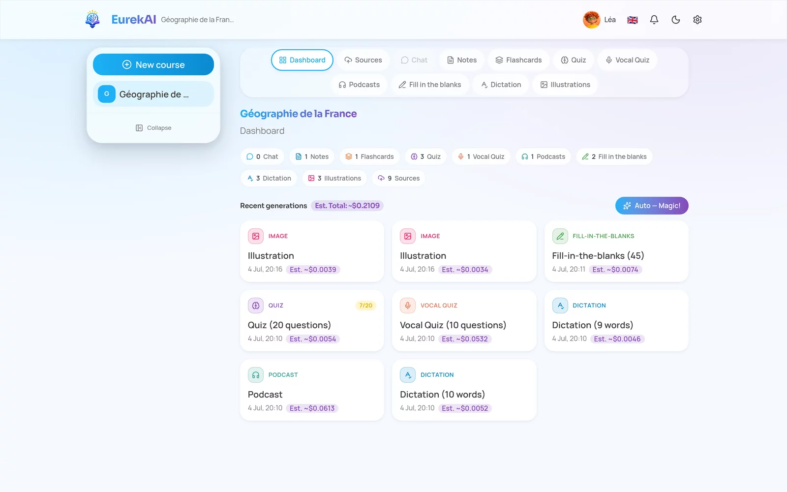
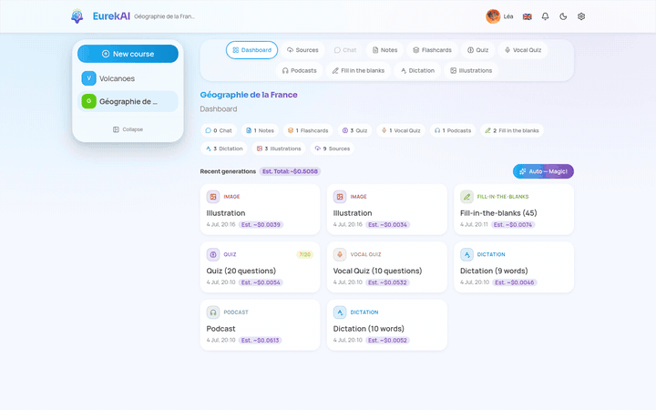
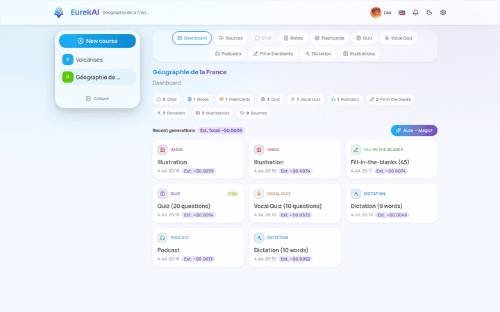

<p align="center">
  
</p>

<h1 align="center">EurekAI</h1>

<p align="center">
  <strong>حوّل أي محتوى إلى تجربة تعلّم تفاعلية — بدعم من <a href="https://mistral.ai">Mistral AI</a>.</strong>
</p>

<p align="center">
  <a href="README-en.md">🇬🇧 الإنجليزية</a> · <a href="README-es.md">🇪🇸 الإسبانية</a> · <a href="README-pt.md">🇧🇷 البرتغالية</a> · <a href="README-de.md">🇩🇪 الألمانية</a> · <a href="README-it.md">🇮🇹 الإيطالية</a> · <a href="README-nl.md">🇳🇱 الهولندية</a> · <a href="README-ar.md">🇸🇦 العربية</a><br>
  <a href="README-hi.md">🇮🇳 الهندية</a> · <a href="README-zh.md">🇨🇳 الصينية</a> · <a href="README-ja.md">🇯🇵 اليابانية</a> · <a href="README-ko.md">🇰🇷 الكورية</a> · <a href="README-pl.md">🇵🇱 البولندية</a> · <a href="README-ro.md">🇷🇴 الرومانية</a> · <a href="README-sv.md">🇸🇪 السويدية</a>
</p>

<p align="center">
  <a href="https://www.youtube.com/watch?v=_b1TQz2leoI"></a>
</p>

<h4 align="center">📊 جودة الشيفرة</h4>

<p align="center">
  <a href="https://sonarcloud.io/summary/new_code?id=jls42_EurekAI"></a>
  <a href="https://sonarcloud.io/summary/new_code?id=jls42_EurekAI"></a>
  <a href="https://sonarcloud.io/summary/new_code?id=jls42_EurekAI"></a>
  <a href="https://sonarcloud.io/summary/new_code?id=jls42_EurekAI"></a>
</p>
<p align="center">
  <a href="https://sonarcloud.io/summary/new_code?id=jls42_EurekAI"></a>
  <a href="https://sonarcloud.io/summary/new_code?id=jls42_EurekAI"></a>
  <a href="https://sonarcloud.io/summary/new_code?id=jls42_EurekAI"></a>
  <a href="https://sonarcloud.io/summary/new_code?id=jls42_EurekAI"></a>
</p>
<p align="center">
  <a href="https://app.codacy.com/gh/jls42/EurekAI/dashboard?utm_source=gh&utm_medium=referral&utm_content=&utm_campaign=Badge_grade"></a>
  <a href="https://www.codefactor.io/repository/github/jls42/eurekai"></a>
</p>

---

## القصة — لماذا EurekAI؟

وُلد **EurekAI** خلال [هاكاثون Mistral AI العالمي](https://luma.com/mistralhack-online) ([الموقع الرسمي](https://worldwide-hackathon.mistral.ai/)) (مارس 2026). كنت بحاجة إلى موضوع — وجاءت الفكرة من تجربة واقعية جدًا: أراجع مع ابنتي بانتظام استعدادًا للاختبارات، وفكرت في أنه لا بد من وجود طريقة لجعل ذلك أكثر متعة وتفاعلية بفضل الذكاء الاصطناعي.

الهدف: أخذ **أي مُدخل** — صورة للدرس، أو نص منسوخ وملصق، أو تسجيل صوتي، أو بحث على الويب — وتحويله إلى **ملخصات للمراجعة، وبطاقات تعليمية، واختبارات، وبودكاست، ونصوص لملء الفراغات، ورسوم توضيحية، وغير ذلك الكثير**. كل ذلك بدعم من نماذج Mistral AI، وهي شركة فرنسية، مما يجعل EurekAI حلًا ملائمًا بطبيعته للطلاب الناطقين بالفرنسية.

صُمّم [النموذج الأولي](https://github.com/jls42/worldwide-hackathon.mistral.ai) خلال 48 ساعة أثناء الهاكاثون لإثبات المفهوم اعتمادًا على خدمات Mistral — وكان يعمل بالفعل، لكن بإمكانات محدودة. منذ ذلك الحين، أصبح EurekAI مشروعًا متكاملًا: نصوص لملء الفراغات، وتنقّل بين التمارين، واستخراج محتوى الويب، وإشراف أبوي قابل للضبط، ومراجعة معمّقة للشيفرة، وغير ذلك الكثير. تُولَّد الشيفرة بالكامل بالذكاء الاصطناعي — أساسًا باستخدام [Claude Code](https://code.claude.com/)، مع بعض المساهمات عبر [Codex](https://openai.com/codex/) و[Gemini CLI](https://geminicli.com/).

---

## نظرة عامة

<p align="center">
  
</p>

| | |
|---|---|
| <br>**لوحة التحكم** — أحدث عمليات التوليد، والتكلفة التقديرية لكل بطاقة وللمشروع بالكامل، وزر «تلقائي — سحر!» | <br>**المصادر** — استيراد الصور/PDF/النصوص/الصوت/الويب، والتوليد بنقرة واحدة، واكتشاف التعليمات |

يعرض كل مصدر مستورد [درجة الثقة في OCR، وحالة فحص المحتوى، وتكلفته التقديرية](docs/screenshots/sources-list.webp).

### المكوّنات أثناء الاستخدام

| | |
|---|---|
| <br>**ملخص المراجعة** — نقاط رئيسية، ومفردات، واقتباسات موثّقة بالمصادر، وقراءة صوتية لكل قسم | <br>**اختبار متعدد الخيارات** — إجابة صحيحة واحدة لكل سؤال، وتقييم فوري مع شرح، وتنقّل خطوة بخطوة |
| <br>**البطاقات التعليمية** — بطاقة تُقلب ثم تقييم ذاتي «كنت أعرف / لم أكن أعرف» | <br>**نصوص لملء الفراغات** — تلميح عند الطلب، وتحقّق مرن من الإجابة |
| <br>**الإملاء** — كلمة تُملى صوتيًا، وتصحيح صارم حرفًا بحرف | <br>**اختبار صوتي** — سؤال يُقرأ بصوت عالٍ، وإجابة عبر الميكروفون |
| <br>**بودكاست** — بودكاست قصير بصوتين، مع نص حواري يمكن الاطلاع عليه | <br>**الرسوم التوضيحية** — صور تعليمية يولّدها وكيل |
| <br>**المعلّم بالذكاء الاصطناعي** — دردشة تستند إلى مستندات الدرس، وإجابات مشروحة، وإمكانية توليد اختبارات وبطاقات تعليمية | |

### بدء الاستخدام

| | |
|---|---|
| <br>**اختيار الملف الشخصي** — لكل طفل مساحته وصورته الرمزية ولغته | <br>**إنشاء ملف شخصي** — العمر، والصورة الرمزية، ورمز PIN أبوي لمن هم دون 15 عامًا |
| <br>**إنشاء درس** — مشروع لكل درس، جاهز لاستقبال المصادر | <br>**الإعدادات** — حالة API، واختيار نماذج الذكاء الاصطناعي مع عرض الأسعار |

---

## الميزات

| | الميزة | الوصف |
|---|---|---|
| 📷 | **استيراد الملفات** | استورد دروسك — صورة، أو PDF (عبر Mistral OCR مع متوسط درجة الثقة، ومستويات `high`/`medium`/`low`) أو ملف نصي (TXT، MD). جلسات رفع مع إعادة المحاولة لكل ملف ومؤشر تقدّم مستقل |
| 📝 | **إدخال النص** | اكتب أي نص أو الصقه مباشرة |
| 🎤 | **الإدخال الصوتي** | سجّل صوتك — يحوّل Voxtral STT كلامك إلى نص |
| 🌐 | **الويب / URL** | الصق URL (استخراج مباشر للمحتوى عبر Readability + Lightpanda) أو اكتب بحثًا (وكيل Mistral مع web_search) |
| 📄 | **ملخصات المراجعة** | ملاحظات منظّمة تتضمن نقاطًا رئيسية، ومفردات، واقتباسات، وطرائف معرفية |
| 🃏 | **البطاقات التعليمية** | بطاقات تفاعلية للأسئلة والأجوبة، مع قراءة صوتية حوارية |
| ❓ | **اختبارات متعددة الخيارات** | أسئلة بأربعة خيارات وإجابة صحيحة واحدة، مع مراجعة تكيّفية للأخطاء (العدد قابل للضبط) |
| ✏️ | **نصوص لملء الفراغات** | تمارين إكمال مع تلميحات وتحقّق مرن من الإجابة |
| 🔤 | **الإملاء** | كلمات تُملى صوتيًا (Voxtral TTS) من قائمة مستوردة، وإدخال بلوحة المفاتيح، وتصحيح صارم حرفًا بحرف مع شرح القاعدة الإملائية |
| 🎙️ | **بودكاست** | بودكاست صوتي قصير بصوتين — بأصوات Mistral الافتراضية أو أصوات مخصّصة (أصوات الوالدين!) |
| 🖼️ | **الرسوم التوضيحية** | صور تعليمية يولّدها وكيل Mistral |
| 🗣️ | **اختبار صوتي** | أسئلة تُقرأ بصوت عالٍ (مع إمكانية استخدام صوت مخصّص)، وإجابة شفوية، وتحقّق بالذكاء الاصطناعي |
| 💬 | **المعلّم بالذكاء الاصطناعي** | دردشة تراعي سياق مستندات دروسك، مع استدعاء الأدوات |
| 🧠 | **الموجّه التلقائي** | يحلّل موجّه يعتمد على `mistral-small-latest` المحتوى ويقترح مجموعة من المولّدات من بين الأنواع الثمانية المتاحة |
| 🔁 | **استمرارية العمل بين الدروس** | تواصل عمليات الاستيراد والتوليد التلقائي والتسجيل بالميكروفون والدردشة والبحث على الويب والقراءة بصوت عالٍ عملها في درسها عند فتح درس آخر؛ ويذكر إشعار اسم الدرس عند اكتمالها أثناء عرض درس آخر |
| 🔒 | **الرقابة الأبوية** | فحص محتوى قابل للضبط لكل ملف شخصي (بفئات قابلة للتخصيص)، ورمز PIN أبوي، وقيود على الدردشة |
| 🌍 | **تعدد اللغات** | الواجهة متاحة بتسع لغات؛ ويمكن توجيه التوليد بالذكاء الاصطناعي بخمس عشرة لغة عبر التعليمات |
| 🔊 | **القراءة بصوت عالٍ** | استمع إلى الملخصات والبطاقات التعليمية (حوار سؤال/جواب) عبر Mistral Voxtral TTS |
| 💶 | **تتبّع تكاليف API** | تقدير شفاف لتكلفة كل عملية توليد ومصدر باليورو € (الرموز / الأحرف / الصفحات / ثواني الصوت). شارة لكل بطاقة + إجمالي لكل مشروع، ظاهر في لوحة التحكم |
| 🎨 | **السمة لكل ملف شخصي** | يختار كل ملف شخصي سمته `dark` أو `light` — وتُحفظ معه وتُطبّق مجددًا عند كل تبديل للملف الشخصي |

---

## نظرة عامة على البنية

<p align="center">
  
</p>

---

## خريطة استخدام النماذج

<p align="center">
  
</p>

---

## رحلة المستخدم

<p align="center">
  
</p>

---

## نظرة معمّقة — الميزات

### إدخال متعدد الوسائط

يقبل EurekAI أربعة أنواع من المصادر، ويُفحص محتواها وفقًا للملف الشخصي (الفحص مفعّل افتراضيًا لملفات الأطفال والمراهقين):

- **استيراد الملفات** — ملفات JPG أو PNG أو PDF تُعالَج باستخدام OCR من Mistral — **OCR 4.1** (`mistral-ocr-4-1`) افتراضيًا، و**OCR 3** (`mistral-ocr-2512`) اختياريًا في الإعدادات (أقل تكلفة، نحو نصف التكلفة؛ وأفضل في قراءة الكتابة اليدوية) — للنصوص المطبوعة والجداول والكتابة اليدوية؛ أو ملفات نصية (TXT، MD) تُستورد مباشرة. يستخدم رفع ملفات متعددة نظام **جلسات رفع**: مؤشر تقدّم مستقل لكل ملف، وإعادة محاولة رفع الملف الذي فشل دون إعادة إرسال الملفات الأخرى، وإغلاق الجلسة عند اكتمالها. يوفّر OCR **متوسط درجة الثقة** (`average`، محصور ضمن `[0,1]`، ومحسوب من قيم `averagePageConfidenceScore` التي يعيدها Mistral)، ويُعرض في الواجهة على شكل شارة مستوى `high` / `medium` / `low` (بحدود تقريبية ~0.9 / ~0.7) — ينبّه إلى رداءة المسح الضوئي دون إيقاف العمل. تُحذف نسخة المستند المرسلة إلى Mistral لمعالجة OCR فور انتهاء المعالجة، حتى في حال فشلها.
- **نص حر** — اكتب أي محتوى أو الصقه. يُفحص قبل التخزين إذا كان فحص المحتوى مفعّلًا.
- **الإدخال الصوتي** — سجّل الصوت في المتصفح. يحوّله **Voxtral Mini Transcribe 2** (`voxtral-mini-2602`) إلى نص افتراضيًا؛ ويتوفر **Voxtral Mini Transcribe 3** و**Voxtral Small Transcribe 3** (إصدار معاينة من Mistral) اختياريًا في الإعدادات. تُمرّر لغة الواجهة إلى النموذج (`language`) لتحسين التعرّف على الكلام.
- **الويب / URL** — الصق عنوان URL واحدًا أو عدة عناوين لاستخراج المحتوى مباشرة (Readability + Lightpanda للصفحات التي تستخدم JS)، أو اكتب كلمات مفتاحية للبحث على الويب عبر وكيل Mistral. يقبل الحقل نفسه كلا النوعين — وتُفصل عناوين URL والكلمات المفتاحية تلقائيًا، وتُنشئ كل نتيجة مصدرًا مستقلًا.

### توليد المحتوى بالذكاء الاصطناعي

ثمانية أنواع من المواد التعليمية المُولّدة:

| المولّد | النموذج | المخرجات |
|---|---|---|
| **ملخص المراجعة** | `mistral-large-2512` | عنوان، وملخص، ونقاط رئيسية، ومفردات، واقتباسات، وطرفة معرفية |
| **البطاقات التعليمية** | `mistral-large-2512` | بطاقات أسئلة وأجوبة مع إحالات إلى المصادر (العدد قابل للضبط) |
| **اختبار متعدد الخيارات** | `mistral-large-2512` | أسئلة بأربعة خيارات وإجابة صحيحة واحدة، وشروح، ومراجعة تكيّفية (العدد قابل للضبط) |
| **نصوص لملء الفراغات** | `mistral-large-2512` | جمل لإكمالها مع تلميحات وتحقّق مرن من الإجابة (Levenshtein) |
| **الإملاء** | `mistral-large-2512` + Voxtral TTS | كلمات رئيسية تُملى صوتيًا (1 MP3/كلمة) → إدخال بلوحة المفاتيح → تصحيح صارم (نسيان علامة نبر يُحسب خطأً) مع شرح القاعدة |
| **بودكاست** | `mistral-large-2512` + Voxtral TTS | نص حواري بصوتين → صوت MP3 |
| **رسم توضيحي** | وكيل `mistral-large-2512` | صورة تعليمية عبر أداة `image_generation` |
| **اختبار صوتي** | `mistral-large-2512` + Voxtral TTS + STT | أسئلة TTS → إجابة STT → تحقّق بالذكاء الاصطناعي |

### معلّم بالذكاء الاصطناعي عبر الدردشة

معلّم حواري لديه وصول كامل إلى مستندات الدرس:

- يستخدم `mistral-large-2512`
- **استدعاء الأدوات**: يمكنه توليد ملخصات وبطاقات تعليمية واختبارات أو نصوص لملء الفراغات أثناء المحادثة
- سجل من 50 رسالة لكل درس
- فحص المحتوى إذا كان مفعّلًا للملف الشخصي: تُفحص الرسالة، وتُستبعد من السياق والأدوات المصادر المبلّغ عنها، والمصادر التي فشل فحصها، والمصادر التي لم تُفحص بعد (تُعاد أولًا محاولة فحص المصادر التي فشل فحصها أو لم تُفحص بعد، لمدة أقصاها 5 ثوانٍ)

### الموجّه التلقائي

يستخدم الموجّه `mistral-small-latest` لتحليل محتوى المصادر واقتراح المولّدات الأنسب من بين الثمانية المتاحة. تعرض الواجهة التقدّم في الوقت الفعلي: مرحلة تحليل أولًا، ثم عمليات التوليد الفردية مع إمكانية الإلغاء.

يعمل الوضع التلقائي على الخادم: ويستمر عند إعادة تحميل الصفحة أو فتح درس آخر أو تبديل الملف الشخصي، ولا تعمل سوى عملية تلقائية واحدة في الوقت نفسه لكل درس (تنضم علامة تبويب ثانية إلى العملية الجارية). يشغّل الخادم بحد أقصى 3 عمليات توليد متزامنة لكل مفتاح Mistral. تظهر رسالة لكل عملية توليد مكتملة، ثم يظهر تقرير نهائي مرة واحدة فقط؛ وإذا اكتملت العملية أثناء عرض درس آخر، تذكر الرسالة اسم درسها. لا تُحسب عملية توليد أُلغيت منفردة على أنها فشل في التقرير. يوقف «إلغاء الكل» دفعة عمليات الدرس بالكامل، مع رسالة واحدة. إذا أُعيد تشغيل الخادم أثناء عملية تلقائية، تُعرض على أنها انقطعت، مع زر «استئناف» يعيد تشغيل عمليات التوليد التي لم تكتمل فقط، دون إعادة التحليل.

تعمل بحد أقصى 3 عمليات توليد طويلة أُطلقت من علامة التبويب في الوقت نفسه (عمليات توليد تُطلق واحدة تلو الأخرى، وبطاقات التذكير): وتنتظر العمليات التالية دورها، ويُفتح الدرس دون انتظار اكتمال عمليات التوليد الجارية.

### التعلّم التكيّفي

- **إحصاءات الاختبارات**: تتبّع المحاولات ودقة الإجابات لكل سؤال
- **مراجعة الاختبارات**: توليد 5-10 أسئلة جديدة تستهدف المفاهيم التي تحتاج إلى تقوية، اعتمادًا على مصادر الاختبار الأصلي (وتُطبّق ضوابط فحص المحتوى على المصادر نفسها)
- **اكتشاف التعليمات**: يكتشف تعليمات المراجعة («أكون قد أتقنت درسي إذا كنت أعرف...») ويمنحها الأولوية في مولّدات النصوص المتوافقة (الملخصات، والبطاقات التعليمية، والاختبارات، ونصوص ملء الفراغات). عند تفعيل فحص المحتوى، ينتظر الاكتشاف فحص المصادر ولا يقرأ إلا المصادر التي اعتُبرت آمنة؛ وتحتفظ التعليمات بقائمة مصادرها الأصلية: إذا أُبلغ عن أحدها، فلا تُعرض التعليمات ولا تُطبّق، وإذا حُذف أحدها، تُمحى التعليمات. وتُحتسب تكلفته
### الأمان والرقابة الأبوية

- **4 فئات عمرية**: طفل (≤10 سنوات)، مراهق (11-15)، طالب (16-25)، بالغ (26+)
- **الإشراف على المحتوى**: `mistral-moderation-2603` (Mistral Moderation 2) مع 11 فئة متاحة، تُحظر 6 منها افتراضيًا للملفات الشخصية الجديدة للأطفال والمراهقين (`sexual`، `hate_and_discrimination`، `violence_and_threats`، `criminal`، `selfharm`، `jailbreaking`؛ أُضيفت `criminal` بعد تقييم شمل 50 درسًا، بما فيها التاريخ، دون أي نتائج إيجابية كاذبة). يمكن تخصيص الفئات لكل ملف شخصي في الإعدادات؛ قسّم Moderation 2 الفئة السابقة «المحتوى الخطير» إلى `dangerous` + `criminal` (تُرحّل الملفات الشخصية الحالية تلقائيًا، وتنطبق الفئات المحظورة أيضًا على المصادر المستوردة سابقًا). الأمان افتراضيًا: إذا لم تسمح استجابة النموذج بالتحقق من فئة محظورة، يُرفض المحتوى («الإشراف غير متاح»)؛ وعندما يكون الإشراف مفعّلًا، يستبعد كل من التوليد والمحادثة المصادر المُبلّغ عنها، وتلك التي فشل التحقق منها، وتلك التي يجري التحقق منها. يُتحقق قبل الاستخدام من أي مصدر لم يُفحص من قبل (استُورد عندما كان الإشراف معطّلًا، أو كان ضمن مشروع قديم أُلحق بملف شخصي). يُستأنف الإشراف الذي انقطع بسبب إعادة التشغيل عند بدء التشغيل إذا سمح مفتاح الخادم بذلك؛ وإلا فيُستأنف، كما في حالة الإشراف الذي تعطل بخطأ، عند فتح المشروع أو عند التوليد التالي. يتيح زر «إعادة التحقق» بدء التحقق مجددًا عند الطلب. عندما يكون الإشراف مفعّلًا، يبقى محتوى المصدر مخفيًا عن الطفل (المعاينة والنص والمستند الأصلي) حتى يُعدّ آمنًا؛ ويمكن لأحد الوالدين عرضه باستخدام رمز PIN الخاص به، للاطلاع مرة واحدة فقط. تخضع الإجابة الشفهية في الاختبار الصوتي للإشراف قبل التحقق من صحتها. المعرّف المؤرّخ مثبّت في `helpers/moderation-model.ts`: لم تعد API تُدرج الاسم المستعار `-latest` الذي أُوقف استخدامه.
- **رمز PIN الأبوي**: تجزئة SHA-256، مطلوب للملفات الشخصية لمن تقل أعمارهم عن 15 عامًا؛ بحد أقصى 10 رموز خاطئة كل ربع ساعة ولكل عنوان IP (429 `rate_limited`). للنشر في بيئة الإنتاج، ينبغي استخدام تجزئة بطيئة مع قيمة عشوائية مضافة (Argon2id، bcrypt).
- **بيانات الخادم**: لا ينشر `/output` سوى وسائط المشاريع (الصوت والصور والملفات المستوردة)؛ ولا تُقدَّم أبدًا `profiles.json` و`config.json` و`projects.json` و`project.json`
- **قيود المحادثة**: تُعطّل محادثة الذكاء الاصطناعي افتراضيًا لمن تقل أعمارهم عن 16 عامًا، ويمكن للوالدين تفعيلها

### نظام الملفات الشخصية المتعددة

- ملفات شخصية متعددة تتضمن الاسم والعمر والصورة الرمزية وتفضيلات اللغة
- **أصوات لكل ملف شخصي** (`Profile.mistralVoices?: { host?, guest? }` — كل دور اختياري) — يمكن أن يكون لكل طفل زوج أصوات خاص به للبودكاست والاختبار الصوتي
- **سمة لكل ملف شخصي** (`Profile.theme: 'dark' | 'light'`) — تبديل تلقائي عند تغيير الملف الشخصي، مع حفظها في الواجهة الخلفية
- تُربط المشاريع بالملفات الشخصية عبر `profileId`؛ ويُلحق أي مشروع قديم بلا ملف شخصي بأول ملف شخصي يفتحه، ثم يخضع للإشراف وفقًا لذلك الملف
- حذف متسلسل: يؤدي حذف ملف شخصي إلى حذف جميع مشاريعه

### تتبّع تكاليف API

تُزوّد كل مكالمة Mistral قابلة للفوترة (المحادثة وOCR وSTT وTTS والوكلاء)، بما فيها اكتشاف التعليمات والإجابات الشفهية للاختبار الصوتي، بآلية قياس لتقديم تقدير **شفاف** للتكلفة باليورو € للمستخدم. الإشراف مجاني ولا يُحتسب. تشمل التكلفة رسوم أدوات الوكلاء: 0,03 $ لكل بحث على الويب و0,10 $ لكل صورة مولّدة (أسعار Mistral)، بالإضافة إلى الرموز التي تنتجها هذه الأدوات، والتي يحتسبها التقدير بسعر الإدخال الخاص بنموذج الوكيل.

- **المصدر المرجعي المعتمد**: `helpers/pricing.ts` — `MODEL_PRICING` حسب بادئة النموذج (مثلًا: `mistral-large` → إدخال 0.5 €/M رمز، إخراج 1.5 €/M رمز)، و`PRICING_SOURCES` مع روابط توثيق Mistral لإعادة الاستخراج دوريًا
- **الوحدات المدعومة**: `tokens`، `characters` (TTS)، `pages` (OCR)، `audio-seconds` (STT) — يتحكم `helpers/cost-calc.ts` في التحويل
- **سلسلة القياس**: `helpers/tracked-client.ts` (يغلّف عميل Mistral) → `helpers/usage-context.ts` (AsyncLocalStorage) → `helpers/cost-calc.ts` → `helpers/cost-persist.ts` → `helpers/cost-middleware.ts` (إدراج في استجابة HTTP)
- **واجهة المستخدم**: شارة تكلفة لكل عملية توليد (`src/partials/cost-badge-gen.html`)، ولكل مصدر (`cost-badge-src.html`)، وإجمالي تراكمي في لوحة المعلومات (`Project.totalCost`)
- **نقاط النهاية**: تُضيف استجابات `/generate/*` و`/sources/*` إلى الكائن المُعاد (`Generation` / `Source`) الحقول `estimatedCost` و`usage` و`costBreakdown`. يضيف `POST /generate/route` حقل `costDelta: number` لتكلفة التوجيه وحده؛ ويُعيد `POST /detect-consigne` (`{consigne, costDelta}`) والتحقق من إجابة شفهية أيضًا قيمة `costDelta` الخاصة بهما. يُعيد `GET /projects/:pid` المشروع مع إضافة `totalCost` (مجموع محسوب من `costLog[]`) + السجل الكامل

### TTS (Mistral Voxtral) والأصوات المخصصة

- **Mistral Voxtral TTS**: **Voxtral TTS** (`voxtral-mini-tts-2603`) افتراضيًا، و**Voxtral TTS 3** (`voxtral-mini-tts-3-0`، إصدار معاينة من Mistral، بأصوات أصلية بلغات أكثر) اختياريًا في الإعدادات؛ تحويل النص إلى كلام عبر Mistral بنسبة 100%، دون الحاجة إلى مفتاح إضافي. لا تُعرض سوى الأصوات التي يقبلها النموذج المختار: يرفض Voxtral TTS الأصوات المضافة مع Voxtral 3
- **الأصوات المخصصة**: يمكن للوالدين إنشاء أصواتهم الخاصة عبر Mistral Voices API (انطلاقًا من عينة صوتية) وإسنادها إلى دوري المضيف والضيف — فتُقرأ حلقات البودكاست والاختبارات الصوتية بصوت أحد الوالدين، مما يجعل التجربة أكثر تشويقًا للطفل
- دوران صوتيان قابلان للضبط: **المضيف** (الراوي الرئيسي) و**الضيف** (الصوت الثاني في البودكاست)
- فهرس كامل لأصوات Mistral متاح في الإعدادات، ويمكن تصفيته حسب اللغة
- تتوقف القراءة (بطاقة دراسية أو بودكاست أو كلمة إملاء) مؤقتًا عند مغادرة واجهتها، وتُستأنف من الموضع الذي توقفت عنده
- يُنشأ صوت القراءة الجهرية للبطاقات التعليمية عند الاستماع الأول، ثم يُحفظ ضمن عملية توليدها: فلا يُعاد إنشاؤه ولا تُفرض تكلفته مجددًا عند كل عودة
- لا تُقرأ علامات المصادر (`[Source N]`) بصوت عالٍ

### دعم اللغات

- الواجهة متاحة بـ9 لغات: fr، en، es، pt، it، nl، de، hi، ar
- تدعم تعليمات الذكاء الاصطناعي 15 لغة (fr، en، es، de، it، pt، nl، ja، zh، ko، ar، hi، pl، ro، sv)
- يمكن ضبط اللغة لكل ملف شخصي

---

## الحزمة التقنية

| الطبقة | التقنية | الدور |
|---|---|---|
| **بيئة التشغيل** | Node.js + TypeScript 6.x | الخادم وسلامة الأنواع |
| **الواجهة الخلفية** | Express 5.x | API REST |
| **خادم التطوير** | Vite 8.x (Rolldown) + tsx | HMR، أجزاء قوالب Handlebars، وكيل |
| **الواجهة الأمامية** | HTML + TailwindCSS 4.x + Alpine.js 3.x | واجهة تفاعلية، وTypeScript يُجمّعه Vite |
| **القوالب** | vite-plugin-handlebars | تركيب HTML باستخدام أجزاء القوالب |
| **الذكاء الاصطناعي** | Mistral AI SDK | المحادثة، OCR، STT، TTS، الوكلاء، الإشراف |
| **TTS** | Mistral Voxtral TTS | `voxtral-mini-tts-2603` (Voxtral TTS 3 اختياري)، تحويل النص إلى كلام مدمج |
| **الأيقونات** | Lucide 1.x | مكتبة أيقونات SVG |
| **استخراج محتوى الويب** | Readability + linkedom | استخراج المحتوى الرئيسي لصفحات الويب (تقنية Firefox Reader View) |
| **متصفح بلا واجهة** | Lightpanda | متصفح خفيف للغاية بلا واجهة (Zig + V8) لصفحات JS/SPA — بديل احتياطي لاستخراج المحتوى |
| **Markdown** | Marked | عرض Markdown في المحادثة |
| **رفع الملفات** | Multer 2.x | إدارة النماذج متعددة الأجزاء |
| **الصوت** | ffmpeg-static | دمج المقاطع الصوتية |
| **الاختبارات** | Vitest | اختبارات الوحدات — تُقاس التغطية بواسطة SonarCloud |
| **التخزين الدائم** | ملفات JSON | تخزين بلا اعتماديات |

---

## مرجع النماذج

| النموذج | الاستخدام | السبب |
|---|---|---|
| `mistral-large-2512` (Large 3، افتراضي مثبّت) | بطاقة دراسية، بطاقات تعليمية، بودكاست، اختبار، نصوص لملء الفراغات، محادثة، التحقق من الاختبار الصوتي، وكيل الصور، وكيل البحث على الويب، اكتشاف التعليمات | أفضل في تعدد اللغات واتباع التعليمات؛ مثبّت لأن الاسم المستعار `mistral-large-latest` يقدّم Large 4 منذ نوفمبر 2026، وهو بطيء جدًا لعمليات التوليد لدينا (أُعلن عن سحب Large 3 في 30/04/2027) |
| `mistral-ocr-4-1` (OCR 4.1، افتراضي) | OCR للمستندات | النصوص المطبوعة والجداول والكتابة اليدوية ($4 / 1000 صفحة) |
| `mistral-ocr-2512` (OCR 3، اختياري) | OCR للمستندات | يمكن اختياره في الإعدادات، أقل تكلفة ($2 / 1000 صفحة)، ويقرأ الكتابة اليدوية بشكل أفضل |
| `voxtral-mini-2602` (Voxtral Mini Transcribe 2، افتراضي) | التعرف على الكلام (STT) | الإدخال الصوتي والإجابات الشفهية للاختبار الصوتي ($0.003 / min) |
| `voxtral-mini-transcribe-3-0` / `voxtral-small-transcribe-3-0` (Transcribe 3، اختياري، إصدار معاينة) | التعرف على الكلام (STT) | يمكن اختيارهما في الإعدادات ($0.0035 / min و$0.004 / min) |
| `voxtral-mini-tts-2603` (Voxtral TTS، افتراضي) | تحويل النص إلى كلام (TTS) | البودكاست والاختبار الصوتي والإملاء والقراءة الجهرية ($16 / M حرف) |
| `voxtral-mini-tts-3-0` (Voxtral TTS 3، اختياري، إصدار معاينة) | تحويل النص إلى كلام (TTS) | يمكن اختياره في الإعدادات، بأصوات أصلية بلغات أكثر ($13 / M حرف) |
| `mistral-moderation-2603` | الإشراف على المحتوى | 6 فئات محظورة للأطفال والمراهقين (منها `jailbreaking`) |
| `mistral-small-latest` | موجّه تلقائي | تحليل سريع للمحتوى لاتخاذ قرارات التوجيه |

على الهاتف، تعرض الإعدادات أسفل كل قائمة اختيار الوصف الكامل للنموذج المختار (السعر، «موصى به» أو «إصدار معاينة»)، والذي كانت القائمة المغلقة تقتطعه.

---

## البدء السريع

```bash
# Cloner le dépôt
git clone https://github.com/jls42/EurekAI.git
cd EurekAI

# Installer les dépendances
npm install

# Configurer les clés API
cp .env.example .env
# Éditez .env (toutes optionnelles) :
#   MISTRAL_API_KEY=<your_api_key>           (optionnel — sinon chaque utilisateur saisit sa clé dans l'app)
#   SONAR_TOKEN=...                          (optionnel, CI SonarCloud uniquement)

# Lancer le développement
npm run dev
# → Backend :  http://localhost:3000 (API)
# → Frontend : http://localhost:5173 (serveur Vite avec HMR)
```

> **ملاحظة**: Mistral Voxtral TTS هو المزوّد الوحيد لـTTS — لا حاجة إلى مفتاح إضافي إلى جانب `MISTRAL_API_KEY`.

> **مفتاح API الذي يُدخله المستخدم**: أصبح `MISTRAL_API_KEY` **اختياريًا**. عند غيابه، يبدأ التطبيق مع ذلك ويطلب من كل مستخدم إدخال **مفتاح Mistral الخاص به** في الواجهة. يُخزّن المفتاح **في المتصفح** (مشفّرًا عبر Web Crypto + IndexedDB في سياق آمن) ويُرسل مع كل طلب — **ولا يُحفظ أبدًا على الخادم**. ترتيب الأولوية: مفتاح الملف الشخصي > مفتاح المتصفح العام > `MISTRAL_API_KEY` (البيئة). يؤدي تعيين `EUREKAI_REQUIRE_USER_KEY=true` إلى إلزام كل مستخدم بتقديم مفتاحه (ويُستخدم مفتاح البيئة عندئذٍ للتحميل المسبق فقط).

> **HTTPS محلي (جهاز لوحي/LAN)**: يُعدّ `localhost` سياقًا آمنًا بالفعل. للوصول عبر LAN (جهاز لوحي)، أنشئ شهادة محلية وفعّل HTTPS: يستطيع المتصفح عندئذٍ تشفير المفتاح الذي يخزّنه، ويُشفّر المفتاح أثناء نقله:
> ```bash
> ./scripts/gen-cert.sh 192.168.1.42   # mkcert si dispo, sinon openssl self-signed
> export HTTPS_KEY=certs/key.pem HTTPS_CERT=certs/cert.pem
> npm run dev                          # Express + Vite en HTTPS
> ```

### متغيرات البيئة

| المتغير | مطلوب | القيمة الافتراضية | الدور |
|---|---|---|---|
| `MISTRAL_API_KEY` | اختياري | — | مفتاح Mistral API (المحادثة، OCR، STT، TTS Voxtral، الوكلاء، الإشراف). عند غيابه، يُدخل المستخدم مفتاحه في التطبيق (يُخزّن في المتصفح، ولا يُخزّن أبدًا على الخادم) |
| `EUREKAI_REQUIRE_USER_KEY` | اختياري | `false` | `true` → يعطّل الرجوع الاحتياطي إلى `MISTRAL_API_KEY` لطلبات الذكاء الاصطناعي (يجب على كل مستخدم تقديم مفتاحه). مفيد عند إتاحة نسخة التطبيق للعامة |
| `HTTPS_KEY` / `HTTPS_CERT` | اختياري | — | مسارا مفتاح وشهادة TLS (راجع `scripts/gen-cert.sh`) → يقدّم Express وVite المحتوى عبر HTTPS (سياق آمن عبر LAN/الجهاز اللوحي) |
| `PORT` | اختياري | `3000` | منفذ HTTP للواجهة الخلفية Express |
| `NODE_ENV` | اختياري | `development` | إذا كان `production` → يقدّم Express الواجهة الأمامية من `dist/` (وإلا فمن `public/`) |
| `SONAR_TOKEN` | اختياري في CI | — | يُستخدم فقط في سير عمل GitHub Actions الخاص بـSonarCloud |

### الاختبارات وجودة الشيفرة والمساهمة

```bash
npm test                # vitest (déclenche pretest : typecheck + lint:complexity + lint:ci + lint:deadcode)
npm run test:coverage   # couverture vitest
npm run lint            # ESLint + typescript-eslint + sonarjs
npm run lint:fix        # auto-fix
npm run format          # prettier
npm run security        # Opengrep (SAST local) — bloque sur finding ERROR
```

**خطافات Git (Husky)**: ينفّذ `pre-commit` بالتتابع `scripts/pre-commit-fast.sh` (التعارضات والملفات الكبيرة وshellcheck)، ثم `lint-staged` ثم `npm test`؛ وينفّذ `pre-push` أولًا فحصًا مانعًا `npm audit` (يمنع المتابعة بمجرد وجود ثغرة بمستوى `critical` في أي اعتمادية، حتى غير المباشرة، راجع `scripts/audit-verdict.mjs`) ثم `npm run security`. يمنع كل خطاف عمليتي الإيداع والدفع بمجرد فشل إحدى خطواته.

**أدوات خارجية (اختيارية لتشغيل التطبيق، وضرورية لـ`pretest` و`npm run security`)**:

```bash
# Lizard (Python) pour lint:complexity (CCN > 8 sur l'allowlist)
pipx install lizard          # ou : pipx run lizard

# Opengrep (binaire standalone ~40 Mo) pour npm run security
./scripts/install-opengrep.sh   # installe dans ~/.local/bin/
```

من دون هذه الأدوات، يفشل `npm test` عند `pretest` (لغياب lizard)، ويفشل `npm run security` (لغياب opengrep). وعندئذٍ تمنع خطافات husky عمليتي الإيداع والدفع.

---

## النشر باستخدام حاوية

تُنشر الصورة على **GitHub Container Registry**:

```bash
# Télécharger l'image
podman pull ghcr.io/jls42/eurekai:latest

# Lancer EurekAI
mkdir -p ./data
podman run -d --name eurekai \
  -e MISTRAL_API_KEY=<your_api_key> \
  -v ./data:/app/output:U \
  -p 3000:3000 \
  ghcr.io/jls42/eurekai:latest
# → http://localhost:3000
```

> **`:U`**: خيار Podman في وضع التشغيل دون صلاحيات الجذر، يضبط أذونات وحدة التخزين تلقائيًا.

```bash
# Build local
podman build -t eurekai -f Containerfile .

# Publier sur ghcr.io (mainteneurs)
./scripts/publish-ghcr.sh
```

---

## بنية المشروع

```
server.ts                 — Point d'entrée Express, monte les routes + config
config.ts                 — Config runtime (modèles, voix, modèle TTS), persistée dans output/config.json
store.ts                  — ProjectStore : CRUD projets/sources/générations, persistance JSON
profiles.ts               — ProfileStore : gestion des profils, hachage PIN
types.ts                  — Types TypeScript : Source, Generation (8 types), QuizStats, Profile
prompts.ts                — Tous les prompts IA centralisés (system + user templates, 15 langues)

generators/
  auto-agents.ts          — Source unique de vérité : AUTO_AGENTS_SET (8 agents) + MAX_AUTO_PLAN_LENGTH
  generation-types.ts     — Types générables individuellement (SINGLE_GENERATE_TYPES, coïncide avec les 8 agents auto)
  ocr.ts                  — OCR via Mistral (JPG, PNG, PDF) avec extraction interne des scores de confiance moyens par page
  summary.ts              — Génération de fiche de révision (JSON structuré)
  flashcards.ts           — Flashcards Q/R (nombre configurable)
  quiz.ts                 — Quiz QCM (nombre configurable) + révision adaptative
  fill-blank.ts           — Exercices à trous avec validation tolérante
  dictation.ts            — Dictée : mots + phrases-exemples + règles, 1 audio TTS par mot (8e agent auto)
  podcast.ts              — Script podcast 2 voix
  quiz-vocal.ts           — Quiz vocal : questions TTS + réponses STT + vérification IA
  image.ts                — Génération d'image via Agent Mistral (outil image_generation)
  chat.ts                 — Tuteur IA par chat avec appel d'outils
  router.ts               — Routeur automatique (contenu → générateurs recommandés)
  consigne.ts             — Détection de consignes de révision
  tts-provider.ts         — TTS Mistral Voxtral (synthèse vocale + listing des voix)
  tts.ts                  — Génération audio multi-voix (podcast + flashcards, concaténation de segments)
  stt.ts                  — Voxtral STT (audio → texte)
  websearch.ts            — Agent Mistral avec outil web_search (fallback)
  moderation.ts           — Modération de contenu (filtrage par âge)

routes/
  projects.ts             — CRUD projets
  profiles.ts             — CRUD profils avec gestion du PIN
  sources.ts              — Import fichiers (OCR + texte brut), texte libre, voix STT, scraping URL + recherche web, modération
  generate.ts             — Endpoints de génération (8 types + route)
  auto-runs.ts            — Lots Auto côté serveur : lancement, analyse et étapes en arrière-plan, état, annulation
  generations.ts          — Tentatives de quiz/fill-blank, réponses vocales, lecture à voix haute
  chat.ts                 — Chat IA avec appel d'outils

helpers/
  # IO & parsing
  index.ts                — getContent, stripJsonMarkdown, safeParseJson, tryParseJson, retryTurns, unwrapJsonArray, extractAllText, timer
  audio.ts                — collectStream (ReadableStream → Buffer)
  audio-files.ts          — Persistance et lecture des fichiers audio générés (podcast, flashcards)
  generation-media.ts     — Noms uniques des médias (MP3/PNG) et suppression avec leur génération
  media-ledger.ts         — Médias écrits pendant une génération, supprimés si elle échoue ou est annulée
  keyed-lock.ts           — File d'attente par clé (OCR sérialisé par contenu)
  keyed-slots.ts          — Places par clé (au plus 3 étapes d'Auto en même temps par clé Mistral)
  logger.ts               — Logger structuré (niveaux, contexte JSON)

  # Génération & UX
  auto-title.ts           — autoTitle(type, data, lang) : préfixe auto pour carte liste (Fiche, Note, Quiz, etc.)
  choice-labels.ts        — Labels localisés des choix (quiz, quiz-vocal) — 9 langues
  diversity.ts            — Diversité des générations (exclusion du contenu déjà produit, `diversityParams` : temperature/presencePenalty/randomSeed)
  fill-blank-validate.ts  — Validation tolérante des réponses (normalisation, Levenshtein)
  dictation-diff.ts       — Comparaison stricte lettre à lettre pour la correction de dictée (local, zéro coût IA)
  reading-comfort.ts      — Option « Confort de lecture » par profil (police Luciole, espacements) — partagé serveur/client
  ocr-models.ts           — Source de vérité sélection OCR (OCR 4 défaut / OCR 3 option) + normalizeOcrModel
  moderation-model.ts     — Modèle de modération épinglé + ses 11 catégories + migration des catégories legacy
  stt-models.ts           — Source de vérité sélection transcription (Mini Transcribe 2 défaut / Transcribe 3 option) + normalizeSttModel
  tts-models.ts           — Source de vérité sélection synthèse vocale (Voxtral TTS défaut / TTS 3 option) + compatibilité des voix
  tts-text.ts             — Texte envoyé au TTS : marqueurs de sources et crochets retirés (Voxtral les lit ou avale le mot)
  source-markers.ts       — Regex des marqueurs `[Source N]` des fiches (pastilles côté navigateur, texte lu côté serveur)
  moderation-http.ts      — Statut de modération → réponse HTTP (400 signalé / 503 indisponible / 409 en cours), statut effectif, garde de la consigne
  moderation-profile.ts   — Profil propriétaire du projet et catégories actives (source unique des routes)
  source-moderation.ts    — Modérations en vol et reprise (démarrage, génération, chat, « Revérifier »)
  input-moderation.ts     — Modération d'un texte saisi ou dicté (texte libre, recherche web, réponse orale)
  chat-sources.ts         — Sources accessibles au chat (sans les sources non vérifiées si la modération est active)

  # Codes d'erreur stables
  error-codes.ts              — Re-export mince de l'API publique
  error-code-resolution.ts    — Orchestration extractErrorCode(e, agent) → FailedStepCode
  error-code-rules.ts         — Règles de mapping par agent/step
  error-matchers.ts           — Matchers par pattern d'erreur HTTP/LLM (délimités pour Lizard)

  # Cost tracking API (suivi coûts €)
  pricing.ts              — MODEL_PRICING + PRICING_SOURCES (tarifs Mistral par prefix de modèle)
  cost-calc.ts            — Conversion ApiUsage → coût € (tokens / characters / pages / audio-seconds)
  cost-persist.ts         — Écriture dans Project.costLog + totalCost
  cost-middleware.ts      — Injection de costDelta dans la réponse HTTP
  tracked-client.ts       — Wrap du client Mistral (capture ApiUsage automatiquement)
  usage-context.ts        — AsyncLocalStorage pour propager l'usage dans les pipelines async

  # Clé API Mistral & sécurité
  mistral-client-factory.ts — Source UNIQUE de construction du client Mistral (buildTrackedClient, resolveClient, requireKeyMiddleware)
  rate-limit.ts           — Rate-limiters Express (authLimiter, pinLimiter, aiLimiter / aiPathLimiter, generalLimiter), 429 `rate_limited`
  request-validation.ts   — Validation de lang / ageGroup sur toutes les routes IA (400 invalid_input)
  output-static.ts        — Liste blanche du montage statique /output (médias des projets seulement)
  security-headers.ts     — Options Helmet / CSP (createHelmetOptions)
  redact.ts               — Redaction des secrets dans les logs (clé API, headers sensibles)
  mistral-retry.ts        — Retry avec backoff sur erreurs transitoires Mistral (3 tentatives)

  # Événements & notifications (SSE)
  event-bus.ts            — Bus d'événements de génération et de lots Auto en mémoire (dispatch SSE, filet anti-uncaughtException)
  auto-run-state.ts       — Transitions d'un lot Auto (fonctions pures, appliquées par le store)
  event-key.ts            — Clé d'événement typée partagée client/serveur (idempotence notifications)

  # Voix & profils
  voice-selection.ts      — selectVoices : rotation déterministe par profil + langue (host/guest)
  voice-types.ts          — Type MistralVoice (importable côté frontend sans embarquer le SDK Mistral)

src/                      — Frontend (Vite + Handlebars)
  index.html              — Point d'entrée HTML principal
  main.ts                 — Entrée frontend (init Alpine.js + icônes Lucide)
  app/                    — Modules applicatifs Alpine.js
    state.ts              — Gestion d'état réactif
    navigation.ts         — Routage des vues + gardes par âge
    view-media.ts         — Pause du son au changement de vue (position gardée)
    profiles.ts           — Logique du sélecteur de profils
    projects.ts           — CRUD des cours
    sources.ts            — Gestionnaires d'upload de sources
    generate.ts           — Déclencheurs de génération (individuel, tout, Auto)
    auto-launch.ts        — Lancement d'un Auto côté serveur, suivi pendant qu'un autre cours est affiché, annulation
    auto-runs.ts          — Auto suivis par l'onglet : état reçu du serveur, bilan affiché une seule fois, coût de l'analyse
    request-slots.ts      — Au plus 3 générations longues en même temps pour l'onglet, file d'attente FIFO
    moderation-gate.ts    — Pré-contrôle de modération des générations (vérifie d'abord les sources en attente)
    effective-moderation.ts — Statut de modération affiché et masquage du contenu des sources
    generations.ts        — Affichage + actions sur les générations
    chat.ts               — Interface de chat
    chat-in-flight.ts     — Messages du chat en attente de réponse, par cours
    config.ts             — Interface de configuration (modèles de chat, d'OCR, de transcription et de TTS, voix)
    render.ts             — Helpers de rendu HTML
    i18n.ts               — Changement de langue
    ...
  components/
    quiz.ts               — Composant quiz interactif
    quiz-vocal.ts         — Composant quiz vocal
    fill-blank.ts         — Composant textes à trous
    fill-blank-validate.ts — Ré-export client de la validation textes à trous (validateAnswer)
    flashcards.ts         — Composant flashcards avec retournement
    dictation.ts          — Composant dictée interactif
    step-by-step.ts       — Mixin navigation pas-à-pas (quiz, fill-blank, flashcards)
  i18n/
    fr.ts, en.ts, es.ts, — Dictionnaires par langue (9 langues)
    pt.ts, it.ts, nl.ts,
    de.ts, hi.ts, ar.ts
    languages.ts          — Registre des langues UI disponibles
    index.ts              — Chargeur i18n
  partials/               — Partials HTML Handlebars (header, sidebar, dialogues, vues)
  styles/
    main.css              — Entrée TailwindCSS
    theme.css             — Variables de thème personnalisées

public/assets/            — Ressources statiques (logo, avatars, schémas architecture)
docs/                     — Notes internes (inventaire prompts, audits, prompts des diagrammes) + screenshots du README
scripts/                  — Tooling : check-deps, check-models, check-security, check-complexity, gen-cert, install-opengrep, translate-readme, publish-ghcr, update-pricing
output/                   — Données d'exécution (projets, config, fichiers audio) ; en mode prod (`NODE_ENV=production`), Express sert le frontend depuis `dist/` au lieu de `public/`
```

> **لوكلاء الذكاء الاصطناعي الذين يساهمون في الشيفرة**: راجع [`CLAUDE.md`](CLAUDE.md) (القواعد العامة والفهرس) والقواعد التفصيلية في [`.claude/rules/`](.claude/rules/)، التي تُحمّل عند الطلب وفقًا للملفات المقروءة أو المعدّلة، للاطلاع على السياق المعماري المفصّل والقواعد الإلزامية (رموز الأخطاء، وتتبّع التكاليف، وتعليمات خالية من الكلمات الوصفية للمستند، أي دون نعوت تصف المستند مثل نوعه، لأن النموذج سينسخ هذه الكلمات في مخرجاته) والمزالق المعروفة (Lizard CCN، Opengrep، الانتقال من Codacy/Semgrep).

---

## مرجع API

### الإعدادات
| الطريقة | نقطة النهاية | الوصف |
|---|---|---|
| `GET` | `/api/config` | الإعدادات الحالية |
| `PUT` | `/api/config` | تعديل الإعدادات (النماذج والأصوات ونموذج TTS) |
| `GET` | `/api/config/status` | حالة واجهات API: `mistral` (مفتاح Mistral محدّد)، `ttsAvailable` (اسم مستعار لـ`mistral`، وMistral Voxtral هو المزوّد الوحيد لـTTS) |
| `POST` | `/api/config/reset` | استعادة الإعدادات الافتراضية |
| `GET` | `/api/config/voices` | عرض أصوات Mistral TTS (`?lang=fr` اختياري) |
| `GET` | `/api/moderation-categories` | فئات الإشراف المتاحة + القيم الافتراضية حسب العمر |
| `POST` | `/api/providers/mistral/validate` | التحقق من صلاحية مفتاح Mistral الذي أدخله المستخدم — دائمًا 200 `{status}` (`ok`/`invalid`/`quota`/`network`/`missing`)، دون رجوع احتياطي إلى البيئة |

### الملفات الشخصية
| الطريقة | نقطة النهاية | الوصف |
|---|---|---|
| `GET` | `/api/profiles` | عرض جميع الملفات الشخصية |
| `POST` | `/api/profiles` | إنشاء ملف شخصي |
| `PUT` | `/api/profiles/:id` | تعديل ملف شخصي (رمز PIN مطلوب لمن هم < 15 عامًا؛ 10 رموز PIN خاطئة / 15 min → 429 `rate_limited`) |
| `DELETE` | `/api/profiles/:id` | حذف ملف شخصي + حذف المشاريع بالتسلسل `{pin?}` → `{ok, deletedProjects}` |

### المشاريع
| الطريقة | نقطة النهاية | الوصف |
|---|---|---|
| `GET` | `/api/projects` | عرض المشاريع (`?profileId=` اختياري) |
| `POST` | `/api/projects` | إنشاء مشروع `{name, profileId}` |
| `GET` | `/api/projects/:pid` | تفاصيل المشروع؛ يُلحق `?profileId=` مشروعًا بلا ملف شخصي بالملف الشخصي الذي يفتحه |
| `PUT` | `/api/projects/:pid` | إعادة تسمية `{name}` |
| `DELETE` | `/api/projects/:pid` | حذف المشروع |
| `GET` | `/api/projects/:pid/events` | تدفق SSE آني (`event: generation`) لانتقالات التوليد (`completed`/`failed`/`cancelled`) + نبضات دورية لإبقاء الاتصال حيًا |

### المصادر
| الطريقة | نقطة النهاية | الوصف |
|---|---|---|
| `POST` | `/api/projects/:pid/sources/upload` | استيراد ملفات متعددة الأجزاء (OCR لملفات JPG/PNG/PDF، وقراءة مباشرة لملفات TXT/MD) |
| `POST` | `/api/projects/:pid/sources/text` | نص حر `{text}` |
| `POST` | `/api/projects/:pid/sources/voice` | صوت STT (صوت متعدد الأجزاء) |
| `POST` | `/api/projects/:pid/sources/websearch` | استخراج محتوى URL أو بحث على الويب `{query}` — يُعيد مصفوفة مصادر؛ 422 `url_blocked` إذا رُفضت جميع العناوين (شبكة داخلية)، و502 `all_sources_failed` إذا تعذّر إنشاء أي مصدر |
| `POST` | `/api/projects/:pid/sources/moderate` | استئناف عمليات الإشراف المعلّقة أو المتعطلة بخطأ `{sourceIds?}` (10 كحد أقصى لكل استدعاء، انتظار ≤ 10 s) → `{sources: [{id, moderation}]}` |
| `DELETE` | `/api/projects/:pid/sources/:sid` | حذف مصدر وملفه المستورد والتعليمات التي تعتمد عليه → `{ok, consigne}` |
| `POST` | `/api/projects/:pid/moderate` | إخضاع `{text}` للإشراف |
| `POST` | `/api/projects/:pid/detect-consigne` | اكتشاف تعليمات المراجعة (المصادر التي جرى التحقق منها فقط) → `{consigne, costDelta}` |
### التوليد
| الطريقة | نقطة النهاية | الوصف |
|---|---|---|
| `POST` | `/api/projects/:pid/generate/summary` | ورقة مراجعة |
| `POST` | `/api/projects/:pid/generate/flashcards` | بطاقات تعليمية |
| `POST` | `/api/projects/:pid/generate/quiz` | اختبار متعدد الخيارات (4 خيارات، إجابة صحيحة واحدة فقط) |
| `POST` | `/api/projects/:pid/generate/fill-blank` | نصوص لملء الفراغات |
| `POST` | `/api/projects/:pid/generate/dictation` | إملاء (كلمات + جمل توضيحية + قواعد، مقطع صوتي واحد بتقنية TTS لكل كلمة؛ يقدمه أيضًا الموجّه التلقائي) |
| `POST` | `/api/projects/:pid/generate/podcast` | بودكاست |
| `POST` | `/api/projects/:pid/generate/image` | رسم توضيحي |
| `POST` | `/api/projects/:pid/generate/quiz-vocal` | اختبار صوتي |
| `POST` | `/api/projects/:pid/generate/quiz-review` | مراجعة تكيفية `{generationId, weakQuestions}` |
| `POST` | `/api/projects/:pid/generate/remediation-summary` | ورقة تذكير تركز على أسئلة الاختبار التي أُجيب عنها خطأً `{generationId, weakQuestions}` — تُستدعى بالتوازي مع `quiz-review` عبر زر المعالجة في عرض الاختبار |
| `POST` | `/api/projects/:pid/generate/route` | تحليل التوجيه (خطة المولّدات المطلوب تشغيلها) — يعيد `{plan, costDelta}` (تكلفة التوجيه وحده) |
| `POST` | `/api/projects/:pid/generate/auto/start` | تشغيل دفعة Auto على الخادم `{runId, …}`: استجابة 202 فورية، ثم التحليل والخطوات في الخلفية، بحد أقصى 3 خطوات متزامنة لكل مفتاح Mistral؛ تستمر الدفعة عند إعادة تحميل الصفحة. 409 `auto_busy` إذا كانت هناك دفعة قيد التشغيل لهذا الدرس |
| `POST` | `/api/projects/:pid/generate/auto/resume` | استئناف دفعة Auto توقفت بسبب إعادة تشغيل الخادم `{runId}`: تُعاد خطواتها المتوقفة باستخدام مفتاح هذا الطلب، دون إعادة التحليل (استجابة 202) |
| `GET` | `/api/projects/:pid/auto-runs/:runId` | حالة دفعة Auto: التحليل والخطوات ونتيجة كل منها |
| `POST` | `/api/projects/:pid/auto-runs/:runId/cancel` | إلغاء دفعة Auto كاملة (تُلغى الخطوة المنفردة كما تُلغى عملية توليد) |

تقبل جميع مسارات التوليد `{sourceIds?, lang?, ageGroup?, count?, useConsigne?}`؛ إذا كان `ageGroup` غير معروف أو لم يكن `lang` رمز لغة صالحًا (المتوقع: `fr`، `pt-BR`…) → 400 `invalid_input`، قبل أي استدعاء للذكاء الاصطناعي. يتطلب `quiz-review` و`remediation-summary` أيضًا `{generationId, weakQuestions}` ويعتمدان على مصادر الاختبار الأصلي.

### عمليات CRUD للتوليد
| الطريقة | نقطة النهاية | الوصف |
|---|---|---|
| `POST` | `/api/projects/:pid/generations/:gid/quiz-attempt` | إرسال إجابات الاختبار `{answers}` |
| `POST` | `/api/projects/:pid/generations/:gid/fill-blank-attempt` | إرسال إجابات نصوص ملء الفراغات `{answers}` |
| `POST` | `/api/projects/:pid/generations/:gid/dictation-attempt` | إرسال إجابات الإملاء `{answers}` (تقييم صارم على الخادم) |
| `POST` | `/api/projects/:pid/generations/:gid/vocal-answer` | التحقق من إجابة شفهية (صوت + questionIndex)؛ تخضع الإجابة الشفهية لمراجعة المحتوى قبل التحقق منها (الرفض: 400 `quiz.answerBlocked`)، وتُعاد التكلفة في `costDelta` |
| `POST` | `/api/projects/:pid/generations/:gid/read-aloud` | قراءة بصوت عالٍ بتقنية TTS (أوراق/بطاقات تعليمية) |
| `POST` | `/api/projects/:pid/generations/:gid/cancel` | إلغاء عملية توليد جارية (المسار الوحيد لإلغاء عملية معلّقة) |
| `PUT` | `/api/projects/:pid/generations/:gid` | إعادة تسمية `{title}` |
| `DELETE` | `/api/projects/:pid/generations/:gid` | حذف عملية التوليد ووسائطها (صوت، صورة) |

### الدردشة
| الطريقة | نقطة النهاية | الوصف |
|---|---|---|
| `GET` | `/api/projects/:pid/chat` | جلب سجل الدردشة |
| `POST` | `/api/projects/:pid/chat` | إرسال رسالة `{message, lang, ageGroup, useConsigne?}` |
| `DELETE` | `/api/projects/:pid/chat` | مسح سجل الدردشة |

---

## القرارات المعمارية

| القرار | المبرر |
|---|---|
| **Alpine.js بدلًا من React/Vue** | استهلاك أدنى للموارد، وتفاعلية خفيفة باستخدام TypeScript المترجم عبر Vite. مثالي لهاكاثون تكون فيه السرعة مهمة. |
| **التخزين الدائم في ملفات JSON** | دون أي اعتماديات، وتشغيل فوري. لا حاجة إلى إعداد قاعدة بيانات — يكفي التشغيل للبدء. |
| **Vite + Handlebars** | أفضل ما في العالمين: HMR سريع للتطوير، وقوالب HTML جزئية لتنظيم الشيفرة، وTailwind JIT. |
| **موجّهات مركزية** | جميع موجّهات الذكاء الاصطناعي في `prompts.ts` — يسهل تحسينها واختبارها وتكييفها حسب اللغة/الفئة العمرية. |
| **نظام متعدد التوليدات** | كل عملية توليد كائن مستقل له معرّفه الخاص — مما يتيح عدة أوراق واختبارات وغيرها لكل درس. |
| **موجّهات ملائمة للعمر** | 4 فئات عمرية تختلف في المفردات والتعقيد والنبرة — يُقدَّم المحتوى نفسه بأسلوب تعليمي مختلف حسب المتعلم. |
| **ميزات تعتمد على الوكلاء** | يستخدم توليد الصور والبحث على الويب وكلاء Mistral مؤقتين — دورة حياة منظمة مع تنظيف تلقائي. |
| **استخراج ذكي للمحتوى من عناوين URL** | يقبل حقل واحد مزيجًا من عناوين URL والكلمات المفتاحية — يُستخرج محتوى عناوين URL عبر Readability (للصفحات الثابتة) مع استخدام Lightpanda كخيار احتياطي (لصفحات JS/SPA)، وتُشغّل الكلمات المفتاحية وكيل Mistral يستخدم web_search. تُنشئ كل نتيجة مصدرًا مستقلًا. |
| **TTS من Mistral بنسبة 100%** | Mistral Voxtral TTS (دون مفتاح إضافي إلى جانب `MISTRAL_API_KEY`) — تحويل النص إلى كلام مدمج في سلسلة حساب التكلفة وتحديد الصوت حسب اللغة. |

---

## الإسهامات والشكر

- **[Mistral AI](https://mistral.ai)** — نماذج الذكاء الاصطناعي (Large، OCR، Voxtral STT، Voxtral TTS، Moderation، Small) + الهاكاثون العالمي
- **[Alpine.js](https://alpinejs.dev)** — إطار عمل تفاعلي خفيف
- **[TailwindCSS](https://tailwindcss.com)** — إطار عمل CSS قائم على الفئات المساعدة
- **[Vite](https://vitejs.dev)** — أداة بناء الواجهة الأمامية
- **[Lucide](https://lucide.dev)** — مكتبة أيقونات
- **[Marked](https://marked.js.org)** — محلّل Markdown
- **[Readability](https://github.com/mozilla/readability)** — استخراج محتوى الويب (بتقنية Firefox Reader View)
- **[Lightpanda](https://lightpanda.io)** — متصفح فائق الخفة بلا واجهة رسومية لاستخراج محتوى صفحات JS/SPA
- **[Luciole](https://luciole-vision.com)** — خط مصمم للقراء ضعاف البصر، © لوران بورسيلييه وجوناثان بيريز، [CC BY 4.0](https://creativecommons.org/licenses/by/4.0/) (خيار «راحة القراءة» في الملفات الشخصية)

بدأ خلال الهاكاثون العالمي لـ Mistral AI (مارس 2026)، وطُوّر بالكامل بالذكاء الاصطناعي باستخدام [Claude Code](https://code.claude.com/) و[Codex](https://openai.com/codex/) و[Gemini CLI](https://geminicli.com/).

---

## المؤلف

**Julien LS** — [contact@jls42.org](mailto:contact@jls42.org)

## الترخيص

[AGPL-3.0](LICENSE) — حقوق النشر (C) 2026 Julien LS

**مقال مترجم من الفرنسية إلى العربية باستخدام gpt-6.1-sol.**
