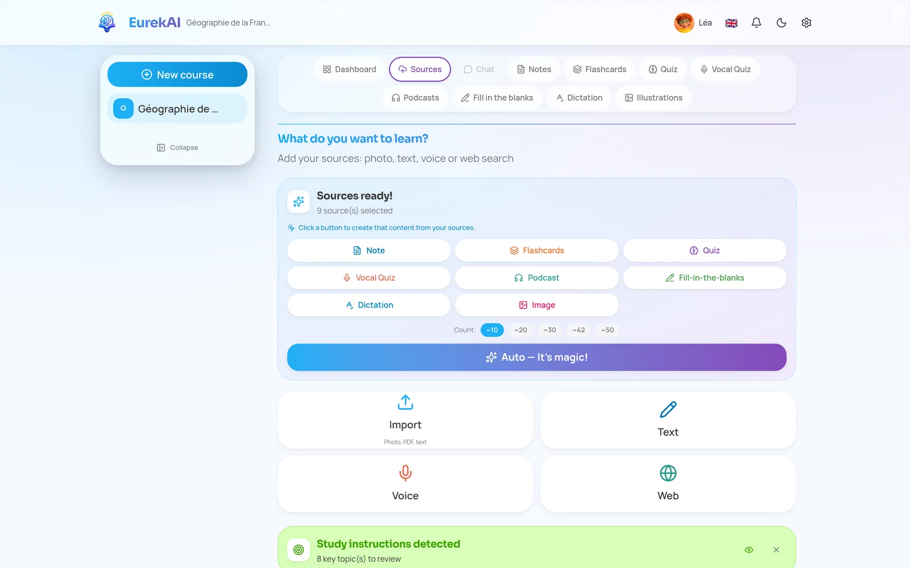
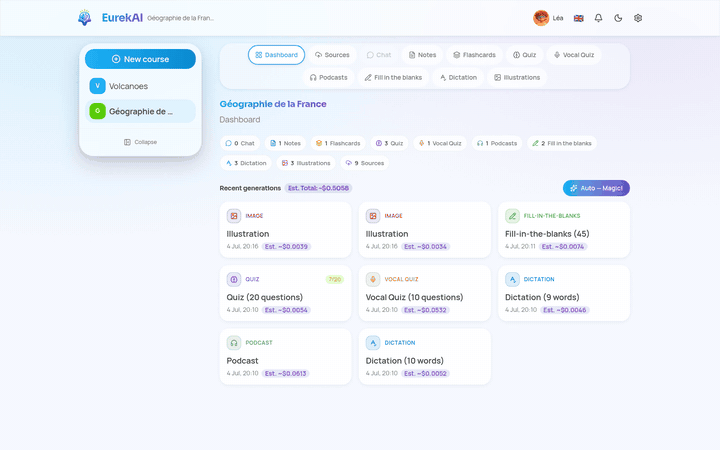
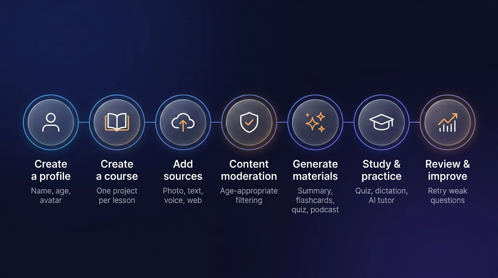

<p align="center">
  
</p>

<h1 align="center">EurekAI</h1>

<p align="center">
  <strong>Verwandle beliebige Inhalte in ein interaktives Lernerlebnis — unterstützt von <a href="https://mistral.ai">Mistral AI</a>.</strong>
</p>

<p align="center">
  <a href="README-en.md">🇬🇧 Englisch</a> · <a href="README-es.md">🇪🇸 Spanisch</a> · <a href="README-pt.md">🇧🇷 Portugiesisch</a> · <a href="README-de.md">🇩🇪 Deutsch</a> · <a href="README-it.md">🇮🇹 Italienisch</a> · <a href="README-nl.md">🇳🇱 Niederländisch</a> · <a href="README-ar.md">🇸🇦 Arabisch</a><br>
  <a href="README-hi.md">🇮🇳 Hindi</a> · <a href="README-zh.md">🇨🇳 Chinesisch</a> · <a href="README-ja.md">🇯🇵 Japanisch</a> · <a href="README-ko.md">🇰🇷 Koreanisch</a> · <a href="README-pl.md">🇵🇱 Polnisch</a> · <a href="README-ro.md">🇷🇴 Rumänisch</a> · <a href="README-sv.md">🇸🇪 Schwedisch</a>
</p>

<p align="center">
  <a href="https://www.youtube.com/watch?v=_b1TQz2leoI"></a>
</p>

<h4 align="center">📊 Codequalität</h4>

<p align="center">
  <a href="https://sonarcloud.io/summary/new_code?id=jls42_EurekAI"></a>
  <a href="https://sonarcloud.io/summary/new_code?id=jls42_EurekAI"></a>
  <a href="https://sonarcloud.io/summary/new_code?id=jls42_EurekAI"></a>
  <a href="https://sonarcloud.io/summary/new_code?id=jls42_EurekAI"></a>
</p>
<p align="center">
  <a href="https://sonarcloud.io/summary/new_code?id=jls42_EurekAI"></a>
  <a href="https://sonarcloud.io/summary/new_code?id=jls42_EurekAI"></a>
  <a href="https://sonarcloud.io/summary/new_code?id=jls42_EurekAI"></a>
  <a href="https://sonarcloud.io/summary/new_code?id=jls42_EurekAI"></a>
</p>
<p align="center">
  <a href="https://app.codacy.com/gh/jls42/EurekAI/dashboard?utm_source=gh&utm_medium=referral&utm_content=&utm_campaign=Badge_grade"></a>
  <a href="https://www.codefactor.io/repository/github/jls42/eurekai"></a>
</p>

---

## Die Geschichte — Warum EurekAI?

**EurekAI** entstand während des [Mistral AI Worldwide Hackathon](https://luma.com/mistralhack-online) ([offizielle Website](https://worldwide-hackathon.mistral.ai/)) (März 2026). Ich brauchte ein Thema — und die Idee entstand aus etwas sehr Konkretem: Ich bereite mich regelmäßig mit meiner Tochter auf Klassenarbeiten vor und dachte mir, dass sich das mit KI spielerischer und interaktiver gestalten lassen müsste.

Das Ziel: **beliebige Eingaben** — ein Foto des Unterrichtsstoffs, kopierter Text, eine Sprachaufnahme, eine Websuche — in **Lernzettel, Flashcards, Quiz, Podcasts, Lückentexte, Illustrationen und vieles mehr** verwandeln. Alles wird von den Modellen des französischen Unternehmens Mistral AI unterstützt, wodurch EurekAI sich besonders gut für französischsprachige Schülerinnen und Schüler eignet.

Der [ursprüngliche Prototyp](https://github.com/jls42/worldwide-hackathon.mistral.ai) wurde während des Hackathons in 48h als Proof of Concept auf Basis der Mistral-Dienste entwickelt — bereits funktionsfähig, aber begrenzt. Seitdem ist EurekAI zu einem echten Projekt geworden: Lückentexte, Navigation in Übungen, Web-Scraping, konfigurierbare elterliche Moderation, gründliche Code-Reviews und vieles mehr. Der gesamte Code wird mit KI generiert — hauptsächlich mit [Claude Code](https://code.claude.com/), mit einigen Beiträgen über [Codex](https://openai.com/codex/) und [Gemini CLI](https://geminicli.com/).

---

## Überblick

<p align="center">
  
</p>

| | |
|---|---|
| <br>**Dashboard** — zuletzt generierte Inhalte, geschätzte Kosten pro Karte und für das gesamte Projekt, Schaltfläche „Auto — Magie!“ | <br>**Quellen** — Import von Fotos/PDF/Text/Sprache/Webinhalten, Generierung mit einem Klick, Erkennung von Lernvorgaben |

Jede importierte Quelle zeigt ihren [OCR-Konfidenzwert, ihren Moderationsstatus und ihre geschätzten Kosten](docs/screenshots/sources-list.webp) an.

### Die Komponenten in Aktion

| | |
|---|---|
| <br>**Lernzettel** — Kernpunkte, Wortschatz, Zitate mit Quellenangaben, Audiowiedergabe pro Abschnitt | <br>**Multiple-Choice-Quiz** — genau eine richtige Antwort pro Frage, sofortiges Feedback mit Erklärung, schrittweise Navigation |
| <br>**Flashcards** — Karte umdrehen und anschließend selbst bewerten: „Wusste ich / Wusste ich nicht“ | <br>**Lückentexte** — Hinweise auf Anfrage, fehlertolerante Antwortprüfung |
| <br>**Diktat** — Wort wird per Audio diktiert, strenge Korrektur Buchstabe für Buchstabe | <br>**Sprachquiz** — Frage wird vorgelesen, Antwort über das Mikrofon |
| <br>**Podcast** — Mini-Podcast mit 2 Stimmen, einsehbares Dialogskript | <br>**Illustrationen** — von einem Agent generierte Lernbilder |
| <br>**KI-Tutor** — Chat auf Grundlage der Kursdokumente, erklärte Antworten, kann Quiz und Flashcards generieren | |

### Erste Schritte

| | |
|---|---|
| <br>**Profilauswahl** — jedes Kind hat seinen eigenen Bereich, Avatar und seine eigene Sprache | <br>**Profilerstellung** — Alter, Avatar, Eltern-PIN für Kinder unter 15 Jahren |
| <br>**Kurserstellung** — ein Projekt pro Lektion, bereit für den Import von Quellen | <br>**Einstellungen** — API-Status, Auswahl der KI-Modelle mit Preisangaben |

---

## Funktionen

| | Funktion | Beschreibung |
|---|---|---|
| 📷 | **Dateiimport** | Importiere deinen Unterrichtsstoff — als Foto, PDF (über Mistral OCR mit gemitteltem Konfidenzwert, Stufen `high`/`medium`/`low`) oder Textdatei (TXT, MD). Upload-Sitzungen mit Wiederholungsversuchen pro Datei und individueller Fortschrittsanzeige |
| 📝 | **Texteingabe** | Beliebigen Text direkt eingeben oder einfügen |
| 🎤 | **Spracheingabe** | Nimm deine Stimme auf — Voxtral STT transkribiert sie |
| 🌐 | **Web / URL** | Füge eine URL ein (direktes Scraping über Readability + Lightpanda) oder gib eine Suchanfrage ein (Mistral Agent web_search) |
| 📄 | **Lernzettel** | Strukturierte Notizen mit Kernpunkten, Wortschatz, Zitaten und Anekdoten |
| 🃏 | **Flashcards** | Interaktive Frage-Antwort-Karten, Audiowiedergabe als Dialog |
| ❓ | **Multiple-Choice-Quiz** | Fragen mit 4 Antwortmöglichkeiten und genau einer richtigen Antwort, mit adaptiver Wiederholung bei Fehlern (Anzahl konfigurierbar) |
| ✏️ | **Lückentexte** | Übungen zum Ausfüllen mit Hinweisen und fehlertoleranter Antwortprüfung |
| 🔤 | **Diktat** | Wörter aus einer importierten Liste werden per Audio diktiert (Voxtral TTS), Tastatureingabe, strenge Korrektur Buchstabe für Buchstabe mit Erklärung der Rechtschreibregel |
| 🎙️ | **Podcast** | Mini-Podcast mit 2 Stimmen als Audio — standardmäßig Mistral-Stimmen oder individuelle Stimmen (der Eltern!) |
| 🖼️ | **Illustrationen** | Von einem Mistral Agent generierte Lernbilder |
| 🗣️ | **Sprachquiz** | Vorgelesene Fragen (individuelle Stimme möglich), mündliche Antwort, KI-Prüfung |
| 💬 | **KI-Tutor** | Kontextbezogener Chat mit deinen Kursdokumenten und Tool-Aufrufen |
| 🧠 | **Automatischer Router** | Ein auf `mistral-small-latest` basierender Router analysiert den Inhalt und schlägt eine Kombination von Generatoren aus den 8 verfügbaren Typen vor |
| 🔁 | **Kontinuität zwischen Kursen** | Importe, automatische Generierungen, Mikrofonaufnahmen, Chat, Websuche und Vorlesen laufen für ihren jeweiligen Kurs weiter, wenn ein anderer geöffnet wird; eine Benachrichtigung nennt den Kurs, wenn ein Vorgang anderswo abgeschlossen wird |
| 🔒 | **Kindersicherung** | Pro Profil konfigurierbare Moderation (anpassbare Kategorien), Eltern-PIN, Chat-Einschränkungen |
| 🌍 | **Mehrsprachigkeit** | Oberfläche in 9 Sprachen verfügbar; KI-Generierung über Prompts in 15 Sprachen steuerbar |
| 🔊 | **Vorlesen** | Lernzettel und Flashcards (Frage-Antwort-Dialog) über Mistral Voxtral TTS anhören |
| 💶 | **API-Kostenübersicht** | Transparente Schätzung der Kosten in € für jede Generierung und Quelle (Tokens / Zeichen / Seiten / Audiosekunden). Badge pro Karte + Gesamtsumme pro Projekt, im Dashboard sichtbar |
| 🎨 | **Design pro Profil** | Jedes Profil wählt sein Design `dark` oder `light` — im Profil gespeichert und bei jedem Profilwechsel erneut angewendet |

---

## Architekturübersicht

<p align="center">
  
</p>

---

## Übersicht der Modellverwendung

<p align="center">
  
</p>

---

## Nutzerablauf

<p align="center">
  
</p>

---

## Funktionen im Detail

### Multimodale Eingabe

EurekAI akzeptiert 4 Arten von Quellen, die je nach Profil moderiert werden (Moderation für Kinder- und Jugendprofile standardmäßig aktiviert):

- **Dateiimport** — JPG-, PNG- oder PDF-Dateien, die mit Mistral OCR verarbeitet werden — standardmäßig **OCR 4.1** (`mistral-ocr-4-1`), optional **OCR 3** (`mistral-ocr-2512`) in den Einstellungen (günstiger, ~½ der Kosten; liest Handschrift besser) — für gedruckten Text, Tabellen und Handschrift; oder direkt importierte Textdateien (TXT, MD). Uploads mehrerer Dateien verwenden ein System aus **Upload-Sitzungen**: individueller Fortschritt pro Datei, erneuter Versuch für fehlgeschlagene Dateien ohne erneutes Übermitteln der anderen, Schließen der Sitzung nach Abschluss. OCR liefert einen gemittelten **Konfidenzwert** (`average`, auf `[0,1]` begrenzt, berechnet aus den von Mistral zurückgegebenen `averagePageConfidenceScore`), der in der UI als Badge der Stufe `high` / `medium` / `low` angezeigt wird (Schwellenwerte ~0.9 / ~0.7) — warnt bei schlechter Scanqualität, ohne den Vorgang zu blockieren. Die für OCR an Mistral gesendete Dokumentkopie wird sofort nach Abschluss der Verarbeitung gelöscht, auch bei einem Fehler.
- **Freitext** — Beliebige Inhalte eingeben oder einfügen. Bei aktiver Moderation vor der Speicherung geprüft.
- **Spracheingabe** — Audio im Browser aufnehmen. Standardmäßig durch **Voxtral Mini Transcribe 2** (`voxtral-mini-2602`) transkribiert; **Voxtral Mini Transcribe 3** und **Voxtral Small Transcribe 3** (Mistral-Vorschauversion) sind optional in den Einstellungen verfügbar. Die Sprache der Oberfläche wird an das Modell übermittelt (`language`), um die Erkennung zu optimieren.
- **Web / URL** — Eine oder mehrere URLs einfügen, um Inhalte direkt zu scrapen (Readability + Lightpanda für JS-Seiten), oder Stichwörter für eine Websuche über einen Mistral Agent eingeben. Das einzelne Eingabefeld akzeptiert beides — URLs und Stichwörter werden automatisch getrennt, jedes Ergebnis erstellt eine unabhängige Quelle.

### KI-Inhaltsgenerierung

Acht Arten generierter Lernmaterialien:

| Generator | Modell | Ausgabe |
|---|---|---|
| **Lernzettel** | `mistral-large-2512` | Titel, Zusammenfassung, Kernpunkte, Wortschatz, Zitate, Anekdote |
| **Flashcards** | `mistral-large-2512` | Frage-Antwort-Karten mit Quellenverweisen (Anzahl konfigurierbar) |
| **Multiple-Choice-Quiz** | `mistral-large-2512` | Fragen mit 4 Antwortmöglichkeiten und genau einer richtigen Antwort, Erklärungen, adaptive Wiederholung (Anzahl konfigurierbar) |
| **Lückentexte** | `mistral-large-2512` | Sätze zum Ergänzen mit Hinweisen, fehlertolerante Antwortprüfung (Levenshtein) |
| **Diktat** | `mistral-large-2512` + Voxtral TTS | Schlüsselwörter werden per Audio diktiert (1 MP3/Wort) → Tastatureingabe → strenge Korrektur (ein vergessener Akzent zählt als Fehler) mit Erklärung der Regel |
| **Podcast** | `mistral-large-2512` + Voxtral TTS | Skript für 2 Stimmen → MP3-Audio |
| **Illustration** | Agent `mistral-large-2512` | Lernbild über das Tool `image_generation` |
| **Sprachquiz** | `mistral-large-2512` + Voxtral TTS + STT | TTS-Fragen → STT-Antwort → KI-Prüfung |

### KI-Tutor im Chat

Ein dialogorientierter Tutor mit vollständigem Zugriff auf die Kursdokumente:

- Verwendet `mistral-large-2512`
- **Tool-Aufrufe**: kann während des Gesprächs Lernzettel, Flashcards, Quiz oder Lückentexte generieren
- Verlauf von 50 Nachrichten pro Kurs
- Moderation, sofern für das Profil aktiviert: Die Nachricht wird geprüft, und beanstandete Quellen, Quellen mit fehlgeschlagener Prüfung sowie noch ungeprüfte Quellen werden aus dem Kontext und den Tools ausgeschlossen (die Prüfung fehlgeschlagener oder noch ungeprüfter Quellen wird zunächst erneut gestartet, für höchstens 5 s)

### Automatischer Router

Der Router verwendet `mistral-small-latest`, um die Quellinhalte zu analysieren und die passendsten Generatoren aus den 8 verfügbaren vorzuschlagen. Die Oberfläche zeigt den Fortschritt in Echtzeit an: zunächst eine Analysephase, dann die einzelnen Generierungen mit Abbruchmöglichkeit.

Auto läuft auf dem Server: Der Vorgang wird fortgesetzt, wenn die Seite neu geladen, ein anderer Kurs geöffnet oder das Profil gewechselt wird. Pro Kurs läuft jeweils nur ein Auto-Vorgang (ein zweiter Tab schließt sich dem laufenden Vorgang an). Der Server startet höchstens 3 Generierungen gleichzeitig pro Mistral-Schlüssel. Jede abgeschlossene Generierung erhält eine eigene Meldung, danach wird einmalig eine abschließende Bilanz angezeigt; endet der Vorgang, während ein anderer Kurs angezeigt wird, nennt die Meldung den zugehörigen Kurs. Eine einzeln abgebrochene Generierung zählt in der Bilanz nicht als Fehler. „Alles abbrechen“ stoppt den gesamten Stapel des Kurses mit einer einzigen Meldung. Wird der Server während eines Auto-Vorgangs neu gestartet, wird dieser als unterbrochen angezeigt, mit einer Schaltfläche „Fortsetzen“, die nur die noch nicht abgeschlossenen Generierungen erneut startet, ohne die Analyse zu wiederholen.

Höchstens 3 vom Tab aus gestartete längere Generierungen laufen gleichzeitig (einzeln gestartete Generierungen, Wiederholungskarten): Weitere warten, bis sie an der Reihe sind, und ein Kurs wird geöffnet, ohne auf den Abschluss laufender Generierungen zu warten.

### Adaptives Lernen

- **Quizstatistiken**: Erfassung der Versuche und der Trefferquote pro Frage
- **Quizwiederholung**: generiert 5-10 neue Fragen zu unsicher beherrschten Konzepten auf Grundlage der Quellen des ursprünglichen Quiz (die Moderationsprüfung bezieht sich auf dieselben Quellen)
- **Erkennung von Lernvorgaben**: erkennt Wiederholungsanweisungen („Ich beherrsche den Stoff, wenn ich … kann“) und priorisiert sie in kompatiblen Textgeneratoren (Lernzettel, Flashcards, Quiz, Lückentexte). Bei aktiver Moderation wartet die Erkennung auf die Prüfung der Quellen und liest nur die als sicher eingestuften; die Lernvorgabe behält die Liste ihrer ursprünglichen Quellen: Wird eine davon beanstandet, wird die Vorgabe weder angezeigt noch angewendet, und wird eine davon gelöscht, wird die Vorgabe entfernt. Die Kosten werden erfasst
### Sicherheit & Kindersicherung

- **4 Altersgruppen**: Kind (≤10 Jahre), Teenager (11-15), Studierende (16-25), Erwachsene (26+)
- **Inhaltsmoderation**: `mistral-moderation-2603` (Mistral Moderation 2) mit 11 verfügbaren Kategorien, davon 6 standardmäßig für neue Kinder-/Teenagerprofile gesperrt (`sexual`, `hate_and_discrimination`, `violence_and_threats`, `criminal`, `selfharm`, `jailbreaking`; `criminal` wurde nach einer Prüfung von 50 Lektionen einschließlich Geschichte ohne einen einzigen Fehlalarm hinzugefügt). Die Kategorien lassen sich in den Einstellungen pro Profil anpassen; Moderation 2 hat die bisherige Kategorie „gefährliche Inhalte“ in `dangerous` + `criminal` aufgeteilt (bestehende Profile werden automatisch migriert, und die gesperrten Kategorien gelten auch für bereits importierte Quellen). Standardmäßig sicher: Wenn sich eine gesperrte Kategorie anhand der Modellantwort nicht überprüfen lässt, wird der Inhalt abgelehnt („Moderation nicht verfügbar“); bei aktiver Moderation schließen sowohl die Generierung als auch der Chat gemeldete Quellen, Quellen mit fehlgeschlagener Prüfung und Quellen mit laufender Prüfung aus. Eine noch nie geprüfte Quelle (importiert bei deaktivierter Moderation oder ein älteres Projekt, das einem Profil zugeordnet wurde) wird vor der Verwendung geprüft. Eine durch einen Neustart unterbrochene Moderation wird beim Start fortgesetzt, sofern der Serverschlüssel dies ermöglicht; andernfalls wird sie, ebenso wie eine fehlgeschlagene Moderation, beim Öffnen des Projekts oder bei der nächsten Generierung fortgesetzt. Über die Schaltfläche „Erneut prüfen“ lässt sich die Prüfung bei Bedarf erneut starten. Bei aktiver Moderation bleibt der Inhalt einer Quelle für das Kind verborgen (Vorschau, Text, Originaldokument), bis sie als sicher eingestuft wurde; ein Elternteil kann ihn mit seiner PIN für eine einmalige Ansicht freischalten. Die gesprochene Antwort im Sprachquiz wird vor der Überprüfung moderiert. Datierte ID in `helpers/moderation-model.ts` festgelegt: Der veraltete Alias `-latest` wird von der API nicht mehr aufgeführt.
- **Eltern-PIN**: SHA-256-Hash, für Profile unter 15 Jahren erforderlich; höchstens 10 falsche Codes pro Viertelstunde und IP-Adresse (429 `rate_limited`). Für einen Produktiveinsatz einen langsamen Hash mit Salt vorsehen (Argon2id, bcrypt).
- **Serverdaten**: `/output` veröffentlicht nur die Medien der Projekte (Audio, Bilder, importierte Dateien); `profiles.json`, `config.json`, `projects.json` und die `project.json` werden niemals ausgeliefert
- **Chat-Einschränkungen**: KI-Chat für unter 16-Jährige standardmäßig deaktiviert, durch die Eltern aktivierbar

### Mehrprofilsystem

- Mehrere Profile mit Name, Alter, Avatar und Spracheinstellungen
- **Stimmen pro Profil** (`Profile.mistralVoices?: { host?, guest? }` — jede Rolle ist optional) — jedes Kind kann sein eigenes Stimmenpaar für Podcast/Sprachquiz haben
- **Design pro Profil** (`Profile.theme: 'dark' | 'light'`) — automatischer Wechsel beim Profilwechsel, im Backend gespeichert
- Projekte sind über `profileId` mit Profilen verknüpft; ein älteres Projekt ohne Profil wird dem ersten Profil zugeordnet, das es öffnet, und anschließend gemäß diesem Profil moderiert
- Kaskadierendes Löschen: Beim Löschen eines Profils werden alle zugehörigen Projekte gelöscht

### Erfassung der API-Kosten

Jeder kostenpflichtige Mistral-Aufruf (Chat, OCR, STT, TTS, Agents), einschließlich der Erkennung von Aufgabenstellungen und der gesprochenen Antworten im Sprachquiz, wird instrumentiert, um dem Nutzer eine **transparente** Kostenschätzung in € bereitzustellen. Die kostenlose Moderation wird nicht mitgerechnet. Die Tool-Gebühren der Agents sind enthalten: 0,03 $ pro Websuche und 0,10 $ pro generiertem Bild (Mistral-Preise), zuzüglich der von diesen Tools erzeugten Tokens, die in der Schätzung zum Eingabetarif des Agent-Modells berechnet werden.

- **Maßgebliche Quelle**: `helpers/pricing.ts` — `MODEL_PRICING` nach Modellpräfix (z. B.: `mistral-large` → Input 0.5 €/M Tokens, Output 1.5 €/M Tokens), `PRICING_SOURCES` mit URLs zur Mistral-Dokumentation für regelmäßiges erneutes Scraping
- **Unterstützte Einheiten**: `tokens`, `characters` (TTS), `pages` (OCR), `audio-seconds` (STT) — Umrechnung gesteuert durch `helpers/cost-calc.ts`
- **Instrumentierungskette**: `helpers/tracked-client.ts` (umschließt den Mistral-Client) → `helpers/usage-context.ts` (AsyncLocalStorage) → `helpers/cost-calc.ts` → `helpers/cost-persist.ts` → `helpers/cost-middleware.ts` (Einfügen in die HTTP-Antwort)
- **UI**: Kostenanzeige pro Generierung (`src/partials/cost-badge-gen.html`), pro Quelle (`cost-badge-src.html`), kumulierte Gesamtkosten im Dashboard (`Project.totalCost`)
- **Endpoints**: Die Antworten von `/generate/*` und `/sources/*` ergänzen das zurückgegebene Objekt (`Generation` / `Source`) um `estimatedCost`, `usage` und `costBreakdown`. `POST /generate/route` fügt ein Feld `costDelta: number` nur für die Routing-Kosten hinzu; `POST /detect-consigne` (`{consigne, costDelta}`) und die Überprüfung einer gesprochenen Antwort geben ebenfalls ihre `costDelta` zurück. `GET /projects/:pid` gibt das um `totalCost` (aus `costLog[]` berechnete Summe) ergänzte Projekt + den vollständigen Verlauf zurück

### TTS (Mistral Voxtral) & benutzerdefinierte Stimmen

- **Mistral Voxtral TTS**: **Voxtral TTS** (`voxtral-mini-tts-2603`) als Standard, **Voxtral TTS 3** (`voxtral-mini-tts-3-0`, Mistral-Vorschauversion, native Stimmen in mehr Sprachen) optional in den Einstellungen; Sprachsynthese zu 100% mit Mistral, kein zusätzlicher Schlüssel erforderlich. Es werden nur Stimmen angeboten, die das gewählte Modell akzeptiert: Voxtral TTS lehnt Stimmen ab, die mit Voxtral 3 hinzugefügt wurden
- **Benutzerdefinierte Stimmen**: Eltern können über die Mistral Voices API eigene Stimmen erstellen (aus einer Audioaufnahme) und sie den Rollen Gastgeber/Gast zuweisen — Podcasts und Sprachquiz werden dann mit der Stimme eines Elternteils vorgelesen, wodurch das Erlebnis für das Kind noch immersiver wird
- Zwei konfigurierbare Stimmrollen: **Gastgeber** (Haupterzähler) und **Gast** (zweite Stimme des Podcasts)
- Vollständiger Katalog der Mistral-Stimmen in den Einstellungen verfügbar, nach Sprache filterbar
- Eine Wiedergabe (Lernblatt, Podcast, Diktatwort) pausiert beim Verlassen ihrer Ansicht und wird an der zuletzt erreichten Stelle fortgesetzt
- Das Audio für das Vorlesen der Lernkarten wird beim ersten Anhören erstellt und anschließend in der zugehörigen Generierung gespeichert: Es wird bei einer Rückkehr weder neu erstellt noch erneut berechnet
- Quellenmarkierungen (`[Source N]`) werden nicht vorgelesen

### Internationalisierung

- Oberfläche in 9 Sprachen verfügbar: fr, en, es, pt, it, nl, de, hi, ar
- KI-Prompts unterstützen 15 Sprachen (fr, en, es, de, it, pt, nl, ja, zh, ko, ar, hi, pl, ro, sv)
- Sprache pro Profil konfigurierbar

---

## Technischer Stack

| Schicht | Technologie | Rolle |
|---|---|---|
| **Runtime** | Node.js + TypeScript 6.x | Server und Typsicherheit |
| **Backend** | Express 5.x | REST-API |
| **Entwicklungsserver** | Vite 8.x (Rolldown) + tsx | HMR, Handlebars-Partials, Proxy |
| **Frontend** | HTML + TailwindCSS 4.x + Alpine.js 3.x | Reaktive Oberfläche, durch Vite kompiliertes TypeScript |
| **Templating** | vite-plugin-handlebars | HTML-Komposition mit Partials |
| **KI** | Mistral AI SDK | Chat, OCR, STT, TTS, Agents, Moderation |
| **TTS** | Mistral Voxtral TTS | `voxtral-mini-tts-2603` (Voxtral TTS 3 optional), integrierte Sprachsynthese |
| **Icons** | Lucide 1.x | SVG-Icon-Bibliothek |
| **Web-Scraping** | Readability + linkedom | Extraktion des Hauptinhalts von Webseiten (Technologie von Firefox Reader View) |
| **Headless browser** | Lightpanda | Ultraleichter Headless-Browser (Zig + V8) für JS-/SPA-Seiten — Scraping-Fallback |
| **Markdown** | Marked | Markdown-Rendering im Chat |
| **Datei-Upload** | Multer 2.x | Verarbeitung von Multipart-Formularen |
| **Audio** | ffmpeg-static | Zusammenfügen von Audiosegmenten |
| **Tests** | Vitest | Unit-Tests — Testabdeckung mit SonarCloud gemessen |
| **Persistenz** | JSON-Dateien | Speicherung ohne Abhängigkeit |

---

## Modellreferenz

| Modell | Verwendung | Begründung |
|---|---|---|
| `mistral-large-2512` (Large 3, festgelegter Standard) | Lernblatt, Lernkarten, Podcast, Quiz, Lückentexte, Chat, Überprüfung im Sprachquiz, Image Agent, Web Search Agent, Erkennung von Aufgabenstellungen | Beste Mehrsprachigkeit + Befolgung von Anweisungen; festgelegt, da der Alias `mistral-large-latest` seit November 2026 Large 4 bereitstellt, das für unsere Generierungen zu langsam ist (Abschaltung von Large 3 für den 30/04/2027 angekündigt) |
| `mistral-ocr-4-1` (OCR 4.1, Standard) | Dokumenten-OCR | Gedruckter Text, Tabellen, Handschrift ($4 / 1000 Seiten) |
| `mistral-ocr-2512` (OCR 3, optional) | Dokumenten-OCR | In den Einstellungen auswählbar, günstiger ($2 / 1000 Seiten), liest Handschrift besser |
| `voxtral-mini-2602` (Voxtral Mini Transcribe 2, Standard) | Spracherkennung (STT) | Spracheingabe und gesprochene Antworten im Sprachquiz ($0.003 / min) |
| `voxtral-mini-transcribe-3-0` / `voxtral-small-transcribe-3-0` (Transcribe 3, optional, Vorschauversion) | Spracherkennung (STT) | In den Einstellungen auswählbar ($0.0035 / min und $0.004 / min) |
| `voxtral-mini-tts-2603` (Voxtral TTS, Standard) | Sprachsynthese (TTS) | Podcasts, Sprachquiz, Diktat, Vorlesen ($16 / M Zeichen) |
| `voxtral-mini-tts-3-0` (Voxtral TTS 3, optional, Vorschauversion) | Sprachsynthese (TTS) | In den Einstellungen auswählbar, native Stimmen in mehr Sprachen ($13 / M Zeichen) |
| `mistral-moderation-2603` | Inhaltsmoderation | 6 gesperrte Kategorien für Kinder/Teenager (darunter `jailbreaking`) |
| `mistral-small-latest` | Automatischer Router | Schnelle Inhaltsanalyse für Routing-Entscheidungen |

Auf dem Smartphone zeigen die Einstellungen unter jeder Auswahlliste die vollständige Bezeichnung des gewählten Modells an (Preis, „Empfohlen“ oder „Vorschauversion“), die im geschlossenen Menü abgeschnitten wurde.

---

## Schnellstart

```bash
# Cloner le dépôt
git clone https://github.com/jls42/EurekAI.git
cd EurekAI

# Installer les dépendances
npm install

# Configurer les clés API
cp .env.example .env
# Éditez .env (toutes optionnelles) :
#   MISTRAL_API_KEY=<your_api_key>           (optionnel — sinon chaque utilisateur saisit sa clé dans l'app)
#   SONAR_TOKEN=...                          (optionnel, CI SonarCloud uniquement)

# Lancer le développement
npm run dev
# → Backend :  http://localhost:3000 (API)
# → Frontend : http://localhost:5173 (serveur Vite avec HMR)
```

> **Hinweis**: Mistral Voxtral TTS ist der einzige TTS-Provider — über `MISTRAL_API_KEY` hinaus ist kein zusätzlicher Schlüssel erforderlich.

> **Vom Nutzer eingegebener API-Schlüssel**: `MISTRAL_API_KEY` ist jetzt **optional**. Fehlt er, startet die App trotzdem und fordert jeden Nutzer auf, **seinen eigenen Mistral-Schlüssel** in der Oberfläche einzugeben. Der Schlüssel wird **im Browser gespeichert** (in einem sicheren Kontext mit Web Crypto + IndexedDB verschlüsselt) und bei jeder Anfrage mitgesendet — **niemals auf dem Server gespeichert**. Priorität: Profilschlüssel > globaler Browserschlüssel > `MISTRAL_API_KEY` (env). Durch Setzen von `EUREKAI_REQUIRE_USER_KEY=true` muss jeder Nutzer seinen eigenen Schlüssel bereitstellen (der env-Schlüssel wird dann nur noch zum Vorladen verwendet).

> **Lokales HTTPS (Tablet/LAN)**: `localhost` ist bereits ein sicherer Kontext. Für den LAN-Zugriff (Tablet) ein lokales Zertifikat erzeugen und HTTPS aktivieren: Der Browser kann dann den gespeicherten Schlüssel verschlüsseln, und der Schlüssel wird während der Übertragung verschlüsselt:
> ```bash
> ./scripts/gen-cert.sh 192.168.1.42   # mkcert si dispo, sinon openssl self-signed
> export HTTPS_KEY=certs/key.pem HTTPS_CERT=certs/cert.pem
> npm run dev                          # Express + Vite en HTTPS
> ```

### Umgebungsvariablen

| Variable | Erforderlich | Standard | Rolle |
|---|---|---|---|
| `MISTRAL_API_KEY` | optional | — | Mistral-API-Schlüssel (Chat, OCR, STT, TTS Voxtral, Agents, Moderation). Falls nicht vorhanden, gibt der Nutzer seinen Schlüssel in der App ein (im Browser gespeichert, niemals auf dem Server) |
| `EUREKAI_REQUIRE_USER_KEY` | optional | `false` | `true` → deaktiviert den Fallback auf `MISTRAL_API_KEY` für KI-Anfragen (jeder Nutzer MUSS seinen eigenen Schlüssel bereitstellen). Nützlich bei einer öffentlich zugänglichen Instanz |
| `HTTPS_KEY` / `HTTPS_CERT` | optional | — | Pfade zum TLS-Schlüssel/-Zertifikat (siehe `scripts/gen-cert.sh`) → Express und Vite werden über HTTPS bereitgestellt (sicherer Kontext für LAN/Tablet) |
| `PORT` | optional | `3000` | HTTP-Port des Express-Backends |
| `NODE_ENV` | optional | `development` | Wenn `production` → Express liefert das Frontend aus `dist/` aus (andernfalls `public/`) |
| `SONAR_TOKEN` | optional für CI | — | Wird ausschließlich vom GitHub Actions SonarCloud-Workflow verwendet |

### Tests, Codequalität und Beiträge

```bash
npm test                # vitest (déclenche pretest : typecheck + lint:complexity + lint:ci + lint:deadcode)
npm run test:coverage   # couverture vitest
npm run lint            # ESLint + typescript-eslint + sonarjs
npm run lint:fix        # auto-fix
npm run format          # prettier
npm run security        # Opengrep (SAST local) — bloque sur finding ERROR
```

**Git-Hooks (Husky)**: `pre-commit` führt nacheinander `scripts/pre-commit-fast.sh` (Konflikte, große Dateien, shellcheck), `lint-staged` und `npm test` aus; `pre-push` führt zuerst eine blockierende Prüfung `npm audit` aus (blockiert, sobald eine Abhängigkeit, auch eine transitive, eine Sicherheitslücke der Stufe `critical` aufweist, siehe `scripts/audit-verdict.mjs`), danach `npm run security`. Jeder Hook blockiert den Commit/Push, sobald einer seiner Schritte fehlschlägt.

**Externe Tools (zum Starten der Anwendung optional, für `pretest` und `npm run security` erforderlich)**:

```bash
# Lizard (Python) pour lint:complexity (CCN > 8 sur l'allowlist)
pipx install lizard          # ou : pipx run lizard

# Opengrep (binaire standalone ~40 Mo) pour npm run security
./scripts/install-opengrep.sh   # installe dans ~/.local/bin/
```

Ohne diese Tools scheitert `npm test` bei `pretest` (lizard fehlt) und `npm run security` schlägt fehl (opengrep fehlt). Die Husky-Hooks blockieren dann den Commit/Push.

---

## Bereitstellung mit Container

Das Image wird in der **GitHub Container Registry** veröffentlicht:

```bash
# Télécharger l'image
podman pull ghcr.io/jls42/eurekai:latest

# Lancer EurekAI
mkdir -p ./data
podman run -d --name eurekai \
  -e MISTRAL_API_KEY=<your_api_key> \
  -v ./data:/app/output:U \
  -p 3000:3000 \
  ghcr.io/jls42/eurekai:latest
# → http://localhost:3000
```

> **`:U`**: Flag für Podman im Rootless-Modus, das die Volume-Berechtigungen automatisch anpasst.

```bash
# Build local
podman build -t eurekai -f Containerfile .

# Publier sur ghcr.io (mainteneurs)
./scripts/publish-ghcr.sh
```

---

## Projektstruktur

```
server.ts                 — Point d'entrée Express, monte les routes + config
config.ts                 — Config runtime (modèles, voix, modèle TTS), persistée dans output/config.json
store.ts                  — ProjectStore : CRUD projets/sources/générations, persistance JSON
profiles.ts               — ProfileStore : gestion des profils, hachage PIN
types.ts                  — Types TypeScript : Source, Generation (8 types), QuizStats, Profile
prompts.ts                — Tous les prompts IA centralisés (system + user templates, 15 langues)

generators/
  auto-agents.ts          — Source unique de vérité : AUTO_AGENTS_SET (8 agents) + MAX_AUTO_PLAN_LENGTH
  generation-types.ts     — Types générables individuellement (SINGLE_GENERATE_TYPES, coïncide avec les 8 agents auto)
  ocr.ts                  — OCR via Mistral (JPG, PNG, PDF) avec extraction interne des scores de confiance moyens par page
  summary.ts              — Génération de fiche de révision (JSON structuré)
  flashcards.ts           — Flashcards Q/R (nombre configurable)
  quiz.ts                 — Quiz QCM (nombre configurable) + révision adaptative
  fill-blank.ts           — Exercices à trous avec validation tolérante
  dictation.ts            — Dictée : mots + phrases-exemples + règles, 1 audio TTS par mot (8e agent auto)
  podcast.ts              — Script podcast 2 voix
  quiz-vocal.ts           — Quiz vocal : questions TTS + réponses STT + vérification IA
  image.ts                — Génération d'image via Agent Mistral (outil image_generation)
  chat.ts                 — Tuteur IA par chat avec appel d'outils
  router.ts               — Routeur automatique (contenu → générateurs recommandés)
  consigne.ts             — Détection de consignes de révision
  tts-provider.ts         — TTS Mistral Voxtral (synthèse vocale + listing des voix)
  tts.ts                  — Génération audio multi-voix (podcast + flashcards, concaténation de segments)
  stt.ts                  — Voxtral STT (audio → texte)
  websearch.ts            — Agent Mistral avec outil web_search (fallback)
  moderation.ts           — Modération de contenu (filtrage par âge)

routes/
  projects.ts             — CRUD projets
  profiles.ts             — CRUD profils avec gestion du PIN
  sources.ts              — Import fichiers (OCR + texte brut), texte libre, voix STT, scraping URL + recherche web, modération
  generate.ts             — Endpoints de génération (8 types + route)
  auto-runs.ts            — Lots Auto côté serveur : lancement, analyse et étapes en arrière-plan, état, annulation
  generations.ts          — Tentatives de quiz/fill-blank, réponses vocales, lecture à voix haute
  chat.ts                 — Chat IA avec appel d'outils

helpers/
  # IO & parsing
  index.ts                — getContent, stripJsonMarkdown, safeParseJson, tryParseJson, retryTurns, unwrapJsonArray, extractAllText, timer
  audio.ts                — collectStream (ReadableStream → Buffer)
  audio-files.ts          — Persistance et lecture des fichiers audio générés (podcast, flashcards)
  generation-media.ts     — Noms uniques des médias (MP3/PNG) et suppression avec leur génération
  media-ledger.ts         — Médias écrits pendant une génération, supprimés si elle échoue ou est annulée
  keyed-lock.ts           — File d'attente par clé (OCR sérialisé par contenu)
  keyed-slots.ts          — Places par clé (au plus 3 étapes d'Auto en même temps par clé Mistral)
  logger.ts               — Logger structuré (niveaux, contexte JSON)

  # Génération & UX
  auto-title.ts           — autoTitle(type, data, lang) : préfixe auto pour carte liste (Fiche, Note, Quiz, etc.)
  choice-labels.ts        — Labels localisés des choix (quiz, quiz-vocal) — 9 langues
  diversity.ts            — Diversité des générations (exclusion du contenu déjà produit, `diversityParams` : temperature/presencePenalty/randomSeed)
  fill-blank-validate.ts  — Validation tolérante des réponses (normalisation, Levenshtein)
  dictation-diff.ts       — Comparaison stricte lettre à lettre pour la correction de dictée (local, zéro coût IA)
  reading-comfort.ts      — Option « Confort de lecture » par profil (police Luciole, espacements) — partagé serveur/client
  ocr-models.ts           — Source de vérité sélection OCR (OCR 4 défaut / OCR 3 option) + normalizeOcrModel
  moderation-model.ts     — Modèle de modération épinglé + ses 11 catégories + migration des catégories legacy
  stt-models.ts           — Source de vérité sélection transcription (Mini Transcribe 2 défaut / Transcribe 3 option) + normalizeSttModel
  tts-models.ts           — Source de vérité sélection synthèse vocale (Voxtral TTS défaut / TTS 3 option) + compatibilité des voix
  tts-text.ts             — Texte envoyé au TTS : marqueurs de sources et crochets retirés (Voxtral les lit ou avale le mot)
  source-markers.ts       — Regex des marqueurs `[Source N]` des fiches (pastilles côté navigateur, texte lu côté serveur)
  moderation-http.ts      — Statut de modération → réponse HTTP (400 signalé / 503 indisponible / 409 en cours), statut effectif, garde de la consigne
  moderation-profile.ts   — Profil propriétaire du projet et catégories actives (source unique des routes)
  source-moderation.ts    — Modérations en vol et reprise (démarrage, génération, chat, « Revérifier »)
  input-moderation.ts     — Modération d'un texte saisi ou dicté (texte libre, recherche web, réponse orale)
  chat-sources.ts         — Sources accessibles au chat (sans les sources non vérifiées si la modération est active)

  # Codes d'erreur stables
  error-codes.ts              — Re-export mince de l'API publique
  error-code-resolution.ts    — Orchestration extractErrorCode(e, agent) → FailedStepCode
  error-code-rules.ts         — Règles de mapping par agent/step
  error-matchers.ts           — Matchers par pattern d'erreur HTTP/LLM (délimités pour Lizard)

  # Cost tracking API (suivi coûts €)
  pricing.ts              — MODEL_PRICING + PRICING_SOURCES (tarifs Mistral par prefix de modèle)
  cost-calc.ts            — Conversion ApiUsage → coût € (tokens / characters / pages / audio-seconds)
  cost-persist.ts         — Écriture dans Project.costLog + totalCost
  cost-middleware.ts      — Injection de costDelta dans la réponse HTTP
  tracked-client.ts       — Wrap du client Mistral (capture ApiUsage automatiquement)
  usage-context.ts        — AsyncLocalStorage pour propager l'usage dans les pipelines async

  # Clé API Mistral & sécurité
  mistral-client-factory.ts — Source UNIQUE de construction du client Mistral (buildTrackedClient, resolveClient, requireKeyMiddleware)
  rate-limit.ts           — Rate-limiters Express (authLimiter, pinLimiter, aiLimiter / aiPathLimiter, generalLimiter), 429 `rate_limited`
  request-validation.ts   — Validation de lang / ageGroup sur toutes les routes IA (400 invalid_input)
  output-static.ts        — Liste blanche du montage statique /output (médias des projets seulement)
  security-headers.ts     — Options Helmet / CSP (createHelmetOptions)
  redact.ts               — Redaction des secrets dans les logs (clé API, headers sensibles)
  mistral-retry.ts        — Retry avec backoff sur erreurs transitoires Mistral (3 tentatives)

  # Événements & notifications (SSE)
  event-bus.ts            — Bus d'événements de génération et de lots Auto en mémoire (dispatch SSE, filet anti-uncaughtException)
  auto-run-state.ts       — Transitions d'un lot Auto (fonctions pures, appliquées par le store)
  event-key.ts            — Clé d'événement typée partagée client/serveur (idempotence notifications)

  # Voix & profils
  voice-selection.ts      — selectVoices : rotation déterministe par profil + langue (host/guest)
  voice-types.ts          — Type MistralVoice (importable côté frontend sans embarquer le SDK Mistral)

src/                      — Frontend (Vite + Handlebars)
  index.html              — Point d'entrée HTML principal
  main.ts                 — Entrée frontend (init Alpine.js + icônes Lucide)
  app/                    — Modules applicatifs Alpine.js
    state.ts              — Gestion d'état réactif
    navigation.ts         — Routage des vues + gardes par âge
    view-media.ts         — Pause du son au changement de vue (position gardée)
    profiles.ts           — Logique du sélecteur de profils
    projects.ts           — CRUD des cours
    sources.ts            — Gestionnaires d'upload de sources
    generate.ts           — Déclencheurs de génération (individuel, tout, Auto)
    auto-launch.ts        — Lancement d'un Auto côté serveur, suivi pendant qu'un autre cours est affiché, annulation
    auto-runs.ts          — Auto suivis par l'onglet : état reçu du serveur, bilan affiché une seule fois, coût de l'analyse
    request-slots.ts      — Au plus 3 générations longues en même temps pour l'onglet, file d'attente FIFO
    moderation-gate.ts    — Pré-contrôle de modération des générations (vérifie d'abord les sources en attente)
    effective-moderation.ts — Statut de modération affiché et masquage du contenu des sources
    generations.ts        — Affichage + actions sur les générations
    chat.ts               — Interface de chat
    chat-in-flight.ts     — Messages du chat en attente de réponse, par cours
    config.ts             — Interface de configuration (modèles de chat, d'OCR, de transcription et de TTS, voix)
    render.ts             — Helpers de rendu HTML
    i18n.ts               — Changement de langue
    ...
  components/
    quiz.ts               — Composant quiz interactif
    quiz-vocal.ts         — Composant quiz vocal
    fill-blank.ts         — Composant textes à trous
    fill-blank-validate.ts — Ré-export client de la validation textes à trous (validateAnswer)
    flashcards.ts         — Composant flashcards avec retournement
    dictation.ts          — Composant dictée interactif
    step-by-step.ts       — Mixin navigation pas-à-pas (quiz, fill-blank, flashcards)
  i18n/
    fr.ts, en.ts, es.ts, — Dictionnaires par langue (9 langues)
    pt.ts, it.ts, nl.ts,
    de.ts, hi.ts, ar.ts
    languages.ts          — Registre des langues UI disponibles
    index.ts              — Chargeur i18n
  partials/               — Partials HTML Handlebars (header, sidebar, dialogues, vues)
  styles/
    main.css              — Entrée TailwindCSS
    theme.css             — Variables de thème personnalisées

public/assets/            — Ressources statiques (logo, avatars, schémas architecture)
docs/                     — Notes internes (inventaire prompts, audits, prompts des diagrammes) + screenshots du README
scripts/                  — Tooling : check-deps, check-models, check-security, check-complexity, gen-cert, install-opengrep, translate-readme, publish-ghcr, update-pricing
output/                   — Données d'exécution (projets, config, fichiers audio) ; en mode prod (`NODE_ENV=production`), Express sert le frontend depuis `dist/` au lieu de `public/`
```

> **Für KI-Agents, die zum Code beitragen**: [`CLAUDE.md`](CLAUDE.md) (übergreifende Regeln, Index) und die detaillierten Regeln unter [`.claude/rules/`](.claude/rules/) lesen, die je nach gelesenen oder geänderten Dateien bei Bedarf geladen werden. Sie enthalten den detaillierten Architekturkontext, verbindliche Regeln (Fehlercodes, Cost Tracking und Prompts ohne Metawörter, also ohne Bezeichnungen für Eigenschaften des Dokuments wie seinen Typ, da das Modell diese Wörter in seine Ausgaben übernehmen würde) sowie bekannte Fallstricke (Lizard CCN, Opengrep, Codacy/Semgrep-Migration).

---

## API-Referenz

### Konfiguration
| Methode | Endpoint | Beschreibung |
|---|---|---|
| `GET` | `/api/config` | Aktuelle Konfiguration |
| `PUT` | `/api/config` | Konfiguration ändern (Modelle, Stimmen, TTS-Modell) |
| `GET` | `/api/config/status` | Status der APIs: `mistral` (Mistral-Schlüssel gesetzt), `ttsAvailable` (Alias für `mistral`, Mistral Voxtral ist der einzige TTS-Provider) |
| `POST` | `/api/config/reset` | Konfiguration auf die Standardwerte zurücksetzen |
| `GET` | `/api/config/voices` | Mistral-TTS-Stimmen auflisten (optional `?lang=fr`) |
| `GET` | `/api/moderation-categories` | Verfügbare Moderationskategorien + Standardwerte nach Alter |
| `POST` | `/api/providers/mistral/validate` | Einen vom Nutzer eingegebenen Mistral-Schlüssel validieren — immer 200 `{status}` (`ok`/`invalid`/`quota`/`network`/`missing`), kein env-Fallback |

### Profile
| Methode | Endpoint | Beschreibung |
|---|---|---|
| `GET` | `/api/profiles` | Alle Profile auflisten |
| `POST` | `/api/profiles` | Ein Profil erstellen |
| `PUT` | `/api/profiles/:id` | Ein Profil ändern (PIN für < 15 Jahre erforderlich; 10 falsche PINs / 15 min → 429 `rate_limited`) |
| `DELETE` | `/api/profiles/:id` | Ein Profil + zugehörige Projekte kaskadierend löschen `{pin?}` → `{ok, deletedProjects}` |

### Projekte
| Methode | Endpoint | Beschreibung |
|---|---|---|
| `GET` | `/api/projects` | Projekte auflisten (`?profileId=` optional) |
| `POST` | `/api/projects` | Ein Projekt erstellen `{name, profileId}` |
| `GET` | `/api/projects/:pid` | Projektdetails; `?profileId=` ordnet ein Projekt ohne Profil dem Profil zu, das es öffnet |
| `PUT` | `/api/projects/:pid` | Umbenennen `{name}` |
| `DELETE` | `/api/projects/:pid` | Das Projekt löschen |
| `GET` | `/api/projects/:pid/events` | SSE-Echtzeitstream (`event: generation`) der Generierungsübergänge (`completed`/`failed`/`cancelled`) + Heartbeat-Keep-Alive |

### Quellen
| Methode | Endpoint | Beschreibung |
|---|---|---|
| `POST` | `/api/projects/:pid/sources/upload` | Multipart-Dateiimport (OCR für JPG/PNG/PDF, direktes Einlesen für TXT/MD) |
| `POST` | `/api/projects/:pid/sources/text` | Freitext `{text}` |
| `POST` | `/api/projects/:pid/sources/voice` | Sprache per STT (Multipart-Audio) |
| `POST` | `/api/projects/:pid/sources/websearch` | URL-Scraping oder Websuche `{query}` — gibt ein Array von Quellen zurück; 422 `url_blocked`, wenn alle Adressen abgelehnt werden (internes Netzwerk), 502 `all_sources_failed`, wenn keine Quelle erstellt werden konnte |
| `POST` | `/api/projects/:pid/sources/moderate` | Ausstehende oder fehlgeschlagene Moderationen fortsetzen `{sourceIds?}` (höchstens 10 pro Aufruf, Wartezeit ≤ 10 s) → `{sources: [{id, moderation}]}` |
| `DELETE` | `/api/projects/:pid/sources/:sid` | Eine Quelle, ihre importierte Datei und die davon abhängige Aufgabenstellung löschen → `{ok, consigne}` |
| `POST` | `/api/projects/:pid/moderate` | Moderieren `{text}` |
| `POST` | `/api/projects/:pid/detect-consigne` | Aufgabenstellungen zur Wiederholung erkennen (nur geprüfte Quellen) → `{consigne, costDelta}` |
### Generierung
| Methode | Endpoint | Beschreibung |
|---|---|---|
| `POST` | `/api/projects/:pid/generate/summary` | Lernzettel |
| `POST` | `/api/projects/:pid/generate/flashcards` | Flashcards |
| `POST` | `/api/projects/:pid/generate/quiz` | Multiple-Choice-Quiz (4 Antwortmöglichkeiten, nur eine richtige Antwort) |
| `POST` | `/api/projects/:pid/generate/fill-blank` | Lückentexte |
| `POST` | `/api/projects/:pid/generate/dictation` | Diktat (Wörter + Beispielsätze + Regeln, 1 TTS-Audio pro Wort; auch vom Auto-Router angeboten) |
| `POST` | `/api/projects/:pid/generate/podcast` | Podcast |
| `POST` | `/api/projects/:pid/generate/image` | Illustration |
| `POST` | `/api/projects/:pid/generate/quiz-vocal` | Sprachquiz |
| `POST` | `/api/projects/:pid/generate/quiz-review` | Adaptives Wiederholen `{generationId, weakQuestions}` |
| `POST` | `/api/projects/:pid/generate/remediation-summary` | Gezielter Wiederholungszettel zu falsch beantworteten Quizfragen `{generationId, weakQuestions}` — wird über den Button zur Nachbereitung in der Quizansicht parallel zu `quiz-review` aufgerufen |
| `POST` | `/api/projects/:pid/generate/route` | Routing-Analyse (Plan der zu startenden Generatoren) — gibt `{plan, costDelta}` zurück (Kosten allein für das Routing) |
| `POST` | `/api/projects/:pid/generate/auto/start` | Einen Auto-Batch serverseitig starten `{runId, …}`: sofortige Antwort 202, anschließend Analyse und Schritte im Hintergrund, höchstens 3 Schritte gleichzeitig pro Mistral-Schlüssel; der Batch läuft beim Neuladen der Seite weiter. 409 `auto_busy`, wenn für diesen Kurs bereits ein Batch läuft |
| `POST` | `/api/projects/:pid/generate/auto/resume` | Einen durch einen Serverneustart unterbrochenen Auto-Batch fortsetzen `{runId}`: Seine unterbrochenen Schritte werden mit dem Schlüssel dieser Anfrage neu gestartet, ohne die Analyse zu wiederholen (Antwort 202) |
| `GET` | `/api/projects/:pid/auto-runs/:runId` | Status eines Auto-Batches: Analyse, Schritte und deren jeweiliges Ergebnis |
| `POST` | `/api/projects/:pid/auto-runs/:runId/cancel` | Einen gesamten Auto-Batch abbrechen (ein einzelner Schritt wird wie eine Generierung abgebrochen) |

Alle Generierungsrouten akzeptieren `{sourceIds?, lang?, ageGroup?, count?, useConsigne?}`; ein unbekanntes `ageGroup` oder ein `lang`, das kein gültiger Sprachcode ist (erwartet: `fr`, `pt-BR`…) → 400 `invalid_input`, vor jedem KI-Aufruf. `quiz-review` und `remediation-summary` erfordern zusätzlich `{generationId, weakQuestions}` und beziehen sich auf die Quellen des ursprünglichen Quiz.

### CRUD für Generierungen
| Methode | Endpoint | Beschreibung |
|---|---|---|
| `POST` | `/api/projects/:pid/generations/:gid/quiz-attempt` | Quizantworten einreichen `{answers}` |
| `POST` | `/api/projects/:pid/generations/:gid/fill-blank-attempt` | Lückentextantworten einreichen `{answers}` |
| `POST` | `/api/projects/:pid/generations/:gid/dictation-attempt` | Diktatantworten einreichen `{answers}` (strenge serverseitige Bewertung) |
| `POST` | `/api/projects/:pid/generations/:gid/vocal-answer` | Eine mündliche Antwort prüfen (Audio + questionIndex); die mündliche Antwort wird vor der Prüfung moderiert (Ablehnung: 400 `quiz.answerBlocked`), Kosten werden in `costDelta` zurückgegeben |
| `POST` | `/api/projects/:pid/generations/:gid/read-aloud` | TTS-Vorlesen (Lernzettel/Flashcards) |
| `POST` | `/api/projects/:pid/generations/:gid/cancel` | Eine laufende Generierung abbrechen (einziger Weg zum Abbrechen eines pending) |
| `PUT` | `/api/projects/:pid/generations/:gid` | Umbenennen `{title}` |
| `DELETE` | `/api/projects/:pid/generations/:gid` | Die Generierung und ihre Medien (Audio, Bild) löschen |

### Chat
| Methode | Endpoint | Beschreibung |
|---|---|---|
| `GET` | `/api/projects/:pid/chat` | Den Chatverlauf abrufen |
| `POST` | `/api/projects/:pid/chat` | Eine Nachricht senden `{message, lang, ageGroup, useConsigne?}` |
| `DELETE` | `/api/projects/:pid/chat` | Den Chatverlauf löschen |

---

## Architekturentscheidungen

| Entscheidung | Begründung |
|---|---|
| **Alpine.js statt React/Vue** | Minimaler Ressourcenbedarf, leichtgewichtige Reaktivität mit durch Vite kompiliertem TypeScript. Perfekt für einen Hackathon, bei dem Geschwindigkeit zählt. |
| **Persistenz in JSON-Dateien** | Keine Abhängigkeiten, sofortiger Start. Keine Datenbank zu konfigurieren — starten und loslegen. |
| **Vite + Handlebars** | Das Beste aus beiden Welten: schnelles HMR für die Entwicklung, HTML-Partials zur Codeorganisation, Tailwind JIT. |
| **Zentralisierte Prompts** | Alle KI-Prompts in `prompts.ts` — einfach zu überarbeiten, zu testen und je nach Sprache/Altersgruppe anzupassen. |
| **System mit mehreren Generierungen** | Jede Generierung ist ein unabhängiges Objekt mit eigener ID — ermöglicht mehrere Lernzettel, Quiz usw. pro Kurs. |
| **Altersgerechte Prompts** | 4 Altersgruppen mit unterschiedlichem Wortschatz, unterschiedlicher Komplexität und Tonalität — derselbe Inhalt wird je nach Lernendem unterschiedlich vermittelt. |
| **Agentenbasierte Funktionen** | Bildgenerierung und Websuche nutzen temporäre Mistral-Agenten — sauberer Lebenszyklus mit automatischer Bereinigung. |
| **Intelligentes URL-Scraping** | Ein einziges Feld akzeptiert URLs und Schlüsselwörter gemischt — URLs werden über Readability (statische Seiten) mit Lightpanda als Fallback (JS/SPA-Seiten) gescrapt, Schlüsselwörter lösen einen Mistral-Agenten mit web_search aus. Jedes Ergebnis erstellt eine unabhängige Quelle. |
| **TTS zu 100% mit Mistral** | Mistral Voxtral TTS (kein zusätzlicher Schlüssel neben `MISTRAL_API_KEY`) — Sprachsynthese integriert in die Kostenerfassung und die sprachabhängige Stimmenzuordnung. |

---

## Credits & Danksagungen

- **[Mistral AI](https://mistral.ai)** — KI-Modelle (Large, OCR, Voxtral STT, Voxtral TTS, Moderation, Small) + Worldwide Hackathon
- **[Alpine.js](https://alpinejs.dev)** — Leichtgewichtiges reaktives Framework
- **[TailwindCSS](https://tailwindcss.com)** — Utility-CSS-Framework
- **[Vite](https://vitejs.dev)** — Frontend-Build-Tool
- **[Lucide](https://lucide.dev)** — Icon-Bibliothek
- **[Marked](https://marked.js.org)** — Markdown-Parser
- **[Readability](https://github.com/mozilla/readability)** — Extraktion von Webinhalten (Technologie von Firefox Reader View)
- **[Lightpanda](https://lightpanda.io)** — Ultraleichter Headless-Browser zum Scraping von JS/SPA-Seiten
- **[Luciole](https://luciole-vision.com)** — Für sehbehinderte Leser entwickelte Schriftart, © Laurent Bourcellier & Jonathan Perez, [CC BY 4.0](https://creativecommons.org/licenses/by/4.0/) (Profiloption „Lesekomfort“)

Während des Mistral AI Worldwide Hackathon (März 2026) begonnen, vollständig durch KI mit [Claude Code](https://code.claude.com/), [Codex](https://openai.com/codex/) und [Gemini CLI](https://geminicli.com/) entwickelt.

---

## Autor

**Julien LS** — [contact@jls42.org](mailto:contact@jls42.org)

## Lizenz

[AGPL-3.0](LICENSE) — Copyright (C) 2026 Julien LS

**Artikel mit gpt-6.1-sol aus dem Französischen ins Deutsche übersetzt.**
