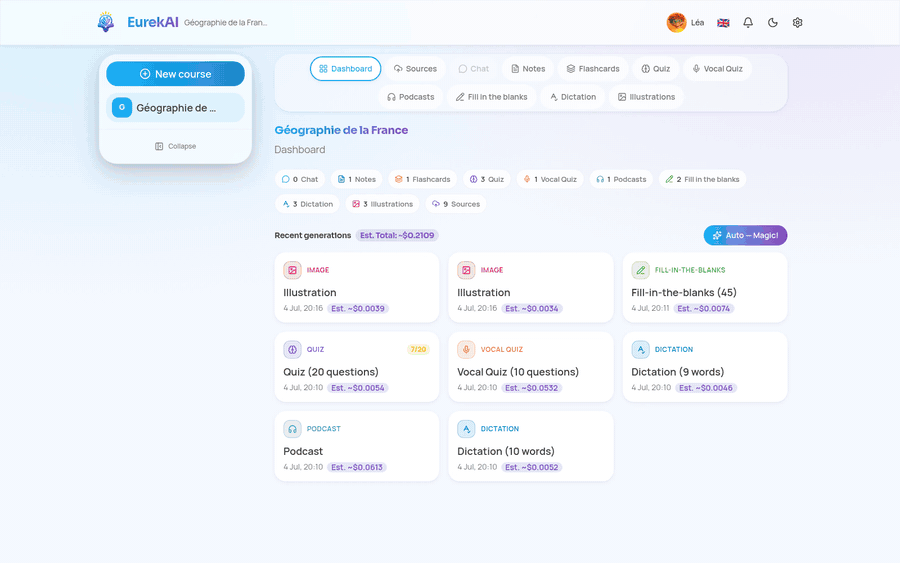
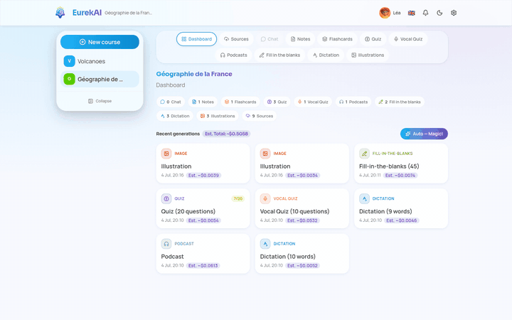
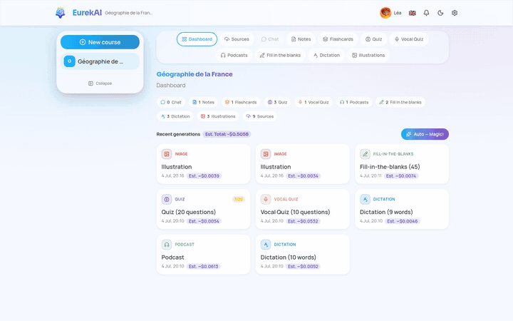
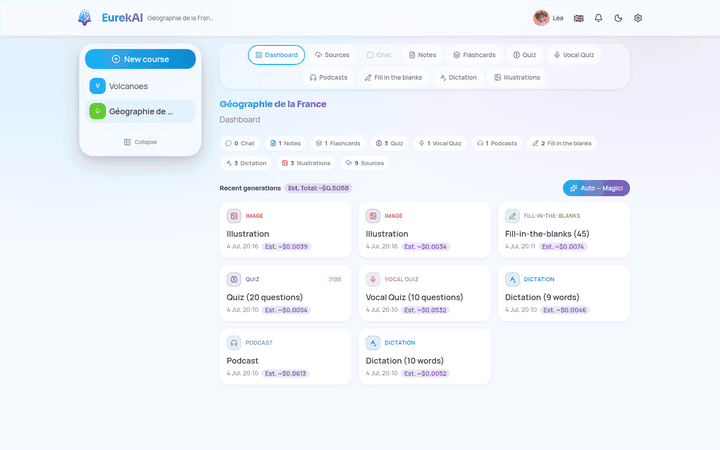
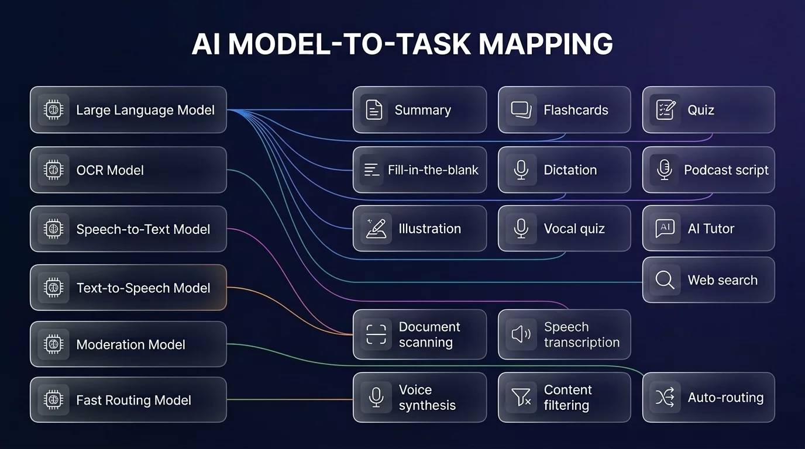

<p align="center">
  
</p>

<h1 align="center">EurekAI</h1>

<p align="center">
  <strong>किसी भी सामग्री को सीखने के संवादात्मक अनुभव में बदलें — <a href="https://mistral.ai">Mistral AI</a> द्वारा संचालित।</strong>
</p>

<p align="center">
  <a href="README-en.md">🇬🇧 अंग्रेज़ी</a> · <a href="README-es.md">🇪🇸 स्पेनी</a> · <a href="README-pt.md">🇧🇷 पुर्तगाली</a> · <a href="README-de.md">🇩🇪 जर्मन</a> · <a href="README-it.md">🇮🇹 इतालवी</a> · <a href="README-nl.md">🇳🇱 डच</a> · <a href="README-ar.md">🇸🇦 अरबी</a><br>
  <a href="README-hi.md">🇮🇳 हिन्दी</a> · <a href="README-zh.md">🇨🇳 चीनी</a> · <a href="README-ja.md">🇯🇵 जापानी</a> · <a href="README-ko.md">🇰🇷 कोरियाई</a> · <a href="README-pl.md">🇵🇱 पोलिश</a> · <a href="README-ro.md">🇷🇴 रोमानियाई</a> · <a href="README-sv.md">🇸🇪 स्वीडिश</a>
</p>

<p align="center">
  <a href="https://www.youtube.com/watch?v=_b1TQz2leoI"></a>
</p>

<h4 align="center">📊 कोड की गुणवत्ता</h4>

<p align="center">
  <a href="https://sonarcloud.io/summary/new_code?id=jls42_EurekAI"></a>
  <a href="https://sonarcloud.io/summary/new_code?id=jls42_EurekAI"></a>
  <a href="https://sonarcloud.io/summary/new_code?id=jls42_EurekAI"></a>
  <a href="https://sonarcloud.io/summary/new_code?id=jls42_EurekAI"></a>
</p>
<p align="center">
  <a href="https://sonarcloud.io/summary/new_code?id=jls42_EurekAI"></a>
  <a href="https://sonarcloud.io/summary/new_code?id=jls42_EurekAI"></a>
  <a href="https://sonarcloud.io/summary/new_code?id=jls42_EurekAI"></a>
  <a href="https://sonarcloud.io/summary/new_code?id=jls42_EurekAI"></a>
</p>
<p align="center">
  <a href="https://app.codacy.com/gh/jls42/EurekAI/dashboard?utm_source=gh&utm_medium=referral&utm_content=&utm_campaign=Badge_grade"></a>
  <a href="https://www.codefactor.io/repository/github/jls42/eurekai"></a>
</p>

---

## कहानी — EurekAI क्यों?

**EurekAI** की शुरुआत [Mistral AI Worldwide Hackathon](https://luma.com/mistralhack-online) ([आधिकारिक वेबसाइट](https://worldwide-hackathon.mistral.ai/)) के दौरान हुई थी (मार्च 2026)। मुझे एक विषय चाहिए था — और इसका विचार रोज़मर्रा की एक ठोस ज़रूरत से आया: मैं नियमित रूप से अपनी बेटी को परीक्षाओं की तैयारी करवाता हूँ, और मुझे लगा कि कृत्रिम बुद्धिमत्ता की मदद से इसे अधिक मज़ेदार और संवादात्मक बनाया जा सकता है।

लक्ष्य: **किसी भी इनपुट** — पाठ की तस्वीर, कॉपी-पेस्ट किया गया पाठ, आवाज़ की रिकॉर्डिंग, वेब खोज — को लेकर उसे **पुनरावृत्ति पत्रकों, फ़्लैशकार्ड, प्रश्नोत्तरी, पॉडकास्ट, रिक्त स्थान भरने वाले अभ्यासों, चित्रों और बहुत कुछ** में बदलना। यह सब फ़्रांसीसी कंपनी Mistral AI के मॉडल से संचालित होता है, जिससे EurekAI फ़्रांसीसी भाषी विद्यार्थियों के लिए स्वाभाविक रूप से अनुकूल समाधान बनता है।

[शुरुआती प्रोटोटाइप](https://github.com/jls42/worldwide-hackathon.mistral.ai) को हैकाथॉन के दौरान 48 घंटों में Mistral की सेवाओं पर आधारित अवधारणा के प्रमाण के रूप में बनाया गया था — वह काम करता था, लेकिन सीमित था। तब से EurekAI एक वास्तविक परियोजना बन गया है: रिक्त स्थान भरने वाले अभ्यास, अभ्यासों के बीच नेविगेशन, वेब स्क्रैपिंग, अभिभावकों द्वारा विन्यास योग्य सामग्री निगरानी, गहन कोड समीक्षा और बहुत कुछ। पूरा कोड कृत्रिम बुद्धिमत्ता से तैयार किया गया है — मुख्य रूप से [Claude Code](https://code.claude.com/) से, और कुछ योगदान [Codex](https://openai.com/codex/) तथा [Gemini CLI](https://geminicli.com/) के माध्यम से।

---

## एक नज़र

<p align="center">
  
</p>

| | |
|---|---|
| <br>**डैशबोर्ड** — हाल में तैयार की गई सामग्री, हर कार्ड और पूरी परियोजना की अनुमानित लागत, « स्वतः — जादू! » बटन | <br>**स्रोत** — तस्वीर/PDF/पाठ/आवाज़/वेब से आयात, एक क्लिक में सामग्री निर्माण, निर्देशों की पहचान |

हर आयातित स्रोत अपना [OCR विश्वसनीयता स्कोर, सामग्री निगरानी की स्थिति और अनुमानित लागत](docs/screenshots/sources-list.webp) दिखाता है।

### घटक काम करते हुए

| | |
|---|---|
| <br>**पुनरावृत्ति पत्रक** — मुख्य बिंदु, शब्दावली, स्रोत सहित उद्धरण, हर खंड का ऑडियो वाचन | <br>**बहुविकल्पीय प्रश्नोत्तरी** — हर प्रश्न का केवल एक सही उत्तर, व्याख्या के साथ तुरंत प्रतिक्रिया, चरणबद्ध नेविगेशन |
| <br>**फ़्लैशकार्ड** — कार्ड पलटें और फिर « मुझे पता था / मुझे पता नहीं था » से स्वयं का मूल्यांकन करें | <br>**रिक्त स्थान भरें** — माँगने पर संकेत, छोटी त्रुटियों को स्वीकार करने वाला सत्यापन |
| <br>**श्रुतलेख** — ऑडियो में बोला गया शब्द, अक्षर-दर-अक्षर सख्त जाँच | <br>**मौखिक प्रश्नोत्तरी** — प्रश्न ज़ोर से पढ़ा जाता है, जवाब माइक्रोफ़ोन से दें |
| <br>**पॉडकास्ट** — 2 आवाज़ों वाला छोटा पॉडकास्ट, पढ़ने के लिए संवाद की पटकथा उपलब्ध | <br>**चित्र** — एजेंट द्वारा तैयार किए गए शैक्षिक चित्र |
| <br>**कृत्रिम बुद्धिमत्ता शिक्षक** — पाठ्य सामग्री के दस्तावेज़ों पर आधारित चैट, व्याख्या सहित उत्तर, प्रश्नोत्तरी और फ़्लैशकार्ड तैयार कर सकता है | |

### शुरुआत करें

| | |
|---|---|
| <br>**प्रोफ़ाइल चुनना** — हर बच्चे का अपना स्थान, अवतार और भाषा | <br>**प्रोफ़ाइल बनाना** — उम्र, अवतार, 15 वर्ष से कम उम्र वालों के लिए अभिभावकीय PIN |
| <br>**पाठ्यक्रम बनाना** — हर पाठ के लिए एक परियोजना, जिसमें स्रोत जोड़े जा सकते हैं | <br>**सेटिंग्स** — API की स्थिति, कीमतों के साथ कृत्रिम बुद्धिमत्ता मॉडल का चयन |

---

## सुविधाएँ

| | सुविधा | विवरण |
|---|---|---|
| 📷 | **फ़ाइल आयात** | अपने पाठ आयात करें — तस्वीर, PDF (Mistral OCR के माध्यम से, औसत विश्वसनीयता स्कोर और `high`/`medium`/`low` स्तरों सहित) या पाठ फ़ाइल (TXT, MD)। अपलोड सत्रों में हर फ़ाइल को दोबारा भेजने और उसकी प्रगति अलग से देखने की सुविधा |
| 📝 | **पाठ दर्ज करना** | सीधे कोई भी पाठ लिखें या पेस्ट करें |
| 🎤 | **आवाज़ से इनपुट** | अपनी आवाज़ रिकॉर्ड करें — Voxtral STT उसे पाठ में बदलता है |
| 🌐 | **वेब / URL** | URL पेस्ट करें (Readability + Lightpanda से सीधे स्क्रैपिंग) या खोज लिखें (Mistral एजेंट का web_search) |
| 📄 | **पुनरावृत्ति पत्रक** | मुख्य बिंदुओं, शब्दावली, उद्धरणों और रोचक प्रसंगों के साथ व्यवस्थित नोट्स |
| 🃏 | **फ़्लैशकार्ड** | संवादात्मक प्रश्न/उत्तर कार्ड, संवाद के रूप में ऑडियो वाचन |
| ❓ | **बहुविकल्पीय प्रश्नोत्तरी** | 4 विकल्पों वाले प्रश्न, जिनमें केवल एक उत्तर सही होता है; गलतियों के अनुसार अनुकूलित पुनरावृत्ति सहित (संख्या निर्धारित की जा सकती है) |
| ✏️ | **रिक्त स्थान भरें** | संकेतों और छोटी त्रुटियों को स्वीकार करने वाले सत्यापन के साथ पूरा करने योग्य अभ्यास |
| 🔤 | **श्रुतलेख** | आयातित सूची से ऑडियो में बोले गए शब्द (Voxtral TTS), कीबोर्ड से उत्तर, वर्तनी के नियम की व्याख्या सहित अक्षर-दर-अक्षर सख्त जाँच |
| 🎙️ | **पॉडकास्ट** | 2 आवाज़ों वाला छोटा ऑडियो पॉडकास्ट — पहले से निर्धारित Mistral आवाज़ें या अपनी चुनी हुई आवाज़ें (अभिभावकों की भी!) |
| 🖼️ | **चित्र** | Mistral एजेंट द्वारा तैयार किए गए शैक्षिक चित्र |
| 🗣️ | **मौखिक प्रश्नोत्तरी** | ज़ोर से पढ़े गए प्रश्न (अपनी चुनी हुई आवाज़ भी संभव), मौखिक उत्तर, कृत्रिम बुद्धिमत्ता से जाँच |
| 💬 | **कृत्रिम बुद्धिमत्ता शिक्षक** | आपके पाठ्यक्रम दस्तावेज़ों के संदर्भ में चैट, टूल कॉल की सुविधा के साथ |
| 🧠 | **स्वचालित राउटर** | `mistral-small-latest` पर आधारित राउटर सामग्री का विश्लेषण करता है और उपलब्ध 8 प्रकारों में से सामग्री जनरेटर का संयोजन सुझाता है |
| 🔁 | **पाठ्यक्रमों के बीच निरंतरता** | दूसरा पाठ्यक्रम खोलने पर भी आयात, स्वचालित सामग्री निर्माण, माइक्रोफ़ोन रिकॉर्डिंग, चैट, वेब खोज और सस्वर वाचन अपने संबंधित पाठ्यक्रम के लिए जारी रहते हैं; दूसरे पाठ्यक्रम में काम पूरा होने पर सूचना में उसका नाम दिखता है |
| 🔒 | **अभिभावकीय नियंत्रण** | हर प्रोफ़ाइल के लिए विन्यास योग्य सामग्री निगरानी (बदली जा सकने वाली श्रेणियाँ), अभिभावकीय PIN, चैट प्रतिबंध |
| 🌍 | **बहुभाषी** | इंटरफ़ेस 9 भाषाओं में उपलब्ध; प्रॉम्प्ट के माध्यम से 15 भाषाओं में कृत्रिम बुद्धिमत्ता से सामग्री निर्माण नियंत्रित किया जा सकता है |
| 🔊 | **सस्वर वाचन** | Mistral Voxtral TTS के माध्यम से पत्रक और फ़्लैशकार्ड सुनें (प्रश्न/उत्तर संवाद) |
| 💶 | **API लागत की निगरानी** | हर सामग्री निर्माण और स्रोत की € लागत का पारदर्शी अनुमान (टोकन / अक्षर / पृष्ठ / ऑडियो सेकंड)। हर कार्ड पर बैज और हर परियोजना का कुल खर्च, डैशबोर्ड में दिखाई देता है |
| 🎨 | **हर प्रोफ़ाइल की थीम** | हर प्रोफ़ाइल अपनी `dark` या `light` थीम चुनती है — यह प्रोफ़ाइल के साथ सहेजी जाती है और हर बार प्रोफ़ाइल बदलने पर फिर लागू होती है |

---

## आर्किटेक्चर का अवलोकन

<p align="center">
  
</p>

---

## मॉडल उपयोग का मानचित्र

<p align="center">
  
</p>

---

## उपयोगकर्ता की यात्रा

<p align="center">
  
</p>

---

## विस्तार से — सुविधाएँ

### बहुमाध्यमीय इनपुट

EurekAI 4 प्रकार के स्रोत स्वीकार करता है, जिनकी सामग्री निगरानी प्रोफ़ाइल के अनुसार होती है (बच्चों और किशोरों की प्रोफ़ाइल के लिए सामग्री निगरानी पहले से चालू रहती है):

- **फ़ाइल आयात** — JPG, PNG या PDF फ़ाइलें Mistral OCR से संसाधित होती हैं — पहले से निर्धारित **OCR 4.1** (`mistral-ocr-4-1`), और सेटिंग्स में वैकल्पिक **OCR 3** (`mistral-ocr-2512`) (सस्ता, लगभग ~½ लागत; हस्तलिखित पाठ बेहतर पढ़ता है) — मुद्रित पाठ, तालिकाओं और हस्तलिखित पाठ के लिए; या पाठ फ़ाइलें (TXT, MD) सीधे आयात की जाती हैं। कई फ़ाइलों के अपलोड में **अपलोड सत्रों** की व्यवस्था होती है: हर फ़ाइल की अलग प्रगति, असफल फ़ाइल को बाकी फ़ाइलें दोबारा भेजे बिना पुनः भेजना, और पूरा होने पर सत्र हटाना। OCR एक औसत **विश्वसनीयता स्कोर** देता है (`average`, `[0,1]` की सीमा में रखा जाता है, Mistral से लौटाए गए `averagePageConfidenceScore` से गणना की जाती है), जिसे इंटरफ़ेस में `high` / `medium` / `low` स्तर वाले बैज के रूप में दिखाया जाता है (सीमाएँ ~0.9 / ~0.7) — स्कैन की गुणवत्ता खराब होने पर प्रक्रिया रोके बिना चेतावनी देता है। OCR के लिए Mistral को भेजी गई दस्तावेज़ की प्रति संसाधन पूरा होते ही मिटा दी जाती है, भले ही प्रक्रिया असफल हो जाए।
- **मुक्त पाठ** — कोई भी सामग्री लिखें या पेस्ट करें। सामग्री निगरानी सक्रिय होने पर सहेजने से पहले जाँच होती है।
- **आवाज़ से इनपुट** — ब्राउज़र में ऑडियो रिकॉर्ड करें। पहले से निर्धारित **Voxtral Mini Transcribe 2** (`voxtral-mini-2602`) से पाठ में बदला जाता है; सेटिंग्स में **Voxtral Mini Transcribe 3** और **Voxtral Small Transcribe 3** (Mistral पूर्वावलोकन) भी विकल्प के रूप में उपलब्ध हैं। आवाज़ की पहचान बेहतर करने के लिए इंटरफ़ेस की भाषा मॉडल को भेजी जाती है (`language`)।
- **वेब / URL** — सामग्री सीधे स्क्रैप करने के लिए एक या अधिक URL पेस्ट करें (JS पृष्ठों के लिए Readability + Lightpanda), या Mistral एजेंट से वेब खोज करने के लिए मुख्य शब्द लिखें। एक ही फ़ील्ड दोनों स्वीकार करती है — URL और मुख्य शब्द अपने-आप अलग किए जाते हैं, हर परिणाम एक स्वतंत्र स्रोत बनाता है।

### कृत्रिम बुद्धिमत्ता से सामग्री निर्माण

सीखने की सामग्री के आठ प्रकार तैयार किए जाते हैं:

| जनरेटर | मॉडल | आउटपुट |
|---|---|---|
| **पुनरावृत्ति पत्रक** | `mistral-large-2512` | शीर्षक, सारांश, मुख्य बिंदु, शब्दावली, उद्धरण, रोचक प्रसंग |
| **फ़्लैशकार्ड** | `mistral-large-2512` | स्रोत संदर्भों वाले प्रश्न/उत्तर कार्ड (संख्या निर्धारित की जा सकती है) |
| **बहुविकल्पीय प्रश्नोत्तरी** | `mistral-large-2512` | 4 विकल्पों वाले प्रश्न जिनमें केवल एक उत्तर सही होता है, व्याख्याएँ, अनुकूलित पुनरावृत्ति (संख्या निर्धारित की जा सकती है) |
| **रिक्त स्थान भरें** | `mistral-large-2512` | संकेतों के साथ पूरा करने योग्य वाक्य, छोटी त्रुटियों को स्वीकार करने वाला सत्यापन (Levenshtein) |
| **श्रुतलेख** | `mistral-large-2512` + Voxtral TTS | ऑडियो में बोले गए मुख्य शब्द (1 MP3/शब्द) → कीबोर्ड से उत्तर → नियम की व्याख्या सहित सख्त जाँच (मात्रा या उच्चारण चिह्न छूटना भी गलती माना जाता है) |
| **पॉडकास्ट** | `mistral-large-2512` + Voxtral TTS | 2 आवाज़ों की पटकथा → MP3 ऑडियो |
| **चित्र** | एजेंट `mistral-large-2512` | `image_generation` टूल से शैक्षिक चित्र |
| **मौखिक प्रश्नोत्तरी** | `mistral-large-2512` + Voxtral TTS + STT | TTS से प्रश्न → STT से उत्तर → कृत्रिम बुद्धिमत्ता से जाँच |

### चैट के माध्यम से कृत्रिम बुद्धिमत्ता शिक्षक

पाठ्यक्रम के दस्तावेज़ों तक पूरी पहुँच वाला संवादात्मक शिक्षक:

- `mistral-large-2512` का उपयोग करता है
- **टूल कॉल**: बातचीत के दौरान पत्रक, फ़्लैशकार्ड, प्रश्नोत्तरी या रिक्त स्थान भरने वाले अभ्यास तैयार कर सकता है
- हर पाठ्यक्रम के लिए 50 संदेशों का इतिहास
- प्रोफ़ाइल में सक्रिय होने पर सामग्री निगरानी: संदेश की जाँच होती है, और चिह्नित स्रोत, जिनकी जाँच असफल रही है तथा जिनकी जाँच अभी नहीं हुई है, संदर्भ और टूल से बाहर रखे जाते हैं (असफल या अभी तक न जाँचे गए स्रोतों की जाँच पहले दोबारा शुरू की जाती है, अधिकतम 5 सेकंड तक)

### स्वचालित राउटर

राउटर स्रोतों की सामग्री का विश्लेषण करने और उपलब्ध 8 जनरेटर में से सबसे उपयुक्त सुझाने के लिए `mistral-small-latest` का उपयोग करता है। इंटरफ़ेस प्रगति को वास्तविक समय में दिखाता है: पहले विश्लेषण चरण, फिर अलग-अलग सामग्री निर्माण, जिन्हें रद्द किया जा सकता है।

स्वचालित प्रक्रिया सर्वर पर चलती है: पृष्ठ फिर से लोड करने, दूसरा पाठ्यक्रम खोलने या प्रोफ़ाइल बदलने पर भी यह जारी रहती है, और हर पाठ्यक्रम के लिए एक समय में केवल एक स्वचालित प्रक्रिया चलती है (दूसरा टैब पहले से चल रही प्रक्रिया से जुड़ जाता है)। सर्वर हर Mistral कुंजी के लिए एक समय में अधिकतम 3 सामग्री निर्माण प्रक्रियाएँ चलाता है। हर निर्माण पूरा होने पर उसका संदेश आता है, फिर अंतिम विवरण केवल एक बार दिखता है; यदि किसी दूसरे पाठ्यक्रम को देखते समय प्रक्रिया पूरी होती है, तो संदेश में उसके पाठ्यक्रम का नाम आता है। केवल एक निर्माण को रद्द करने पर उसे अंतिम विवरण में असफलता नहीं माना जाता। « सब रद्द करें » पाठ्यक्रम का पूरा बैच रोक देता है और केवल एक संदेश दिखाता है। स्वचालित प्रक्रिया के दौरान सर्वर दोबारा शुरू होने पर उसे बाधित दिखाया जाता है, और « फिर शुरू करें » बटन केवल अधूरे निर्माण दोबारा शुरू करता है, विश्लेषण फिर से नहीं करता।

टैब से शुरू की गई लंबी निर्माण प्रक्रियाओं में से अधिकतम 3 एक साथ चलती हैं (एक-एक करके शुरू किए गए निर्माण, स्मरण पत्रक): अगली प्रक्रियाएँ अपनी बारी की प्रतीक्षा करती हैं, और पाठ्यक्रम चल रहे निर्माणों के पूरा होने की प्रतीक्षा किए बिना खुल जाता है।

### अनुकूलित अध्ययन

- **प्रश्नोत्तरी के आँकड़े**: हर प्रश्न के लिए प्रयासों और उत्तरों की सटीकता की निगरानी
- **प्रश्नोत्तरी की पुनरावृत्ति**: मूल प्रश्नोत्तरी के स्रोतों के आधार पर कमज़ोर अवधारणाओं पर केंद्रित 5-10 नए प्रश्न तैयार करता है (सामग्री निगरानी की जाँच इन्हीं स्रोतों पर लागू होती है)
- **निर्देशों की पहचान**: पुनरावृत्ति के निर्देशों ("मुझे अपना पाठ आता है यदि मैं... कर सकता हूँ") को पहचानता है और संगत पाठ जनरेटर में उन्हें प्राथमिकता देता है (पत्रक, फ़्लैशकार्ड, प्रश्नोत्तरी, रिक्त स्थान भरें)। सामग्री निगरानी सक्रिय होने पर पहचान प्रक्रिया स्रोतों की जाँच पूरी होने की प्रतीक्षा करती है और केवल सुरक्षित माने गए स्रोत पढ़ती है; निर्देश अपने मूल स्रोतों की सूची रखते हैं: यदि उनमें से कोई चिह्नित हो जाए, तो निर्देश न दिखाए जाते हैं, न लागू किए जाते हैं, और यदि उनमें से कोई मिटा दिया जाए, तो निर्देश भी मिटा दिए जाते हैं। इसकी लागत भी गिनी जाती है
### सुरक्षा और अभिभावकीय नियंत्रण

- **4 आयु समूह** : बच्चा (≤10 वर्ष), किशोर (11-15), विद्यार्थी (16-25), वयस्क (26+)
- **सामग्री मॉडरेशन** : `mistral-moderation-2603` (Mistral Moderation 2), जिसमें 11 श्रेणियाँ उपलब्ध हैं और बच्चे/किशोर की नई प्रोफ़ाइलों के लिए डिफ़ॉल्ट रूप से 6 अवरुद्ध हैं (`sexual`, `hate_and_discrimination`, `violence_and_threats`, `criminal`, `selfharm`, `jailbreaking` ; इतिहास सहित 50 पाठों पर परीक्षण में एक भी गलत सकारात्मक परिणाम न मिलने के बाद `criminal` जोड़ा गया)। सेटिंग्स में हर प्रोफ़ाइल की श्रेणियाँ अनुकूलित की जा सकती हैं ; Moderation 2 ने पुरानी « खतरनाक सामग्री » श्रेणी को `dangerous` + `criminal` में विभाजित किया है (मौजूदा प्रोफ़ाइलें अपने आप माइग्रेट होती हैं और अवरुद्ध श्रेणियाँ पहले से आयातित स्रोतों पर भी लागू होती हैं)। डिफ़ॉल्ट सुरक्षा : यदि मॉडल के उत्तर से किसी अवरुद्ध श्रेणी की जाँच संभव नहीं होती, तो सामग्री अस्वीकार कर दी जाती है (« मॉडरेशन अनुपलब्ध ») ; मॉडरेशन सक्रिय होने पर सामग्री निर्माण और चैट, दोनों में चिह्नित स्रोतों, जाँच में विफल स्रोतों और जाँचाधीन स्रोतों को बाहर रखा जाता है। जिस स्रोत की कभी जाँच नहीं हुई हो (मॉडरेशन बंद होने पर आयात किया गया हो या किसी प्रोफ़ाइल से जोड़ा गया पुराना प्रोजेक्ट हो), उसे उपयोग से पहले जाँचा जाता है। रीस्टार्ट के कारण बाधित मॉडरेशन, सर्वर की कुंजी अनुमति दे तो स्टार्टअप पर फिर शुरू होता है ; अन्यथा, त्रुटि के कारण रुके मॉडरेशन की तरह, वह प्रोजेक्ट खोलने या अगली बार सामग्री बनाने पर फिर शुरू होता है। « फिर जाँचें » बटन माँग पर जाँच दोबारा शुरू करता है। मॉडरेशन सक्रिय होने पर, जब तक कोई स्रोत सुरक्षित नहीं माना जाता, उसकी सामग्री बच्चे से छिपी रहती है (पूर्वावलोकन, पाठ, मूल दस्तावेज़) ; अभिभावक अपने PIN से उसे केवल एक बार देखने के लिए खोल सकते हैं। वॉइस क्विज़ के मौखिक उत्तर की शुद्धता जाँचने से पहले उसका मॉडरेशन होता है। दिनांकयुक्त ID को `helpers/moderation-model.ts` में स्थिर किया गया है : अप्रचलित उपनाम `-latest` अब API की सूची में नहीं है।
- **अभिभावकीय PIN** : SHA-256 हैश, 15 वर्ष से कम आयु की प्रोफ़ाइलों के लिए आवश्यक ; हर पंद्रह मिनट में प्रति IP पते पर अधिकतम 10 गलत कोड (429 `rate_limited`)। प्रोडक्शन में तैनाती के लिए सॉल्ट वाला धीमा हैश रखें (Argon2id, bcrypt)।
- **सर्वर डेटा** : `/output` केवल प्रोजेक्ट का मीडिया (ऑडियो, चित्र, आयातित फ़ाइलें) उपलब्ध कराता है ; `profiles.json`, `config.json`, `projects.json` और `project.json` कभी उपलब्ध नहीं कराए जाते
- **चैट प्रतिबंध** : 16 वर्ष से कम आयु के लिए AI चैट डिफ़ॉल्ट रूप से बंद है, अभिभावक इसे चालू कर सकते हैं

### एकाधिक प्रोफ़ाइल प्रणाली

- नाम, आयु, अवतार और भाषा प्राथमिकताओं के साथ कई प्रोफ़ाइलें
- **प्रति प्रोफ़ाइल आवाज़ें** (`Profile.mistralVoices?: { host?, guest? }` — हर भूमिका वैकल्पिक है) — हर बच्चे के लिए पॉडकास्ट/वॉइस क्विज़ की अपनी आवाज़ों की जोड़ी हो सकती है
- **प्रति प्रोफ़ाइल थीम** (`Profile.theme: 'dark' | 'light'`) — प्रोफ़ाइल बदलने पर अपने आप बदलती है और बैकएंड पर सहेजी जाती है
- प्रोजेक्ट `profileId` के माध्यम से प्रोफ़ाइलों से जुड़े हैं ; बिना प्रोफ़ाइल वाला पुराना प्रोजेक्ट उसे पहली बार खोलने वाली प्रोफ़ाइल से जुड़ जाता है, फिर उसी प्रोफ़ाइल के अनुसार उसका मॉडरेशन होता है
- क्रमिक विलोपन : प्रोफ़ाइल हटाने पर उसके सभी प्रोजेक्ट हट जाते हैं

### API लागत की निगरानी

हर शुल्कयोग्य Mistral कॉल (चैट, OCR, STT, TTS, एजेंट), जिसमें निर्देश पहचान और वॉइस क्विज़ के मौखिक उत्तर भी शामिल हैं, में उपयोगकर्ता को € में **पारदर्शी** अनुमान देने के लिए मापन व्यवस्था लगी है। मॉडरेशन निःशुल्क है, इसलिए उसे नहीं गिना जाता। एजेंट के टूल शुल्क शामिल हैं : प्रति वेब खोज 0,03 $ और प्रति निर्मित चित्र 0,10 $ (Mistral की दरें), साथ ही इन टूल से उत्पन्न टोकन, जिन्हें अनुमान में एजेंट के मॉडल की इनपुट दर पर गिना जाता है।

- **प्रामाणिक स्रोत** : `helpers/pricing.ts` — मॉडल के उपसर्ग के अनुसार `MODEL_PRICING` (उदाहरण: `mistral-large` → इनपुट 0.5 €/M टोकन, आउटपुट 1.5 €/M टोकन), समय-समय पर दोबारा स्क्रैप करने के लिए Mistral दस्तावेज़ों के URL सहित `PRICING_SOURCES`
- **समर्थित इकाइयाँ** : `tokens`, `characters` (TTS), `pages` (OCR), `audio-seconds` (STT) — रूपांतरण `helpers/cost-calc.ts` द्वारा नियंत्रित होता है
- **मापन शृंखला** : `helpers/tracked-client.ts` (Mistral क्लाइंट को लपेटता है) → `helpers/usage-context.ts` (AsyncLocalStorage) → `helpers/cost-calc.ts` → `helpers/cost-persist.ts` → `helpers/cost-middleware.ts` (HTTP उत्तर में जोड़ना)
- **UI** : हर सामग्री निर्माण की लागत का बैज (`src/partials/cost-badge-gen.html`), हर स्रोत की लागत (`cost-badge-src.html`), डैशबोर्ड में संचित कुल लागत (`Project.totalCost`)
- **एंडपॉइंट** : `/generate/*` और `/sources/*` के उत्तर लौटाए गए ऑब्जेक्ट (`Generation` / `Source`) में `estimatedCost`, `usage` और `costBreakdown` जोड़ते हैं। `POST /generate/route` केवल रूटिंग की लागत के लिए `costDelta: number` फ़ील्ड जोड़ता है ; `POST /detect-consigne` (`{consigne, costDelta}`) और मौखिक उत्तर की जाँच भी अपना `costDelta` लौटाते हैं। `GET /projects/:pid` प्रोजेक्ट में `totalCost` (`costLog[]` से गणना किया गया योग) जोड़कर लौटाता है + पूरा इतिहास

### TTS (Mistral Voxtral) और अनुकूलित आवाज़ें

- **Mistral Voxtral TTS** : डिफ़ॉल्ट रूप से **Voxtral TTS** (`voxtral-mini-tts-2603`), सेटिंग्स में विकल्प के रूप में **Voxtral TTS 3** (`voxtral-mini-tts-3-0`, Mistral पूर्वावलोकन, अधिक भाषाओं में मूल आवाज़ें) ; वाक् संश्लेषण 100% Mistral, किसी अतिरिक्त कुंजी की आवश्यकता नहीं। केवल चुने गए मॉडल द्वारा स्वीकार की जाने वाली आवाज़ें दिखाई जाती हैं : Voxtral TTS, Voxtral 3 के साथ जोड़ी गई आवाज़ें स्वीकार नहीं करता
- **अनुकूलित आवाज़ें** : अभिभावक Mistral Voices API के माध्यम से (ऑडियो नमूने से) अपनी आवाज़ें बना सकते हैं और उन्हें मेज़बान/अतिथि की भूमिकाओं को सौंप सकते हैं — इसके बाद पॉडकास्ट और वॉइस क्विज़ अभिभावक की आवाज़ में पढ़े जाते हैं, जिससे बच्चे का अनुभव और अधिक जीवंत हो जाता है
- आवाज़ की दो विन्यासयोग्य भूमिकाएँ : **मेज़बान** (मुख्य कथावाचक) और **अतिथि** (पॉडकास्ट की दूसरी आवाज़)
- सेटिंग्स में Mistral की आवाज़ों की पूरी सूची उपलब्ध है, जिसे भाषा के अनुसार फ़िल्टर किया जा सकता है
- पाठ-पठन (अध्ययन पत्रक, पॉडकास्ट, श्रुतलेख का शब्द) उसका दृश्य छोड़ने पर रुक जाता है और वहीं से फिर शुरू होता है जहाँ रुका था
- फ़्लैशकार्ड को बोलकर पढ़ने का ऑडियो पहली बार सुनने पर बनता है, फिर उसी निर्मित सामग्री में सहेजा जाता है : हर बार लौटने पर इसे दोबारा बनाया या इसका शुल्क दोबारा नहीं लिया जाता
- स्रोत संकेतक (`[Source N]`) बोलकर नहीं पढ़े जाते

### अंतर्राष्ट्रीयकरण

- इंटरफ़ेस 9 भाषाओं में उपलब्ध है : fr, en, es, pt, it, nl, de, hi, ar
- AI प्रॉम्प्ट 15 भाषाओं का समर्थन करते हैं (fr, en, es, de, it, pt, nl, ja, zh, ko, ar, hi, pl, ro, sv)
- हर प्रोफ़ाइल के लिए भाषा निर्धारित की जा सकती है

---

## तकनीकी स्टैक

| परत | प्रौद्योगिकी | भूमिका |
|---|---|---|
| **रनटाइम** | Node.js + TypeScript 6.x | सर्वर और टाइप सुरक्षा |
| **बैकएंड** | Express 5.x | REST API |
| **विकास सर्वर** | Vite 8.x (Rolldown) + tsx | HMR, Handlebars के आंशिक टेम्पलेट, प्रॉक्सी |
| **फ़्रंटएंड** | HTML + TailwindCSS 4.x + Alpine.js 3.x | प्रतिक्रियाशील इंटरफ़ेस, Vite द्वारा संकलित TypeScript |
| **टेम्पलेट प्रणाली** | vite-plugin-handlebars | आंशिक टेम्पलेट से HTML संयोजन |
| **AI** | Mistral AI SDK | चैट, OCR, STT, TTS, एजेंट, मॉडरेशन |
| **TTS** | Mistral Voxtral TTS | `voxtral-mini-tts-2603` (विकल्प के रूप में Voxtral TTS 3), एकीकृत वाक् संश्लेषण |
| **आइकन** | Lucide 1.x | SVG आइकन लाइब्रेरी |
| **वेब स्क्रैपिंग** | Readability + linkedom | वेब पृष्ठों की मुख्य सामग्री निकालना (Firefox Reader View तकनीक) |
| **हेडलेस ब्राउज़र** | Lightpanda | JS/SPA पृष्ठों के लिए बेहद हल्का हेडलेस ब्राउज़र (Zig + V8) — स्क्रैपिंग का वैकल्पिक उपाय |
| **Markdown** | Marked | चैट में Markdown का रेंडरिंग |
| **फ़ाइल अपलोड** | Multer 2.x | मल्टीपार्ट फ़ॉर्म का प्रबंधन |
| **ऑडियो** | ffmpeg-static | ऑडियो खंडों को जोड़ना |
| **परीक्षण** | Vitest | इकाई परीक्षण — कवरेज का मापन SonarCloud द्वारा |
| **स्थायी भंडारण** | JSON फ़ाइलें | निर्भरता के बिना भंडारण |

---

## मॉडल संदर्भ

| मॉडल | उपयोग | कारण |
|---|---|---|
| `mistral-large-2512` (Large 3, स्थिर किया गया डिफ़ॉल्ट) | अध्ययन पत्रक, फ़्लैशकार्ड, पॉडकास्ट, क्विज़, रिक्त स्थान वाले पाठ, चैट, वॉइस क्विज़ की जाँच, चित्र एजेंट, वेब खोज एजेंट, निर्देश पहचान | बेहतर बहुभाषी क्षमता + निर्देशों का पालन ; स्थिर किया गया है क्योंकि उपनाम `mistral-large-latest` नवंबर 2026 से Large 4 उपलब्ध कराता है, जो हमारी सामग्री बनाने के लिए बहुत धीमा है (Large 3 को 30/04/2027 को हटाने की घोषणा हुई है) |
| `mistral-ocr-4-1` (OCR 4.1, डिफ़ॉल्ट) | दस्तावेज़ों का OCR | मुद्रित पाठ, तालिकाएँ, हस्तलेखन ($4 / 1000 पृष्ठ) |
| `mistral-ocr-2512` (OCR 3, वैकल्पिक) | दस्तावेज़ों का OCR | सेटिंग्स में चुना जा सकता है, कम महँगा ($2 / 1000 पृष्ठ), हस्तलेखन बेहतर पढ़ता है |
| `voxtral-mini-2602` (Voxtral Mini Transcribe 2, डिफ़ॉल्ट) | वाक् पहचान (STT) | वॉइस इनपुट और वॉइस क्विज़ के मौखिक उत्तर ($0.003 / min) |
| `voxtral-mini-transcribe-3-0` / `voxtral-small-transcribe-3-0` (Transcribe 3, वैकल्पिक, पूर्वावलोकन) | वाक् पहचान (STT) | सेटिंग्स में चुने जा सकते हैं ($0.0035 / min और $0.004 / min) |
| `voxtral-mini-tts-2603` (Voxtral TTS, डिफ़ॉल्ट) | वाक् संश्लेषण (TTS) | पॉडकास्ट, वॉइस क्विज़, श्रुतलेख, बोलकर पढ़ना ($16 / M अक्षर) |
| `voxtral-mini-tts-3-0` (Voxtral TTS 3, वैकल्पिक, पूर्वावलोकन) | वाक् संश्लेषण (TTS) | सेटिंग्स में चुना जा सकता है, अधिक भाषाओं में मूल आवाज़ें ($13 / M अक्षर) |
| `mistral-moderation-2603` | सामग्री मॉडरेशन | बच्चे/किशोर के लिए 6 श्रेणियाँ अवरुद्ध (जिनमें `jailbreaking` शामिल है) |
| `mistral-small-latest` | स्वचालित राउटर | रूटिंग संबंधी निर्णयों के लिए सामग्री का त्वरित विश्लेषण |

फ़ोन पर, सेटिंग्स में हर चयनकर्ता के नीचे चुने गए मॉडल का पूरा लेबल (मूल्य, « अनुशंसित » या « पूर्वावलोकन ») दिखता है, जो बंद मेनू में कट जाता था।

---

## त्वरित शुरुआत

```bash
# Cloner le dépôt
git clone https://github.com/jls42/EurekAI.git
cd EurekAI

# Installer les dépendances
npm install

# Configurer les clés API
cp .env.example .env
# Éditez .env (toutes optionnelles) :
#   MISTRAL_API_KEY=<your_api_key>           (optionnel — sinon chaque utilisateur saisit sa clé dans l'app)
#   SONAR_TOKEN=...                          (optionnel, CI SonarCloud uniquement)

# Lancer le développement
npm run dev
# → Backend :  http://localhost:3000 (API)
# → Frontend : http://localhost:5173 (serveur Vite avec HMR)
```

> **नोट** : Mistral Voxtral TTS ही एकमात्र TTS प्रदाता है — `MISTRAL_API_KEY` के अतिरिक्त किसी कुंजी की आवश्यकता नहीं।

> **उपयोगकर्ता द्वारा दर्ज API कुंजी** : `MISTRAL_API_KEY` अब **वैकल्पिक** है। इसके न होने पर भी ऐप शुरू होता है और हर उपयोगकर्ता से इंटरफ़ेस में **अपनी Mistral कुंजी** दर्ज करने को कहता है। कुंजी **ब्राउज़र में सहेजी जाती है** (सुरक्षित संदर्भ में Web Crypto + IndexedDB के माध्यम से एन्क्रिप्ट की जाती है) और हर अनुरोध के साथ भेजी जाती है — **सर्वर पर कभी स्थायी रूप से सहेजी नहीं जाती**। प्राथमिकता : प्रोफ़ाइल की कुंजी > ब्राउज़र की वैश्विक कुंजी > `MISTRAL_API_KEY` (परिवेश)। `EUREKAI_REQUIRE_USER_KEY=true` सेट करने पर हर उपयोगकर्ता को अपनी कुंजी देनी होती है (परिवेश की कुंजी केवल प्रीलोड के काम आती है)।

> **स्थानीय HTTPS (टैबलेट/LAN)** : `localhost` पहले से सुरक्षित संदर्भ है। LAN से पहुँच के लिए (टैबलेट), स्थानीय प्रमाणपत्र बनाएँ और HTTPS सक्रिय करें : तब ब्राउज़र अपनी सहेजी हुई कुंजी एन्क्रिप्ट कर सकता है और कुंजी भेजे जाने के दौरान भी एन्क्रिप्ट रहती है :
> ```bash
> ./scripts/gen-cert.sh 192.168.1.42   # mkcert si dispo, sinon openssl self-signed
> export HTTPS_KEY=certs/key.pem HTTPS_CERT=certs/cert.pem
> npm run dev                          # Express + Vite en HTTPS
> ```

### परिवेश चर

| चर | आवश्यक | डिफ़ॉल्ट | भूमिका |
|---|---|---|---|
| `MISTRAL_API_KEY` | वैकल्पिक | — | Mistral API कुंजी (चैट, OCR, STT, TTS Voxtral, एजेंट, मॉडरेशन)। अनुपस्थित होने पर उपयोगकर्ता ऐप में अपनी कुंजी दर्ज करता है (ब्राउज़र में सहेजी जाती है, सर्वर पर कभी नहीं) |
| `EUREKAI_REQUIRE_USER_KEY` | वैकल्पिक | `false` | `true` → AI अनुरोधों के लिए `MISTRAL_API_KEY` के वैकल्पिक उपयोग को बंद करता है (हर उपयोगकर्ता को अपनी कुंजी देना अनिवार्य है)। सार्वजनिक रूप से उपलब्ध इंस्टेंस पर उपयोगी |
| `HTTPS_KEY` / `HTTPS_CERT` | वैकल्पिक | — | TLS कुंजी/प्रमाणपत्र के पथ (देखें `scripts/gen-cert.sh`) → Express और Vite, HTTPS पर उपलब्ध होते हैं (LAN/टैबलेट के लिए सुरक्षित संदर्भ) |
| `PORT` | वैकल्पिक | `3000` | Express बैकएंड का HTTP पोर्ट |
| `NODE_ENV` | वैकल्पिक | `development` | यदि `production` → Express, `dist/` से फ़्रंटएंड उपलब्ध कराता है (अन्यथा `public/`) |
| `SONAR_TOKEN` | CI के लिए वैकल्पिक | — | केवल GitHub Actions के SonarCloud वर्कफ़्लो द्वारा उपयोग किया जाता है |

### परीक्षण, कोड गुणवत्ता और योगदान

```bash
npm test                # vitest (déclenche pretest : typecheck + lint:complexity + lint:ci + lint:deadcode)
npm run test:coverage   # couverture vitest
npm run lint            # ESLint + typescript-eslint + sonarjs
npm run lint:fix        # auto-fix
npm run format          # prettier
npm run security        # Opengrep (SAST local) — bloque sur finding ERROR
```

**Git हुक (Husky)** : `pre-commit` क्रम से `scripts/pre-commit-fast.sh` (टकराव, बड़ी फ़ाइलें, shellcheck), `lint-staged` और फिर `npm test` चलाता है ; `pre-push` पहले अनिवार्य जाँच `npm audit` चलाता है (किसी निर्भरता, यहाँ तक कि अप्रत्यक्ष निर्भरता में भी, `critical` स्तर की भेद्यता होने पर रोक देता है, देखें `scripts/audit-verdict.mjs`), फिर `npm run security` चलाता है। किसी भी चरण के विफल होते ही संबंधित हुक कमिट/पुश रोक देता है।

**बाहरी टूल (ऐप चलाने के लिए वैकल्पिक, `pretest` और `npm run security` के लिए अनिवार्य)** :

```bash
# Lizard (Python) pour lint:complexity (CCN > 8 sur l'allowlist)
pipx install lizard          # ou : pipx run lizard

# Opengrep (binaire standalone ~40 Mo) pour npm run security
./scripts/install-opengrep.sh   # installe dans ~/.local/bin/
```

इन टूल के बिना, `npm test`, `pretest` पर विफल होता है (lizard अनुपस्थित) और `npm run security` विफल होता है (opengrep अनुपस्थित)। तब husky हुक कमिट/पुश रोक देते हैं।

---

## कंटेनर के साथ तैनाती

इमेज **GitHub Container Registry** पर प्रकाशित है :

```bash
# Télécharger l'image
podman pull ghcr.io/jls42/eurekai:latest

# Lancer EurekAI
mkdir -p ./data
podman run -d --name eurekai \
  -e MISTRAL_API_KEY=<your_api_key> \
  -v ./data:/app/output:U \
  -p 3000:3000 \
  ghcr.io/jls42/eurekai:latest
# → http://localhost:3000
```

> **`:U`** : रूटलेस Podman का फ़्लैग, जो वॉल्यूम की अनुमतियाँ अपने आप समायोजित करता है।

```bash
# Build local
podman build -t eurekai -f Containerfile .

# Publier sur ghcr.io (mainteneurs)
./scripts/publish-ghcr.sh
```

---

## प्रोजेक्ट की संरचना

```
server.ts                 — Point d'entrée Express, monte les routes + config
config.ts                 — Config runtime (modèles, voix, modèle TTS), persistée dans output/config.json
store.ts                  — ProjectStore : CRUD projets/sources/générations, persistance JSON
profiles.ts               — ProfileStore : gestion des profils, hachage PIN
types.ts                  — Types TypeScript : Source, Generation (8 types), QuizStats, Profile
prompts.ts                — Tous les prompts IA centralisés (system + user templates, 15 langues)

generators/
  auto-agents.ts          — Source unique de vérité : AUTO_AGENTS_SET (8 agents) + MAX_AUTO_PLAN_LENGTH
  generation-types.ts     — Types générables individuellement (SINGLE_GENERATE_TYPES, coïncide avec les 8 agents auto)
  ocr.ts                  — OCR via Mistral (JPG, PNG, PDF) avec extraction interne des scores de confiance moyens par page
  summary.ts              — Génération de fiche de révision (JSON structuré)
  flashcards.ts           — Flashcards Q/R (nombre configurable)
  quiz.ts                 — Quiz QCM (nombre configurable) + révision adaptative
  fill-blank.ts           — Exercices à trous avec validation tolérante
  dictation.ts            — Dictée : mots + phrases-exemples + règles, 1 audio TTS par mot (8e agent auto)
  podcast.ts              — Script podcast 2 voix
  quiz-vocal.ts           — Quiz vocal : questions TTS + réponses STT + vérification IA
  image.ts                — Génération d'image via Agent Mistral (outil image_generation)
  chat.ts                 — Tuteur IA par chat avec appel d'outils
  router.ts               — Routeur automatique (contenu → générateurs recommandés)
  consigne.ts             — Détection de consignes de révision
  tts-provider.ts         — TTS Mistral Voxtral (synthèse vocale + listing des voix)
  tts.ts                  — Génération audio multi-voix (podcast + flashcards, concaténation de segments)
  stt.ts                  — Voxtral STT (audio → texte)
  websearch.ts            — Agent Mistral avec outil web_search (fallback)
  moderation.ts           — Modération de contenu (filtrage par âge)

routes/
  projects.ts             — CRUD projets
  profiles.ts             — CRUD profils avec gestion du PIN
  sources.ts              — Import fichiers (OCR + texte brut), texte libre, voix STT, scraping URL + recherche web, modération
  generate.ts             — Endpoints de génération (8 types + route)
  auto-runs.ts            — Lots Auto côté serveur : lancement, analyse et étapes en arrière-plan, état, annulation
  generations.ts          — Tentatives de quiz/fill-blank, réponses vocales, lecture à voix haute
  chat.ts                 — Chat IA avec appel d'outils

helpers/
  # IO & parsing
  index.ts                — getContent, stripJsonMarkdown, safeParseJson, tryParseJson, retryTurns, unwrapJsonArray, extractAllText, timer
  audio.ts                — collectStream (ReadableStream → Buffer)
  audio-files.ts          — Persistance et lecture des fichiers audio générés (podcast, flashcards)
  generation-media.ts     — Noms uniques des médias (MP3/PNG) et suppression avec leur génération
  media-ledger.ts         — Médias écrits pendant une génération, supprimés si elle échoue ou est annulée
  keyed-lock.ts           — File d'attente par clé (OCR sérialisé par contenu)
  keyed-slots.ts          — Places par clé (au plus 3 étapes d'Auto en même temps par clé Mistral)
  logger.ts               — Logger structuré (niveaux, contexte JSON)

  # Génération & UX
  auto-title.ts           — autoTitle(type, data, lang) : préfixe auto pour carte liste (Fiche, Note, Quiz, etc.)
  choice-labels.ts        — Labels localisés des choix (quiz, quiz-vocal) — 9 langues
  diversity.ts            — Diversité des générations (exclusion du contenu déjà produit, `diversityParams` : temperature/presencePenalty/randomSeed)
  fill-blank-validate.ts  — Validation tolérante des réponses (normalisation, Levenshtein)
  dictation-diff.ts       — Comparaison stricte lettre à lettre pour la correction de dictée (local, zéro coût IA)
  reading-comfort.ts      — Option « Confort de lecture » par profil (police Luciole, espacements) — partagé serveur/client
  ocr-models.ts           — Source de vérité sélection OCR (OCR 4 défaut / OCR 3 option) + normalizeOcrModel
  moderation-model.ts     — Modèle de modération épinglé + ses 11 catégories + migration des catégories legacy
  stt-models.ts           — Source de vérité sélection transcription (Mini Transcribe 2 défaut / Transcribe 3 option) + normalizeSttModel
  tts-models.ts           — Source de vérité sélection synthèse vocale (Voxtral TTS défaut / TTS 3 option) + compatibilité des voix
  tts-text.ts             — Texte envoyé au TTS : marqueurs de sources et crochets retirés (Voxtral les lit ou avale le mot)
  source-markers.ts       — Regex des marqueurs `[Source N]` des fiches (pastilles côté navigateur, texte lu côté serveur)
  moderation-http.ts      — Statut de modération → réponse HTTP (400 signalé / 503 indisponible / 409 en cours), statut effectif, garde de la consigne
  moderation-profile.ts   — Profil propriétaire du projet et catégories actives (source unique des routes)
  source-moderation.ts    — Modérations en vol et reprise (démarrage, génération, chat, « Revérifier »)
  input-moderation.ts     — Modération d'un texte saisi ou dicté (texte libre, recherche web, réponse orale)
  chat-sources.ts         — Sources accessibles au chat (sans les sources non vérifiées si la modération est active)

  # Codes d'erreur stables
  error-codes.ts              — Re-export mince de l'API publique
  error-code-resolution.ts    — Orchestration extractErrorCode(e, agent) → FailedStepCode
  error-code-rules.ts         — Règles de mapping par agent/step
  error-matchers.ts           — Matchers par pattern d'erreur HTTP/LLM (délimités pour Lizard)

  # Cost tracking API (suivi coûts €)
  pricing.ts              — MODEL_PRICING + PRICING_SOURCES (tarifs Mistral par prefix de modèle)
  cost-calc.ts            — Conversion ApiUsage → coût € (tokens / characters / pages / audio-seconds)
  cost-persist.ts         — Écriture dans Project.costLog + totalCost
  cost-middleware.ts      — Injection de costDelta dans la réponse HTTP
  tracked-client.ts       — Wrap du client Mistral (capture ApiUsage automatiquement)
  usage-context.ts        — AsyncLocalStorage pour propager l'usage dans les pipelines async

  # Clé API Mistral & sécurité
  mistral-client-factory.ts — Source UNIQUE de construction du client Mistral (buildTrackedClient, resolveClient, requireKeyMiddleware)
  rate-limit.ts           — Rate-limiters Express (authLimiter, pinLimiter, aiLimiter / aiPathLimiter, generalLimiter), 429 `rate_limited`
  request-validation.ts   — Validation de lang / ageGroup sur toutes les routes IA (400 invalid_input)
  output-static.ts        — Liste blanche du montage statique /output (médias des projets seulement)
  security-headers.ts     — Options Helmet / CSP (createHelmetOptions)
  redact.ts               — Redaction des secrets dans les logs (clé API, headers sensibles)
  mistral-retry.ts        — Retry avec backoff sur erreurs transitoires Mistral (3 tentatives)

  # Événements & notifications (SSE)
  event-bus.ts            — Bus d'événements de génération et de lots Auto en mémoire (dispatch SSE, filet anti-uncaughtException)
  auto-run-state.ts       — Transitions d'un lot Auto (fonctions pures, appliquées par le store)
  event-key.ts            — Clé d'événement typée partagée client/serveur (idempotence notifications)

  # Voix & profils
  voice-selection.ts      — selectVoices : rotation déterministe par profil + langue (host/guest)
  voice-types.ts          — Type MistralVoice (importable côté frontend sans embarquer le SDK Mistral)

src/                      — Frontend (Vite + Handlebars)
  index.html              — Point d'entrée HTML principal
  main.ts                 — Entrée frontend (init Alpine.js + icônes Lucide)
  app/                    — Modules applicatifs Alpine.js
    state.ts              — Gestion d'état réactif
    navigation.ts         — Routage des vues + gardes par âge
    view-media.ts         — Pause du son au changement de vue (position gardée)
    profiles.ts           — Logique du sélecteur de profils
    projects.ts           — CRUD des cours
    sources.ts            — Gestionnaires d'upload de sources
    generate.ts           — Déclencheurs de génération (individuel, tout, Auto)
    auto-launch.ts        — Lancement d'un Auto côté serveur, suivi pendant qu'un autre cours est affiché, annulation
    auto-runs.ts          — Auto suivis par l'onglet : état reçu du serveur, bilan affiché une seule fois, coût de l'analyse
    request-slots.ts      — Au plus 3 générations longues en même temps pour l'onglet, file d'attente FIFO
    moderation-gate.ts    — Pré-contrôle de modération des générations (vérifie d'abord les sources en attente)
    effective-moderation.ts — Statut de modération affiché et masquage du contenu des sources
    generations.ts        — Affichage + actions sur les générations
    chat.ts               — Interface de chat
    chat-in-flight.ts     — Messages du chat en attente de réponse, par cours
    config.ts             — Interface de configuration (modèles de chat, d'OCR, de transcription et de TTS, voix)
    render.ts             — Helpers de rendu HTML
    i18n.ts               — Changement de langue
    ...
  components/
    quiz.ts               — Composant quiz interactif
    quiz-vocal.ts         — Composant quiz vocal
    fill-blank.ts         — Composant textes à trous
    fill-blank-validate.ts — Ré-export client de la validation textes à trous (validateAnswer)
    flashcards.ts         — Composant flashcards avec retournement
    dictation.ts          — Composant dictée interactif
    step-by-step.ts       — Mixin navigation pas-à-pas (quiz, fill-blank, flashcards)
  i18n/
    fr.ts, en.ts, es.ts, — Dictionnaires par langue (9 langues)
    pt.ts, it.ts, nl.ts,
    de.ts, hi.ts, ar.ts
    languages.ts          — Registre des langues UI disponibles
    index.ts              — Chargeur i18n
  partials/               — Partials HTML Handlebars (header, sidebar, dialogues, vues)
  styles/
    main.css              — Entrée TailwindCSS
    theme.css             — Variables de thème personnalisées

public/assets/            — Ressources statiques (logo, avatars, schémas architecture)
docs/                     — Notes internes (inventaire prompts, audits, prompts des diagrammes) + screenshots du README
scripts/                  — Tooling : check-deps, check-models, check-security, check-complexity, gen-cert, install-opengrep, translate-readme, publish-ghcr, update-pricing
output/                   — Données d'exécution (projets, config, fichiers audio) ; en mode prod (`NODE_ENV=production`), Express sert le frontend depuis `dist/` au lieu de `public/`
```

> **कोड में योगदान देने वाले AI एजेंटों के लिए** : विस्तृत आर्किटेक्चर संदर्भ, अनिवार्य नियमों (त्रुटि कोड, लागत की निगरानी और मेटा शब्दों के बिना प्रॉम्प्ट, यानी दस्तावेज़ के प्रकार जैसे विशेषणों के बिना, क्योंकि मॉडल इन शब्दों को अपने आउटपुट में दोहरा देगा) और ज्ञात समस्याओं (Lizard CCN, Opengrep, Codacy/Semgrep माइग्रेशन) के लिए [`CLAUDE.md`](CLAUDE.md) (सामान्य नियम, अनुक्रमणिका) और [`.claude/rules/`](.claude/rules/) के विस्तृत नियम देखें, जिन्हें पढ़ी या बदली गई फ़ाइलों के अनुसार आवश्यकतानुसार लोड किया जाता है।

---

## API संदर्भ

### कॉन्फ़िगरेशन
| विधि | एंडपॉइंट | विवरण |
|---|---|---|
| `GET` | `/api/config` | वर्तमान कॉन्फ़िगरेशन |
| `PUT` | `/api/config` | कॉन्फ़िगरेशन बदलें (मॉडल, आवाज़ें, TTS मॉडल) |
| `GET` | `/api/config/status` | API की स्थिति : `mistral` (Mistral कुंजी निर्धारित), `ttsAvailable` (`mistral` का उपनाम, Mistral Voxtral एकमात्र TTS प्रदाता है) |
| `POST` | `/api/config/reset` | डिफ़ॉल्ट कॉन्फ़िगरेशन बहाल करें |
| `GET` | `/api/config/voices` | Mistral TTS आवाज़ों की सूची दिखाएँ (वैकल्पिक `?lang=fr`) |
| `GET` | `/api/moderation-categories` | उपलब्ध मॉडरेशन श्रेणियाँ + आयु के अनुसार डिफ़ॉल्ट |
| `POST` | `/api/providers/mistral/validate` | उपयोगकर्ता द्वारा दर्ज Mistral कुंजी सत्यापित करें — हमेशा 200 `{status}` (`ok`/`invalid`/`quota`/`network`/`missing`), परिवेश की कुंजी का वैकल्पिक उपयोग नहीं |

### प्रोफ़ाइलें
| विधि | एंडपॉइंट | विवरण |
|---|---|---|
| `GET` | `/api/profiles` | सभी प्रोफ़ाइलों की सूची दिखाएँ |
| `POST` | `/api/profiles` | प्रोफ़ाइल बनाएँ |
| `PUT` | `/api/profiles/:id` | प्रोफ़ाइल बदलें (< 15 वर्ष के लिए PIN आवश्यक ; 10 गलत PIN / 15 min → 429 `rate_limited`) |
| `DELETE` | `/api/profiles/:id` | प्रोफ़ाइल हटाएँ + संबंधित प्रोजेक्ट क्रमिक रूप से हटाएँ `{pin?}` → `{ok, deletedProjects}` |

### प्रोजेक्ट
| विधि | एंडपॉइंट | विवरण |
|---|---|---|
| `GET` | `/api/projects` | प्रोजेक्ट की सूची दिखाएँ (`?profileId=` वैकल्पिक) |
| `POST` | `/api/projects` | प्रोजेक्ट बनाएँ `{name, profileId}` |
| `GET` | `/api/projects/:pid` | प्रोजेक्ट का विवरण ; `?profileId=` बिना प्रोफ़ाइल वाले प्रोजेक्ट को उसे खोलने वाली प्रोफ़ाइल से जोड़ता है |
| `PUT` | `/api/projects/:pid` | नाम बदलें `{name}` |
| `DELETE` | `/api/projects/:pid` | प्रोजेक्ट हटाएँ |
| `GET` | `/api/projects/:pid/events` | सामग्री निर्माण की स्थिति में बदलावों (`completed`/`failed`/`cancelled`) की वास्तविक समय SSE स्ट्रीम (`event: generation`) + कनेक्शन सक्रिय रखने का आवधिक संकेत |

### स्रोत
| विधि | एंडपॉइंट | विवरण |
|---|---|---|
| `POST` | `/api/projects/:pid/sources/upload` | मल्टीपार्ट फ़ाइल आयात (JPG/PNG/PDF के लिए OCR, TXT/MD के लिए सीधे पढ़ना) |
| `POST` | `/api/projects/:pid/sources/text` | मुक्त पाठ `{text}` |
| `POST` | `/api/projects/:pid/sources/voice` | आवाज़ से STT (मल्टीपार्ट ऑडियो) |
| `POST` | `/api/projects/:pid/sources/websearch` | URL स्क्रैपिंग या वेब खोज `{query}` — स्रोतों की एक सरणी लौटाता है ; सभी पते अस्वीकार होने पर 422 `url_blocked` (आंतरिक नेटवर्क), कोई स्रोत न बन पाने पर 502 `all_sources_failed` |
| `POST` | `/api/projects/:pid/sources/moderate` | लंबित या त्रुटि वाले मॉडरेशन फिर शुरू करें `{sourceIds?}` (प्रति कॉल अधिकतम 10, प्रतीक्षा ≤ 10 s) → `{sources: [{id, moderation}]}` |
| `DELETE` | `/api/projects/:pid/sources/:sid` | स्रोत, उसकी आयातित फ़ाइल और उस पर निर्भर निर्देश हटाएँ → `{ok, consigne}` |
| `POST` | `/api/projects/:pid/moderate` | मॉडरेशन करें `{text}` |
| `POST` | `/api/projects/:pid/detect-consigne` | पुनरावृत्ति के निर्देश पहचानें (केवल जाँचे गए स्रोत) → `{consigne, costDelta}` |
### जनरेशन
| विधि | एंडपॉइंट | विवरण |
|---|---|---|
| `POST` | `/api/projects/:pid/generate/summary` | पुनरावृत्ति पत्रक |
| `POST` | `/api/projects/:pid/generate/flashcards` | फ़्लैशकार्ड |
| `POST` | `/api/projects/:pid/generate/quiz` | बहुविकल्पीय प्रश्नोत्तरी (4 विकल्प, केवल एक सही उत्तर) |
| `POST` | `/api/projects/:pid/generate/fill-blank` | रिक्त स्थान भरने वाले पाठ |
| `POST` | `/api/projects/:pid/generate/dictation` | श्रुतलेख (शब्द + उदाहरण वाक्य + नियम, प्रत्येक शब्द के लिए 1 TTS ऑडियो; स्वचालित राउटर भी इसे सुझाता है) |
| `POST` | `/api/projects/:pid/generate/podcast` | पॉडकास्ट |
| `POST` | `/api/projects/:pid/generate/image` | चित्रण |
| `POST` | `/api/projects/:pid/generate/quiz-vocal` | मौखिक प्रश्नोत्तरी |
| `POST` | `/api/projects/:pid/generate/quiz-review` | अनुकूली पुनरावृत्ति `{generationId, weakQuestions}` |
| `POST` | `/api/projects/:pid/generate/remediation-summary` | प्रश्नोत्तरी में गलत उत्तर दिए गए प्रश्नों पर केंद्रित स्मरण पत्रक `{generationId, weakQuestions}` — प्रश्नोत्तरी दृश्य के सुधारात्मक अभ्यास बटन द्वारा `quiz-review` के समानांतर बुलाया जाता है |
| `POST` | `/api/projects/:pid/generate/route` | राउटिंग विश्लेषण (चलाए जाने वाले जनरेटर की योजना) — `{plan, costDelta}` लौटाता है (केवल राउटिंग की लागत) |
| `POST` | `/api/projects/:pid/generate/auto/start` | सर्वर पर Auto बैच शुरू करें `{runId, …}` : तत्काल 202 प्रतिक्रिया, फिर पृष्ठभूमि में विश्लेषण और चरण, प्रत्येक Mistral कुंजी पर एक साथ अधिकतम 3 चरण; पृष्ठ दोबारा लोड होने पर भी बैच चलता रहता है। इस पाठ्यक्रम पर पहले से कोई बैच चल रहा हो तो 409 `auto_busy` |
| `POST` | `/api/projects/:pid/generate/auto/resume` | सर्वर पुनः आरंभ होने से बाधित Auto बैच फिर शुरू करें `{runId}` : उसके बाधित चरण इस अनुरोध की कुंजी के साथ दोबारा शुरू होते हैं, विश्लेषण दोहराए बिना (202 प्रतिक्रिया) |
| `GET` | `/api/projects/:pid/auto-runs/:runId` | Auto बैच की स्थिति: विश्लेषण, चरण और प्रत्येक का परिणाम |
| `POST` | `/api/projects/:pid/auto-runs/:runId/cancel` | पूरा Auto बैच रद्द करें (अकेला चरण किसी जनरेशन की तरह रद्द होता है) |

सभी जनरेशन रूट `{sourceIds?, lang?, ageGroup?, count?, useConsigne?}` स्वीकार करते हैं; अज्ञात `ageGroup` या ऐसा `lang` जो मान्य भाषा कोड नहीं है (अपेक्षित: `fr`, `pt-BR`…) → 400 `invalid_input`, किसी भी एआई कॉल से पहले। `quiz-review` और `remediation-summary` के लिए अतिरिक्त रूप से `{generationId, weakQuestions}` आवश्यक है और वे मूल प्रश्नोत्तरी के स्रोतों पर आधारित हैं।

### जनरेशन CRUD
| विधि | एंडपॉइंट | विवरण |
|---|---|---|
| `POST` | `/api/projects/:pid/generations/:gid/quiz-attempt` | प्रश्नोत्तरी के उत्तर जमा करें `{answers}` |
| `POST` | `/api/projects/:pid/generations/:gid/fill-blank-attempt` | रिक्त स्थान भरने वाले पाठों के उत्तर जमा करें `{answers}` |
| `POST` | `/api/projects/:pid/generations/:gid/dictation-attempt` | श्रुतलेख के उत्तर जमा करें `{answers}` (सर्वर पर सख्त अंक निर्धारण) |
| `POST` | `/api/projects/:pid/generations/:gid/vocal-answer` | मौखिक उत्तर की जाँच करें (ऑडियो + questionIndex); जाँच से पहले मौखिक उत्तर का मॉडरेशन किया जाता है (अस्वीकृति: 400 `quiz.answerBlocked`), लागत `costDelta` में लौटाई जाती है |
| `POST` | `/api/projects/:pid/generations/:gid/read-aloud` | TTS द्वारा सस्वर पठन (पत्रक/फ़्लैशकार्ड) |
| `POST` | `/api/projects/:pid/generations/:gid/cancel` | चल रहा जनरेशन रद्द करें (लंबित जनरेशन को रद्द करने का एकमात्र तरीका) |
| `PUT` | `/api/projects/:pid/generations/:gid` | नाम बदलें `{title}` |
| `DELETE` | `/api/projects/:pid/generations/:gid` | जनरेशन और उसके मीडिया (ऑडियो, चित्र) हटाएँ |

### चैट
| विधि | एंडपॉइंट | विवरण |
|---|---|---|
| `GET` | `/api/projects/:pid/chat` | चैट का इतिहास प्राप्त करें |
| `POST` | `/api/projects/:pid/chat` | संदेश भेजें `{message, lang, ageGroup, useConsigne?}` |
| `DELETE` | `/api/projects/:pid/chat` | चैट का इतिहास मिटाएँ |

---

## आर्किटेक्चर संबंधी निर्णय

| निर्णय | औचित्य |
|---|---|
| **React/Vue के बजाय Alpine.js** | न्यूनतम संसाधन उपयोग, Vite द्वारा संकलित TypeScript के साथ हल्की प्रतिक्रियाशीलता। ऐसे हैकाथॉन के लिए आदर्श जहाँ गति मायने रखती है। |
| **JSON फ़ाइलों में स्थायी भंडारण** | कोई निर्भरता नहीं, तत्काल शुरुआत। कॉन्फ़िगर करने के लिए कोई डेटाबेस नहीं — शुरू करें और काम चालू। |
| **Vite + Handlebars** | दोनों के श्रेष्ठ गुण: विकास के लिए तेज़ HMR, कोड के संगठन के लिए HTML पार्शियल, Tailwind JIT। |
| **केंद्रीकृत प्रॉम्प्ट** | सभी एआई प्रॉम्प्ट `prompts.ts` में — सुधारना, परीक्षण करना और भाषा/आयु वर्ग के अनुसार ढालना आसान। |
| **बहु-जनरेशन प्रणाली** | प्रत्येक जनरेशन अपनी अलग ID वाली स्वतंत्र वस्तु है — हर पाठ्यक्रम में कई पत्रक, प्रश्नोत्तरियाँ आदि संभव हैं। |
| **आयु के अनुसार अनुकूलित प्रॉम्प्ट** | अलग शब्दावली, जटिलता और लहजे वाले 4 आयु वर्ग — एक ही सामग्री शिक्षार्थी के अनुसार अलग ढंग से सिखाती है। |
| **एजेंट पर आधारित सुविधाएँ** | चित्र जनरेशन और वेब खोज अस्थायी Mistral एजेंट का उपयोग करते हैं — स्वचालित सफ़ाई के साथ सुव्यवस्थित जीवनचक्र। |
| **URL की बुद्धिमान स्क्रैपिंग** | एक ही फ़ील्ड में URL और कीवर्ड मिलाकर दिए जा सकते हैं — URL की स्क्रैपिंग Readability (स्थिर पृष्ठ) से होती है और आवश्यकता पड़ने पर Lightpanda (JS/SPA पृष्ठ) का उपयोग होता है; कीवर्ड Mistral web_search एजेंट को सक्रिय करते हैं। प्रत्येक परिणाम एक स्वतंत्र स्रोत बनाता है। |
| **TTS 100% Mistral** | Mistral Voxtral TTS (`MISTRAL_API_KEY` के अतिरिक्त कोई कुंजी नहीं) — वाक् संश्लेषण लागत गणना और भाषा के अनुसार आवाज़ चुनने की प्रक्रिया में एकीकृत है। |

---

## श्रेय और धन्यवाद

- **[Mistral AI](https://mistral.ai)** — एआई मॉडल (Large, OCR, Voxtral STT, Voxtral TTS, Moderation, Small) + Worldwide Hackathon
- **[Alpine.js](https://alpinejs.dev)** — हल्का प्रतिक्रियाशील फ़्रेमवर्क
- **[TailwindCSS](https://tailwindcss.com)** — यूटिलिटी आधारित CSS फ़्रेमवर्क
- **[Vite](https://vitejs.dev)** — फ़्रंटएंड बिल्ड उपकरण
- **[Lucide](https://lucide.dev)** — आइकन लाइब्रेरी
- **[Marked](https://marked.js.org)** — Markdown पार्सर
- **[Readability](https://github.com/mozilla/readability)** — वेब सामग्री निष्कर्षण (Firefox Reader View तकनीक)
- **[Lightpanda](https://lightpanda.io)** — JS/SPA पृष्ठों की स्क्रैपिंग के लिए बेहद हल्का हेडलेस ब्राउज़र
- **[Luciole](https://luciole-vision.com)** — कम दृष्टि वाले पाठकों के लिए बनाया गया फ़ॉन्ट, © Laurent Bourcellier & Jonathan Perez, [CC BY 4.0](https://creativecommons.org/licenses/by/4.0/) (प्रोफ़ाइल में « पढ़ने में सुविधा » विकल्प)

Mistral AI Worldwide Hackathon (मार्च 2026) के दौरान शुरू किया गया, [Claude Code](https://code.claude.com/), [Codex](https://openai.com/codex/) और [Gemini CLI](https://geminicli.com/) के साथ पूरी तरह एआई द्वारा विकसित।

---

## लेखक

**Julien LS** — [contact@jls42.org](mailto:contact@jls42.org)

## लाइसेंस

[AGPL-3.0](LICENSE) — सर्वाधिकार (C) 2026 Julien LS

**gpt-6.1-sol से फ़्रेंच से हिंदी में अनुवादित लेख।**
