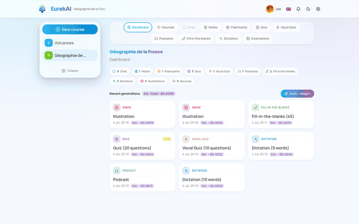

<p align="center">
  
</p>

<h1 align="center">EurekAI</h1>

<p align="center">
  <strong>どんなコンテンツも、対話的な学習体験に変える — <a href="https://mistral.ai">Mistral AI</a> が支えます。</strong>
</p>

<p align="center">
  <a href="README-en.md">🇬🇧 英語</a> · <a href="README-es.md">🇪🇸 スペイン語</a> · <a href="README-pt.md">🇧🇷 ポルトガル語</a> · <a href="README-de.md">🇩🇪 ドイツ語</a> · <a href="README-it.md">🇮🇹 イタリア語</a> · <a href="README-nl.md">🇳🇱 オランダ語</a> · <a href="README-ar.md">🇸🇦 アラビア語</a><br>
  <a href="README-hi.md">🇮🇳 ヒンディー語</a> · <a href="README-zh.md">🇨🇳 中国語</a> · <a href="README-ja.md">🇯🇵 日本語</a> · <a href="README-ko.md">🇰🇷 韓国語</a> · <a href="README-pl.md">🇵🇱 ポーランド語</a> · <a href="README-ro.md">🇷🇴 ルーマニア語</a> · <a href="README-sv.md">🇸🇪 スウェーデン語</a>
</p>

<p align="center">
  <a href="https://www.youtube.com/watch?v=_b1TQz2leoI"></a>
</p>

<h4 align="center">📊 コード品質</h4>

<p align="center">
  <a href="https://sonarcloud.io/summary/new_code?id=jls42_EurekAI"></a>
  <a href="https://sonarcloud.io/summary/new_code?id=jls42_EurekAI"></a>
  <a href="https://sonarcloud.io/summary/new_code?id=jls42_EurekAI"></a>
  <a href="https://sonarcloud.io/summary/new_code?id=jls42_EurekAI"></a>
</p>
<p align="center">
  <a href="https://sonarcloud.io/summary/new_code?id=jls42_EurekAI"></a>
  <a href="https://sonarcloud.io/summary/new_code?id=jls42_EurekAI"></a>
  <a href="https://sonarcloud.io/summary/new_code?id=jls42_EurekAI"></a>
  <a href="https://sonarcloud.io/summary/new_code?id=jls42_EurekAI"></a>
</p>
<p align="center">
  <a href="https://app.codacy.com/gh/jls42/EurekAI/dashboard?utm_source=gh&utm_medium=referral&utm_content=&utm_campaign=Badge_grade"></a>
  <a href="https://www.codefactor.io/repository/github/jls42/eurekai"></a>
</p>

---

## 誕生の背景 — なぜ EurekAI なのか？

**EurekAI** は、[Mistral AI Worldwide Hackathon](https://luma.com/mistralhack-online)（[公式サイト](https://worldwide-hackathon.mistral.ai/)）（2026年3月）で誕生しました。テーマを探していた私にアイデアを与えたのは、とても身近な経験でした。普段から娘と一緒にテスト勉強をしていて、AI を使えば、もっと楽しく対話的にできるはずだと考えたのです。

目標は、授業の写真、コピー＆ペーストした文章、音声録音、ウェブ検索など、**どんな入力でも**、**復習シート、フラッシュカード、クイズ、ポッドキャスト、穴埋め問題、イラストなど**に変えることです。すべてをフランス企業 Mistral AI のモデルで実現しているため、EurekAI はフランス語圏の生徒に自然に適したソリューションとなっています。

[初期プロトタイプ](https://github.com/jls42/worldwide-hackathon.mistral.ai)は、ハッカソンの48時間で Mistral のサービスを使った概念実証として開発しました。すでに動作していましたが、機能は限られていました。それ以来、EurekAI は本格的なプロジェクトへと成長しました。穴埋め問題、演習内の移動、ウェブスクレイピング、設定可能な保護者向けモデレーション、詳細なコードレビューなど、多くの機能を備えています。コードはすべて AI が生成しており、主に [Claude Code](https://code.claude.com/) を使用し、一部では [Codex](https://openai.com/codex/) と [Gemini CLI](https://geminicli.com/) も活用しています。

---

## 概要

<p align="center">
  
</p>

| | |
|---|---|
| <br>**ダッシュボード** — 最近の生成結果、カードごとの推定費用とプロジェクトの合計費用、「自動 — 魔法！」ボタン | <br>**資料** — 写真/PDF/テキスト/音声/ウェブの取り込み、ワンクリック生成、学習指示の検出 |

取り込んだ各資料には、[OCR 信頼度スコア、モデレーション結果、推定費用](docs/screenshots/sources-list.webp)が表示されます。

### 各機能の動作例

| | |
|---|---|
| <br>**復習シート** — 要点、語彙、出典付きの引用、セクションごとの音声読み上げ | <br>**多肢選択クイズ** — 各問題の正解は1つ、解説付きの即時フィードバック、段階的な操作 |
| <br>**フラッシュカード** — カードを裏返して「知っていた / 知らなかった」で自己評価 | <br>**穴埋め問題** — 必要に応じてヒントを表示、多少の違いを許容する判定 |
| <br>**書き取り** — 音声で読み上げられた単語を入力し、文字ごとに厳密に採点 | <br>**音声クイズ** — 問題を音声で読み上げ、マイクで回答 |
| <br>**ポッドキャスト** — 2人の声による短いポッドキャスト、会話形式の台本も閲覧可能 | <br>**イラスト** — エージェントが生成する学習用画像 |
| <br>**AI チューター** — 授業資料に基づくチャット、解説付きの回答、クイズやフラッシュカードの生成も可能 | |

### はじめに

| | |
|---|---|
| <br>**プロフィールの選択** — 子どもごとに専用のスペース、アバター、言語を設定 | <br>**プロフィールの作成** — 年齢、アバター、15歳未満向けの保護者用 PIN |
| <br>**コースの作成** — 授業ごとにプロジェクトを作成し、資料を追加 | <br>**設定** — API の状態、料金表示付きの AI モデル選択 |

---

## 機能

| | 機能 | 説明 |
|---|---|---|
| 📷 | **ファイルの取り込み** | 授業資料を取り込み — 写真、PDF（Mistral OCR を使用し、平均信頼度スコアと `high`/`medium`/`low` の段階評価を表示）、またはテキストファイル（TXT、MD）。アップロードセッションでは、ファイルごとの再試行と個別の進捗表示に対応 |
| 📝 | **テキスト入力** | 任意のテキストを直接入力または貼り付け |
| 🎤 | **音声入力** | 音声を録音 — Voxtral STT が文字起こし |
| 🌐 | **ウェブ / URL** | URL を貼り付け（Readability + Lightpanda による直接スクレイピング）、または検索語を入力（Mistral エージェントの web_search） |
| 📄 | **復習シート** | 要点、語彙、引用、豆知識を含む構造化されたノート |
| 🃏 | **フラッシュカード** | 対話式の質問・回答カード、会話形式の音声読み上げ |
| ❓ | **多肢選択クイズ** | 正解が1つの4択問題、間違いに応じた適応型復習付き（問題数を設定可能） |
| ✏️ | **穴埋め問題** | ヒント付きの穴埋め演習、多少の違いを許容する判定 |
| 🔤 | **書き取り** | 取り込んだ単語リストを音声で読み上げ（Voxtral TTS）、キーボードで入力、綴りの規則を解説しながら文字ごとに厳密に採点 |
| 🎙️ | **ポッドキャスト** | 2人の声による短い音声ポッドキャスト — 標準の Mistral 音声、またはカスタム音声（保護者の声も！） |
| 🖼️ | **イラスト** | Mistral エージェントが生成する学習用画像 |
| 🗣️ | **音声クイズ** | 問題の音声読み上げ（カスタム音声も使用可能）、口頭での回答、AI による確認 |
| 💬 | **AI チューター** | 授業資料を踏まえたチャット、ツール呼び出しに対応 |
| 🧠 | **自動ルーター** | `mistral-small-latest` に基づくルーターが内容を分析し、利用可能な8種類から生成機能の組み合わせを提案 |
| 🔁 | **コース間での処理継続** | 別のコースを開いても、取り込み、自動生成、マイク録音、チャット、ウェブ検索、読み上げは元のコースで継続。別のコースを表示中に完了した場合は、通知にコース名を表示 |
| 🔒 | **保護者による管理** | プロフィールごとに設定可能なモデレーション（カテゴリをカスタマイズ可能）、保護者用 PIN、チャットの制限 |
| 🌍 | **多言語対応** | インターフェースは9言語に対応。プロンプトで AI 生成の言語を15言語から指定可能 |
| 🔊 | **音声読み上げ** | Mistral Voxtral TTS で復習シートとフラッシュカード（質問・回答の会話）を読み上げ |
| 💶 | **API 費用の追跡** | 各生成と資料の費用を € で明確に推定（トークン / 文字 / ページ / 音声の秒数）。カードごとのバッジとプロジェクトごとの合計をダッシュボードに表示 |
| 🎨 | **プロフィールごとのテーマ** | 各プロフィールで `dark` または `light` のテーマを選択 — プロフィールに保存され、プロフィールを切り替えるたびに再適用 |

---

## アーキテクチャの概要

<p align="center">
  
</p>

---

## モデルの用途マップ

<p align="center">
  
</p>

---

## ユーザーの利用の流れ

<p align="center">
  
</p>

---

## 詳しく見る — 機能

### マルチモーダル入力

EurekAI は4種類の資料に対応し、プロフィールに応じてモデレーションを行います（子どもと10代のプロフィールでは、標準でモデレーションが有効です）。

- **ファイルの取り込み** — JPG、PNG、PDF ファイルを Mistral OCR で処理します。標準では **OCR 4.1**（`mistral-ocr-4-1`）を使用し、設定で **OCR 3**（`mistral-ocr-2512`）も選択できます（料金は約½で、手書き文字の読み取りに優れています）。印刷文字、表、手書き文字に対応し、テキストファイル（TXT、MD）は直接取り込めます。複数ファイルのアップロードには**アップロードセッション**を使用し、ファイルごとの進捗表示、ほかのファイルを再送せずに失敗したファイルだけを再試行する機能、完了したセッションを閉じる機能を備えています。OCR は平均**信頼度スコア**（`average`、`[0,1]` の範囲に制限、Mistral が返す `averagePageConfidenceScore` から算出）を提供し、画面に `high` / `medium` / `low` の段階別バッジで表示します（しきい値は約0.9 / 約0.7）。スキャン品質が低い場合も処理を止めずに警告します。OCR のために Mistral に送信した文書のコピーは、処理が失敗した場合も含め、処理終了時に削除されます。
- **自由入力テキスト** — 任意の内容を入力または貼り付けできます。モデレーションが有効な場合は、保存前にチェックします。
- **音声入力** — ブラウザーで音声を録音します。標準では **Voxtral Mini Transcribe 2**（`voxtral-mini-2602`）で文字起こしし、設定で **Voxtral Mini Transcribe 3** と **Voxtral Small Transcribe 3**（Mistral プレビュー版）も選択できます。認識精度を高めるため、インターフェースの言語をモデルに渡します（`language`）。
- **ウェブ / URL** — 1つ以上の URL を貼り付けて内容を直接スクレイピングするか（Readability + JavaScript ページ向けの Lightpanda）、キーワードを入力して Mistral エージェントでウェブ検索します。1つの入力欄が両方に対応し、URL とキーワードを自動的に分離して、結果ごとに独立した資料を作成します。

### AI によるコンテンツ生成

8種類の学習教材を生成します。

| 生成機能 | モデル | 出力 |
|---|---|---|
| **復習シート** | `mistral-large-2512` | タイトル、要約、要点、語彙、引用、豆知識 |
| **フラッシュカード** | `mistral-large-2512` | 出典への参照付きの質問・回答カード（枚数を設定可能） |
| **多肢選択クイズ** | `mistral-large-2512` | 正解が1つの4択問題、解説、適応型復習（問題数を設定可能） |
| **穴埋め問題** | `mistral-large-2512` | ヒント付きの穴埋め文、多少の違いを許容する判定（レーベンシュタイン距離） |
| **書き取り** | `mistral-large-2512` + Voxtral TTS | 重要単語を音声で読み上げ（1 MP3/単語）→ キーボードで入力 → 規則の解説付きで厳密に採点（アクセント記号の付け忘れも誤りとして扱う） |
| **ポッドキャスト** | `mistral-large-2512` + Voxtral TTS | 2人の声による台本 → MP3 音声 |
| **イラスト** | エージェント `mistral-large-2512` | `image_generation` ツールによる学習用画像 |
| **音声クイズ** | `mistral-large-2512` + Voxtral TTS + STT | TTS による問題読み上げ → STT による回答認識 → AI による確認 |

### チャット型 AI チューター

授業資料全体にアクセスできる対話型チューターです。

- `mistral-large-2512` を使用
- **ツール呼び出し**：会話中に復習シート、フラッシュカード、クイズ、穴埋め問題を生成可能
- コースごとに50件のメッセージ履歴を保持
- プロフィールでモデレーションが有効な場合：メッセージをチェックし、問題が報告された資料、チェックに失敗した資料、未チェックの資料をコンテキストとツールの対象から除外します（チェックに失敗した資料と未チェックの資料は、まず最大5 s の再チェックを行います）

### 自動ルーター

ルーターは `mistral-small-latest` を使って資料の内容を分析し、利用可能な8種類から最適な生成機能を提案します。画面には進捗がリアルタイムで表示され、まず分析段階、その後に個々の生成処理が続き、途中でキャンセルもできます。

自動生成はサーバー上で動作します。ページを再読み込みした場合、別のコースを開いた場合、プロフィールを切り替えた場合も継続し、各コースで同時に実行される自動生成は1つだけです（2つ目のタブは実行中の処理に接続します）。サーバーは Mistral キーごとに最大3件の生成を同時に実行します。生成が1件完了するたびにメッセージを表示し、最後に結果のまとめを1回だけ表示します。別のコースを表示中に完了した場合は、メッセージにコース名が表示されます。個別にキャンセルした生成は、結果のまとめで失敗として数えません。「すべてキャンセル」はそのコースの処理全体を停止し、メッセージを1件だけ表示します。自動生成中にサーバーが再起動した場合は、中断されたことを示し、「再開」ボタンを表示します。このボタンは分析をやり直さず、未完了の生成だけを再実行します。

タブから開始した時間のかかる生成処理（個別に開始した生成、復習シート）は、最大3件まで同時に実行します。それ以降の処理は順番を待ち、コースは実行中の生成の完了を待たずに開きます。

### 適応型学習

- **クイズの統計**：問題ごとの回答履歴と正答率を追跡
- **クイズの復習**：元のクイズの資料に基づき、苦手な概念に焦点を当てた新しい問題を5-10問生成します（モデレーションのチェックも同じ資料を対象にします）
- **学習指示の検出**：復習の指示（「次のことができれば、この授業を理解できている……」など）を検出し、対応するテキスト生成機能（復習シート、フラッシュカード、クイズ、穴埋め問題）で優先します。モデレーションが有効な場合、検出は資料のチェック完了を待ち、安全と判断された資料だけを読み取ります。指示には元の資料の一覧を保持します。そのうち1つでも問題が報告されると、指示は表示も適用もされなくなり、1つでも削除されると指示も削除されます。この処理の費用も計上されます
### 安全性とペアレンタルコントロール

- **4つの年齢層**：子ども（≤10歳）、青少年（11-15）、学生（16-25）、成人（26+）
- **コンテンツのモデレーション**：`mistral-moderation-2603`（Mistral Moderation 2）では11のカテゴリーを利用でき、新しい子ども／青少年のプロフィールでは6つを既定でブロック（`sexual`、`hate_and_discrimination`、`violence_and_threats`、`criminal`、`selfharm`、`jailbreaking`。`criminal`は、歴史を含む50レッスンでの測定で誤検知が一度もなかったことを確認して追加）。カテゴリーは設定でプロフィールごとにカスタマイズ可能。Moderation 2では従来の「危険なコンテンツ」カテゴリーが`dangerous` + `criminal`に分割された（既存のプロフィールは自動移行され、ブロック対象のカテゴリーはインポート済みのソースにも適用される）。既定の安全措置：モデルの応答からブロック対象のカテゴリーを確認できない場合、コンテンツは拒否される（「モデレーションを利用できません」）。モデレーションが有効な場合、生成とチャットの両方で、問題が報告されたソース、確認に失敗したソース、確認中のソースを除外する。一度も確認されていないソース（モデレーション無効時にインポートされたもの、またはプロフィールに紐づけられた旧プロジェクトのもの）は使用前に確認される。再起動で中断されたモデレーションは、サーバーのキーで実行可能なら起動時に再開される。それ以外の場合は、エラーになったモデレーションと同様に、プロジェクトを開いたとき、または次回の生成時に再開される。「再確認」ボタンで必要に応じて確認を再実行できる。モデレーションが有効な場合、ソースが安全と判断されるまで、その内容（プレビュー、テキスト、元の文書）は子どもに表示されない。保護者はPINを入力すると、1回限り閲覧できる。音声クイズの口頭回答は、正誤判定の前にモデレーションされる。日付付きIDを`helpers/moderation-model.ts`に固定：非推奨のエイリアス`-latest`は、APIの一覧に表示されなくなった。
- **保護者用PIN**：SHA-256ハッシュ。15歳未満のプロフィールでは必須。誤ったコードの入力は、IPアドレスごとに15分間で最大10回（429 `rate_limited`）。本番環境へのデプロイでは、ソルト付きの低速ハッシュ（Argon2id、bcrypt）を用意する。
- **サーバーデータ**：`/output`で公開するのはプロジェクトのメディア（音声、画像、インポートしたファイル）のみ。`profiles.json`、`config.json`、`projects.json`、`project.json`は一切配信しない
- **チャットの制限**：16歳未満ではAIチャットが既定で無効。保護者が有効にできる

### マルチプロフィールシステム

- 名前、年齢、アバター、言語設定を持つ複数のプロフィール
- **プロフィールごとの音声**（`Profile.mistralVoices?: { host?, guest? }` — 各役割は任意）— 子どもごとにポッドキャスト／音声クイズ用の音声の組み合わせを設定できる
- **プロフィールごとのテーマ**（`Profile.theme: 'dark' | 'light'`）— プロフィールの変更時に自動で切り替わり、バックエンドに保存される
- `profileId`でプロジェクトをプロフィールに紐づける。プロフィールのない旧プロジェクトは、最初に開いたプロフィールに紐づけられ、そのプロフィールに従ってモデレーションされる
- 連鎖削除：プロフィールを削除すると、そのプロフィールのプロジェクトがすべて削除される

### APIコストの追跡

課金対象のMistral呼び出し（チャット、OCR、STT、TTS、エージェント）は、指示の検出と音声クイズの口頭回答も含め、ユーザーに**透明性のある**€単位の見積もりを提供するために計測される。無料のモデレーションは集計しない。エージェントのツール料金も含まれる：ウェブ検索1回あたり0,03 $、画像生成1枚あたり0,10 $（Mistralの料金）。さらに、これらのツールが生成するトークンは、エージェントのモデルの入力料金で見積もりに加算する。

- **正とする情報源**：`helpers/pricing.ts` — モデルのプレフィックスごとの`MODEL_PRICING`（例：`mistral-large` → 入力0.5 €/Mトークン、出力1.5 €/Mトークン）、定期的な再スクレイピング用のMistralドキュメントURLを含む`PRICING_SOURCES`
- **対応する単位**：`tokens`、`characters`（TTS）、`pages`（OCR）、`audio-seconds`（STT）— `helpers/cost-calc.ts`で換算を制御
- **計測の処理経路**：`helpers/tracked-client.ts`（Mistralクライアントをラップ）→ `helpers/usage-context.ts`（AsyncLocalStorage）→ `helpers/cost-calc.ts` → `helpers/cost-persist.ts` → `helpers/cost-middleware.ts`（HTTPレスポンスに挿入）
- **ユーザーインターフェース**：生成ごと（`src/partials/cost-badge-gen.html`）、ソースごと（`cost-badge-src.html`）のコストバッジ、ダッシュボードの累計（`Project.totalCost`）
- **エンドポイント**：`/generate/*`と`/sources/*`のレスポンスは、返却するオブジェクト（`Generation` / `Source`）に`estimatedCost`、`usage`、`costBreakdown`を付加する。`POST /generate/route`はルーティングのみのコストを示す`costDelta: number`フィールドを追加する。`POST /detect-consigne`（`{consigne, costDelta}`）と口頭回答の正誤判定も、それぞれの`costDelta`を返す。`GET /projects/:pid`は、`totalCost`（`costLog[]`から計算した合計）を付加したプロジェクトと完全な履歴を返す

### TTS（Mistral Voxtral）とカスタム音声

- **Mistral Voxtral TTS**：既定は**Voxtral TTS**（`voxtral-mini-tts-2603`）。**Voxtral TTS 3**（`voxtral-mini-tts-3-0`、Mistralのプレビュー版、より多くの言語でネイティブ音声に対応）を設定から選択可能。音声合成は100% Mistralで、追加のキーは不要。選択したモデルが受け付ける音声のみ表示する：Voxtral TTSはVoxtral 3で追加された音声を受け付けない
- **カスタム音声**：保護者はMistral Voices APIで音声サンプルから独自の音声を作成し、ホスト／ゲストの役割に割り当てられる。ポッドキャストと音声クイズが保護者の声で読み上げられ、子どもがより没入できる体験になる
- 設定可能な2つの音声の役割：**ホスト**（メインナレーター）と**ゲスト**（ポッドキャストの2人目の声）
- 設定でMistral音声の全カタログを利用でき、言語で絞り込み可能
- 再生（学習シート、ポッドキャスト、書き取りの単語）は、その画面を離れると一時停止し、停止した位置から再開する
- フラッシュカードの読み上げ音声は、初回再生時に作成して生成結果に保存する。再び開くたびに再作成や再課金はされない
- ソースのマーカー（`[Source N]`）は読み上げない

### 国際化

- インターフェースは9言語に対応：fr、en、es、pt、it、nl、de、hi、ar
- AIプロンプトは15言語に対応（fr、en、es、de、it、pt、nl、ja、zh、ko、ar、hi、pl、ro、sv）
- プロフィールごとに言語を設定可能

---

## 技術スタック

| レイヤー | 技術 | 役割 |
|---|---|---|
| **ランタイム** | Node.js + TypeScript 6.x | サーバーと型安全性 |
| **バックエンド** | Express 5.x | REST API |
| **開発サーバー** | Vite 8.x (Rolldown) + tsx | HMR、Handlebarsのパーシャル、プロキシ |
| **フロントエンド** | HTML + TailwindCSS 4.x + Alpine.js 3.x | リアクティブなインターフェース、ViteでコンパイルするTypeScript |
| **テンプレート処理** | vite-plugin-handlebars | パーシャルによるHTMLの構成 |
| **AI** | Mistral AI SDK | チャット、OCR、STT、TTS、エージェント、モデレーション |
| **TTS** | Mistral Voxtral TTS | `voxtral-mini-tts-2603`（Voxtral TTS 3はオプション）、音声合成を内蔵 |
| **アイコン** | Lucide 1.x | SVGアイコンライブラリ |
| **ウェブスクレイピング** | Readability + linkedom | ウェブページの主要コンテンツの抽出（Firefox Reader Viewの技術） |
| **ヘッドレスブラウザー** | Lightpanda | JS/SPAページ向けの超軽量ヘッドレスブラウザー（Zig + V8）— スクレイピングのフォールバック |
| **Markdown** | Marked | チャット内のMarkdownレンダリング |
| **ファイルアップロード** | Multer 2.x | マルチパートフォームの管理 |
| **音声** | ffmpeg-static | 音声セグメントの連結 |
| **テスト** | Vitest | 単体テスト — SonarCloudでカバレッジを測定 |
| **永続化** | JSONファイル | 依存関係のないストレージ |

---

## モデルリファレンス

| モデル | 用途 | 採用理由 |
|---|---|---|
| `mistral-large-2512`（Large 3、固定した既定モデル） | 学習シート、フラッシュカード、ポッドキャスト、クイズ、穴埋め問題、チャット、音声クイズの正誤判定、画像エージェント、ウェブ検索エージェント、指示の検出 | 多言語対応と指示への追従性が最良。エイリアス`mistral-large-latest`は2026年11月からLarge 4を提供しており、こちらの生成には遅すぎるため固定（Large 3は30/04/2027に提供終了予定） |
| `mistral-ocr-4-1`（OCR 4.1、既定） | 文書のOCR | 印刷文字、表、手書き文字（$4 / 1000ページ） |
| `mistral-ocr-2512`（OCR 3、オプション） | 文書のOCR | 設定で選択可能。低コスト（$2 / 1000ページ）で、手書き文字の読み取りに優れる |
| `voxtral-mini-2602`（Voxtral Mini Transcribe 2、既定） | 音声認識（STT） | 音声入力と音声クイズの口頭回答（$0.003 / min） |
| `voxtral-mini-transcribe-3-0` / `voxtral-small-transcribe-3-0`（Transcribe 3、オプション、プレビュー版） | 音声認識（STT） | 設定で選択可能（$0.0035 / minおよび$0.004 / min） |
| `voxtral-mini-tts-2603`（Voxtral TTS、既定） | 音声合成（TTS） | ポッドキャスト、音声クイズ、書き取り、読み上げ（$16 / M文字） |
| `voxtral-mini-tts-3-0`（Voxtral TTS 3、オプション、プレビュー版） | 音声合成（TTS） | 設定で選択可能。より多くの言語でネイティブ音声に対応（$13 / M文字） |
| `mistral-moderation-2603` | コンテンツのモデレーション | 子ども／青少年向けに6つのカテゴリーをブロック（`jailbreaking`を含む） |
| `mistral-small-latest` | 自動ルーター | ルーティングを判断するためのコンテンツの高速分析 |

スマートフォンでは、閉じたメニューで切れていた選択中モデルの完全なラベル（料金、「推奨」または「プレビュー版」）を、設定の各セレクターの下に表示する。

---

## クイックスタート

```bash
# Cloner le dépôt
git clone https://github.com/jls42/EurekAI.git
cd EurekAI

# Installer les dépendances
npm install

# Configurer les clés API
cp .env.example .env
# Éditez .env (toutes optionnelles) :
#   MISTRAL_API_KEY=<your_api_key>           (optionnel — sinon chaque utilisateur saisit sa clé dans l'app)
#   SONAR_TOKEN=...                          (optionnel, CI SonarCloud uniquement)

# Lancer le développement
npm run dev
# → Backend :  http://localhost:3000 (API)
# → Frontend : http://localhost:5173 (serveur Vite avec HMR)
```

> **注**：TTSプロバイダーはMistral Voxtral TTSのみ。`MISTRAL_API_KEY`以外に追加のキーは不要。

> **ユーザーが入力するAPIキー**：`MISTRAL_API_KEY`は**任意**になった。未設定でもアプリは起動し、各ユーザーにインターフェースで**自分のMistralキー**を入力するよう促す。キーは**ブラウザーに保存**され（セキュアコンテキストでWeb Crypto + IndexedDBにより暗号化）、リクエストごとに送信される。**サーバーには一切永続保存されない**。優先順位：プロフィールのキー > ブラウザーのグローバルキー > `MISTRAL_API_KEY`（環境変数）。`EUREKAI_REQUIRE_USER_KEY=true`を設定すると、各ユーザーにキーの入力を必須にできる（環境変数のキーは事前読み込みのみに使用される）。

> **ローカルHTTPS（タブレット／LAN）**：`localhost`はすでにセキュアコンテキストである。LAN経由（タブレット）でアクセスするには、ローカル証明書を生成してHTTPSを有効にする。これにより、ブラウザーは保存するキーを暗号化でき、キーは転送中も暗号化される：
> ```bash
> ./scripts/gen-cert.sh 192.168.1.42   # mkcert si dispo, sinon openssl self-signed
> export HTTPS_KEY=certs/key.pem HTTPS_CERT=certs/cert.pem
> npm run dev                          # Express + Vite en HTTPS
> ```

### 環境変数

| 変数 | 必須 | 既定値 | 役割 |
|---|---|---|---|
| `MISTRAL_API_KEY` | 任意 | — | Mistral APIキー（チャット、OCR、STT、Voxtral TTS、エージェント、モデレーション）。未設定の場合、ユーザーがアプリでキーを入力する（ブラウザーに保存し、サーバーには保存しない） |
| `EUREKAI_REQUIRE_USER_KEY` | 任意 | `false` | `true` → AIリクエストで`MISTRAL_API_KEY`へのフォールバックを無効にする（各ユーザーが必ず自分のキーを入力する必要がある）。外部公開するインスタンスで有用 |
| `HTTPS_KEY` / `HTTPS_CERT` | 任意 | — | TLSキー／証明書のパス（`scripts/gen-cert.sh`を参照）→ ExpressとViteがHTTPSで配信する（LAN／タブレットでのセキュアコンテキスト） |
| `PORT` | 任意 | `3000` | ExpressバックエンドのHTTPポート |
| `NODE_ENV` | 任意 | `development` | `production`の場合 → Expressが`dist/`からフロントエンドを配信（それ以外は`public/`） |
| `SONAR_TOKEN` | CIでは任意 | — | GitHub ActionsのSonarCloudワークフローでのみ使用 |

### テスト、コード品質、コントリビューション

```bash
npm test                # vitest (déclenche pretest : typecheck + lint:complexity + lint:ci + lint:deadcode)
npm run test:coverage   # couverture vitest
npm run lint            # ESLint + typescript-eslint + sonarjs
npm run lint:fix        # auto-fix
npm run format          # prettier
npm run security        # Opengrep (SAST local) — bloque sur finding ERROR
```

**Gitフック（Husky）**：`pre-commit`は`scripts/pre-commit-fast.sh`（競合、大容量ファイル、shellcheck）、`lint-staged`、`npm test`を順に実行する。`pre-push`は、まずブロッキングチェック`npm audit`（間接依存も含め、依存関係に`critical`レベルの脆弱性があればブロック。`scripts/audit-verdict.mjs`を参照）を実行し、続いて`npm run security`を実行する。各フックは、いずれかのステップが失敗するとコミット／プッシュをブロックする。

**外部ツール（アプリケーションの起動には任意、`pretest`と`npm run security`には必須）**：

```bash
# Lizard (Python) pour lint:complexity (CCN > 8 sur l'allowlist)
pipx install lizard          # ou : pipx run lizard

# Opengrep (binaire standalone ~40 Mo) pour npm run security
./scripts/install-opengrep.sh   # installe dans ~/.local/bin/
```

これらのツールがない場合、`npm test`は`pretest`で失敗し（lizardが未導入）、`npm run security`も失敗する（opengrepが未導入）。そのため、huskyフックがコミット／プッシュをブロックする。

---

## コンテナーでのデプロイ

イメージは**GitHub Container Registry**で公開されている：

```bash
# Télécharger l'image
podman pull ghcr.io/jls42/eurekai:latest

# Lancer EurekAI
mkdir -p ./data
podman run -d --name eurekai \
  -e MISTRAL_API_KEY=<your_api_key> \
  -v ./data:/app/output:U \
  -p 3000:3000 \
  ghcr.io/jls42/eurekai:latest
# → http://localhost:3000
```

> **`:U`**：ボリュームの権限を自動調整するルートレスPodmanのフラグ。

```bash
# Build local
podman build -t eurekai -f Containerfile .

# Publier sur ghcr.io (mainteneurs)
./scripts/publish-ghcr.sh
```

---

## プロジェクト構成

```
server.ts                 — Point d'entrée Express, monte les routes + config
config.ts                 — Config runtime (modèles, voix, modèle TTS), persistée dans output/config.json
store.ts                  — ProjectStore : CRUD projets/sources/générations, persistance JSON
profiles.ts               — ProfileStore : gestion des profils, hachage PIN
types.ts                  — Types TypeScript : Source, Generation (8 types), QuizStats, Profile
prompts.ts                — Tous les prompts IA centralisés (system + user templates, 15 langues)

generators/
  auto-agents.ts          — Source unique de vérité : AUTO_AGENTS_SET (8 agents) + MAX_AUTO_PLAN_LENGTH
  generation-types.ts     — Types générables individuellement (SINGLE_GENERATE_TYPES, coïncide avec les 8 agents auto)
  ocr.ts                  — OCR via Mistral (JPG, PNG, PDF) avec extraction interne des scores de confiance moyens par page
  summary.ts              — Génération de fiche de révision (JSON structuré)
  flashcards.ts           — Flashcards Q/R (nombre configurable)
  quiz.ts                 — Quiz QCM (nombre configurable) + révision adaptative
  fill-blank.ts           — Exercices à trous avec validation tolérante
  dictation.ts            — Dictée : mots + phrases-exemples + règles, 1 audio TTS par mot (8e agent auto)
  podcast.ts              — Script podcast 2 voix
  quiz-vocal.ts           — Quiz vocal : questions TTS + réponses STT + vérification IA
  image.ts                — Génération d'image via Agent Mistral (outil image_generation)
  chat.ts                 — Tuteur IA par chat avec appel d'outils
  router.ts               — Routeur automatique (contenu → générateurs recommandés)
  consigne.ts             — Détection de consignes de révision
  tts-provider.ts         — TTS Mistral Voxtral (synthèse vocale + listing des voix)
  tts.ts                  — Génération audio multi-voix (podcast + flashcards, concaténation de segments)
  stt.ts                  — Voxtral STT (audio → texte)
  websearch.ts            — Agent Mistral avec outil web_search (fallback)
  moderation.ts           — Modération de contenu (filtrage par âge)

routes/
  projects.ts             — CRUD projets
  profiles.ts             — CRUD profils avec gestion du PIN
  sources.ts              — Import fichiers (OCR + texte brut), texte libre, voix STT, scraping URL + recherche web, modération
  generate.ts             — Endpoints de génération (8 types + route)
  auto-runs.ts            — Lots Auto côté serveur : lancement, analyse et étapes en arrière-plan, état, annulation
  generations.ts          — Tentatives de quiz/fill-blank, réponses vocales, lecture à voix haute
  chat.ts                 — Chat IA avec appel d'outils

helpers/
  # IO & parsing
  index.ts                — getContent, stripJsonMarkdown, safeParseJson, tryParseJson, retryTurns, unwrapJsonArray, extractAllText, timer
  audio.ts                — collectStream (ReadableStream → Buffer)
  audio-files.ts          — Persistance et lecture des fichiers audio générés (podcast, flashcards)
  generation-media.ts     — Noms uniques des médias (MP3/PNG) et suppression avec leur génération
  media-ledger.ts         — Médias écrits pendant une génération, supprimés si elle échoue ou est annulée
  keyed-lock.ts           — File d'attente par clé (OCR sérialisé par contenu)
  keyed-slots.ts          — Places par clé (au plus 3 étapes d'Auto en même temps par clé Mistral)
  logger.ts               — Logger structuré (niveaux, contexte JSON)

  # Génération & UX
  auto-title.ts           — autoTitle(type, data, lang) : préfixe auto pour carte liste (Fiche, Note, Quiz, etc.)
  choice-labels.ts        — Labels localisés des choix (quiz, quiz-vocal) — 9 langues
  diversity.ts            — Diversité des générations (exclusion du contenu déjà produit, `diversityParams` : temperature/presencePenalty/randomSeed)
  fill-blank-validate.ts  — Validation tolérante des réponses (normalisation, Levenshtein)
  dictation-diff.ts       — Comparaison stricte lettre à lettre pour la correction de dictée (local, zéro coût IA)
  reading-comfort.ts      — Option « Confort de lecture » par profil (police Luciole, espacements) — partagé serveur/client
  ocr-models.ts           — Source de vérité sélection OCR (OCR 4 défaut / OCR 3 option) + normalizeOcrModel
  moderation-model.ts     — Modèle de modération épinglé + ses 11 catégories + migration des catégories legacy
  stt-models.ts           — Source de vérité sélection transcription (Mini Transcribe 2 défaut / Transcribe 3 option) + normalizeSttModel
  tts-models.ts           — Source de vérité sélection synthèse vocale (Voxtral TTS défaut / TTS 3 option) + compatibilité des voix
  tts-text.ts             — Texte envoyé au TTS : marqueurs de sources et crochets retirés (Voxtral les lit ou avale le mot)
  source-markers.ts       — Regex des marqueurs `[Source N]` des fiches (pastilles côté navigateur, texte lu côté serveur)
  moderation-http.ts      — Statut de modération → réponse HTTP (400 signalé / 503 indisponible / 409 en cours), statut effectif, garde de la consigne
  moderation-profile.ts   — Profil propriétaire du projet et catégories actives (source unique des routes)
  source-moderation.ts    — Modérations en vol et reprise (démarrage, génération, chat, « Revérifier »)
  input-moderation.ts     — Modération d'un texte saisi ou dicté (texte libre, recherche web, réponse orale)
  chat-sources.ts         — Sources accessibles au chat (sans les sources non vérifiées si la modération est active)

  # Codes d'erreur stables
  error-codes.ts              — Re-export mince de l'API publique
  error-code-resolution.ts    — Orchestration extractErrorCode(e, agent) → FailedStepCode
  error-code-rules.ts         — Règles de mapping par agent/step
  error-matchers.ts           — Matchers par pattern d'erreur HTTP/LLM (délimités pour Lizard)

  # Cost tracking API (suivi coûts €)
  pricing.ts              — MODEL_PRICING + PRICING_SOURCES (tarifs Mistral par prefix de modèle)
  cost-calc.ts            — Conversion ApiUsage → coût € (tokens / characters / pages / audio-seconds)
  cost-persist.ts         — Écriture dans Project.costLog + totalCost
  cost-middleware.ts      — Injection de costDelta dans la réponse HTTP
  tracked-client.ts       — Wrap du client Mistral (capture ApiUsage automatiquement)
  usage-context.ts        — AsyncLocalStorage pour propager l'usage dans les pipelines async

  # Clé API Mistral & sécurité
  mistral-client-factory.ts — Source UNIQUE de construction du client Mistral (buildTrackedClient, resolveClient, requireKeyMiddleware)
  rate-limit.ts           — Rate-limiters Express (authLimiter, pinLimiter, aiLimiter / aiPathLimiter, generalLimiter), 429 `rate_limited`
  request-validation.ts   — Validation de lang / ageGroup sur toutes les routes IA (400 invalid_input)
  output-static.ts        — Liste blanche du montage statique /output (médias des projets seulement)
  security-headers.ts     — Options Helmet / CSP (createHelmetOptions)
  redact.ts               — Redaction des secrets dans les logs (clé API, headers sensibles)
  mistral-retry.ts        — Retry avec backoff sur erreurs transitoires Mistral (3 tentatives)

  # Événements & notifications (SSE)
  event-bus.ts            — Bus d'événements de génération et de lots Auto en mémoire (dispatch SSE, filet anti-uncaughtException)
  auto-run-state.ts       — Transitions d'un lot Auto (fonctions pures, appliquées par le store)
  event-key.ts            — Clé d'événement typée partagée client/serveur (idempotence notifications)

  # Voix & profils
  voice-selection.ts      — selectVoices : rotation déterministe par profil + langue (host/guest)
  voice-types.ts          — Type MistralVoice (importable côté frontend sans embarquer le SDK Mistral)

src/                      — Frontend (Vite + Handlebars)
  index.html              — Point d'entrée HTML principal
  main.ts                 — Entrée frontend (init Alpine.js + icônes Lucide)
  app/                    — Modules applicatifs Alpine.js
    state.ts              — Gestion d'état réactif
    navigation.ts         — Routage des vues + gardes par âge
    view-media.ts         — Pause du son au changement de vue (position gardée)
    profiles.ts           — Logique du sélecteur de profils
    projects.ts           — CRUD des cours
    sources.ts            — Gestionnaires d'upload de sources
    generate.ts           — Déclencheurs de génération (individuel, tout, Auto)
    auto-launch.ts        — Lancement d'un Auto côté serveur, suivi pendant qu'un autre cours est affiché, annulation
    auto-runs.ts          — Auto suivis par l'onglet : état reçu du serveur, bilan affiché une seule fois, coût de l'analyse
    request-slots.ts      — Au plus 3 générations longues en même temps pour l'onglet, file d'attente FIFO
    moderation-gate.ts    — Pré-contrôle de modération des générations (vérifie d'abord les sources en attente)
    effective-moderation.ts — Statut de modération affiché et masquage du contenu des sources
    generations.ts        — Affichage + actions sur les générations
    chat.ts               — Interface de chat
    chat-in-flight.ts     — Messages du chat en attente de réponse, par cours
    config.ts             — Interface de configuration (modèles de chat, d'OCR, de transcription et de TTS, voix)
    render.ts             — Helpers de rendu HTML
    i18n.ts               — Changement de langue
    ...
  components/
    quiz.ts               — Composant quiz interactif
    quiz-vocal.ts         — Composant quiz vocal
    fill-blank.ts         — Composant textes à trous
    fill-blank-validate.ts — Ré-export client de la validation textes à trous (validateAnswer)
    flashcards.ts         — Composant flashcards avec retournement
    dictation.ts          — Composant dictée interactif
    step-by-step.ts       — Mixin navigation pas-à-pas (quiz, fill-blank, flashcards)
  i18n/
    fr.ts, en.ts, es.ts, — Dictionnaires par langue (9 langues)
    pt.ts, it.ts, nl.ts,
    de.ts, hi.ts, ar.ts
    languages.ts          — Registre des langues UI disponibles
    index.ts              — Chargeur i18n
  partials/               — Partials HTML Handlebars (header, sidebar, dialogues, vues)
  styles/
    main.css              — Entrée TailwindCSS
    theme.css             — Variables de thème personnalisées

public/assets/            — Ressources statiques (logo, avatars, schémas architecture)
docs/                     — Notes internes (inventaire prompts, audits, prompts des diagrammes) + screenshots du README
scripts/                  — Tooling : check-deps, check-models, check-security, check-complexity, gen-cert, install-opengrep, translate-readme, publish-ghcr, update-pricing
output/                   — Données d'exécution (projets, config, fichiers audio) ; en mode prod (`NODE_ENV=production`), Express sert le frontend depuis `dist/` au lieu de `public/`
```

> **コードに貢献するAIエージェント向け**：[`CLAUDE.md`](CLAUDE.md)（共通ルール、索引）と、読み取りまたは変更するファイルに応じて必要時に読み込まれる[`.claude/rules/`](.claude/rules/)の詳細ルールを参照すること。詳細なアーキテクチャの背景、必須ルール（エラーコード、コスト追跡、メタ的な語句を含めないプロンプト。つまり、モデルが出力にその語句を写してしまうため、文書の種類など、文書を形容する語句を含めないこと）、既知の注意点（Lizard CCN、Opengrep、Codacy/Semgrepの移行）が記載されている。

---

## APIリファレンス

### 設定
| メソッド | エンドポイント | 説明 |
|---|---|---|
| `GET` | `/api/config` | 現在の設定 |
| `PUT` | `/api/config` | 設定の変更（モデル、音声、TTSモデル） |
| `GET` | `/api/config/status` | APIの状態：`mistral`（Mistralキーが設定済み）、`ttsAvailable`（`mistral`のエイリアス。TTSプロバイダーはMistral Voxtralのみ） |
| `POST` | `/api/config/reset` | 設定を既定値にリセット |
| `GET` | `/api/config/voices` | Mistral TTSの音声一覧を取得（`?lang=fr`は任意） |
| `GET` | `/api/moderation-categories` | 利用可能なモデレーションカテゴリーと年齢別の既定値 |
| `POST` | `/api/providers/mistral/validate` | ユーザーが入力したMistralキーを検証 — 常に200 `{status}`（`ok`/`invalid`/`quota`/`network`/`missing`）、環境変数へのフォールバックなし |

### プロフィール
| メソッド | エンドポイント | 説明 |
|---|---|---|
| `GET` | `/api/profiles` | すべてのプロフィールの一覧を取得 |
| `POST` | `/api/profiles` | プロフィールを作成 |
| `PUT` | `/api/profiles/:id` | プロフィールを変更（15歳未満はPIN必須。15 minで誤ったPINを10回入力 → 429 `rate_limited`） |
| `DELETE` | `/api/profiles/:id` | プロフィールを削除し、プロジェクトも連鎖削除 `{pin?}` → `{ok, deletedProjects}` |

### プロジェクト
| メソッド | エンドポイント | 説明 |
|---|---|---|
| `GET` | `/api/projects` | プロジェクトの一覧を取得（`?profileId=`は任意） |
| `POST` | `/api/projects` | プロジェクトを作成 `{name, profileId}` |
| `GET` | `/api/projects/:pid` | プロジェクトの詳細。`?profileId=`はプロフィールのないプロジェクトを、それを開いたプロフィールに紐づける |
| `PUT` | `/api/projects/:pid` | 名前を変更 `{name}` |
| `DELETE` | `/api/projects/:pid` | プロジェクトを削除 |
| `GET` | `/api/projects/:pid/events` | 生成状態の遷移（`completed`/`failed`/`cancelled`）を配信するリアルタイムSSEストリーム（`event: generation`）と、接続維持用のハートビート |

### ソース
| メソッド | エンドポイント | 説明 |
|---|---|---|
| `POST` | `/api/projects/:pid/sources/upload` | マルチパートでファイルをインポート（JPG/PNG/PDFにはOCR、TXT/MDは直接読み取り） |
| `POST` | `/api/projects/:pid/sources/text` | 自由入力テキスト `{text}` |
| `POST` | `/api/projects/:pid/sources/voice` | STTによる音声入力（マルチパート音声） |
| `POST` | `/api/projects/:pid/sources/websearch` | URLのスクレイピングまたはウェブ検索 `{query}` — ソースの配列を返す。すべてのアドレスが拒否された場合（内部ネットワーク）は422 `url_blocked`、ソースを1つも作成できなかった場合は502 `all_sources_failed` |
| `POST` | `/api/projects/:pid/sources/moderate` | 保留中またはエラーになったモデレーションを再開 `{sourceIds?}`（1回の呼び出しにつき最大10件、待機時間 ≤ 10 s）→ `{sources: [{id, moderation}]}` |
| `DELETE` | `/api/projects/:pid/sources/:sid` | ソース、インポートしたファイル、そのソースに依存する指示を削除 → `{ok, consigne}` |
| `POST` | `/api/projects/:pid/moderate` | モデレーションを実行 `{text}` |
| `POST` | `/api/projects/:pid/detect-consigne` | 復習の指示を検出（確認済みのソースのみ）→ `{consigne, costDelta}` |
### 生成
| メソッド | エンドポイント | 説明 |
|---|---|---|
| `POST` | `/api/projects/:pid/generate/summary` | 復習シート |
| `POST` | `/api/projects/:pid/generate/flashcards` | フラッシュカード |
| `POST` | `/api/projects/:pid/generate/quiz` | 多肢選択クイズ（4択、正解は1つのみ） |
| `POST` | `/api/projects/:pid/generate/fill-blank` | 穴埋め問題 |
| `POST` | `/api/projects/:pid/generate/dictation` | ディクテーション（単語＋例文＋規則、単語ごとに1つのTTS音声。自動ルーターからも提案） |
| `POST` | `/api/projects/:pid/generate/podcast` | ポッドキャスト |
| `POST` | `/api/projects/:pid/generate/image` | イラスト |
| `POST` | `/api/projects/:pid/generate/quiz-vocal` | 音声クイズ |
| `POST` | `/api/projects/:pid/generate/quiz-review` | 適応型復習 `{generationId, weakQuestions}` |
| `POST` | `/api/projects/:pid/generate/remediation-summary` | クイズで間違えた問題に絞った復習シート `{generationId, weakQuestions}` — クイズ画面の補習ボタンから `quiz-review` と並列で呼び出される |
| `POST` | `/api/projects/:pid/generate/route` | ルーティング分析（実行する生成処理の計画）— `{plan, costDelta}`（ルーティングのみの費用）を返す |
| `POST` | `/api/projects/:pid/generate/auto/start` | サーバー側でAutoバッチを開始 `{runId, …}`：即座に202を返し、その後バックグラウンドで分析と各ステップを実行。Mistralキーごとに最大3ステップを同時実行。ページを再読み込みしてもバッチは継続。このコースでバッチがすでに実行中の場合は409 `auto_busy` |
| `POST` | `/api/projects/:pid/generate/auto/resume` | サーバーの再起動で中断されたAutoバッチを再開 `{runId}`：中断されたステップをこのリクエストのキーで再実行し、分析はやり直さない（応答は202） |
| `GET` | `/api/projects/:pid/auto-runs/:runId` | Autoバッチの状態：分析、各ステップとその結果 |
| `POST` | `/api/projects/:pid/auto-runs/:runId/cancel` | Autoバッチ全体をキャンセル（個別のステップは生成処理と同じ方法でキャンセル） |

すべての生成ルートは `{sourceIds?, lang?, ageGroup?, count?, useConsigne?}` を受け付ける。不明な `ageGroup`、または有効な言語コードではない `lang`（想定：`fr`、`pt-BR`…）の場合、AIを呼び出す前に400 `invalid_input` を返す。`quiz-review` と `remediation-summary` は追加で `{generationId, weakQuestions}` を必須とし、元のクイズのソースを対象とする。

### 生成データのCRUD
| メソッド | エンドポイント | 説明 |
|---|---|---|
| `POST` | `/api/projects/:pid/generations/:gid/quiz-attempt` | クイズの回答を送信 `{answers}` |
| `POST` | `/api/projects/:pid/generations/:gid/fill-blank-attempt` | 穴埋め問題の回答を送信 `{answers}` |
| `POST` | `/api/projects/:pid/generations/:gid/dictation-attempt` | ディクテーションの回答を送信 `{answers}`（サーバー側で厳密に採点） |
| `POST` | `/api/projects/:pid/generations/:gid/vocal-answer` | 音声回答を検証（音声＋questionIndex）。音声回答は検証前にモデレーションされる（拒否時：400 `quiz.answerBlocked`）。費用は `costDelta` で返される |
| `POST` | `/api/projects/:pid/generations/:gid/read-aloud` | TTSによる読み上げ（シート／フラッシュカード） |
| `POST` | `/api/projects/:pid/generations/:gid/cancel` | 実行中の生成処理をキャンセル（保留中の処理をキャンセルする唯一の方法） |
| `PUT` | `/api/projects/:pid/generations/:gid` | 名前を変更 `{title}` |
| `DELETE` | `/api/projects/:pid/generations/:gid` | 生成データとそのメディア（音声、画像）を削除 |

### チャット
| メソッド | エンドポイント | 説明 |
|---|---|---|
| `GET` | `/api/projects/:pid/chat` | チャット履歴を取得 |
| `POST` | `/api/projects/:pid/chat` | メッセージを送信 `{message, lang, ageGroup, useConsigne?}` |
| `DELETE` | `/api/projects/:pid/chat` | チャット履歴を消去 |

---

## アーキテクチャ上の決定

| 決定 | 理由 |
|---|---|
| **React/VueよりAlpine.jsを採用** | 最小限のリソース使用量で、ViteでコンパイルしたTypeScriptによる軽量なリアクティビティを実現。スピードが重要なハッカソンに最適。 |
| **JSONファイルによる永続化** | 依存関係がなく、即座に起動。データベースの設定が不要で、起動すればすぐに使える。 |
| **Vite + Handlebars** | 高速な開発用HMR、コードを整理するHTMLパーシャル、Tailwind JITを組み合わせ、それぞれの長所を活用。 |
| **プロンプトの一元管理** | すべてのAIプロンプトを `prompts.ts` に集約し、反復改善、テスト、言語や年齢層に応じた調整を容易にする。 |
| **複数の生成データに対応するシステム** | 各生成データは固有のIDを持つ独立したオブジェクトで、コースごとに複数のシートやクイズなどを作成できる。 |
| **年齢に応じたプロンプト** | 4つの年齢層ごとに語彙、複雑さ、口調を調整し、同じ内容でも学習者に応じた教え方を実現。 |
| **エージェントを利用する機能** | 画像生成とウェブ検索には一時的なMistralエージェントを使用し、自動クリーンアップでライフサイクルを適切に管理。 |
| **URLのインテリジェントなスクレイピング** | 1つの入力欄でURLとキーワードの混在に対応。URLはReadability（静的ページ）でスクレイピングし、必要に応じてLightpanda（JS/SPAページ）にフォールバック。キーワードはMistralのweb_searchエージェントを起動。各結果から独立したソースを作成。 |
| **100% MistralのTTS** | Mistral Voxtral TTS（`MISTRAL_API_KEY` 以外の追加キーは不要）— 音声合成を費用集計と、言語に応じた音声選択の仕組みに統合。 |

---

## クレジットと謝辞

- **[Mistral AI](https://mistral.ai)** — AIモデル（Large、OCR、Voxtral STT、Voxtral TTS、Moderation、Small）＋Worldwide Hackathon
- **[Alpine.js](https://alpinejs.dev)** — 軽量なリアクティブフレームワーク
- **[TailwindCSS](https://tailwindcss.com)** — ユーティリティ型CSSフレームワーク
- **[Vite](https://vitejs.dev)** — フロントエンドのビルドツール
- **[Lucide](https://lucide.dev)** — アイコンライブラリ
- **[Marked](https://marked.js.org)** — Markdownパーサー
- **[Readability](https://github.com/mozilla/readability)** — ウェブコンテンツの抽出（Firefox Reader Viewの技術）
- **[Lightpanda](https://lightpanda.io)** — JS/SPAページのスクレイピング用の超軽量ヘッドレスブラウザー
- **[Luciole](https://luciole-vision.com)** — 弱視の読者向けに設計されたフォント、© Laurent Bourcellier & Jonathan Perez、[CC BY 4.0](https://creativecommons.org/licenses/by/4.0/)（プロフィールの「読みやすさ」オプション）

Mistral AI Worldwide Hackathon（2026年3月）で開始し、[Claude Code](https://code.claude.com/)、[Codex](https://openai.com/codex/)、[Gemini CLI](https://geminicli.com/)を使用して全面的にAIで開発。

---

## 作者

**Julien LS** — [contact@jls42.org](mailto:contact@jls42.org)

## ライセンス

[AGPL-3.0](LICENSE) — 著作権 (C) 2026 Julien LS

**gpt-6.1-solでフランス語から日本語に翻訳された記事。**
