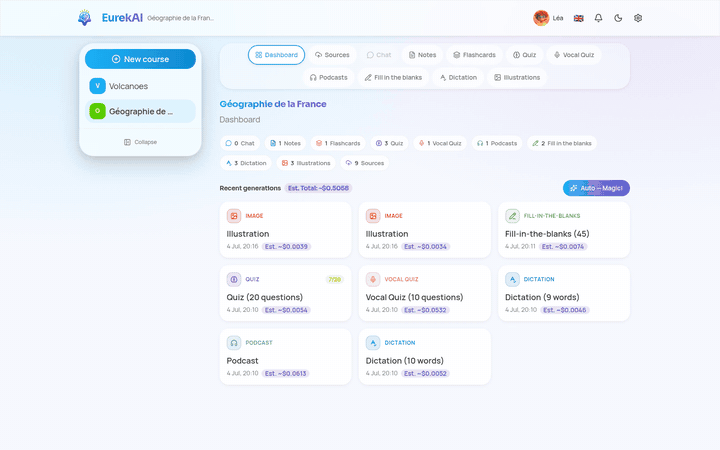
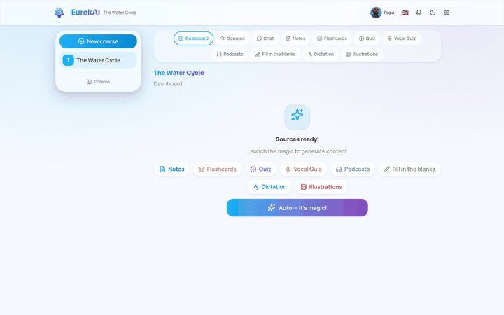

<p align="center">
  
</p>

<h1 align="center">EurekAI</h1>

<p align="center">
  <strong>Zamień dowolną treść w interaktywną naukę — dzięki <a href="https://mistral.ai">Mistral AI</a>.</strong>
</p>

<p align="center">
  <a href="README-en.md">🇬🇧 Angielski</a> · <a href="README-es.md">🇪🇸 Hiszpański</a> · <a href="README-pt.md">🇧🇷 Portugalski</a> · <a href="README-de.md">🇩🇪 Niemiecki</a> · <a href="README-it.md">🇮🇹 Włoski</a> · <a href="README-nl.md">🇳🇱 Niderlandzki</a> · <a href="README-ar.md">🇸🇦 Arabski</a><br>
  <a href="README-hi.md">🇮🇳 Hindi</a> · <a href="README-zh.md">🇨🇳 Chiński</a> · <a href="README-ja.md">🇯🇵 Japoński</a> · <a href="README-ko.md">🇰🇷 Koreański</a> · <a href="README-pl.md">🇵🇱 Polski</a> · <a href="README-ro.md">🇷🇴 Rumuński</a> · <a href="README-sv.md">🇸🇪 Szwedzki</a>
</p>

<p align="center">
  <a href="https://www.youtube.com/watch?v=_b1TQz2leoI"></a>
</p>

<h4 align="center">📊 Jakość kodu</h4>

<p align="center">
  <a href="https://sonarcloud.io/summary/new_code?id=jls42_EurekAI"></a>
  <a href="https://sonarcloud.io/summary/new_code?id=jls42_EurekAI"></a>
  <a href="https://sonarcloud.io/summary/new_code?id=jls42_EurekAI"></a>
  <a href="https://sonarcloud.io/summary/new_code?id=jls42_EurekAI"></a>
</p>
<p align="center">
  <a href="https://sonarcloud.io/summary/new_code?id=jls42_EurekAI"></a>
  <a href="https://sonarcloud.io/summary/new_code?id=jls42_EurekAI"></a>
  <a href="https://sonarcloud.io/summary/new_code?id=jls42_EurekAI"></a>
  <a href="https://sonarcloud.io/summary/new_code?id=jls42_EurekAI"></a>
</p>
<p align="center">
  <a href="https://app.codacy.com/gh/jls42/EurekAI/dashboard?utm_source=gh&utm_medium=referral&utm_content=&utm_campaign=Badge_grade"></a>
  <a href="https://www.codefactor.io/repository/github/jls42/eurekai"></a>
</p>

---

## Historia — Dlaczego EurekAI?

**EurekAI** powstał podczas [Mistral AI Worldwide Hackathon](https://luma.com/mistralhack-online) ([oficjalna strona](https://worldwide-hackathon.mistral.ai/)) (marzec 2026). Potrzebowałem tematu — a pomysł zrodził się z czegoś bardzo konkretnego: regularnie przygotowuję się z córką do sprawdzianów i pomyślałem, że dzięki AI można sprawić, by było to ciekawsze i bardziej interaktywne.

Cel: wziąć **dowolny materiał wejściowy** — zdjęcie lekcji, wklejony tekst, nagranie głosowe, wyniki wyszukiwania w internecie — i zamienić go w **notatki do powtórek, fiszki, quizy, podcasty, teksty z lukami, ilustracje i wiele więcej**. Wszystko to dzięki modelom francuskiej firmy Mistral AI, co sprawia, że EurekAI jest rozwiązaniem naturalnie dostosowanym do uczniów francuskojęzycznych.

[Pierwszy prototyp](https://github.com/jls42/worldwide-hackathon.mistral.ai) powstał w 48h podczas hackathonu jako demonstracja koncepcji oparta na usługach Mistral — już działająca, ale ograniczona. Od tego czasu EurekAI stał się pełnoprawnym projektem: teksty z lukami, nawigacja po ćwiczeniach, scraping stron internetowych, konfigurowalna moderacja rodzicielska, szczegółowy przegląd kodu i wiele więcej. Cały kod jest generowany przez AI — głównie [Claude Code](https://code.claude.com/), z pewnym udziałem [Codex](https://openai.com/codex/) i [Gemini CLI](https://geminicli.com/).

---

## Przegląd

<p align="center">
  
</p>

| | |
|---|---|
| <br>**Panel główny** — ostatnio wygenerowane materiały, szacowany koszt na karcie i łączny koszt projektu, przycisk „Auto — Magia!” | <br>**Źródła** — import zdjęć/PDF/tekstu/głosu/stron internetowych, generowanie jednym kliknięciem, wykrywanie poleceń |

Każde zaimportowane źródło wyświetla [wskaźnik pewności OCR, wynik moderacji i szacowany koszt](docs/screenshots/sources-list.webp).

### Komponenty w działaniu

| | |
|---|---|
| <br>**Notatka do powtórek** — kluczowe zagadnienia, słownictwo, cytaty ze wskazaniem źródeł, odczyt audio poszczególnych sekcji | <br>**Quiz jednokrotnego wyboru** — jedna poprawna odpowiedź na pytanie, natychmiastowa informacja zwrotna z wyjaśnieniem, nawigacja krok po kroku |
| <br>**Fiszki** — karta do odwrócenia, a następnie samoocena „wiedziałem / nie wiedziałem” | <br>**Teksty z lukami** — podpowiedź na żądanie, sprawdzanie z tolerancją na drobne błędy |
| <br>**Dyktando** — słowo dyktowane głosowo, ścisłe sprawdzanie litera po literze | <br>**Quiz głosowy** — pytanie odczytywane na głos, odpowiedź przez mikrofon |
| <br>**Podcast** — minipodcast na 2 głosy, dostępny scenariusz dialogu | <br>**Ilustracje** — obrazy edukacyjne generowane przez Agenta |
| <br>**Korepetytor AI** — czat oparty na dokumentach lekcji, odpowiedzi z wyjaśnieniami, możliwość generowania quizów i fiszek | |

### Pierwsze kroki

| | |
|---|---|
| <br>**Wybór profilu** — każde dziecko ma własną przestrzeń, awatar i język | <br>**Tworzenie profilu** — wiek, awatar, PIN rodzicielski dla osób poniżej 15 lat |
| <br>**Tworzenie lekcji** — jeden projekt na lekcję, gotowy do dodania źródeł | <br>**Ustawienia** — status API, wybór modeli AI z widocznymi cenami |

---

## Funkcje

| | Funkcja | Opis |
|---|---|---|
| 📷 | **Import plików** | Importuj materiały z lekcji — zdjęcia, PDF (przez Mistral OCR z uśrednionym wskaźnikiem pewności, poziomy `high`/`medium`/`low`) lub pliki tekstowe (TXT, MD). Sesje przesyłania z ponawianiem dla każdego pliku i osobnym wskaźnikiem postępu |
| 📝 | **Wprowadzanie tekstu** | Wpisz lub wklej bezpośrednio dowolny tekst |
| 🎤 | **Wprowadzanie głosowe** | Nagraj swój głos — Voxtral STT dokona transkrypcji |
| 🌐 | **Internet / URL** | Wklej URL (bezpośredni scraping przez Readability + Lightpanda) lub wpisz zapytanie (Agent Mistral web_search) |
| 📄 | **Notatki do powtórek** | Uporządkowane notatki z kluczowymi zagadnieniami, słownictwem, cytatami i ciekawostkami |
| 🃏 | **Fiszki** | Interaktywne karty z pytaniami i odpowiedziami, odczyt audio w formie dialogu |
| ❓ | **Quiz jednokrotnego wyboru** | Pytania z 4 odpowiedziami, z których tylko jedna jest poprawna, z adaptacyjną powtórką błędów (konfigurowalna liczba) |
| ✏️ | **Teksty z lukami** | Ćwiczenia do uzupełnienia z podpowiedziami i sprawdzaniem z tolerancją na drobne błędy |
| 🔤 | **Dyktando** | Słowa z zaimportowanej listy dyktowane głosowo (Voxtral TTS), wpisywanie na klawiaturze, ścisłe sprawdzanie litera po literze z wyjaśnieniem reguły ortograficznej |
| 🎙️ | **Podcast** | Minipodcast audio na 2 głosy — domyślne głosy Mistral lub własne głosy (rodziców!) |
| 🖼️ | **Ilustracje** | Obrazy edukacyjne generowane przez Agenta Mistral |
| 🗣️ | **Quiz głosowy** | Pytania odczytywane na głos (możliwość użycia własnego głosu), odpowiedź ustna, sprawdzanie przez AI |
| 💬 | **Korepetytor AI** | Czat uwzględniający kontekst dokumentów lekcji, z wywoływaniem narzędzi |
| 🧠 | **Automatyczny router** | Router oparty na `mistral-small-latest` analizuje treść i proponuje zestaw generatorów spośród 8 dostępnych typów |
| 🔁 | **Ciągłość między lekcjami** | Importowanie, automatyczne generowanie, nagrywanie przez mikrofon, czat, wyszukiwanie w internecie i odczyt na głos są kontynuowane dla danej lekcji po otwarciu innej; powiadomienie podaje nazwę lekcji, jeśli zadanie zakończy się podczas przeglądania innej |
| 🔒 | **Kontrola rodzicielska** | Moderacja konfigurowalna dla każdego profilu (konfigurowalne kategorie), PIN rodzicielski, ograniczenia czatu |
| 🌍 | **Wielojęzyczność** | Interfejs dostępny w 9 językach; generowanie przez AI w 15 językach sterowane przez prompty |
| 🔊 | **Odczyt na głos** | Słuchaj notatek i fiszek (dialog pytanie/odpowiedź) dzięki Mistral Voxtral TTS |
| 💶 | **Śledzenie kosztów API** | Przejrzyste szacowanie kosztu € każdego generowania i źródła (tokeny / znaki / strony / sekundy audio). Oznaczenie na każdej karcie + suma dla projektu, widoczna w panelu głównym |
| 🎨 | **Motyw dla każdego profilu** | Każdy profil wybiera motyw `dark` lub `light` — zapisywany wraz z profilem i ponownie stosowany przy każdej zmianie profilu |

---

## Przegląd architektury

<p align="center">
  
</p>

---

## Mapa wykorzystania modeli

<p align="center">
  
</p>

---

## Ścieżka użytkownika

<p align="center">
  
</p>

---

## Szczegółowe omówienie — Funkcje

### Multimodalne dane wejściowe

EurekAI obsługuje 4 typy źródeł, moderowanych zgodnie z ustawieniami profilu (moderacja domyślnie włączona dla profili dzieci i nastolatków):

- **Import plików** — Pliki JPG, PNG lub PDF przetwarzane przez OCR Mistral — domyślnie **OCR 4.1** (`mistral-ocr-4-1`), opcjonalnie **OCR 3** (`mistral-ocr-2512`) w Ustawieniach (tańszy, ~½ kosztu; lepiej odczytuje pismo odręczne) — do tekstu drukowanego, tabel i pisma odręcznego; lub pliki tekstowe (TXT, MD) importowane bezpośrednio. Przesyłanie wielu plików korzysta z systemu **sesji przesyłania**: osobny wskaźnik postępu dla każdego pliku, ponawianie przesyłania pliku zakończonego błędem bez ponownego wysyłania pozostałych, możliwość zamknięcia sesji po zakończeniu. OCR udostępnia uśredniony **wskaźnik pewności** (`average`, ograniczony do `[0,1]`, obliczany na podstawie `averagePageConfidenceScore` zwracanych przez Mistral), wyświetlany w UI jako oznaczenie poziomu `high` / `medium` / `low` (progi ~0.9 / ~0.7) — ostrzega o niskiej jakości skanu bez blokowania przetwarzania. Kopia dokumentu wysłana do Mistral na potrzeby OCR jest usuwana natychmiast po zakończeniu przetwarzania, również w przypadku błędu.
- **Dowolny tekst** — Wpisz lub wklej dowolną treść. Jeśli moderacja jest aktywna, treść jest moderowana przed zapisaniem.
- **Wprowadzanie głosowe** — Nagraj dźwięk w przeglądarce. Domyślnie transkrypcję wykonuje **Voxtral Mini Transcribe 2** (`voxtral-mini-2602`); **Voxtral Mini Transcribe 3** i **Voxtral Small Transcribe 3** (wersja zapoznawcza Mistral) są dostępne opcjonalnie w Ustawieniach. Język interfejsu jest przekazywany do modelu (`language`), aby poprawić rozpoznawanie.
- **Internet / URL** — Wklej jeden lub kilka adresów URL, aby bezpośrednio pobrać treść (Readability + Lightpanda dla stron JS), lub wpisz słowa kluczowe, aby wyszukać informacje w internecie przez Agenta Mistral. Jedno pole obsługuje oba rodzaje danych — adresy URL i słowa kluczowe są automatycznie rozdzielane, a każdy wynik tworzy osobne źródło.

### Generowanie treści przez AI

Osiem typów generowanych materiałów edukacyjnych:

| Generator | Model | Wynik |
|---|---|---|
| **Notatka do powtórek** | `mistral-large-2512` | Tytuł, podsumowanie, kluczowe zagadnienia, słownictwo, cytaty, ciekawostka |
| **Fiszki** | `mistral-large-2512` | Karty z pytaniami i odpowiedziami oraz odwołaniami do źródeł (konfigurowalna liczba) |
| **Quiz jednokrotnego wyboru** | `mistral-large-2512` | Pytania z 4 odpowiedziami, z których tylko jedna jest poprawna, wyjaśnienia, adaptacyjna powtórka (konfigurowalna liczba) |
| **Teksty z lukami** | `mistral-large-2512` | Zdania do uzupełnienia z podpowiedziami, sprawdzanie z tolerancją na drobne błędy (Levenshtein) |
| **Dyktando** | `mistral-large-2512` + Voxtral TTS | Słowa kluczowe dyktowane głosowo (1 MP3/słowo) → wpisywanie na klawiaturze → ścisłe sprawdzanie (pominięty akcent liczy się jako błąd) z wyjaśnieniem reguły |
| **Podcast** | `mistral-large-2512` + Voxtral TTS | Scenariusz na 2 głosy → audio MP3 |
| **Ilustracja** | Agent `mistral-large-2512` | Obraz edukacyjny za pomocą narzędzia `image_generation` |
| **Quiz głosowy** | `mistral-large-2512` + Voxtral TTS + STT | Pytania TTS → odpowiedź STT → sprawdzanie przez AI |

### Korepetytor AI na czacie

Korepetytor konwersacyjny z pełnym dostępem do dokumentów lekcji:

- Korzysta z `mistral-large-2512`
- **Wywoływanie narzędzi**: może generować notatki, fiszki, quizy lub teksty z lukami podczas rozmowy
- Historia 50 wiadomości na lekcję
- Moderacja, jeśli jest włączona dla profilu: wiadomość jest sprawdzana, a źródła oznaczone jako nieodpowiednie, te, których weryfikacja zakończyła się błędem, oraz te jeszcze niesprawdzone są wykluczane z kontekstu i narzędzi (najpierw ponawiana jest weryfikacja źródeł z błędem lub jeszcze niesprawdzonych, maksymalnie przez 5 s)

### Automatyczny router

Router korzysta z `mistral-small-latest`, aby przeanalizować treść źródeł i zaproponować najbardziej odpowiednie generatory spośród 8 dostępnych. Interfejs pokazuje postęp w czasie rzeczywistym: najpierw etap analizy, a następnie poszczególne zadania generowania z możliwością anulowania.

Auto działa na serwerze: kontynuuje pracę po odświeżeniu strony, otwarciu innej lekcji lub zmianie profilu, a dla jednej lekcji działa tylko jedno Auto naraz (druga karta dołącza do trwającego zadania). Serwer uruchamia maksymalnie 3 zadania generowania jednocześnie na klucz Mistral. Każde zakończone zadanie generowania ma własny komunikat, a następnie jednokrotnie wyświetla się końcowe podsumowanie; jeśli zakończy się podczas wyświetlania innej lekcji, komunikat podaje nazwę właściwej lekcji. Pojedyncze anulowane zadanie generowania nie jest liczone w podsumowaniu jako niepowodzenie. „Anuluj wszystko” zatrzymuje całą partię zadań dla lekcji, wyświetlając jeden komunikat. Jeśli serwer uruchomi się ponownie podczas działania Auto, zadanie zostanie oznaczone jako przerwane, z przyciskiem „Wznów”, który uruchamia ponownie tylko niezakończone zadania generowania, bez powtarzania analizy.

Jednocześnie działają maksymalnie 3 długotrwałe zadania generowania uruchomione z karty (zadania uruchamiane pojedynczo, fiszki do powtórek): kolejne czekają na swoją kolej, a lekcja otwiera się bez oczekiwania na zakończenie trwających zadań generowania.

### Nauka adaptacyjna

- **Statystyki quizu**: śledzenie prób i trafności odpowiedzi na każde pytanie
- **Powtórka quizu**: generuje 5-10 nowych pytań dotyczących słabiej opanowanych zagadnień na podstawie źródeł oryginalnego quizu (kontrola moderacji dotyczy tych samych źródeł)
- **Wykrywanie poleceń**: wykrywa wskazówki do powtórki („Umiem lekcję, jeśli potrafię...”) i nadaje im priorytet w zgodnych generatorach tekstowych (notatka, fiszki, quiz, teksty z lukami). Przy aktywnej moderacji wykrywanie czeka na weryfikację źródeł i odczytuje tylko te uznane za bezpieczne; polecenie zachowuje listę swoich źródeł pochodzenia: jeśli jedno z nich zostanie oznaczone jako nieodpowiednie, polecenie nie jest wyświetlane ani stosowane, a jeśli jedno z nich zostanie usunięte, polecenie jest kasowane. Jego koszt jest uwzględniany
### Bezpieczeństwo i kontrola rodzicielska

- **4 grupy wiekowe**: dziecko (≤10 lat), nastolatek (11-15), student (16-25), dorosły (26+)
- **Moderacja treści**: `mistral-moderation-2603` (Mistral Moderation 2) z 11 dostępnymi kategoriami, z których 6 jest domyślnie blokowanych dla nowych profili dzieci i nastolatków (`sexual`, `hate_and_discrimination`, `violence_and_threats`, `criminal`, `selfharm`, `jailbreaking`; `criminal` dodano po pomiarze na 50 lekcjach, w tym historii, bez żadnych wyników fałszywie dodatnich). Kategorie można dostosować dla każdego profilu w ustawieniach; Moderation 2 podzielił dawną kategorię „niebezpieczne treści” na `dangerous` + `criminal` (istniejące profile są automatycznie migrowane, a blokowane kategorie mają zastosowanie także do już zaimportowanych źródeł). Domyślne zabezpieczenie: jeśli odpowiedź modelu nie pozwala sprawdzić blokowanej kategorii, treść zostaje odrzucona („Moderacja niedostępna”); przy włączonej moderacji zarówno generowanie, jak i czat pomijają źródła oznaczone jako nieodpowiednie, te, których weryfikacja się nie powiodła, oraz te będące w trakcie weryfikacji. Źródło, którego nigdy nie zweryfikowano (zaimportowane przy wyłączonej moderacji lub pochodzące ze starego projektu przypisanego do profilu), jest sprawdzane przed użyciem. Moderacja przerwana przez ponowne uruchomienie jest wznawiana przy starcie, jeśli pozwala na to klucz serwera; w przeciwnym razie, podobnie jak moderacja zakończona błędem, jest wznawiana przy otwarciu projektu lub kolejnym generowaniu. Przycisk „Sprawdź ponownie” uruchamia weryfikację na żądanie. Przy włączonej moderacji treść źródła pozostaje ukryta przed dzieckiem (podgląd, tekst, oryginalny dokument), dopóki źródło nie zostanie uznane za bezpieczne; rodzic może ją wyświetlić po podaniu swojego PIN-u, na czas jednego przeglądania. Odpowiedź ustna w quizie głosowym jest moderowana przed sprawdzeniem jej poprawności. Identyfikator z datą przypięty w `helpers/moderation-model.ts`: przestarzały alias `-latest` nie jest już wymieniany przez API.
- **PIN rodzicielski**: hash SHA-256, wymagany dla profili osób poniżej 15 lat; maksymalnie 10 błędnych kodów na kwadrans i na adres IP (429 `rate_limited`). Przy wdrożeniu produkcyjnym należy zastosować wolny hash z solą (Argon2id, bcrypt).
- **Dane serwera**: `/output` udostępnia wyłącznie multimedia projektów (audio, obrazy, zaimportowane pliki); `profiles.json`, `config.json`, `projects.json` i `project.json` nigdy nie są udostępniane
- **Ograniczenia czatu**: czat AI jest domyślnie wyłączony dla osób poniżej 16 lat, rodzice mogą go włączyć

### System wielu profili

- Wiele profili z imieniem, wiekiem, awatarem i preferencjami językowymi
- **Głosy dla każdego profilu** (`Profile.mistralVoices?: { host?, guest? }` — każda rola jest opcjonalna) — każde dziecko może mieć własną parę głosów do podcastu/quizu głosowego
- **Motyw dla każdego profilu** (`Profile.theme: 'dark' | 'light'`) — automatyczne przełączanie przy zmianie profilu, zapisywane po stronie backendu
- Projekty powiązane z profilami przez `profileId`; stary projekt bez profilu jest przypisywany do pierwszego profilu, który go otworzy, a następnie moderowany zgodnie z tym profilem
- Usuwanie kaskadowe: usunięcie profilu usuwa wszystkie jego projekty

### Śledzenie kosztów API

Każde płatne wywołanie Mistral (czat, OCR, STT, TTS, agenci), w tym wykrywanie poleceń i odpowiedzi ustne w quizie głosowym, jest monitorowane, aby zapewnić użytkownikowi **przejrzyste** oszacowanie kosztu w €. Bezpłatna moderacja nie jest uwzględniana. Uwzględniono opłaty za narzędzia agentów: 0,03 $ za wyszukiwanie w sieci i 0,10 $ za wygenerowany obraz (stawki Mistral), a także tokeny wytworzone przez te narzędzia, które szacunek rozlicza według stawki wejściowej modelu agenta.

- **Źródło prawdy**: `helpers/pricing.ts` — `MODEL_PRICING` według prefiksu modelu (np. `mistral-large` → wejście 0.5 €/M tokenów, wyjście 1.5 €/M tokenów), `PRICING_SOURCES` z adresami URL dokumentacji Mistral do okresowego ponownego scrapingu
- **Obsługiwane jednostki**: `tokens`, `characters` (TTS), `pages` (OCR), `audio-seconds` (STT) — konwersja sterowana przez `helpers/cost-calc.ts`
- **Łańcuch instrumentacji**: `helpers/tracked-client.ts` (opakowuje klienta Mistral) → `helpers/usage-context.ts` (AsyncLocalStorage) → `helpers/cost-calc.ts` → `helpers/cost-persist.ts` → `helpers/cost-middleware.ts` (wstrzyknięcie do odpowiedzi HTTP)
- **UI**: znacznik kosztu dla każdego generowania (`src/partials/cost-badge-gen.html`), dla każdego źródła (`cost-badge-src.html`), łączna suma w panelu (`Project.totalCost`)
- **Endpointy**: odpowiedzi `/generate/*` i `/sources/*` uzupełniają zwracany obiekt (`Generation` / `Source`) o `estimatedCost`, `usage` i `costBreakdown`. `POST /generate/route` dodaje pole `costDelta: number` zawierające koszt samego routingu; `POST /detect-consigne` (`{consigne, costDelta}`) oraz sprawdzenie odpowiedzi ustnej również zwracają własne `costDelta`. `GET /projects/:pid` zwraca projekt uzupełniony o `totalCost` (suma obliczana na podstawie `costLog[]`) + pełną historię

### TTS (Mistral Voxtral) i własne głosy

- **Mistral Voxtral TTS**: domyślnie **Voxtral TTS** (`voxtral-mini-tts-2603`), opcjonalnie **Voxtral TTS 3** (`voxtral-mini-tts-3-0`, wersja zapoznawcza Mistral, natywne głosy w większej liczbie języków) w Ustawieniach; synteza mowy w 100% Mistral, bez konieczności używania dodatkowego klucza. Oferowane są wyłącznie głosy akceptowane przez wybrany model: Voxtral TTS odrzuca głosy dodane za pomocą Voxtral 3
- **Własne głosy**: rodzice mogą tworzyć własne głosy przez API Mistral Voices (na podstawie próbki audio) i przypisywać je do ról prowadzącego/gościa — podcasty i quizy głosowe są wtedy odczytywane głosem rodzica, dzięki czemu dziecko jeszcze bardziej angażuje się w naukę
- Dwie konfigurowalne role głosowe: **prowadzący** (główny narrator) i **gość** (drugi głos podcastu)
- Pełny katalog głosów Mistral dostępny w ustawieniach, z możliwością filtrowania według języka
- Odtwarzanie (karty, podcastu, słowa z dyktanda) jest wstrzymywane po opuszczeniu jego widoku i wznawiane od miejsca zatrzymania
- Nagranie odczytu fiszek jest tworzone przy pierwszym odsłuchaniu, a następnie zachowywane w ramach ich wygenerowanej wersji: nie jest ponownie tworzone ani naliczane przy każdym powrocie
- Znaczniki źródeł (`[Source N]`) nie są odczytywane na głos

### Internacjonalizacja

- Interfejs dostępny w 9 językach: fr, en, es, pt, it, nl, de, hi, ar
- Prompty AI obsługują 15 języków (fr, en, es, de, it, pt, nl, ja, zh, ko, ar, hi, pl, ro, sv)
- Język konfigurowalny dla każdego profilu

---

## Stos technologiczny

| Warstwa | Technologia | Rola |
|---|---|---|
| **Runtime** | Node.js + TypeScript 6.x | Serwer i bezpieczeństwo typów |
| **Backend** | Express 5.x | API REST |
| **Serwer deweloperski** | Vite 8.x (Rolldown) + tsx | HMR, partials Handlebars, proxy |
| **Frontend** | HTML + TailwindCSS 4.x + Alpine.js 3.x | Reaktywny interfejs, TypeScript kompilowany przez Vite |
| **Templating** | vite-plugin-handlebars | Składanie HTML z partials |
| **AI** | Mistral AI SDK | Czat, OCR, STT, TTS, agenci, moderacja |
| **TTS** | Mistral Voxtral TTS | `voxtral-mini-tts-2603` (opcjonalnie Voxtral TTS 3), wbudowana synteza mowy |
| **Ikony** | Lucide 1.x | Biblioteka ikon SVG |
| **Scraping stron internetowych** | Readability + linkedom | Wyodrębnianie głównej treści stron internetowych (technologia Firefox Reader View) |
| **Headless browser** | Lightpanda | Ultralekka przeglądarka headless (Zig + V8) do stron JS/SPA — fallback scrapingu |
| **Markdown** | Marked | Renderowanie Markdown w czacie |
| **Przesyłanie plików** | Multer 2.x | Obsługa formularzy multipart |
| **Audio** | ffmpeg-static | Łączenie segmentów audio |
| **Testy** | Vitest | Testy jednostkowe — pokrycie mierzone przez SonarCloud |
| **Trwałe przechowywanie** | Pliki JSON | Przechowywanie bez zależności |

---

## Przegląd modeli

| Model | Zastosowanie | Uzasadnienie |
|---|---|---|
| `mistral-large-2512` (Large 3, przypięty jako domyślny) | Karta, fiszki, podcast, quiz, teksty z lukami, czat, sprawdzanie quizu głosowego, agent obrazów, agent wyszukiwania w sieci, wykrywanie poleceń | Najlepsza wielojęzyczność i wykonywanie instrukcji; przypięty, ponieważ alias `mistral-large-latest` od listopada 2026 wskazuje na Large 4, zbyt wolny dla naszego generowania (wycofanie Large 3 zapowiedziano na 30/04/2027) |
| `mistral-ocr-4-1` (OCR 4.1, domyślny) | OCR dokumentów | Tekst drukowany, tabele, pismo odręczne ($4 / 1000 stron) |
| `mistral-ocr-2512` (OCR 3, opcjonalny) | OCR dokumentów | Dostępny do wyboru w Ustawieniach, tańszy ($2 / 1000 stron), lepiej odczytuje pismo odręczne |
| `voxtral-mini-2602` (Voxtral Mini Transcribe 2, domyślny) | Rozpoznawanie mowy (STT) | Wprowadzanie głosowe i odpowiedzi ustne w quizie głosowym ($0.003 / min) |
| `voxtral-mini-transcribe-3-0` / `voxtral-small-transcribe-3-0` (Transcribe 3, opcjonalne, wersja zapoznawcza) | Rozpoznawanie mowy (STT) | Dostępne do wyboru w Ustawieniach ($0.0035 / min i $0.004 / min) |
| `voxtral-mini-tts-2603` (Voxtral TTS, domyślny) | Synteza mowy (TTS) | Podcasty, quiz głosowy, dyktando, czytanie na głos ($16 / M znaków) |
| `voxtral-mini-tts-3-0` (Voxtral TTS 3, opcjonalny, wersja zapoznawcza) | Synteza mowy (TTS) | Dostępny do wyboru w Ustawieniach, natywne głosy w większej liczbie języków ($13 / M znaków) |
| `mistral-moderation-2603` | Moderacja treści | 6 kategorii blokowanych dla dzieci/nastolatków (w tym `jailbreaking`) |
| `mistral-small-latest` | Automatyczny router | Szybka analiza treści na potrzeby decyzji o routingu |

Na telefonie Ustawienia wyświetlają pod każdym selektorem pełną etykietę wybranego modelu (cenę, „Zalecany” lub „Wersja zapoznawcza”), którą zamknięte menu ucinało.

---

## Szybki start

```bash
# Cloner le dépôt
git clone https://github.com/jls42/EurekAI.git
cd EurekAI

# Installer les dépendances
npm install

# Configurer les clés API
cp .env.example .env
# Éditez .env (toutes optionnelles) :
#   MISTRAL_API_KEY=<your_api_key>           (optionnel — sinon chaque utilisateur saisit sa clé dans l'app)
#   SONAR_TOKEN=...                          (optionnel, CI SonarCloud uniquement)

# Lancer le développement
npm run dev
# → Backend :  http://localhost:3000 (API)
# → Frontend : http://localhost:5173 (serveur Vite avec HMR)
```

> **Uwaga**: Mistral Voxtral TTS jest jedynym dostawcą TTS — poza `MISTRAL_API_KEY` nie jest wymagany żaden dodatkowy klucz.

> **Klucz API wprowadzany przez użytkownika**: `MISTRAL_API_KEY` jest teraz **opcjonalny**. Jeśli go brakuje, aplikacja i tak się uruchamia i prosi każdego użytkownika o podanie **własnego klucza Mistral** w interfejsie. Klucz jest **przechowywany w przeglądarce** (szyfrowany przez Web Crypto + IndexedDB w bezpiecznym kontekście) i wysyłany z każdym żądaniem — **nigdy nie jest trwale zapisywany na serwerze**. Kolejność priorytetów: klucz profilu > globalny klucz przeglądarki > `MISTRAL_API_KEY` (env). Ustawienie `EUREKAI_REQUIRE_USER_KEY=true` wymusza podanie własnego klucza przez każdego użytkownika (klucz ze środowiska służy już tylko do wstępnego ładowania).

> **Lokalny HTTPS (tablet/LAN)**: `localhost` jest już bezpiecznym kontekstem. Aby uzyskać dostęp przez LAN (tablet), wygeneruj lokalny certyfikat i włącz HTTPS: przeglądarka będzie wtedy mogła szyfrować przechowywany klucz, a sam klucz będzie szyfrowany podczas przesyłania:
> ```bash
> ./scripts/gen-cert.sh 192.168.1.42   # mkcert si dispo, sinon openssl self-signed
> export HTTPS_KEY=certs/key.pem HTTPS_CERT=certs/cert.pem
> npm run dev                          # Express + Vite en HTTPS
> ```

### Zmienne środowiskowe

| Zmienna | Wymagana | Domyślnie | Rola |
|---|---|---|---|
| `MISTRAL_API_KEY` | opcjonalna | — | Klucz API Mistral (czat, OCR, STT, TTS Voxtral, agenci, moderacja). Jeśli go brakuje, użytkownik wpisuje swój klucz w aplikacji (przechowywany w przeglądarce, nigdy na serwerze) |
| `EUREKAI_REQUIRE_USER_KEY` | opcjonalna | `false` | `true` → wyłącza fallback na `MISTRAL_API_KEY` dla żądań AI (każdy użytkownik MUSI podać swój klucz). Przydatne w publicznie dostępnej instancji |
| `HTTPS_KEY` / `HTTPS_CERT` | opcjonalne | — | Ścieżki klucza/certyfikatu TLS (zob. `scripts/gen-cert.sh`) → Express i Vite udostępniają aplikację przez HTTPS (bezpieczny kontekst dla LAN/tabletu) |
| `PORT` | opcjonalna | `3000` | Port HTTP backendu Express |
| `NODE_ENV` | opcjonalna | `development` | Jeśli `production` → Express udostępnia frontend z `dist/` (w przeciwnym razie `public/`) |
| `SONAR_TOKEN` | opcjonalna w CI | — | Używana wyłącznie przez workflow GitHub Actions SonarCloud |

### Testy, jakość kodu i współtworzenie

```bash
npm test                # vitest (déclenche pretest : typecheck + lint:complexity + lint:ci + lint:deadcode)
npm run test:coverage   # couverture vitest
npm run lint            # ESLint + typescript-eslint + sonarjs
npm run lint:fix        # auto-fix
npm run format          # prettier
npm run security        # Opengrep (SAST local) — bloque sur finding ERROR
```

**Hooki Git (Husky)**: `pre-commit` uruchamia kolejno `scripts/pre-commit-fast.sh` (konflikty, duże pliki, shellcheck), `lint-staged`, a następnie `npm test`; `pre-push` najpierw wykonuje blokującą kontrolę `npm audit` (blokuje, gdy dowolna zależność, nawet przechodnia, ma podatność na poziomie `critical`, zob. `scripts/audit-verdict.mjs`), a następnie `npm run security`. Każdy hook blokuje commit/push, gdy którykolwiek z jego etapów zakończy się niepowodzeniem.

**Narzędzia zewnętrzne (opcjonalne do uruchomienia aplikacji, niezbędne dla `pretest` i `npm run security`)**:

```bash
# Lizard (Python) pour lint:complexity (CCN > 8 sur l'allowlist)
pipx install lizard          # ou : pipx run lizard

# Opengrep (binaire standalone ~40 Mo) pour npm run security
./scripts/install-opengrep.sh   # installe dans ~/.local/bin/
```

Bez tych narzędzi `npm test` kończy się niepowodzeniem na etapie `pretest` (brak lizard), a `npm run security` również kończy się niepowodzeniem (brak opengrep). Hooki husky blokują wtedy commit/push.

---

## Wdrożenie z użyciem kontenera

Obraz jest publikowany w **GitHub Container Registry**:

```bash
# Télécharger l'image
podman pull ghcr.io/jls42/eurekai:latest

# Lancer EurekAI
mkdir -p ./data
podman run -d --name eurekai \
  -e MISTRAL_API_KEY=<your_api_key> \
  -v ./data:/app/output:U \
  -p 3000:3000 \
  ghcr.io/jls42/eurekai:latest
# → http://localhost:3000
```

> **`:U`**: flaga Podman rootless, która automatycznie dostosowuje uprawnienia wolumenu.

```bash
# Build local
podman build -t eurekai -f Containerfile .

# Publier sur ghcr.io (mainteneurs)
./scripts/publish-ghcr.sh
```

---

## Struktura projektu

```
server.ts                 — Point d'entrée Express, monte les routes + config
config.ts                 — Config runtime (modèles, voix, modèle TTS), persistée dans output/config.json
store.ts                  — ProjectStore : CRUD projets/sources/générations, persistance JSON
profiles.ts               — ProfileStore : gestion des profils, hachage PIN
types.ts                  — Types TypeScript : Source, Generation (8 types), QuizStats, Profile
prompts.ts                — Tous les prompts IA centralisés (system + user templates, 15 langues)

generators/
  auto-agents.ts          — Source unique de vérité : AUTO_AGENTS_SET (8 agents) + MAX_AUTO_PLAN_LENGTH
  generation-types.ts     — Types générables individuellement (SINGLE_GENERATE_TYPES, coïncide avec les 8 agents auto)
  ocr.ts                  — OCR via Mistral (JPG, PNG, PDF) avec extraction interne des scores de confiance moyens par page
  summary.ts              — Génération de fiche de révision (JSON structuré)
  flashcards.ts           — Flashcards Q/R (nombre configurable)
  quiz.ts                 — Quiz QCM (nombre configurable) + révision adaptative
  fill-blank.ts           — Exercices à trous avec validation tolérante
  dictation.ts            — Dictée : mots + phrases-exemples + règles, 1 audio TTS par mot (8e agent auto)
  podcast.ts              — Script podcast 2 voix
  quiz-vocal.ts           — Quiz vocal : questions TTS + réponses STT + vérification IA
  image.ts                — Génération d'image via Agent Mistral (outil image_generation)
  chat.ts                 — Tuteur IA par chat avec appel d'outils
  router.ts               — Routeur automatique (contenu → générateurs recommandés)
  consigne.ts             — Détection de consignes de révision
  tts-provider.ts         — TTS Mistral Voxtral (synthèse vocale + listing des voix)
  tts.ts                  — Génération audio multi-voix (podcast + flashcards, concaténation de segments)
  stt.ts                  — Voxtral STT (audio → texte)
  websearch.ts            — Agent Mistral avec outil web_search (fallback)
  moderation.ts           — Modération de contenu (filtrage par âge)

routes/
  projects.ts             — CRUD projets
  profiles.ts             — CRUD profils avec gestion du PIN
  sources.ts              — Import fichiers (OCR + texte brut), texte libre, voix STT, scraping URL + recherche web, modération
  generate.ts             — Endpoints de génération (8 types + route)
  auto-runs.ts            — Lots Auto côté serveur : lancement, analyse et étapes en arrière-plan, état, annulation
  generations.ts          — Tentatives de quiz/fill-blank, réponses vocales, lecture à voix haute
  chat.ts                 — Chat IA avec appel d'outils

helpers/
  # IO & parsing
  index.ts                — getContent, stripJsonMarkdown, safeParseJson, tryParseJson, retryTurns, unwrapJsonArray, extractAllText, timer
  audio.ts                — collectStream (ReadableStream → Buffer)
  audio-files.ts          — Persistance et lecture des fichiers audio générés (podcast, flashcards)
  generation-media.ts     — Noms uniques des médias (MP3/PNG) et suppression avec leur génération
  media-ledger.ts         — Médias écrits pendant une génération, supprimés si elle échoue ou est annulée
  keyed-lock.ts           — File d'attente par clé (OCR sérialisé par contenu)
  keyed-slots.ts          — Places par clé (au plus 3 étapes d'Auto en même temps par clé Mistral)
  logger.ts               — Logger structuré (niveaux, contexte JSON)

  # Génération & UX
  auto-title.ts           — autoTitle(type, data, lang) : préfixe auto pour carte liste (Fiche, Note, Quiz, etc.)
  choice-labels.ts        — Labels localisés des choix (quiz, quiz-vocal) — 9 langues
  diversity.ts            — Diversité des générations (exclusion du contenu déjà produit, `diversityParams` : temperature/presencePenalty/randomSeed)
  fill-blank-validate.ts  — Validation tolérante des réponses (normalisation, Levenshtein)
  dictation-diff.ts       — Comparaison stricte lettre à lettre pour la correction de dictée (local, zéro coût IA)
  reading-comfort.ts      — Option « Confort de lecture » par profil (police Luciole, espacements) — partagé serveur/client
  ocr-models.ts           — Source de vérité sélection OCR (OCR 4 défaut / OCR 3 option) + normalizeOcrModel
  moderation-model.ts     — Modèle de modération épinglé + ses 11 catégories + migration des catégories legacy
  stt-models.ts           — Source de vérité sélection transcription (Mini Transcribe 2 défaut / Transcribe 3 option) + normalizeSttModel
  tts-models.ts           — Source de vérité sélection synthèse vocale (Voxtral TTS défaut / TTS 3 option) + compatibilité des voix
  tts-text.ts             — Texte envoyé au TTS : marqueurs de sources et crochets retirés (Voxtral les lit ou avale le mot)
  source-markers.ts       — Regex des marqueurs `[Source N]` des fiches (pastilles côté navigateur, texte lu côté serveur)
  moderation-http.ts      — Statut de modération → réponse HTTP (400 signalé / 503 indisponible / 409 en cours), statut effectif, garde de la consigne
  moderation-profile.ts   — Profil propriétaire du projet et catégories actives (source unique des routes)
  source-moderation.ts    — Modérations en vol et reprise (démarrage, génération, chat, « Revérifier »)
  input-moderation.ts     — Modération d'un texte saisi ou dicté (texte libre, recherche web, réponse orale)
  chat-sources.ts         — Sources accessibles au chat (sans les sources non vérifiées si la modération est active)

  # Codes d'erreur stables
  error-codes.ts              — Re-export mince de l'API publique
  error-code-resolution.ts    — Orchestration extractErrorCode(e, agent) → FailedStepCode
  error-code-rules.ts         — Règles de mapping par agent/step
  error-matchers.ts           — Matchers par pattern d'erreur HTTP/LLM (délimités pour Lizard)

  # Cost tracking API (suivi coûts €)
  pricing.ts              — MODEL_PRICING + PRICING_SOURCES (tarifs Mistral par prefix de modèle)
  cost-calc.ts            — Conversion ApiUsage → coût € (tokens / characters / pages / audio-seconds)
  cost-persist.ts         — Écriture dans Project.costLog + totalCost
  cost-middleware.ts      — Injection de costDelta dans la réponse HTTP
  tracked-client.ts       — Wrap du client Mistral (capture ApiUsage automatiquement)
  usage-context.ts        — AsyncLocalStorage pour propager l'usage dans les pipelines async

  # Clé API Mistral & sécurité
  mistral-client-factory.ts — Source UNIQUE de construction du client Mistral (buildTrackedClient, resolveClient, requireKeyMiddleware)
  rate-limit.ts           — Rate-limiters Express (authLimiter, pinLimiter, aiLimiter / aiPathLimiter, generalLimiter), 429 `rate_limited`
  request-validation.ts   — Validation de lang / ageGroup sur toutes les routes IA (400 invalid_input)
  output-static.ts        — Liste blanche du montage statique /output (médias des projets seulement)
  security-headers.ts     — Options Helmet / CSP (createHelmetOptions)
  redact.ts               — Redaction des secrets dans les logs (clé API, headers sensibles)
  mistral-retry.ts        — Retry avec backoff sur erreurs transitoires Mistral (3 tentatives)

  # Événements & notifications (SSE)
  event-bus.ts            — Bus d'événements de génération et de lots Auto en mémoire (dispatch SSE, filet anti-uncaughtException)
  auto-run-state.ts       — Transitions d'un lot Auto (fonctions pures, appliquées par le store)
  event-key.ts            — Clé d'événement typée partagée client/serveur (idempotence notifications)

  # Voix & profils
  voice-selection.ts      — selectVoices : rotation déterministe par profil + langue (host/guest)
  voice-types.ts          — Type MistralVoice (importable côté frontend sans embarquer le SDK Mistral)

src/                      — Frontend (Vite + Handlebars)
  index.html              — Point d'entrée HTML principal
  main.ts                 — Entrée frontend (init Alpine.js + icônes Lucide)
  app/                    — Modules applicatifs Alpine.js
    state.ts              — Gestion d'état réactif
    navigation.ts         — Routage des vues + gardes par âge
    view-media.ts         — Pause du son au changement de vue (position gardée)
    profiles.ts           — Logique du sélecteur de profils
    projects.ts           — CRUD des cours
    sources.ts            — Gestionnaires d'upload de sources
    generate.ts           — Déclencheurs de génération (individuel, tout, Auto)
    auto-launch.ts        — Lancement d'un Auto côté serveur, suivi pendant qu'un autre cours est affiché, annulation
    auto-runs.ts          — Auto suivis par l'onglet : état reçu du serveur, bilan affiché une seule fois, coût de l'analyse
    request-slots.ts      — Au plus 3 générations longues en même temps pour l'onglet, file d'attente FIFO
    moderation-gate.ts    — Pré-contrôle de modération des générations (vérifie d'abord les sources en attente)
    effective-moderation.ts — Statut de modération affiché et masquage du contenu des sources
    generations.ts        — Affichage + actions sur les générations
    chat.ts               — Interface de chat
    chat-in-flight.ts     — Messages du chat en attente de réponse, par cours
    config.ts             — Interface de configuration (modèles de chat, d'OCR, de transcription et de TTS, voix)
    render.ts             — Helpers de rendu HTML
    i18n.ts               — Changement de langue
    ...
  components/
    quiz.ts               — Composant quiz interactif
    quiz-vocal.ts         — Composant quiz vocal
    fill-blank.ts         — Composant textes à trous
    fill-blank-validate.ts — Ré-export client de la validation textes à trous (validateAnswer)
    flashcards.ts         — Composant flashcards avec retournement
    dictation.ts          — Composant dictée interactif
    step-by-step.ts       — Mixin navigation pas-à-pas (quiz, fill-blank, flashcards)
  i18n/
    fr.ts, en.ts, es.ts, — Dictionnaires par langue (9 langues)
    pt.ts, it.ts, nl.ts,
    de.ts, hi.ts, ar.ts
    languages.ts          — Registre des langues UI disponibles
    index.ts              — Chargeur i18n
  partials/               — Partials HTML Handlebars (header, sidebar, dialogues, vues)
  styles/
    main.css              — Entrée TailwindCSS
    theme.css             — Variables de thème personnalisées

public/assets/            — Ressources statiques (logo, avatars, schémas architecture)
docs/                     — Notes internes (inventaire prompts, audits, prompts des diagrammes) + screenshots du README
scripts/                  — Tooling : check-deps, check-models, check-security, check-complexity, gen-cert, install-opengrep, translate-readme, publish-ghcr, update-pricing
output/                   — Données d'exécution (projets, config, fichiers audio) ; en mode prod (`NODE_ENV=production`), Express sert le frontend depuis `dist/` au lieu de `public/`
```

> **Dla agentów AI współtworzących kod**: zapoznaj się z [`CLAUDE.md`](CLAUDE.md) (reguły ogólne, indeks) oraz szczegółowymi regułami w [`.claude/rules/`](.claude/rules/), ładowanymi na żądanie w zależności od odczytywanych lub modyfikowanych plików, aby poznać szczegółowy kontekst architektury, obowiązkowe reguły (kody błędów, śledzenie kosztów i prompty bez słów metapoziomu, czyli bez określeń dokumentu takich jak jego typ, ponieważ model kopiowałby te słowa do swoich odpowiedzi) oraz znane pułapki (Lizard CCN, Opengrep, migracja Codacy/Semgrep).

---

## Dokumentacja API

### Konfiguracja
| Metoda | Endpoint | Opis |
|---|---|---|
| `GET` | `/api/config` | Bieżąca konfiguracja |
| `PUT` | `/api/config` | Zmiana konfiguracji (modele, głosy, model TTS) |
| `GET` | `/api/config/status` | Stan API: `mistral` (ustawiony klucz Mistral), `ttsAvailable` (alias `mistral`, Mistral Voxtral jest jedynym dostawcą TTS) |
| `POST` | `/api/config/reset` | Przywrócenie domyślnej konfiguracji |
| `GET` | `/api/config/voices` | Lista głosów Mistral TTS (opcjonalnie `?lang=fr`) |
| `GET` | `/api/moderation-categories` | Dostępne kategorie moderacji + ustawienia domyślne według wieku |
| `POST` | `/api/providers/mistral/validate` | Weryfikacja klucza Mistral wprowadzonego przez użytkownika — zawsze 200 `{status}` (`ok`/`invalid`/`quota`/`network`/`missing`), bez fallbacku na zmienne środowiskowe |

### Profile
| Metoda | Endpoint | Opis |
|---|---|---|
| `GET` | `/api/profiles` | Lista wszystkich profili |
| `POST` | `/api/profiles` | Utworzenie profilu |
| `PUT` | `/api/profiles/:id` | Zmiana profilu (PIN wymagany dla osób < 15 lat; 10 błędnych PIN-ów / 15 min → 429 `rate_limited`) |
| `DELETE` | `/api/profiles/:id` | Usunięcie profilu + kaskadowe usunięcie projektów `{pin?}` → `{ok, deletedProjects}` |

### Projekty
| Metoda | Endpoint | Opis |
|---|---|---|
| `GET` | `/api/projects` | Lista projektów (opcjonalnie `?profileId=`) |
| `POST` | `/api/projects` | Utworzenie projektu `{name, profileId}` |
| `GET` | `/api/projects/:pid` | Szczegóły projektu; `?profileId=` przypisuje projekt bez profilu do profilu, który go otwiera |
| `PUT` | `/api/projects/:pid` | Zmiana nazwy `{name}` |
| `DELETE` | `/api/projects/:pid` | Usunięcie projektu |
| `GET` | `/api/projects/:pid/events` | Strumień SSE w czasie rzeczywistym (`event: generation`) ze zmianami stanów generowania (`completed`/`failed`/`cancelled`) + heartbeat keep-alive |

### Źródła
| Metoda | Endpoint | Opis |
|---|---|---|
| `POST` | `/api/projects/:pid/sources/upload` | Import plików multipart (OCR dla JPG/PNG/PDF, bezpośredni odczyt dla TXT/MD) |
| `POST` | `/api/projects/:pid/sources/text` | Dowolny tekst `{text}` |
| `POST` | `/api/projects/:pid/sources/voice` | Głos STT (audio multipart) |
| `POST` | `/api/projects/:pid/sources/websearch` | Scraping URL lub wyszukiwanie w sieci `{query}` — zwraca tablicę źródeł; 422 `url_blocked`, jeśli wszystkie adresy zostały odrzucone (sieć wewnętrzna), 502 `all_sources_failed`, jeśli nie udało się utworzyć żadnego źródła |
| `POST` | `/api/projects/:pid/sources/moderate` | Wznowienie moderacji oczekujących lub zakończonych błędem `{sourceIds?}` (maksymalnie 10 na wywołanie, oczekiwanie ≤ 10 s) → `{sources: [{id, moderation}]}` |
| `DELETE` | `/api/projects/:pid/sources/:sid` | Usunięcie źródła, jego zaimportowanego pliku i zależnego od niego polecenia → `{ok, consigne}` |
| `POST` | `/api/projects/:pid/moderate` | Moderacja `{text}` |
| `POST` | `/api/projects/:pid/detect-consigne` | Wykrywanie poleceń do powtórki (tylko zweryfikowane źródła) → `{consigne, costDelta}` |
### Generowanie
| Metoda | Endpoint | Opis |
|---|---|---|
| `POST` | `/api/projects/:pid/generate/summary` | Karta powtórkowa |
| `POST` | `/api/projects/:pid/generate/flashcards` | Fiszki |
| `POST` | `/api/projects/:pid/generate/quiz` | Quiz wielokrotnego wyboru (4 opcje, tylko jedna poprawna odpowiedź) |
| `POST` | `/api/projects/:pid/generate/fill-blank` | Teksty z lukami |
| `POST` | `/api/projects/:pid/generate/dictation` | Dyktando (słowa + przykładowe zdania + reguły, 1 nagranie TTS na słowo; proponowane również przez auto-router) |
| `POST` | `/api/projects/:pid/generate/podcast` | Podcast |
| `POST` | `/api/projects/:pid/generate/image` | Ilustracja |
| `POST` | `/api/projects/:pid/generate/quiz-vocal` | Quiz głosowy |
| `POST` | `/api/projects/:pid/generate/quiz-review` | Powtórka adaptacyjna `{generationId, weakQuestions}` |
| `POST` | `/api/projects/:pid/generate/remediation-summary` | Karta przypominająca skupiona na pytaniach z quizu, na które udzielono błędnych odpowiedzi `{generationId, weakQuestions}` — wywoływana równolegle z `quiz-review` przez przycisk uzupełniania braków w widoku quizu |
| `POST` | `/api/projects/:pid/generate/route` | Analiza routingu (plan generatorów do uruchomienia) — zwraca `{plan, costDelta}` (koszt samego routingu) |
| `POST` | `/api/projects/:pid/generate/auto/start` | Uruchomienie partii Auto po stronie serwera `{runId, …}`: natychmiastowa odpowiedź 202, następnie analiza i etapy w tle, najwyżej 3 etapy jednocześnie na klucz Mistral; partia jest kontynuowana po ponownym załadowaniu strony. 409 `auto_busy`, jeśli dla tego kursu trwa już wykonywanie partii |
| `POST` | `/api/projects/:pid/generate/auto/resume` | Wznowienie partii Auto przerwanej przez restart serwera `{runId}`: przerwane etapy uruchamiają się ponownie z kluczem tego żądania, bez powtarzania analizy (odpowiedź 202) |
| `GET` | `/api/projects/:pid/auto-runs/:runId` | Stan partii Auto: analiza, etapy i wynik każdego z nich |
| `POST` | `/api/projects/:pid/auto-runs/:runId/cancel` | Anulowanie całej partii Auto (pojedynczy etap anuluje się tak jak generowanie) |

Wszystkie trasy generowania akceptują `{sourceIds?, lang?, ageGroup?, count?, useConsigne?}`; nieznany `ageGroup` lub `lang`, który nie jest prawidłowym kodem języka (oczekiwane: `fr`, `pt-BR`…) → 400 `invalid_input`, przed jakimkolwiek wywołaniem AI. `quiz-review` i `remediation-summary` wymagają dodatkowo `{generationId, weakQuestions}` i dotyczą źródeł pierwotnego quizu.

### CRUD generowań
| Metoda | Endpoint | Opis |
|---|---|---|
| `POST` | `/api/projects/:pid/generations/:gid/quiz-attempt` | Przesłanie odpowiedzi na quiz `{answers}` |
| `POST` | `/api/projects/:pid/generations/:gid/fill-blank-attempt` | Przesłanie odpowiedzi do tekstów z lukami `{answers}` |
| `POST` | `/api/projects/:pid/generations/:gid/dictation-attempt` | Przesłanie odpowiedzi z dyktanda `{answers}` (ścisła ocena na serwerze) |
| `POST` | `/api/projects/:pid/generations/:gid/vocal-answer` | Weryfikacja odpowiedzi ustnej (audio + questionIndex); odpowiedź ustna podlega moderacji przed weryfikacją (odrzucenie: 400 `quiz.answerBlocked`), koszt zwracany w `costDelta` |
| `POST` | `/api/projects/:pid/generations/:gid/read-aloud` | Odczyt na głos przez TTS (karty/fiszki) |
| `POST` | `/api/projects/:pid/generations/:gid/cancel` | Anulowanie trwającego generowania (jedyna ścieżka anulowania stanu pending) |
| `PUT` | `/api/projects/:pid/generations/:gid` | Zmiana nazwy `{title}` |
| `DELETE` | `/api/projects/:pid/generations/:gid` | Usunięcie wygenerowanego materiału i jego mediów (audio, obraz) |

### Czat
| Metoda | Endpoint | Opis |
|---|---|---|
| `GET` | `/api/projects/:pid/chat` | Pobranie historii czatu |
| `POST` | `/api/projects/:pid/chat` | Wysłanie wiadomości `{message, lang, ageGroup, useConsigne?}` |
| `DELETE` | `/api/projects/:pid/chat` | Wyczyszczenie historii czatu |

---

## Decyzje architektoniczne

| Decyzja | Uzasadnienie |
|---|---|
| **Alpine.js zamiast React/Vue** | Minimalne zużycie zasobów, lekka reaktywność z TypeScript kompilowanym przez Vite. Idealne rozwiązanie na hackathon, gdzie liczy się szybkość. |
| **Przechowywanie danych w plikach JSON** | Zero zależności, natychmiastowy start. Nie trzeba konfigurować bazy danych — wystarczy uruchomić i można działać. |
| **Vite + Handlebars** | Najlepsze cechy obu rozwiązań: szybki HMR podczas programowania, partials HTML do organizacji kodu, Tailwind JIT. |
| **Scentralizowane prompty** | Wszystkie prompty AI w `prompts.ts` — łatwe do iteracyjnego udoskonalania, testowania i dostosowywania do języka/grupy wiekowej. |
| **System wielu generowań** | Każdy wygenerowany materiał jest niezależnym obiektem z własnym ID — umożliwia tworzenie wielu kart, quizów itp. dla jednego kursu. |
| **Prompty dostosowane do wieku** | 4 grupy wiekowe z różnym słownictwem, poziomem złożoności i tonem — te same treści są przekazywane inaczej w zależności od ucznia. |
| **Funkcje oparte na Agents** | Generowanie obrazów i wyszukiwanie w sieci korzystają z tymczasowych Agents Mistral — uporządkowany cykl życia z automatycznym sprzątaniem. |
| **Inteligentny scraping adresów URL** | Jedno pole przyjmuje zarówno adresy URL, jak i słowa kluczowe — zawartość adresów URL jest pobierana przez Readability (strony statyczne), z Lightpanda jako rozwiązaniem zapasowym (strony JS/SPA), a słowa kluczowe uruchamiają Agent Mistral web_search. Każdy wynik tworzy niezależne źródło. |
| **TTS 100% Mistral** | Mistral Voxtral TTS (bez dodatkowego klucza poza `MISTRAL_API_KEY`) — synteza mowy zintegrowana z rozliczaniem kosztów i doborem głosu według języka. |

---

## Wykorzystane narzędzia i podziękowania

- **[Mistral AI](https://mistral.ai)** — Modele AI (Large, OCR, Voxtral STT, Voxtral TTS, Moderation, Small) + Worldwide Hackathon
- **[Alpine.js](https://alpinejs.dev)** — Lekki reaktywny framework
- **[TailwindCSS](https://tailwindcss.com)** — Framework CSS oparty na klasach użytkowych
- **[Vite](https://vitejs.dev)** — Narzędzie do budowania frontendu
- **[Lucide](https://lucide.dev)** — Biblioteka ikon
- **[Marked](https://marked.js.org)** — Parser Markdown
- **[Readability](https://github.com/mozilla/readability)** — Wyodrębnianie treści ze stron internetowych (technologia Firefox Reader View)
- **[Lightpanda](https://lightpanda.io)** — Ultralekka przeglądarka headless do scrapingu stron JS/SPA
- **[Luciole](https://luciole-vision.com)** — Krój pisma zaprojektowany dla osób słabowidzących, © Laurent Bourcellier & Jonathan Perez, [CC BY 4.0](https://creativecommons.org/licenses/by/4.0/) (opcja „Komfort czytania” w profilach)

Projekt rozpoczęty podczas Mistral AI Worldwide Hackathon (marzec 2026), opracowany w całości przez AI przy użyciu [Claude Code](https://code.claude.com/), [Codex](https://openai.com/codex/) i [Gemini CLI](https://geminicli.com/).

---

## Autor

**Julien LS** — [contact@jls42.org](mailto:contact@jls42.org)

## Licencja

[AGPL-3.0](LICENSE) — Copyright (C) 2026 Julien LS

**Artykuł przetłumaczony z fr na pl za pomocą gpt-6.1-sol.**
