<p align="center">
  
</p>

<h1 align="center">EurekAI</h1>

<p align="center">
  <strong>Förvandla vilket innehåll som helst till en interaktiv inlärningsupplevelse – drivs av <a href="https://mistral.ai">Mistral AI</a>.</strong>
</p>

<p align="center">
  <a href="README-en.md">🇬🇧 English</a> · <a href="README-es.md">🇪🇸 Español</a> · <a href="README-pt.md">🇧🇷 Português</a> · <a href="README-de.md">🇩🇪 Deutsch</a> · <a href="README-it.md">🇮🇹 Italiano</a> · <a href="README-nl.md">🇳🇱 Nederlands</a> · <a href="README-ar.md">🇸🇦 العربية</a><br>
  <a href="README-hi.md">🇮🇳 हिन्दी</a> · <a href="README-zh.md">🇨🇳 中文</a> · <a href="README-ja.md">🇯🇵 日本語</a> · <a href="README-ko.md">🇰🇷 한국어</a> · <a href="README-pl.md">🇵🇱 Polski</a> · <a href="README-ro.md">🇷🇴 Română</a> · <a href="README-sv.md">🇸🇪 Svenska</a>
</p>

<p align="center">
  <a href="https://www.youtube.com/watch?v=_b1TQz2leoI"></a>
</p>

<h4 align="center">📊 Kodkvalitet</h4>

<p align="center">
  <a href="https://sonarcloud.io/summary/new_code?id=jls42_EurekAI"></a>
  <a href="https://sonarcloud.io/summary/new_code?id=jls42_EurekAI"></a>
  <a href="https://sonarcloud.io/summary/new_code?id=jls42_EurekAI"></a>
  <a href="https://sonarcloud.io/summary/new_code?id=jls42_EurekAI"></a>
</p>
<p align="center">
  <a href="https://sonarcloud.io/summary/new_code?id=jls42_EurekAI"></a>
  <a href="https://sonarcloud.io/summary/new_code?id=jls42_EurekAI"></a>
  <a href="https://sonarcloud.io/summary/new_code?id=jls42_EurekAI"></a>
  <a href="https://sonarcloud.io/summary/new_code?id=jls42_EurekAI"></a>
</p>
<p align="center">
  <a href="https://app.codacy.com/gh/jls42/EurekAI/dashboard?utm_source=gh&utm_medium=referral&utm_content=&utm_campaign=Badge_grade"></a>
  <a href="https://www.codefactor.io/repository/github/jls42/eurekai"></a>
</p>

---

## Bakgrunden – Varför EurekAI?

**EurekAI** föddes under [Mistral AI Worldwide Hackathon](https://luma.com/mistralhack-online) ([officiell webbplats](https://worldwide-hackathon.mistral.ai/)) (mars 2026). Jag behövde ett projekt – och idén kom från något väldigt konkret: jag pluggar regelbundet inför prov tillsammans med min dotter, och jag tänkte att det borde gå att göra det mer lekfullt och interaktivt med hjälp av AI.

Målet: att ta **vilken indata som helst** – ett foto av läxan, inklistrad text, en röstinspelning, en webbsökning – och förvandla den till **repetitionsblad, flashcards, quiz, poddar, lucktexter, illustrationer och mycket mer**. Allt drivs av modeller från Mistral AI, ett franskt företag, vilket gör EurekAI till en lösning som är naturligt anpassad för fransktalande elever.

Den [ursprungliga prototypen](https://github.com/jls42/worldwide-hackathon.mistral.ai) togs fram på 48 timmar under hackathonet som ett konceptbevis (Proof of Concept) byggt på Mistrals tjänster – redan funktionell, men begränsad. Sedan dess har EurekAI utvecklats till ett fullvärdigt projekt: lucktexter, navigering i övningar, webbskrapning, anpassningsbar föräldramoderering, grundlig kodgranskning och mycket mer. All kod har genererats av AI – främst [Claude Code](https://code.claude.com/), med vissa bidrag via [Codex](https://openai.com/codex/) och [Gemini CLI](https://geminicli.com/).

---

## Översikt

<p align="center">
  
</p>

| | |
|---|---|
| 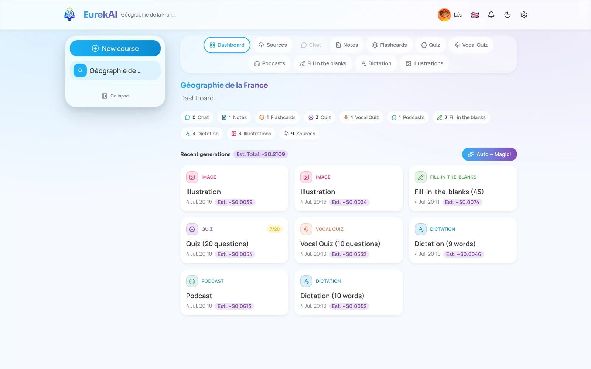<br>**Översiktspanel** — senaste genereringar, beräknad kostnad per kort och totalt för projektet, knappen ”Auto – Magi!” | 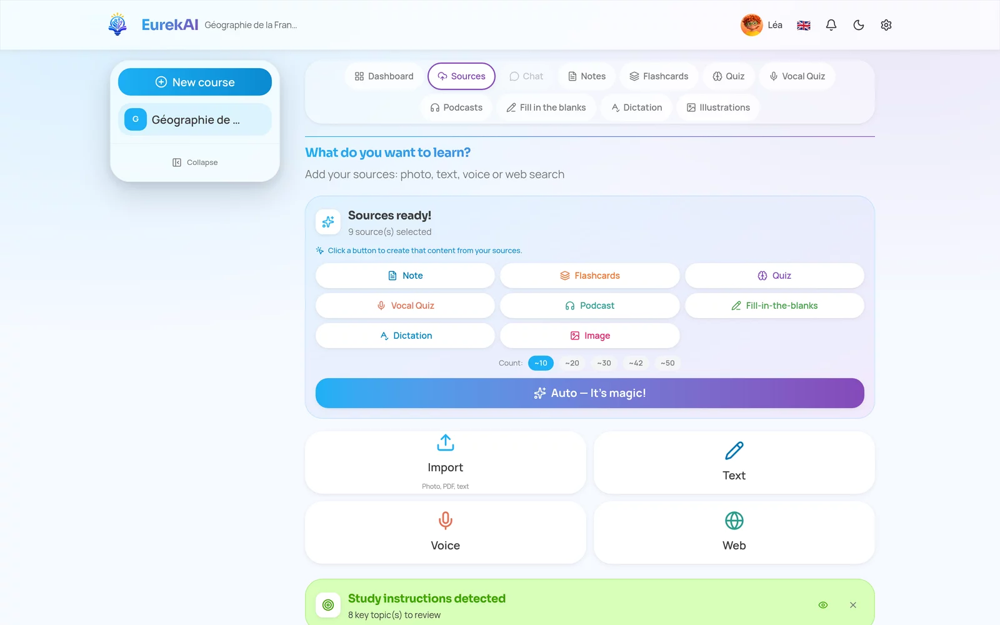<br>**Källor** — import av foto/PDF/text/röst/webb, generering med ett klick, identifiering av instruktioner |

Varje importerad källa visar sin [OCR-konfidenspoäng, modereringsstatus och beräknade kostnad](docs/screenshots/sources-list.webp).

### Komponenterna i praktiken

| | |
|---|---|
| 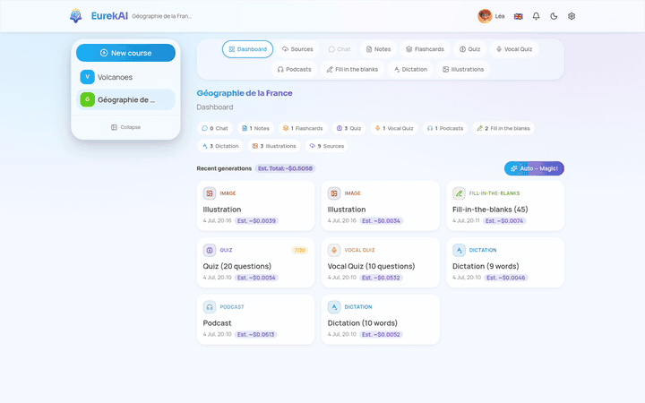<br>**Repetitionsblad** — nyckelpunkter, ordförråd, källhänvisade citat, ljuduppläsning avsnitt för avsnitt | <br>**Flervalsquiz** — endast ett rätt svar per fråga, omedelbar feedback med förklaring, steg-för-steg-navigering |
| 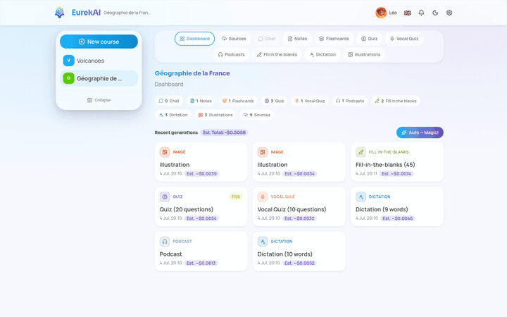<br>**Flashcards** — vänd på kortet och gör självbedömning: ”jag visste / jag visste inte” | <br>**Lucktexter** — ledtråd vid behov, tolerant validering |
| 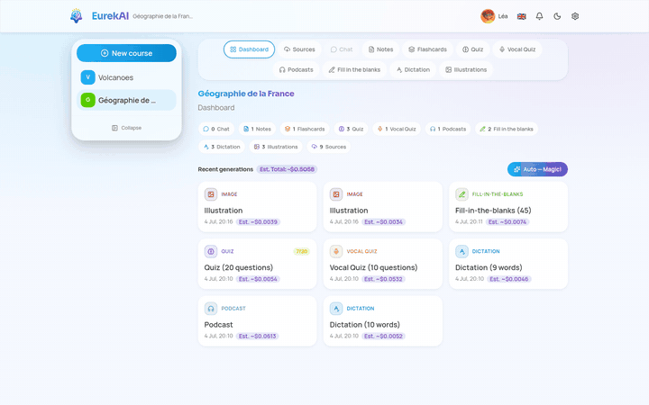<br>**Diktamen** — ord dikterat med ljud, strikt rättning bokstav för bokstav | <br>**Röstquiz** — frågan läses upp högt, svara med mikrofonen |
| <br>**Podd** — minipodd med 2 röster, läsbart dialogmanus | <br>**Illustrationer** — utbildningsbilder genererade av en Agent |
| 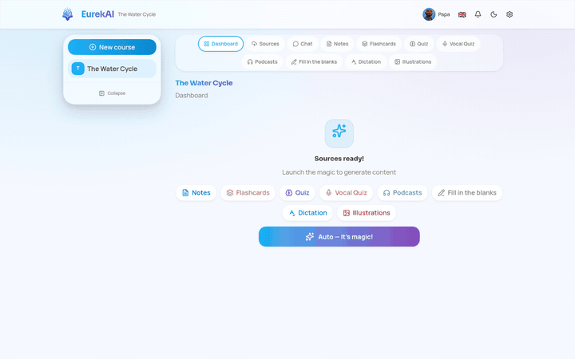<br>**AI-handledare** — chatt förankrad i kursdokumenten, förklarande svar, kan generera quiz och flashcards | |

### Komma igång

| | |
|---|---|
| 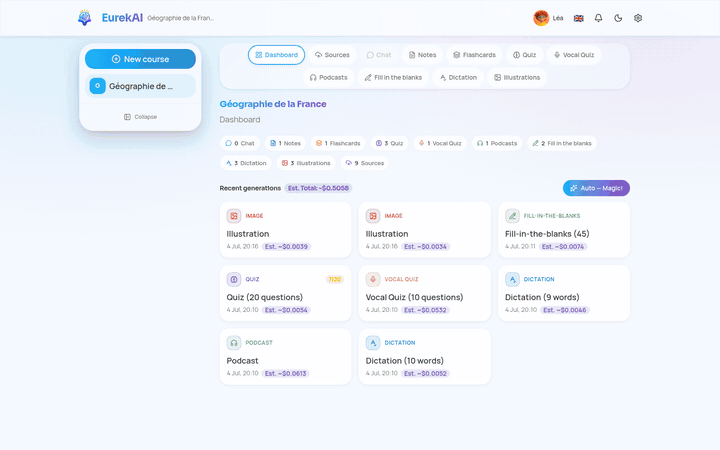<br>**Val av profil** — varje barn har sin egen yta, avatar och sitt eget språk | <br>**Skapa profil** — ålder, avatar, föräldra-PIN för barn under 15 år |
| 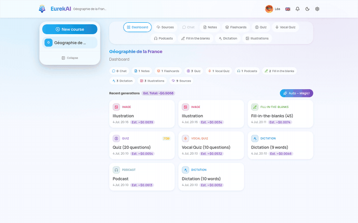<br>**Skapa kurs** — ett projekt per lektion, redo att ta emot källor | 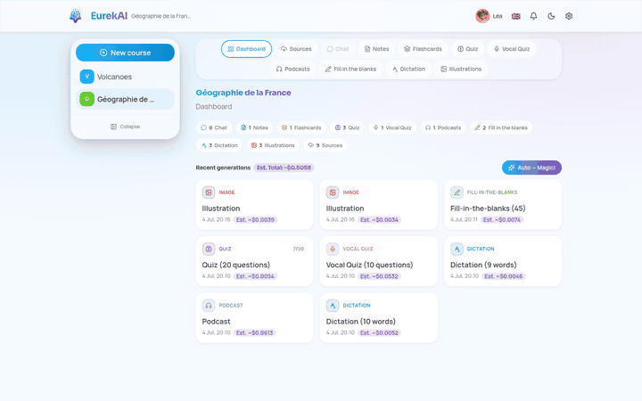<br>**Inställningar** — API-status, val av AI-modeller med visade priser |

---

## Funktioner

| | Funktion | Beskrivning |
|---|---|---|
| 📷 | **Filimport** | Importera dina lektioner – foto, PDF (via Mistral OCR med genomsnittlig konfidenspoäng, nivåerna `high`/`medium`/`low`) eller textfil (TXT, MD). Uppladdningssessioner med återförsök per fil och individuell förloppsindikering |
| 📝 | **Textinmatning** | Skriv eller klistra in valfri text direkt |
| 🎤 | **Röstinmatning** | Spela in dig själv – Voxtral STT transkriberar din röst |
| 🌐 | **Webb / URL** | Klistra in en URL (direkt skrapning via Readability + Lightpanda) eller skriv en sökning (Mistral-agenten web_search) |
| 📄 | **Repetitionsblad** | Strukturerade anteckningar med nyckelpunkter, ordförråd, citat och kuriosa |
| 🃏 | **Flashcards** | Interaktiva frågekort (Q/R), uppläsning i dialogform |
| ❓ | **Flervalsquiz** | Frågor med 4 svarsalternativ varav endast ett rätt svar, med adaptiv repetition av felaktiga svar (konfigurerbart antal) |
| ✏️ | **Lucktexter** | Fyll-i-övningar med ledtrådar och tolerant validering |
| 🔤 | **Diktamen** | Ord som dikteras med ljud (Voxtral TTS) från en importerad lista, tangentbordsinmatning, strikt rättning bokstav för bokstav med förklarad stavningsregel |
| 🎙️ | **Podd** | Minipodd för 2 röster i ljudformat – Mistral-standardröster eller anpassade röster (föräldrar!) |
| 🖼️ | **Illustrationer** | Utbildningsbilder genererade av en Mistral-agent |
| 🗣️ | **Röstquiz** | Frågor läses upp högt (anpassad röst möjlig), muntligt svar, AI-verifiering |
| 💬 | **AI-handledare** | Kontextuell chatt med dina kursdokument, med stöd för verktygsanrop |
| 🧠 | **Automatisk router** | En router baserad på `mistral-small-latest` analyserar innehållet och föreslår en kombination av generatorer bland de 8 tillgängliga typerna |
| 🔁 | **Kontinuitet mellan kurser** | Importer, automatiska genereringar, mikrofoninspelning, chatt, webbsökning och uppläsning fortsätter i sin kurs när en annan kurs öppnas; en avisering anger kursens namn när en process slutförs i bakgrunden |
| 🔒 | **Föräldrakontroll** | Anpassningsbar moderering per profil (anpassningsbara kategorier), föräldra-PIN, chattbegränsningar |
| 🌍 | **Flerspråkig** | Gränssnittet finns på 9 språk; AI-genereringen kan styras på 15 språk via prompter |
| 🔊 | **Högläsning** | Lyssna på repetitionsblad och flashcards (fråga/svar-dialog) via Mistral Voxtral TTS |
| 💶 | **Spårning av API-kostnader** | Transparent uppskattning av kostnaden i € för varje generering och källa (tokens / tecken / sidor / ljudsekunder). Badge per kort + totalt för projektet, synligt i översikten |
| 🎨 | **Tema per profil** | Varje profil väljer sitt tema (`dark` eller `light`) – sparas med profilen och återaktiveras vid varje profilbyte |

---

## Arkitekturöversikt

<p align="center">
  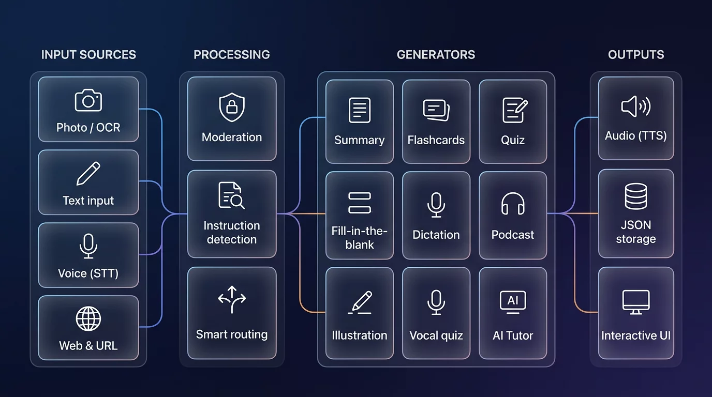
</p>

---

## Karta över modellanvändning

<p align="center">
  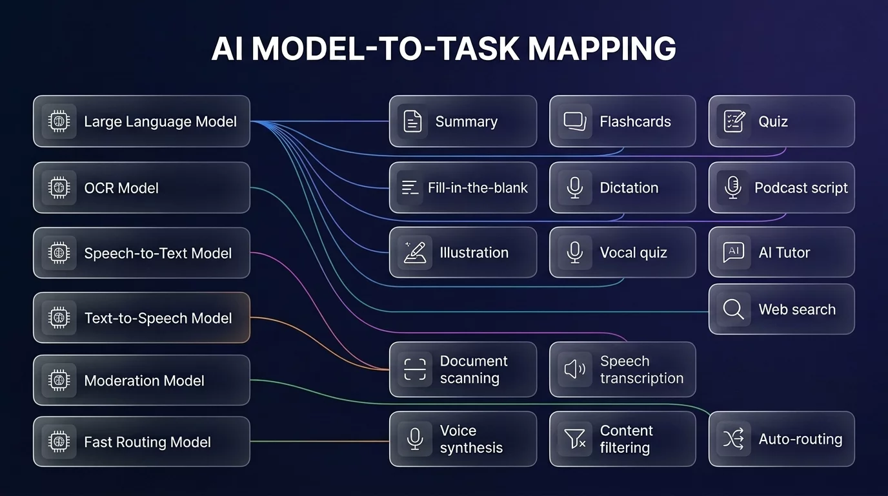
</p>

---

## Användarresa

<p align="center">
  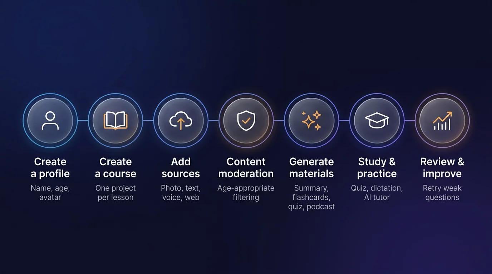
</p>

---

## Fördjupning – Funktioner

### Multimodal inmatning

EurekAI tar emot 4 typer av källor, som modereras utifrån profilen (moderering är aktiverad som standard för barn- och tonårsprofiler):

- **Filimport** — JPG-, PNG- eller PDF-filer som behandlas med Mistral OCR – **OCR 4.1** (`mistral-ocr-4-1`) som standard, **OCR 3** (`mistral-ocr-2512`) som tillval i inställningarna (billigare, ~½ kostnaden; läser handstil bättre) – för tryckt text, tabeller och handstil; eller textfiler (TXT, MD) som importeras direkt. Uppladdning av flera filer använder ett system med **uppladdningssessioner**: individuell förloppsindikering per fil, möjlighet att försöka ladda upp misslyckade filer igen utan att skicka om de andra, samt stängning av sessionen när den är klar. OCR ger en genomsnittlig **konfidenspoäng** (`average`, begränsad till `[0,1]`, beräknad från `averagePageConfidenceScore` som returneras av Mistral), som visas i användargränssnittet som en nivåbricka `high` / `medium` / `low` (trösklar ~0.9 / ~0.7) – varnar utan att blockera om inläsningen är av låg kvalitet. Kopian av dokumentet som skickas till Mistral för OCR raderas omedelbart efter behandlingen, även vid fel.
- **Fritext** — Skriv eller klistra in valfritt innehåll. Modereras före lagring om moderering är aktiverad.
- **Röstinmatning** — Spela in ljud i webbläsaren. Transkriberas av **Voxtral Mini Transcribe 2** (`voxtral-mini-2602`) som standard; **Voxtral Mini Transcribe 3** och **Voxtral Small Transcribe 3** (Mistral-förhandsvisning) finns som tillval i inställningarna. Gränssnittsspråket skickas till modellen (`language`) för att optimera igenkänningen.
- **Webb / URL** — Klistra in en eller flera URL:er för att skrapa innehållet direkt (Readability + Lightpanda för JS-sidor), eller skriv in sökord för en webbsökning via Mistral-agent. Det gemensamma fältet stöder båda – URL:er och sökord separeras automatiskt, och varje resultat skapar en fristående källa.

### AI-innehållsgenerering

Åtta typer av genererat studiematerial:

| Generator | Modell | Resultat |
|---|---|---|
| **Repetitionsblad** | `mistral-large-latest` | Titel, sammanfattning, nyckelpunkter, ordförråd, citat, kuriosa |
| **Flashcards** | `mistral-large-latest` | Frågekort (Q/R) med källhänvisningar (konfigurerbart antal) |
| **Flervalsquiz** | `mistral-large-latest` | Frågor med 4 svarsalternativ varav endast ett rätt svar, förklaringar, adaptiv repetition (konfigurerbart antal) |
| **Lucktexter** | `mistral-large-latest` | Meningar att fylla i med ledtrådar, tolerant validering (Levenshtein) |
| **Diktamen** | `mistral-large-latest` + Voxtral TTS | Nyckelord dikterade som ljud (1 MP3/ord) → tangentbordsinmatning → strikt rättning (en glömd accent räknas som fel) med förklarad regel |
| **Podd** | `mistral-large-latest` + Voxtral TTS | Manus för 2 röster → MP3-ljud |
| **Illustration** | Agent `mistral-large-latest` | Utbildningsbild via verktyget `image_generation` |
| **Röstquiz** | `mistral-large-latest` + Voxtral TTS + STT | TTS-frågor → STT-svar → AI-verifiering |

### AI-handledare via chatt

En samtalsbaserad handledare med full tillgång till kursdokumenten:

- Använder `mistral-large-latest`
- **Verktygsanrop**: kan generera repetitionsblad, flashcards, quiz eller lucktexter under samtalets gång
- Historik på 50 meddelanden per kurs
- Moderering om det är aktiverat för profilen: meddelandet kontrolleras, och flaggade källor, källor vars verifiering misslyckats samt källor som ännu inte verifierats utesluts från kontexten och verktygen (verifieringen av misslyckade eller ännu inte kontrollerade källor startas först om, max 5 sekunder)

### Automatisk router

Routern använder `mistral-small-latest` för att analysera innehållet i källorna och föreslå de mest relevanta generatorerna bland de 8 tillgängliga. Gränssnittet visar förloppet i realtid: först en analysfas, sedan de enskilda genereringarna med möjlighet att avbryta.

Auto körs på servern: det fortsätter om sidan laddas om, om en annan kurs öppnas eller om man byter profil, och endast en Auto-körning åt gången körs per kurs (en andra flik ansluter till den pågående körningen). Servern startar som mest 3 samtidiga genereringar per Mistral-nyckel. Varje slutförd generering får ett eget meddelande, och en slutsammanfattning visas sedan en enda gång; om den blir klar medan en annan kurs visas anger meddelandet vilken kurs det gäller. En enskild avbruten generering räknas inte som ett fel i sammanfattningen. ”Avbryt alla” stoppar hela batchen för kursen med ett enda meddelande. Om servern startar om under en Auto-körning markeras den som avbruten, med en ”Återuppta”-knapp som enbart startar om de genereringar som inte hann slutföras, utan att göra om analysen.

Högst 3 långvariga genereringar som startats från fliken körs samtidigt (manuellt startade genereringar, repetitionsblad): efterföljande väntar på sin tur, och en kurs kan öppnas utan att man behöver vänta på att pågående genereringar ska slutföras.

### Adaptiv inlärning

- **Quizstatistik**: uppföljning av försök och träffsäkerhet per fråga
- **Repetition av quiz**: genererar 5–10 nya frågor inriktade på svaga koncept, baserat på källorna från ursprungsquizet (modereringsskyddet omfattar samma källor)
- **Identifiering av instruktioner**: identifierar repetitionsinstruktioner (”Jag kan min läxa om jag kan...”) och prioriterar dem i kompatibla textgeneratorer (repetitionsblad, flashcards, quiz, lucktexter). Med aktiv moderering väntar identifieringen på att källorna verifieras och läser endast de som bedöms som säkra; instruktionen behåller listan över sina ursprungliga källor: om en av dem flaggas visas eller tillämpas instruktionen inte, och om en av dem raderas tas instruktionen bort. Dess kostnad räknas in

### Säkerhet & föräldrakontroll

- **4 åldersgrupper**: barn (≤10 år), tonåring (11–15), student (16–25), vuxen (26+)
- **Innehållsmoderering**: `mistral-moderation-2603` (Mistral Moderation 2) med 11 tillgängliga kategorier, 6 blockerade som standard för nya barn-/tonårsprofiler (`sexual`, `hate_and_discrimination`, `violence_and_threats`, `criminal`, `selfharm`, `jailbreaking`; `criminal` tillagd efter en mätning på 50 lektioner, inklusive historia, utan några falska positiva). Anpassningsbara kategorier per profil i inställningarna; Moderation 2 delade upp den tidigare kategorin ”farligt innehåll” i `dangerous` + `criminal` (befintliga profiler migreras automatiskt och de blockerade kategorierna tillämpas även på redan importerade källor). Säkerhet som standard: om modellens svar inte tillåter att en blockerad kategori verifieras nekas innehållet (”Moderering inte tillgänglig”); med aktiv moderering utesluter både generering och chatt flaggade källor, källor vars verifiering misslyckades samt källor under verifiering. En källa som aldrig har verifierats (importerad när moderering var inaktiverad, eller ett äldre projekt kopplat till en profil) verifieras före användning. En moderering som avbrutits av en omstart återupptas vid start om servernyckeln tillåter det; annars återupptas den, precis som en moderering som stött på fel, när projektet öppnas eller vid nästa generering. Knappen ”Verifiera igen” startar om verifieringen på begäran. Med aktiv moderering är en källas innehåll dolt för barnet (förhandsgranskning, text, originaldokument) så länge den inte bedöms som säker; en förälder kan visa det med sin PIN-kod för en enstaka visning. Det muntliga svaret i röstquizet modereras innan det verifieras. Daterat ID fäst i `helpers/moderation-model.ts`: det föråldrade aliaset `-latest` listas inte längre av API:et.
- **Föräldra-PIN**: SHA-256-hash, krävs för profiler under 15 år; högst 10 felaktiga koder per kvart och IP-adress (429 `rate_limited`). För produktionsdriftsättning bör en långsam hash med salt användas (Argon2id, bcrypt).
- **Serverdata**: `/output` publicerar endast projektmedia (ljud, bilder, importerade filer); `profiles.json`, `config.json`, `projects.json` och `project.json` serveras aldrig
- **Chattbegränsningar**: AI-chatt är inaktiverad som standard för personer under 16 år, kan aktiveras av föräldrar

### Flerprofilssystem

- Flera profiler med namn, ålder, avatar, språkinställningar
- **Röst per profil** (`Profile.mistralVoices?: { host?, guest? }` – varje roll är valfri) – varje barn kan ha sitt eget röstpar för podcast/röstquiz
- **Tema per profil** (`Profile.theme: 'dark' | 'light'`) – växlar automatiskt vid profilbyte, bevaras i backend
- Projekt länkade till profiler via `profileId`; ett äldre projekt utan profil knyts till den första profilen som öppnar det och modereras sedan enligt den profilen
- Kaskadradering: att ta bort en profil raderar alla dess projekt

### Spårning av API-kostnader

Varje fakturerbart Mistral-anrop (chatt, OCR, STT, TTS, agenter), inklusive instruktionsidentifiering och muntliga svar i röstquizet, instrumenteras för att ge en **transparent** €-uppskattning till användaren. Modereringen är gratis och räknas inte. Verktygskostnader för agenter ingår: 0,03 $ per webbsökning och 0,10 $ per genererad bild (Mistral-tariffer), plus tokens som genereras av dessa verktyg, vilka uppskattningen räknar till indatapriset för agentens modell.

- **Sanningskälla**: `helpers/pricing.ts` – `MODEL_PRICING` per modellprefix (t.ex. `mistral-large` → input 0,5 €/M tokens, output 1,5 €/M tokens), `PRICING_SOURCES` med Mistral-dokumentations-URL:er för periodisk återskrapning
- **Enheter som stöds**: `tokens`, `characters` (TTS), `pages` (OCR), `audio-seconds` (STT) – konvertering styrs av `helpers/cost-calc.ts`
- **Instrumenteringskedja**: `helpers/tracked-client.ts` (kapslar in Mistral-klienten) → `helpers/usage-context.ts` (AsyncLocalStorage) → `helpers/cost-calc.ts` → `helpers/cost-persist.ts` → `helpers/cost-middleware.ts` (injektion i HTTP-svaret)
- **UI**: kostnadsbricka per generering (`src/partials/cost-badge-gen.html`), per källa (`cost-badge-src.html`), ackumulerad totalsumma i instrumentpanelen (`Project.totalCost`)
- **Slutpunkter**: svaren `/generate/*` och `/sources/*` dekorerar det returnerade objektet (`Generation` / `Source`) med `estimatedCost`, `usage` och `costBreakdown`. `POST /generate/route` lägger till fältet `costDelta: number` för enbart dirigeringskostnaden; `POST /detect-consigne` (`{consigne, costDelta}`) och verifieringen av ett muntligt svar returnerar också sitt `costDelta`. `GET /projects/:pid` returnerar projektet berikat med `totalCost` (beräknad summa från `costLog[]`) + hela historiken

### TTS (Mistral Voxtral) & anpassade röster

- **Mistral Voxtral TTS**: **Voxtral TTS** (`voxtral-mini-tts-2603`) som standard, **Voxtral TTS 3** (`voxtral-mini-tts-3-0`, förhandsversion från Mistral, modersmålsröster på fler språk) som tillval i Inställningar; 100 % Mistral-talsyntes, ingen extra nyckel krävs. Endast röster som den valda modellen accepterar föreslås: Voxtral TTS avvisar röster som lagts till med Voxtral 3
- **Anpassade röster**: föräldrar kan skapa sina egna röster via Mistral Voices API (från ett ljudprov) och tilldela dem till rollerna värd/gäst – poddar och röstquiz läses då upp med en förälders röst, vilket gör upplevelsen ännu mer engagerande för barnet
- Två konfigurerbara röstroller: **värd** (huvudberättare) och **gäst** (poddens andra röst)
- Fullständig katalog över Mistral-röster finns tillgänglig i inställningarna, filtrerbar efter språk
- En uppläsning (sammanfattningsblad, podcast, diktamensord) pausas när man lämnar dess vy och återupptas där den slutade
- Ljudet för högläsning av flashcards skapas vid den första lyssningen och bevaras sedan i deras generering: det varken återskapas eller debiteras på nytt vid varje återbesök
- Källmarkörer (`[Source N]`) läses inte upp högt

### Internationalisering

- Gränssnittet finns på 9 språk: fr, en, es, pt, it, nl, de, hi, ar
- AI-prompter stöder 15 språk (fr, en, es, de, it, pt, nl, ja, zh, ko, ar, hi, pl, ro, sv)
- Språk kan konfigureras per profil

---

## Teknisk stack

| Skikt | Teknologi | Roll |
|---|---|---|
| **Runtime** | Node.js + TypeScript 6.x | Server och typsäkerhet |
| **Backend** | Express 5.x | REST-API |
| **Utvecklingsserver** | Vite 8.x (Rolldown) + tsx | HMR, Handlebars-partials, proxy |
| **Frontend** | HTML + TailwindCSS 4.x + Alpine.js 3.x | Reaktivt gränssnitt, TypeScript kompilerat av Vite |
| **Mallmotor** | vite-plugin-handlebars | HTML-komposition via partials |
| **AI** | Mistral AI SDK | Chatt, OCR, STT, TTS, agenter, moderering |
| **TTS** | Mistral Voxtral TTS | `voxtral-mini-tts-2603` (Voxtral TTS 3 som tillval), integrerad talsyntes |
| **Ikoner** | Lucide 1.x | SVG-ikonbibliotek |
| **Webbskrapning** | Readability + linkedom | Extrahering av huvudinnehåll från webbsidor (teknik från Firefox Reader View) |
| **Headless-webbläsare** | Lightpanda | Ultralätt headless-webbläsare (Zig + V8) för JS/SPA-sidor – reserv för skrapning |
| **Markdown** | Marked | Markdown-rendering i chatten |
| **Filuppladdning** | Multer 2.x | Hantering av multipart-formulär |
| **Ljud** | ffmpeg-static | Sammanslagning av ljudsegment |
| **Tester** | Vitest | Enhetstester – täckning mätt med SonarCloud |
| **Persistens** | JSON-filer | Lagring utan externa beroenden |

---

## Modellreferens

| Modell | Användning | Varför |
|---|---|---|
| `mistral-large-latest` | Sammanfattningsblad, flashcards, podcast, quiz, lucktexter, chatt, verifiering av röstquiz, bildagent, webbsökningsagent, instruktionsidentifiering | Bästa flerspråkighet + instruktionsföljning |
| `mistral-ocr-4-1` (OCR 4.1, standard) | Dokument-OCR | Tryckt text, tabeller, handstil ($4 / 1000 sidor) |
| `mistral-ocr-2512` (OCR 3, tillval) | Dokument-OCR | Valbar i Inställningar, billigare ($2 / 1000 sidor), läser handstil bättre |
| `voxtral-mini-2602` (Voxtral Mini Transcribe 2, standard) | Röstigenkänning (STT) | Röstinmatning och muntliga svar i röstquiz ($0.003 / min) |
| `voxtral-mini-transcribe-3-0` / `voxtral-small-transcribe-3-0` (Transcribe 3, tillval, förhandsversion) | Röstigenkänning (STT) | Valbara i Inställningar ($0.0035 / min och $0.004 / min) |
| `voxtral-mini-tts-2603` (Voxtral TTS, standard) | Talsyntes (TTS) | Poddar, röstquiz, diktamen, högläsning ($16 / M tecken) |
| `voxtral-mini-tts-3-0` (Voxtral TTS 3, tillval, förhandsversion) | Talsyntes (TTS) | Valbar i Inställningar, infödda röster på fler språk ($13 / M tecken) |
| `mistral-moderation-2603` | Innehållsmoderering | 6 blockerade kategorier för barn/tonåring (inklusive `jailbreaking`) |
| `mistral-small-latest` | Automatisk dirigerare | Snabb innehållsanalys för dirigeringsbeslut |

På mobil visar Inställningar under varje väljare den fullständiga beteckningen för den valda modellen (pris, ”Rekommenderad” eller ”Förhandsversion”), som tidigare klipptes av när menyn var stängd.

---

## Snabbstart

```bash
# Cloner le dépôt
git clone https://github.com/jls42/EurekAI.git
cd EurekAI

# Installer les dépendances
npm install

# Configurer les clés API
cp .env.example .env
# Éditez .env (toutes optionnelles) :
#   MISTRAL_API_KEY=<your_api_key>           (optionnel — sinon chaque utilisateur saisit sa clé dans l'app)
#   SONAR_TOKEN=...                          (optionnel, CI SonarCloud uniquement)

# Lancer le développement
npm run dev
# → Backend :  http://localhost:3000 (API)
# → Frontend : http://localhost:5173 (serveur Vite avec HMR)
```

> **Obs**: Mistral Voxtral TTS är den enda TTS-leverantören – ingen extra nyckel krävs utöver `MISTRAL_API_KEY`.

> **Användarangiven API-nyckel**: `MISTRAL_API_KEY` är nu **valfri**. Om den saknas startar appen ändå och uppmanar varje användare att ange **sin egen Mistral-nyckel** i gränssnittet. Nyckeln **lagras i webbläsaren** (krypterad via Web Crypto + IndexedDB i säker kontext) och skickas per förfrågan – **sparas aldrig på servern**. Företrädesordning: profilnyckel > global webbläsarnyckel > `MISTRAL_API_KEY` (miljövariabel). Att definiera `EUREKAI_REQUIRE_USER_KEY=true` tvingar varje användare att ange sin egen nyckel (miljövariabelnyckeln används då endast för förinläsning).

> **Lokal HTTPS (surfplatta/LAN)**: `localhost` är redan en säker kontext. För LAN-åtkomst (surfplatta), generera ett lokalt certifikat och aktivera HTTPS: webbläsaren kan då kryptera nyckeln den lagrar, och nyckeln är krypterad under överföringen:
> ```bash
> ./scripts/gen-cert.sh 192.168.1.42   # mkcert si dispo, sinon openssl self-signed
> export HTTPS_KEY=certs/key.pem HTTPS_CERT=certs/cert.pem
> npm run dev                          # Express + Vite en HTTPS
> ```

### Miljövariabler

| Variabel | Krävs | Standard | Roll |
|---|---|---|---|
| `MISTRAL_API_KEY` | valfri | — | Mistral API-nyckel (chatt, OCR, STT, TTS Voxtral, agenter, moderering). Om den saknas anger användaren sin nyckel i appen (lagras i webbläsaren, aldrig på servern) |
| `EUREKAI_REQUIRE_USER_KEY` | valfri | `false` | `true` → inaktiverar fallback till `MISTRAL_API_KEY` för AI-förfrågningar (varje användare MÅSTE tillhandahålla sin nyckel). Användbart på en exponerad instans |
| `HTTPS_KEY` / `HTTPS_CERT` | valfri | — | Sökvägar för TLS-nyckel/certifikat (se `scripts/gen-cert.sh`) → Express och Vite serverar via HTTPS (säker kontext för LAN/surfplatta) |
| `PORT` | valfri | `3000` | HTTP-port för Express-backend |
| `NODE_ENV` | valfri | `development` | Om `production` → Express serverar frontend från `dist/` (annars `public/`) |
| `SONAR_TOKEN` | valfri CI | — | Används endast av GitHub Actions-arbetsflödet för SonarCloud |

### Tester, kodkvalitet och bidrag

```bash
npm test                # vitest (déclenche pretest : typecheck + lint:complexity + lint:ci + lint:deadcode)
npm run test:coverage   # couverture vitest
npm run lint            # ESLint + typescript-eslint + sonarjs
npm run lint:fix        # auto-fix
npm run format          # prettier
npm run security        # Opengrep (SAST local) — bloque sur finding ERROR
```

**Git-hooks (Husky)**: `pre-commit` kör i följd `scripts/pre-commit-fast.sh` (konflikter, stora filer, shellcheck), `lint-staged` och sedan `npm test`; `pre-push` kör först en blockerande kontroll `npm audit` (blockerar så snart ett beroende, även transitivt, har en sårbarhet på nivån `critical`, se `scripts/audit-verdict.mjs`) och sedan `npm run security`. Varje hook blockerar commit/push så snart något av dess steg misslyckas.

**Externa verktyg (valfria för att köra applikationen, nödvändiga för `pretest` och `npm run security`)**:

```bash
# Lizard (Python) pour lint:complexity (CCN > 8 sur l'allowlist)
pipx install lizard          # ou : pipx run lizard

# Opengrep (binaire standalone ~40 Mo) pour npm run security
./scripts/install-opengrep.sh   # installe dans ~/.local/bin/
```

Utan dessa verktyg misslyckas `npm test` vid `pretest` (lizard saknas) och `npm run security` misslyckas (opengrep saknas). Då blockerar Husky-hooks commit/push.

---

## Driftsättning med container

Avbildningen publiceras på **GitHub Container Registry**:

```bash
# Télécharger l'image
podman pull ghcr.io/jls42/eurekai:latest

# Lancer EurekAI
mkdir -p ./data
podman run -d --name eurekai \
  -e MISTRAL_API_KEY=<your_api_key> \
  -v ./data:/app/output:U \
  -p 3000:3000 \
  ghcr.io/jls42/eurekai:latest
# → http://localhost:3000
```

> **`:U`**: flagga för rotlös Podman (rootless) som automatiskt justerar volymens behörigheter.

```bash
# Build local
podman build -t eurekai -f Containerfile .

# Publier sur ghcr.io (mainteneurs)
./scripts/publish-ghcr.sh
```

---

## Projektstruktur

```
server.ts                 — Point d'entrée Express, monte les routes + config
config.ts                 — Config runtime (modèles, voix, modèle TTS), persistée dans output/config.json
store.ts                  — ProjectStore : CRUD projets/sources/générations, persistance JSON
profiles.ts               — ProfileStore : gestion des profils, hachage PIN
types.ts                  — Types TypeScript : Source, Generation (8 types), QuizStats, Profile
prompts.ts                — Tous les prompts IA centralisés (system + user templates, 15 langues)

generators/
  auto-agents.ts          — Source unique de vérité : AUTO_AGENTS_SET (8 agents) + MAX_AUTO_PLAN_LENGTH
  generation-types.ts     — Types générables individuellement (SINGLE_GENERATE_TYPES, coïncide avec les 8 agents auto)
  ocr.ts                  — OCR via Mistral (JPG, PNG, PDF) avec extraction interne des scores de confiance moyens par page
  summary.ts              — Génération de fiche de révision (JSON structuré)
  flashcards.ts           — Flashcards Q/R (nombre configurable)
  quiz.ts                 — Quiz QCM (nombre configurable) + révision adaptative
  fill-blank.ts           — Exercices à trous avec validation tolérante
  dictation.ts            — Dictée : mots + phrases-exemples + règles, 1 audio TTS par mot (8e agent auto)
  podcast.ts              — Script podcast 2 voix
  quiz-vocal.ts           — Quiz vocal : questions TTS + réponses STT + vérification IA
  image.ts                — Génération d'image via Agent Mistral (outil image_generation)
  chat.ts                 — Tuteur IA par chat avec appel d'outils
  router.ts               — Routeur automatique (contenu → générateurs recommandés)
  consigne.ts             — Détection de consignes de révision
  tts-provider.ts         — TTS Mistral Voxtral (synthèse vocale + listing des voix)
  tts.ts                  — Génération audio multi-voix (podcast + flashcards, concaténation de segments)
  stt.ts                  — Voxtral STT (audio → texte)
  websearch.ts            — Agent Mistral avec outil web_search (fallback)
  moderation.ts           — Modération de contenu (filtrage par âge)

routes/
  projects.ts             — CRUD projets
  profiles.ts             — CRUD profils avec gestion du PIN
  sources.ts              — Import fichiers (OCR + texte brut), texte libre, voix STT, scraping URL + recherche web, modération
  generate.ts             — Endpoints de génération (8 types + route)
  auto-runs.ts            — Lots Auto côté serveur : lancement, analyse et étapes en arrière-plan, état, annulation
  generations.ts          — Tentatives de quiz/fill-blank, réponses vocales, lecture à voix haute
  chat.ts                 — Chat IA avec appel d'outils

helpers/
  # IO & parsing
  index.ts                — getContent, stripJsonMarkdown, safeParseJson, tryParseJson, retryTurns, unwrapJsonArray, extractAllText, timer
  audio.ts                — collectStream (ReadableStream → Buffer)
  audio-files.ts          — Persistance et lecture des fichiers audio générés (podcast, flashcards)
  generation-media.ts     — Noms uniques des médias (MP3/PNG) et suppression avec leur génération
  media-ledger.ts         — Médias écrits pendant une génération, supprimés si elle échoue ou est annulée
  keyed-lock.ts           — File d'attente par clé (OCR sérialisé par contenu)
  keyed-slots.ts          — Places par clé (au plus 3 étapes d'Auto en même temps par clé Mistral)
  logger.ts               — Logger structuré (niveaux, contexte JSON)

  # Génération & UX
  auto-title.ts           — autoTitle(type, data, lang) : préfixe auto pour carte liste (Fiche, Note, Quiz, etc.)
  choice-labels.ts        — Labels localisés des choix (quiz, quiz-vocal) — 9 langues
  diversity.ts            — Diversité des générations (exclusion du contenu déjà produit, `diversityParams` : temperature/presencePenalty/randomSeed)
  fill-blank-validate.ts  — Validation tolérante des réponses (normalisation, Levenshtein)
  dictation-diff.ts       — Comparaison stricte lettre à lettre pour la correction de dictée (local, zéro coût IA)
  reading-comfort.ts      — Option « Confort de lecture » par profil (police Luciole, espacements) — partagé serveur/client
  ocr-models.ts           — Source de vérité sélection OCR (OCR 4 défaut / OCR 3 option) + normalizeOcrModel
  moderation-model.ts     — Modèle de modération épinglé + ses 11 catégories + migration des catégories legacy
  stt-models.ts           — Source de vérité sélection transcription (Mini Transcribe 2 défaut / Transcribe 3 option) + normalizeSttModel
  tts-models.ts           — Source de vérité sélection synthèse vocale (Voxtral TTS défaut / TTS 3 option) + compatibilité des voix
  tts-text.ts             — Texte envoyé au TTS : marqueurs de sources et crochets retirés (Voxtral les lit ou avale le mot)
  source-markers.ts       — Regex des marqueurs `[Source N]` des fiches (pastilles côté navigateur, texte lu côté serveur)
  moderation-http.ts      — Statut de modération → réponse HTTP (400 signalé / 503 indisponible / 409 en cours), statut effectif, garde de la consigne
  moderation-profile.ts   — Profil propriétaire du projet et catégories actives (source unique des routes)
  source-moderation.ts    — Modérations en vol et reprise (démarrage, génération, chat, « Revérifier »)
  input-moderation.ts     — Modération d'un texte saisi ou dicté (texte libre, recherche web, réponse orale)
  chat-sources.ts         — Sources accessibles au chat (sans les sources non vérifiées si la modération est active)

  # Codes d'erreur stables
  error-codes.ts              — Re-export mince de l'API publique
  error-code-resolution.ts    — Orchestration extractErrorCode(e, agent) → FailedStepCode
  error-code-rules.ts         — Règles de mapping par agent/step
  error-matchers.ts           — Matchers par pattern d'erreur HTTP/LLM (délimités pour Lizard)

  # Cost tracking API (suivi coûts €)
  pricing.ts              — MODEL_PRICING + PRICING_SOURCES (tarifs Mistral par prefix de modèle)
  cost-calc.ts            — Conversion ApiUsage → coût € (tokens / characters / pages / audio-seconds)
  cost-persist.ts         — Écriture dans Project.costLog + totalCost
  cost-middleware.ts      — Injection de costDelta dans la réponse HTTP
  tracked-client.ts       — Wrap du client Mistral (capture ApiUsage automatiquement)
  usage-context.ts        — AsyncLocalStorage pour propager l'usage dans les pipelines async

  # Clé API Mistral & sécurité
  mistral-client-factory.ts — Source UNIQUE de construction du client Mistral (buildTrackedClient, resolveClient, requireKeyMiddleware)
  rate-limit.ts           — Rate-limiters Express (authLimiter, pinLimiter, aiLimiter / aiPathLimiter, generalLimiter), 429 `rate_limited`
  request-validation.ts   — Validation de lang / ageGroup sur toutes les routes IA (400 invalid_input)
  output-static.ts        — Liste blanche du montage statique /output (médias des projets seulement)
  security-headers.ts     — Options Helmet / CSP (createHelmetOptions)
  redact.ts               — Redaction des secrets dans les logs (clé API, headers sensibles)
  mistral-retry.ts        — Retry avec backoff sur erreurs transitoires Mistral (3 tentatives)

  # Événements & notifications (SSE)
  event-bus.ts            — Bus d'événements de génération et de lots Auto en mémoire (dispatch SSE, filet anti-uncaughtException)
  auto-run-state.ts       — Transitions d'un lot Auto (fonctions pures, appliquées par le store)
  event-key.ts            — Clé d'événement typée partagée client/serveur (idempotence notifications)

  # Voix & profils
  voice-selection.ts      — selectVoices : rotation déterministe par profil + langue (host/guest)
  voice-types.ts          — Type MistralVoice (importable côté frontend sans embarquer le SDK Mistral)

src/                      — Frontend (Vite + Handlebars)
  index.html              — Point d'entrée HTML principal
  main.ts                 — Entrée frontend (init Alpine.js + icônes Lucide)
  app/                    — Modules applicatifs Alpine.js
    state.ts              — Gestion d'état réactif
    navigation.ts         — Routage des vues + gardes par âge
    view-media.ts         — Pause du son au changement de vue (position gardée)
    profiles.ts           — Logique du sélecteur de profils
    projects.ts           — CRUD des cours
    sources.ts            — Gestionnaires d'upload de sources
    generate.ts           — Déclencheurs de génération (individuel, tout, Auto)
    auto-launch.ts        — Lancement d'un Auto côté serveur, suivi pendant qu'un autre cours est affiché, annulation
    auto-runs.ts          — Auto suivis par l'onglet : état reçu du serveur, bilan affiché une seule fois, coût de l'analyse
    request-slots.ts      — Au plus 3 générations longues en même temps pour l'onglet, file d'attente FIFO
    moderation-gate.ts    — Pré-contrôle de modération des générations (vérifie d'abord les sources en attente)
    effective-moderation.ts — Statut de modération affiché et masquage du contenu des sources
    generations.ts        — Affichage + actions sur les générations
    chat.ts               — Interface de chat
    chat-in-flight.ts     — Messages du chat en attente de réponse, par cours
    config.ts             — Interface de configuration (modèles de chat, d'OCR, de transcription et de TTS, voix)
    render.ts             — Helpers de rendu HTML
    i18n.ts               — Changement de langue
    ...
  components/
    quiz.ts               — Composant quiz interactif
    quiz-vocal.ts         — Composant quiz vocal
    fill-blank.ts         — Composant textes à trous
    fill-blank-validate.ts — Ré-export client de la validation textes à trous (validateAnswer)
    flashcards.ts         — Composant flashcards avec retournement
    dictation.ts          — Composant dictée interactif
    step-by-step.ts       — Mixin navigation pas-à-pas (quiz, fill-blank, flashcards)
  i18n/
    fr.ts, en.ts, es.ts, — Dictionnaires par langue (9 langues)
    pt.ts, it.ts, nl.ts,
    de.ts, hi.ts, ar.ts
    languages.ts          — Registre des langues UI disponibles
    index.ts              — Chargeur i18n
  partials/               — Partials HTML Handlebars (header, sidebar, dialogues, vues)
  styles/
    main.css              — Entrée TailwindCSS
    theme.css             — Variables de thème personnalisées

public/assets/            — Ressources statiques (logo, avatars, schémas architecture)
docs/                     — Notes internes (inventaire prompts, audits, prompts des diagrammes) + screenshots du README
scripts/                  — Tooling : check-deps, check-models, check-security, check-complexity, gen-cert, install-opengrep, translate-readme, publish-ghcr, update-pricing
output/                   — Données d'exécution (projets, config, fichiers audio) ; en mode prod (`NODE_ENV=production`), Express sert le frontend depuis `dist/` au lieu de `public/`
```

> **För AI-agenter som bidrar till koden**: se [`CLAUDE.md`](CLAUDE.md) (övergripande regler, index) och de detaljerade reglerna i [`.claude/rules/`](.claude/rules/), som läses in på begäran utifrån vilka filer som läses eller ändras, för detaljerad arkitekturkontext, obligatoriska regler (felkoder, kostnadsspårning samt prompter utan meta-ord, det vill säga utan beskrivningar av dokumentet såsom dess typ, eftersom modellen annars skulle återge dessa ord i sina utdata) och kända fallgropar (Lizard CCN, Opengrep, Codacy/Semgrep-migrering).

---

## API-referens

### Konfiguration
| Metod | Slutpunkt | Beskrivning |
|---|---|---|
| `GET` | `/api/config` | Aktuell konfiguration |
| `PUT` | `/api/config` | Ändra konfigurationen (modeller, röster, TTS-modell) |
| `GET` | `/api/config/status` | API-status: `mistral` (Mistral-nyckel definierad), `ttsAvailable` (alias för `mistral`, Mistral Voxtral är den enda TTS-leverantören) |
| `POST` | `/api/config/reset` | Återställ standardkonfigurationen |
| `GET` | `/api/config/voices` | Lista Mistral TTS-röster (valfritt `?lang=fr`) |
| `GET` | `/api/moderation-categories` | Tillgängliga modereringskategorier + standardvärden efter ålder |
| `POST` | `/api/providers/mistral/validate` | Validera en användarangiven Mistral-nyckel – alltid 200 `{status}` (`ok`/`invalid`/`quota`/`network`/`missing`), ingen fallback till miljövariabel |

### Profiler
| Metod | Slutpunkt | Beskrivning |
|---|---|---|
| `GET` | `/api/profiles` | Lista alla profiler |
| `POST` | `/api/profiles` | Skapa en profil |
| `PUT` | `/api/profiles/:id` | Redigera en profil (PIN krävs för < 15 år; 10 felaktiga PIN-koder / 15 min → 429 `rate_limited`) |
| `DELETE` | `/api/profiles/:id` | Ta bort en profil + kaskadradering av projekt `{pin?}` → `{ok, deletedProjects}` |

### Projekt
| Metod | Slutpunkt | Beskrivning |
|---|---|---|
| `GET` | `/api/projects` | Lista projekt (`?profileId=` valfritt) |
| `POST` | `/api/projects` | Skapa ett projekt `{name, profileId}` |
| `GET` | `/api/projects/:pid` | Projektdetaljer; `?profileId=` knyter ett projekt utan profil till profilen som öppnar det |
| `PUT` | `/api/projects/:pid` | Byt namn på `{name}` |
| `DELETE` | `/api/projects/:pid` | Ta bort projektet |
| `GET` | `/api/projects/:pid/events` | SSE-realtidsström (`event: generation`) för genereringsövergångar (`completed`/`failed`/`cancelled`) + keep-alive-heartbeat |

### Källor
| Metod | Slutpunkt | Beskrivning |
|---|---|---|
| `POST` | `/api/projects/:pid/sources/upload` | Importera multipart-filer (OCR för JPG/PNG/PDF, direktläsning för TXT/MD) |
| `POST` | `/api/projects/:pid/sources/text` | Fritext `{text}` |
| `POST` | `/api/projects/:pid/sources/voice` | Röst-STT (multipart-ljud) |
| `POST` | `/api/projects/:pid/sources/websearch` | URL-skrapning eller webbsökning `{query}` – returnerar en array med källor; 422 `url_blocked` om alla adresser nekas (internt nätverk), 502 `all_sources_failed` om ingen källa kunde skapas |
| `POST` | `/api/projects/:pid/sources/moderate` | Återuppta väntande eller felaktiga modereringar `{sourceIds?}` (högst 10 per anrop, väntetid ≤ 10 s) → `{sources: [{id, moderation}]}` |
| `DELETE` | `/api/projects/:pid/sources/:sid` | Ta bort en källa, dess importerade fil och instruktionen som beror på den → `{ok, consigne}` |
| `POST` | `/api/projects/:pid/moderate` | Moderera `{text}` |
| `POST` | `/api/projects/:pid/detect-consigne` | Identifiera repetitionsinstruktioner (endast verifierade källor) → `{consigne, costDelta}` |

### Generering
| Metod | Endpoint | Beskrivning |
|---|---|---|
| `POST` | `/api/projects/:pid/generate/summary` | Repetitionsblad |
| `POST` | `/api/projects/:pid/generate/flashcards` | Flashcards |
| `POST` | `/api/projects/:pid/generate/quiz` | Flervalsquiz (4 alternativ, endast ett rätt svar) |
| `POST` | `/api/projects/:pid/generate/fill-blank` | Lucktexter |
| `POST` | `/api/projects/:pid/generate/dictation` | Diktamen (ord + exempelmeningar + regler, 1 TTS-ljud per ord; föreslås även av auto-routern) |
| `POST` | `/api/projects/:pid/generate/podcast` | Podcast |
| `POST` | `/api/projects/:pid/generate/image` | Illustration |
| `POST` | `/api/projects/:pid/generate/quiz-vocal` | Röstquiz |
| `POST` | `/api/projects/:pid/generate/quiz-review` | Adaptiv repetition `{generationId, weakQuestions}` |
| `POST` | `/api/projects/:pid/generate/remediation-summary` | Riktat repetitionsblad för missade frågor från ett quiz `{generationId, weakQuestions}` — anropas parallellt med `quiz-review` via åtgärdsknappen i quizvyn |
| `POST` | `/api/projects/:pid/generate/route` | Ruttanalys (plan över generatorer som ska köras) — returnerar `{plan, costDelta}` (endast routningskostnad) |
| `POST` | `/api/projects/:pid/generate/auto/start` | Starta en Auto-batch på serversidan `{runId, …}`: omedelbart 202-svar, därefter analys och steg i bakgrunden, som mest 3 steg samtidigt per Mistral-nyckel; batchen fortsätter om sidan laddas om. 409 `auto_busy` om en batch redan körs för denna kurs |
| `POST` | `/api/projects/:pid/generate/auto/resume` | Återuppta en Auto-batch som avbrutits av en serveromstart `{runId}`: dess avbrutna steg startar om med nyckeln från denna förfrågan, utan att göra om analysen (202-svar) |
| `GET` | `/api/projects/:pid/auto-runs/:runId` | Status för en Auto-batch: analys, steg och utfall för vart och ett |
| `POST` | `/api/projects/:pid/auto-runs/:runId/cancel` | Avbryt en hel Auto-batch (ett enskilt steg avbryts som en generering) |

Alla genereringsrutter accepterar `{sourceIds?, lang?, ageGroup?, count?, useConsigne?}`; en okänd `ageGroup` eller en `lang` som inte är en giltig språkkod (förväntat: `fr`, `pt-BR`…) → 400 `invalid_input`, före varje AI-anrop. `quiz-review` och `remediation-summary` kräver dessutom `{generationId, weakQuestions}` och baseras på källorna från ursprungsquizet.

### CRUD Genereringar
| Metod | Endpoint | Beskrivning |
|---|---|---|
| `POST` | `/api/projects/:pid/generations/:gid/quiz-attempt` | Skicka in quizsvar `{answers}` |
| `POST` | `/api/projects/:pid/generations/:gid/fill-blank-attempt` | Skicka in svar för lucktexter `{answers}` |
| `POST` | `/api/projects/:pid/generations/:gid/dictation-attempt` | Skicka in diktamenssvar `{answers}` (strikt serverpoängsättning) |
| `POST` | `/api/projects/:pid/generations/:gid/vocal-answer` | Verifiera ett muntligt svar (audio + questionIndex); det muntliga svaret modereras innan det verifieras (avslag: 400 `quiz.answerBlocked`), kostnaden returneras i `costDelta` |
| `POST` | `/api/projects/:pid/generations/:gid/read-aloud` | TTS-uppläsning (repetitionsblad/flashcards) |
| `POST` | `/api/projects/:pid/generations/:gid/cancel` | Avbryt en pågående generering (enda sättet att avbryta en pending) |
| `PUT` | `/api/projects/:pid/generations/:gid` | Byt namn på `{title}` |
| `DELETE` | `/api/projects/:pid/generations/:gid` | Ta bort genereringen och dess media (ljud, bild) |

### Chatt
| Metod | Endpoint | Beskrivning |
|---|---|---|
| `GET` | `/api/projects/:pid/chat` | Hämta chatthistorik |
| `POST` | `/api/projects/:pid/chat` | Skicka ett meddelande `{message, lang, ageGroup, useConsigne?}` |
| `DELETE` | `/api/projects/:pid/chat` | Rensa chatthistorik |

---

## Arkitekturbeslut

| Beslut | Motivering |
|---|---|
| **Alpine.js istället för React/Vue** | Minimalt fotavtryck, lättviktsreaktivitet med TypeScript kompilerat av Vite. Perfekt för ett hackathon där snabbhet räknas. |
| **Persistens i JSON-filer** | Noll beroenden, omedelbar start. Ingen databas att konfigurera — det är bara att köra igång. |
| **Vite + Handlebars** | Det bästa av två världar: snabb HMR för utveckling, HTML-partials för kodstruktur, Tailwind JIT. |
| **Centraliserade prompter** | Alla AI-prompter i `prompts.ts` — enkelt att iterera, testa och anpassa efter språk/åldersgrupp. |
| **System för flera genereringar** | Varje generering är ett oberoende objekt med sitt eget ID — möjliggör flera repetitionsblad, quiz osv. per kurs. |
| **Åldersanpassade prompter** | 4 åldersgrupper med olika ordförråd, komplexitet och tonfall — samma innehåll lärs ut på olika sätt beroende på eleven. |
| **Agentbaserade funktioner** | Bildgenerering och webbsökning använder tillfälliga Mistral-agenter — ren livscykel med automatisk upprensning. |
| **Intelligent URL-scraping** | Ett enda fält accepterar URL:er och sökord blandat — URL:er scrapas via Readability (statiska sidor) med Lightpanda som fallback (JS/SPA-sidor), sökord utlöser en web_search Mistral-agent. Varje resultat skapar en oberoende källa. |
| **100 % Mistral TTS** | Mistral Voxtral TTS (ingen extra nyckel utöver `MISTRAL_API_KEY`) — talsyntes integrerad i kostnadskedjan och röstmatchning per språk. |

---

## Tack & erkännanden

- **[Mistral AI](https://mistral.ai)** — AI-modeller (Large, OCR, Voxtral STT, Voxtral TTS, Moderation, Small) + Worldwide Hackathon
- **[Alpine.js](https://alpinejs.dev)** — Lättviktigt reaktivt ramverk
- **[TailwindCSS](https://tailwindcss.com)** — CSS-ramverk med nyttoklasser
- **[Vite](https://vitejs.dev)** — Byggverktyg för frontend
- **[Lucide](https://lucide.dev)** — Ikonbibliotek
- **[Marked](https://marked.js.org)** — Markdown-parser
- **[Readability](https://github.com/mozilla/readability)** — Extrahering av webbinnehåll (teknik från Firefox Reader View)
- **[Lightpanda](https://lightpanda.io)** — Ultralätt headless-webbläsare för scraping av JS/SPA-sidor
- **[Luciole](https://luciole-vision.com)** — Teckensnitt utformat för synskadade läsare, © Laurent Bourcellier & Jonathan Perez, [CC BY 4.0](https://creativecommons.org/licenses/by/4.0/) (alternativet "Läskomfort" i profilerna)

Initierat under Mistral AI Worldwide Hackathon (mars 2026), utvecklat helt med AI via [Claude Code](https://code.claude.com/), [Codex](https://openai.com/codex/) och [Gemini CLI](https://geminicli.com/).

---

## Författare

**Julien LS** — [contact@jls42.org](mailto:contact@jls42.org)

## Licens

[AGPL-3.0](LICENSE) — Copyright (C) 2026 Julien LS

**Artikel översatt från fr till sv med gemini-3.8-flash-high.**
