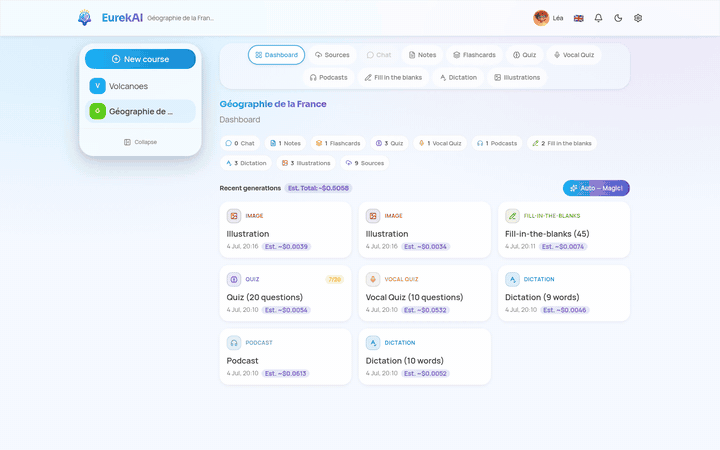
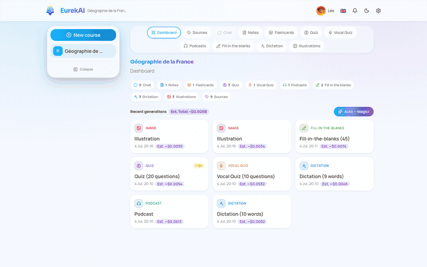
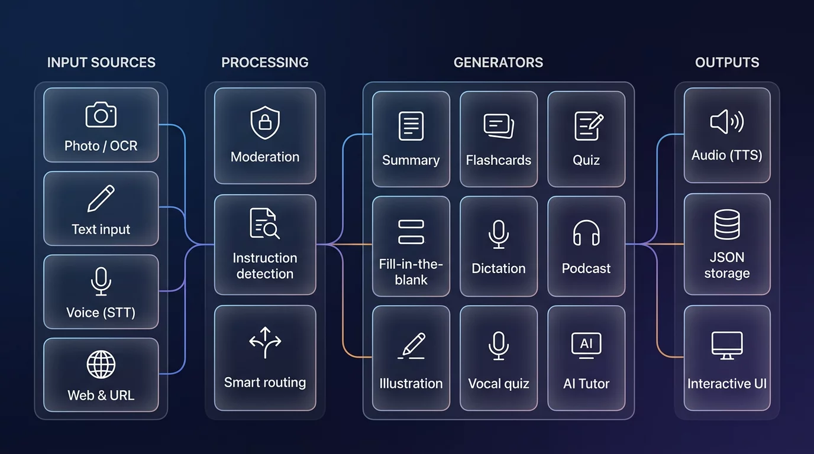

<p align="center">
  
</p>

<h1 align="center">EurekAI</h1>

<p align="center">
  <strong>将任何内容转化为互动学习体验 — 由 <a href="https://mistral.ai">Mistral AI</a> 驱动。</strong>
</p>

<p align="center">
  <a href="README-en.md">🇬🇧 英语</a> · <a href="README-es.md">🇪🇸 西班牙语</a> · <a href="README-pt.md">🇧🇷 葡萄牙语</a> · <a href="README-de.md">🇩🇪 德语</a> · <a href="README-it.md">🇮🇹 意大利语</a> · <a href="README-nl.md">🇳🇱 荷兰语</a> · <a href="README-ar.md">🇸🇦 阿拉伯语</a><br>
  <a href="README-hi.md">🇮🇳 印地语</a> · <a href="README-zh.md">🇨🇳 中文</a> · <a href="README-ja.md">🇯🇵 日语</a> · <a href="README-ko.md">🇰🇷 韩语</a> · <a href="README-pl.md">🇵🇱 波兰语</a> · <a href="README-ro.md">🇷🇴 罗马尼亚语</a> · <a href="README-sv.md">🇸🇪 瑞典语</a>
</p>

<p align="center">
  <a href="https://www.youtube.com/watch?v=_b1TQz2leoI"></a>
</p>

<h4 align="center">📊 代码质量</h4>

<p align="center">
  <a href="https://sonarcloud.io/summary/new_code?id=jls42_EurekAI"></a>
  <a href="https://sonarcloud.io/summary/new_code?id=jls42_EurekAI"></a>
  <a href="https://sonarcloud.io/summary/new_code?id=jls42_EurekAI"></a>
  <a href="https://sonarcloud.io/summary/new_code?id=jls42_EurekAI"></a>
</p>
<p align="center">
  <a href="https://sonarcloud.io/summary/new_code?id=jls42_EurekAI"></a>
  <a href="https://sonarcloud.io/summary/new_code?id=jls42_EurekAI"></a>
  <a href="https://sonarcloud.io/summary/new_code?id=jls42_EurekAI"></a>
  <a href="https://sonarcloud.io/summary/new_code?id=jls42_EurekAI"></a>
</p>
<p align="center">
  <a href="https://app.codacy.com/gh/jls42/EurekAI/dashboard?utm_source=gh&utm_medium=referral&utm_content=&utm_campaign=Badge_grade"></a>
  <a href="https://www.codefactor.io/repository/github/jls42/eurekai"></a>
</p>

---

## 项目故事 — 为什么创建 EurekAI？

**EurekAI** 诞生于 [Mistral AI 全球黑客马拉松](https://luma.com/mistralhack-online)（[官方网站](https://worldwide-hackathon.mistral.ai/)）（2026 年 3 月）。当时我需要一个参赛主题，而灵感来自一件非常具体的事：我经常陪女儿复习备考，于是想到，应该可以借助人工智能让这个过程更有趣、更具互动性。

目标是：接收**任何输入** — 课程照片、复制粘贴的文本、录音、网络搜索 — 并将其转化为**复习笔记、记忆卡片、测验、播客、填空题、插图等**。这一切都由法国公司 Mistral AI 的模型驱动，因此 EurekAI 自然适合法语学生使用。

[最初的原型](https://github.com/jls42/worldwide-hackathon.mistral.ai)在黑客马拉松期间用 48 小时完成，是基于 Mistral 服务构建的概念验证 — 当时已经可以运行，但功能有限。此后，EurekAI 发展成了一个完整项目：填空题、练习导航、网页抓取、可配置的家长内容审核、深入的代码审查，以及更多功能。全部代码均由人工智能生成 — 主要使用 [Claude Code](https://code.claude.com/)，另有部分通过 [Codex](https://openai.com/codex/) 和 [Gemini CLI](https://geminicli.com/) 完成。

---

## 概览

<p align="center">
  
</p>

| | |
|---|---|
| <br>**仪表盘** — 最近生成的内容、每张卡片的预估费用和项目总费用、“自动 — 魔法！”按钮 | <br>**来源** — 导入照片/PDF/文本/语音/网页、一键生成、复习要求检测 |

每个导入的来源都会显示其 [OCR 置信度、审核状态和预估费用](docs/screenshots/sources-list.webp)。

### 功能演示

| | |
|---|---|
| <br>**复习笔记** — 重点、词汇、附来源的引文、分节朗读 | <br>**单项选择测验** — 每题只有一个正确答案、即时反馈与解释、逐题导航 |
| <br>**记忆卡片** — 翻转卡片后自评“我知道 / 我不知道” | <br>**填空题** — 按需提供提示、容错判定 |
| <br>**听写** — 语音播报单词、逐字母严格批改 | <br>**语音测验** — 朗读问题、通过麦克风回答 |
| <br>**播客** — 双人迷你播客、可查看对话脚本 | <br>**插图** — 由智能体生成的教学图片 |
| <br>**人工智能导师** — 基于课程文档的聊天、带解释的回答、可生成测验和记忆卡片 | |

### 快速上手

| | |
|---|---|
| <br>**选择个人资料** — 每个孩子都有自己的空间、头像和语言 | <br>**创建个人资料** — 年龄、头像、为 15 岁以下用户设置家长 PIN |
| <br>**创建课程** — 每节课对应一个项目，随时可以添加来源 | <br>**设置** — API 状态、选择人工智能模型并查看价格 |

---

## 功能

| | 功能 | 说明 |
|---|---|---|
| 📷 | **文件导入** | 导入课程资料 — 照片、PDF（通过 Mistral OCR 处理，提供平均置信度，分为 `high`/`medium`/`low` 等级）或文本文件（TXT、MD）。上传会话支持按文件重试和独立进度显示 |
| 📝 | **文本输入** | 直接输入或粘贴任意文本 |
| 🎤 | **语音输入** | 录制语音 — Voxtral STT 将语音转写为文本 |
| 🌐 | **网页 / URL** | 粘贴 URL（通过 Readability + Lightpanda 直接抓取）或输入搜索内容（Mistral 智能体 web_search） |
| 📄 | **复习笔记** | 包含重点、词汇、引文和趣闻的结构化笔记 |
| 🃏 | **记忆卡片** | 互动问答卡片、对话式语音朗读 |
| ❓ | **单项选择测验** | 每题 4 个选项且只有一个正确答案，支持针对错题的自适应复习（题数可配置） |
| ✏️ | **填空题** | 提供提示和容错判定的填空练习 |
| 🔤 | **听写** | 根据导入的词表语音播报单词（Voxtral TTS），通过键盘输入，逐字母严格批改并解释拼写规则 |
| 🎙️ | **播客** | 双人迷你音频播客 — 使用默认 Mistral 声音或自定义声音（可以是父母的声音！） |
| 🖼️ | **插图** | 由 Mistral 智能体生成的教学图片 |
| 🗣️ | **语音测验** | 朗读问题（可使用自定义声音）、口头回答、人工智能核验 |
| 💬 | **人工智能导师** | 结合课程文档上下文的聊天，支持工具调用 |
| 🧠 | **自动路由器** | 基于 `mistral-small-latest` 的路由器分析内容，并从 8 种可用类型中推荐生成器组合 |
| 🔁 | **跨课程任务连续运行** | 打开其他课程时，导入、自动生成、麦克风录音、聊天、网络搜索和朗读仍会在原课程中继续；若在其他课程界面完成，通知会注明所属课程 |
| 🔒 | **家长控制** | 按个人资料配置内容审核（类别可自定义）、家长 PIN、聊天限制 |
| 🌍 | **多语言** | 界面支持 9 种语言；可通过提示词控制人工智能以 15 种语言生成内容 |
| 🔊 | **语音朗读** | 通过 Mistral Voxtral TTS 收听笔记和记忆卡片（问答对话） |
| 💶 | **API 费用跟踪** | 透明预估每次生成和每个来源的 € 费用（词元 / 字符 / 页数 / 音频秒数）。每张卡片显示费用徽章，仪表盘显示项目总费用 |
| 🎨 | **个人资料主题** | 每份个人资料可选择 `dark` 或 `light` 主题 — 随个人资料保存，并在每次切换个人资料时重新应用 |

---

## 架构概览

<p align="center">
  
</p>

---

## 模型使用映射图

<p align="center">
  
</p>

---

## 用户流程

<p align="center">
  
</p>

---

## 深入了解 — 功能

### 多模态输入

EurekAI 接受 4 种来源，并根据个人资料进行内容审核（儿童和青少年个人资料默认启用审核）：

- **文件导入** — JPG、PNG 或 PDF 文件通过 Mistral OCR 处理 — 默认使用 **OCR 4.1**（`mistral-ocr-4-1`），也可在设置中选择 **OCR 3**（`mistral-ocr-2512`）（更便宜，费用约为 ½；手写识别效果更好）— 支持印刷文本、表格和手写内容；文本文件（TXT、MD）则可直接导入。多文件上传采用**上传会话**机制：每个文件独立显示进度，失败文件可单独重试，无需重新提交其他文件，完成后可关闭会话。OCR 提供平均**置信度**（`average`，限制在 `[0,1]` 范围内，根据 Mistral 返回的 `averagePageConfidenceScore` 计算），在界面中以 `high` / `medium` / `low` 等级徽章显示（阈值约为 0.9 / 0.7）— 扫描质量较差时会发出提示，但不会阻止后续操作。发送给 Mistral 进行 OCR 处理的文档副本会在处理结束后立即删除，即使处理失败也一样。
- **自由文本** — 输入或粘贴任意内容。若启用审核，则在存储前进行审核。
- **语音输入** — 在浏览器中录制音频。默认由 **Voxtral Mini Transcribe 2**（`voxtral-mini-2602`）转写；也可在设置中选择 **Voxtral Mini Transcribe 3** 和 **Voxtral Small Transcribe 3**（Mistral 预览版）。界面语言会传递给模型（`language`），以优化识别效果。
- **网页 / URL** — 粘贴一个或多个 URL 以直接抓取内容（使用 Readability，JavaScript 页面则使用 Lightpanda），或输入关键词，通过 Mistral 智能体进行网络搜索。同一个输入框支持两种方式 — 自动区分 URL 和关键词，每条结果创建为独立来源。

### 人工智能内容生成

可生成八种学习材料：

| 生成器 | 模型 | 输出 |
|---|---|---|
| **复习笔记** | `mistral-large-2512` | 标题、摘要、重点、词汇、引文、趣闻 |
| **记忆卡片** | `mistral-large-2512` | 附来源引用的问答卡片（数量可配置） |
| **单项选择测验** | `mistral-large-2512` | 每题 4 个选项且只有一个正确答案、解释、自适应复习（题数可配置） |
| **填空题** | `mistral-large-2512` | 带提示的句子填空、容错判定（Levenshtein） |
| **听写** | `mistral-large-2512` + Voxtral TTS | 语音播报关键词（每词 1 个 MP3）→ 键盘输入 → 严格批改（漏写重音符号也算错误）并解释规则 |
| **播客** | `mistral-large-2512` + Voxtral TTS | 双人脚本 → MP3 音频 |
| **插图** | 智能体 `mistral-large-2512` | 通过 `image_generation` 工具生成教学图片 |
| **语音测验** | `mistral-large-2512` + Voxtral TTS + STT | TTS 朗读问题 → STT 转写回答 → 人工智能核验 |

### 聊天式人工智能导师

可完整访问课程文档的对话式导师：

- 使用 `mistral-large-2512`
- **工具调用**：可在对话过程中生成笔记、记忆卡片、测验或填空题
- 每门课程保留 50 条消息历史记录
- 若个人资料启用审核：会检查消息，并将被标记、检查失败和尚未检查的来源排除在上下文和工具之外（会先重试检查失败或尚未检查的来源，最多等待 5 秒）

### 自动路由器

路由器使用 `mistral-small-latest` 分析来源内容，并从 8 种可用生成器中推荐最相关的生成器。界面实时显示进度：先进行分析，再逐项生成，期间可以取消。

自动生成在服务器上运行：刷新页面、打开其他课程或切换个人资料后仍会继续，每门课程同时只运行一个自动生成任务（第二个标签页会加入正在运行的任务）。服务器对每个 Mistral 密钥最多同时启动 3 个生成任务。每项生成完成后都会显示消息，最后的汇总只显示一次；如果完成时正在查看其他课程，消息会注明所属课程。单独取消的生成任务不会在汇总中计为失败。“全部取消”会停止该课程的整批任务，并只显示一条消息。如果服务器在自动生成期间重启，该任务会被标记为中断，并提供“继续”按钮，仅重新启动尚未完成的生成任务，无需重新分析。

从标签页启动的耗时生成任务（逐个启动的生成任务、复习卡片）最多同时运行 3 个：后续任务会排队等待，打开课程时无需等待正在运行的生成任务结束。

### 自适应学习

- **测验统计**：按问题跟踪作答次数和正确率
- **测验复习**：基于原测验的来源，针对薄弱知识点生成 5-10 道新题（审核检查也针对这些来源）
- **复习要求检测**：识别复习要求（“如果我能……，就说明我掌握了这节课”），并在兼容的文本生成器中优先采用（笔记、记忆卡片、测验、填空题）。启用审核时，检测会等待来源检查完成，并只读取被判定为安全的来源；复习要求会保留其原始来源列表：如果其中一个来源被标记，该要求将不再显示或应用；如果其中一个来源被删除，该要求也会被清除。其费用会计入统计
### 安全与家长控制

- **4 个年龄组**：儿童（≤10 岁）、青少年（11-15）、学生（16-25）、成人（26+）
- **内容审核**：`mistral-moderation-2603`（Mistral Moderation 2）提供 11 个类别，新建儿童/青少年档案默认屏蔽其中 6 个（`sexual`、`hate_and_discrimination`、`violence_and_threats`、`criminal`、`selfharm`、`jailbreaking`；`criminal` 在对包括历史课在内的 50 节课进行评估且未出现任何误报后加入）。可在设置中为每个档案自定义类别；Moderation 2 将原先的“危险内容”类别拆分为 `dangerous` + `criminal`（现有档案会自动迁移，屏蔽类别也适用于已导入的来源）。默认安全策略：如果模型响应无法确认某个被屏蔽类别的审核结果，则拒绝该内容（“审核不可用”）；启用审核后，内容生成和聊天都会排除被标记、检查失败以及正在检查的来源。从未检查过的来源（在审核关闭时导入，或关联到档案的旧项目）会在使用前接受检查。因重启而中断的审核，如果服务器密钥允许，会在启动时恢复；否则，与出错的审核一样，会在打开项目或下一次生成时恢复。“重新检查”按钮可按需重新启动检查。启用审核后，来源在被判定为安全之前，其内容对儿童隐藏（预览、文本、原始文档）；家长可使用 PIN 显示内容，仅限单次查看。语音测验中的口头回答会先接受审核，再进行答案检查。带日期的标识符固定在 `helpers/moderation-model.ts` 中：已弃用的别名 `-latest` 不再由 API 列出。
- **家长 PIN**：使用 SHA-256 哈希，未满 15 岁的档案必须设置；每个 IP 地址每刻钟最多允许 10 次错误输入（429 `rate_limited`）。生产部署应采用加盐的慢速哈希（Argon2id、bcrypt）。
- **服务器数据**：`/output` 仅公开项目媒体（音频、图片、导入文件）；`profiles.json`、`config.json`、`projects.json` 和 `project.json` 永远不会对外提供
- **聊天限制**：未满 16 岁默认禁用人工智能聊天，可由家长启用

### 多档案系统

- 支持多个档案，包含姓名、年龄、头像和语言偏好
- **每个档案的声音**（`Profile.mistralVoices?: { host?, guest? }` — 每个角色均为可选）— 每个孩子都可以拥有自己的播客/语音测验声音组合
- **每个档案的主题**（`Profile.theme: 'dark' | 'light'`）— 切换档案时自动切换，并在后端持久保存
- 项目通过 `profileId` 关联到档案；没有档案的旧项目会关联到第一个打开它的档案，然后按照该档案的规则接受审核
- 级联删除：删除档案会删除其所有项目

### API 费用跟踪

每次需计费的 Mistral 调用（聊天、OCR、STT、TTS、智能体），包括指令检测和语音测验的口头回答，都会记录用量，为用户提供**透明**的欧元费用估算。免费的内容审核不计入费用。智能体工具费用也包含在内：每次网页搜索 0,03 $，每张生成图片 0,10 $（Mistral 定价），再加上这些工具产生的词元，估算时按智能体模型的输入单价计费。

- **权威数据源**：`helpers/pricing.ts` — 按模型前缀设置 `MODEL_PRICING`（例如：`mistral-large` → 输入 0.5 €/M 词元，输出 1.5 €/M 词元），`PRICING_SOURCES` 包含 Mistral 文档 URL，用于定期重新抓取
- **支持的单位**：`tokens`、`characters`（TTS）、`pages`（OCR）、`audio-seconds`（STT）— 由 `helpers/cost-calc.ts` 控制换算
- **用量记录链路**：`helpers/tracked-client.ts`（封装 Mistral 客户端）→ `helpers/usage-context.ts`（AsyncLocalStorage）→ `helpers/cost-calc.ts` → `helpers/cost-persist.ts` → `helpers/cost-middleware.ts`（注入 HTTP 响应）
- **界面**：每次生成的费用徽标（`src/partials/cost-badge-gen.html`）、每个来源的费用徽标（`cost-badge-src.html`）、仪表盘中的累计总额（`Project.totalCost`）
- **端点**：`/generate/*` 和 `/sources/*` 的响应会在返回对象（`Generation` / `Source`）中附加 `estimatedCost`、`usage` 和 `costBreakdown`。`POST /generate/route` 添加 `costDelta: number` 字段，仅表示路由费用；`POST /detect-consigne`（`{consigne, costDelta}`）以及口头回答检查也会返回各自的 `costDelta`。`GET /projects/:pid` 返回附加了 `totalCost`（根据 `costLog[]` 计算的总和）的项目及完整历史记录

### TTS（Mistral Voxtral）与自定义声音

- **Mistral Voxtral TTS**：默认使用 **Voxtral TTS**（`voxtral-mini-tts-2603`），可在设置中选择 **Voxtral TTS 3**（`voxtral-mini-tts-3-0`，Mistral 预览版，支持更多语言的原生声音）；语音合成完全由 Mistral 提供，无需额外密钥。仅提供所选模型支持的声音：Voxtral TTS 不接受通过 Voxtral 3 添加的声音
- **自定义声音**：家长可以通过 Mistral Voices API（使用音频样本）创建自己的声音，并分配给主持人/嘉宾角色 — 播客和语音测验便会使用家长的声音朗读，让孩子获得更具沉浸感的体验
- 两个可配置的声音角色：**主持人**（主要叙述者）和**嘉宾**（播客的第二个声音）
- 设置中提供完整的 Mistral 声音目录，可按语言筛选
- 朗读（学习卡片、播客、听写单词）会在离开其视图时暂停，并在返回后从暂停位置继续
- 闪卡朗读音频在首次收听时创建，随后保存在该次生成结果中：每次返回时都不会重新创建或重新计费
- 来源标记（`[Source N]`）不会被朗读

### 国际化

- 界面提供 9 种语言：法语、英语、西班牙语、葡萄牙语、意大利语、荷兰语、德语、印地语、阿拉伯语
- 人工智能提示词支持 15 种语言（法语、英语、西班牙语、德语、意大利语、葡萄牙语、荷兰语、日语、中文、韩语、阿拉伯语、印地语、波兰语、罗马尼亚语、瑞典语）
- 可为每个档案配置语言

---

## 技术栈

| 层级 | 技术 | 作用 |
|---|---|---|
| **运行时** | Node.js + TypeScript 6.x | 服务器与类型安全 |
| **后端** | Express 5.x | REST API |
| **开发服务器** | Vite 8.x (Rolldown) + tsx | 热模块替换、Handlebars 局部模板、代理 |
| **前端** | HTML + TailwindCSS 4.x + Alpine.js 3.x | 响应式界面，由 Vite 编译 TypeScript |
| **模板引擎** | vite-plugin-handlebars | 通过局部模板组合 HTML |
| **人工智能** | Mistral AI SDK | 聊天、OCR、STT、TTS、智能体、内容审核 |
| **TTS** | Mistral Voxtral TTS | `voxtral-mini-tts-2603`（可选 Voxtral TTS 3），内置语音合成 |
| **图标** | Lucide 1.x | SVG 图标库 |
| **网页抓取** | Readability + linkedom | 提取网页主体内容（Firefox Reader View 技术） |
| **无头浏览器** | Lightpanda | 用于 JS/SPA 页面的超轻量无头浏览器（Zig + V8）— 抓取备用方案 |
| **Markdown** | Marked | 在聊天中渲染 Markdown |
| **文件上传** | Multer 2.x | 管理多部分表单 |
| **音频** | ffmpeg-static | 拼接音频片段 |
| **测试** | Vitest | 单元测试 — 由 SonarCloud 测量覆盖率 |
| **持久化** | JSON 文件 | 无依赖存储 |

---

## 模型参考

| 模型 | 用途 | 选择原因 |
|---|---|---|
| `mistral-large-2512`（Large 3，固定的默认模型） | 学习卡片、闪卡、播客、测验、填空题、聊天、语音测验答案检查、图片智能体、网页搜索智能体、指令检测 | 多语言能力和指令遵循表现更好；固定使用此模型，因为别名 `mistral-large-latest` 自 2026 年 11 月起指向 Large 4，其速度对我们的内容生成而言过慢（Large 3 已宣布将于 30/04/2027 下线） |
| `mistral-ocr-4-1`（OCR 4.1，默认） | 文档 OCR | 印刷文字、表格、手写内容（$4 / 1000 页） |
| `mistral-ocr-2512`（OCR 3，可选） | 文档 OCR | 可在设置中选择，价格更低（$2 / 1000 页），手写识别效果更好 |
| `voxtral-mini-2602`（Voxtral Mini Transcribe 2，默认） | 语音识别（STT） | 语音输入和语音测验的口头回答（$0.003 / min） |
| `voxtral-mini-transcribe-3-0` / `voxtral-small-transcribe-3-0`（Transcribe 3，可选，预览版） | 语音识别（STT） | 可在设置中选择（$0.0035 / min 和 $0.004 / min） |
| `voxtral-mini-tts-2603`（Voxtral TTS，默认） | 语音合成（TTS） | 播客、语音测验、听写、朗读（$16 / M 字符） |
| `voxtral-mini-tts-3-0`（Voxtral TTS 3，可选，预览版） | 语音合成（TTS） | 可在设置中选择，支持更多语言的原生声音（$13 / M 字符） |
| `mistral-moderation-2603` | 内容审核 | 为儿童/青少年屏蔽 6 个类别（包括 `jailbreaking`） |
| `mistral-small-latest` | 自动路由器 | 快速分析内容以作出路由决策 |

在手机上，设置会在每个选择器下方显示所选模型的完整标签（价格、“推荐”或“预览版”），此前这些内容会被收起的菜单截断。

---

## 快速开始

```bash
# Cloner le dépôt
git clone https://github.com/jls42/EurekAI.git
cd EurekAI

# Installer les dépendances
npm install

# Configurer les clés API
cp .env.example .env
# Éditez .env (toutes optionnelles) :
#   MISTRAL_API_KEY=<your_api_key>           (optionnel — sinon chaque utilisateur saisit sa clé dans l'app)
#   SONAR_TOKEN=...                          (optionnel, CI SonarCloud uniquement)

# Lancer le développement
npm run dev
# → Backend :  http://localhost:3000 (API)
# → Frontend : http://localhost:5173 (serveur Vite avec HMR)
```

> **注意**：Mistral Voxtral TTS 是唯一的 TTS 提供商 — 除 `MISTRAL_API_KEY` 外，无需额外密钥。

> **用户输入的 API 密钥**：`MISTRAL_API_KEY` 现在是**可选的**。如果未设置，应用仍会启动，并提示每位用户在界面中输入**自己的 Mistral 密钥**。密钥**存储在浏览器中**（在安全上下文中通过 Web Crypto + IndexedDB 加密），并随每次请求发送 — **永不持久保存在服务器上**。优先级：档案密钥 > 浏览器全局密钥 > `MISTRAL_API_KEY`（环境变量）。设置 `EUREKAI_REQUIRE_USER_KEY=true` 会要求每位用户提供自己的密钥（环境变量中的密钥仅用于预加载）。

> **本地 HTTPS（平板/局域网）**：`localhost` 已属于安全上下文。如需通过局域网访问（平板），请生成本地证书并启用 HTTPS：这样浏览器就可以加密其存储的密钥，密钥在传输过程中也会被加密：
> ```bash
> ./scripts/gen-cert.sh 192.168.1.42   # mkcert si dispo, sinon openssl self-signed
> export HTTPS_KEY=certs/key.pem HTTPS_CERT=certs/cert.pem
> npm run dev                          # Express + Vite en HTTPS
> ```

### 环境变量

| 变量 | 是否必需 | 默认值 | 作用 |
|---|---|---|---|
| `MISTRAL_API_KEY` | 可选 | — | Mistral API 密钥（聊天、OCR、STT、Voxtral TTS、智能体、内容审核）。如果未设置，用户需在应用中输入密钥（存储在浏览器中，永不存储在服务器上） |
| `EUREKAI_REQUIRE_USER_KEY` | 可选 | `false` | `true` → 禁止人工智能请求回退使用 `MISTRAL_API_KEY`（每位用户必须提供自己的密钥）。适用于对外开放的实例 |
| `HTTPS_KEY` / `HTTPS_CERT` | 可选 | — | TLS 密钥/证书路径（参见 `scripts/gen-cert.sh`）→ Express 和 Vite 通过 HTTPS 提供服务（局域网/平板安全上下文） |
| `PORT` | 可选 | `3000` | Express 后端的 HTTP 端口 |
| `NODE_ENV` | 可选 | `development` | 若为 `production` → Express 从 `dist/` 提供前端（否则为 `public/`） |
| `SONAR_TOKEN` | 持续集成中可选 | — | 仅供 GitHub Actions 的 SonarCloud 工作流使用 |

### 测试、代码质量与贡献

```bash
npm test                # vitest (déclenche pretest : typecheck + lint:complexity + lint:ci + lint:deadcode)
npm run test:coverage   # couverture vitest
npm run lint            # ESLint + typescript-eslint + sonarjs
npm run lint:fix        # auto-fix
npm run format          # prettier
npm run security        # Opengrep (SAST local) — bloque sur finding ERROR
```

**Git 钩子（Husky）**：`pre-commit` 依次执行 `scripts/pre-commit-fast.sh`（冲突、大文件、shellcheck）、`lint-staged` 和 `npm test`；`pre-push` 首先执行具有阻断作用的 `npm audit` 检查（只要任何依赖项，包括传递依赖，存在 `critical` 级别的漏洞就会阻止执行，参见 `scripts/audit-verdict.mjs`），然后执行 `npm run security`。任一阶段失败时，对应钩子都会阻止提交/推送。

**外部工具（启动应用时可选，`pretest` 和 `npm run security` 必需）**：

```bash
# Lizard (Python) pour lint:complexity (CCN > 8 sur l'allowlist)
pipx install lizard          # ou : pipx run lizard

# Opengrep (binaire standalone ~40 Mo) pour npm run security
./scripts/install-opengrep.sh   # installe dans ~/.local/bin/
```

缺少这些工具时，`npm test` 会在 `pretest` 处失败（缺少 lizard），`npm run security` 也会失败（缺少 opengrep）。此时 husky 钩子会阻止提交/推送。

---

## 容器部署

镜像发布在 **GitHub Container Registry**：

```bash
# Télécharger l'image
podman pull ghcr.io/jls42/eurekai:latest

# Lancer EurekAI
mkdir -p ./data
podman run -d --name eurekai \
  -e MISTRAL_API_KEY=<your_api_key> \
  -v ./data:/app/output:U \
  -p 3000:3000 \
  ghcr.io/jls42/eurekai:latest
# → http://localhost:3000
```

> **`:U`**：Podman 无根模式下的标志，可自动调整卷权限。

```bash
# Build local
podman build -t eurekai -f Containerfile .

# Publier sur ghcr.io (mainteneurs)
./scripts/publish-ghcr.sh
```

---

## 项目结构

```
server.ts                 — Point d'entrée Express, monte les routes + config
config.ts                 — Config runtime (modèles, voix, modèle TTS), persistée dans output/config.json
store.ts                  — ProjectStore : CRUD projets/sources/générations, persistance JSON
profiles.ts               — ProfileStore : gestion des profils, hachage PIN
types.ts                  — Types TypeScript : Source, Generation (8 types), QuizStats, Profile
prompts.ts                — Tous les prompts IA centralisés (system + user templates, 15 langues)

generators/
  auto-agents.ts          — Source unique de vérité : AUTO_AGENTS_SET (8 agents) + MAX_AUTO_PLAN_LENGTH
  generation-types.ts     — Types générables individuellement (SINGLE_GENERATE_TYPES, coïncide avec les 8 agents auto)
  ocr.ts                  — OCR via Mistral (JPG, PNG, PDF) avec extraction interne des scores de confiance moyens par page
  summary.ts              — Génération de fiche de révision (JSON structuré)
  flashcards.ts           — Flashcards Q/R (nombre configurable)
  quiz.ts                 — Quiz QCM (nombre configurable) + révision adaptative
  fill-blank.ts           — Exercices à trous avec validation tolérante
  dictation.ts            — Dictée : mots + phrases-exemples + règles, 1 audio TTS par mot (8e agent auto)
  podcast.ts              — Script podcast 2 voix
  quiz-vocal.ts           — Quiz vocal : questions TTS + réponses STT + vérification IA
  image.ts                — Génération d'image via Agent Mistral (outil image_generation)
  chat.ts                 — Tuteur IA par chat avec appel d'outils
  router.ts               — Routeur automatique (contenu → générateurs recommandés)
  consigne.ts             — Détection de consignes de révision
  tts-provider.ts         — TTS Mistral Voxtral (synthèse vocale + listing des voix)
  tts.ts                  — Génération audio multi-voix (podcast + flashcards, concaténation de segments)
  stt.ts                  — Voxtral STT (audio → texte)
  websearch.ts            — Agent Mistral avec outil web_search (fallback)
  moderation.ts           — Modération de contenu (filtrage par âge)

routes/
  projects.ts             — CRUD projets
  profiles.ts             — CRUD profils avec gestion du PIN
  sources.ts              — Import fichiers (OCR + texte brut), texte libre, voix STT, scraping URL + recherche web, modération
  generate.ts             — Endpoints de génération (8 types + route)
  auto-runs.ts            — Lots Auto côté serveur : lancement, analyse et étapes en arrière-plan, état, annulation
  generations.ts          — Tentatives de quiz/fill-blank, réponses vocales, lecture à voix haute
  chat.ts                 — Chat IA avec appel d'outils

helpers/
  # IO & parsing
  index.ts                — getContent, stripJsonMarkdown, safeParseJson, tryParseJson, retryTurns, unwrapJsonArray, extractAllText, timer
  audio.ts                — collectStream (ReadableStream → Buffer)
  audio-files.ts          — Persistance et lecture des fichiers audio générés (podcast, flashcards)
  generation-media.ts     — Noms uniques des médias (MP3/PNG) et suppression avec leur génération
  media-ledger.ts         — Médias écrits pendant une génération, supprimés si elle échoue ou est annulée
  keyed-lock.ts           — File d'attente par clé (OCR sérialisé par contenu)
  keyed-slots.ts          — Places par clé (au plus 3 étapes d'Auto en même temps par clé Mistral)
  logger.ts               — Logger structuré (niveaux, contexte JSON)

  # Génération & UX
  auto-title.ts           — autoTitle(type, data, lang) : préfixe auto pour carte liste (Fiche, Note, Quiz, etc.)
  choice-labels.ts        — Labels localisés des choix (quiz, quiz-vocal) — 9 langues
  diversity.ts            — Diversité des générations (exclusion du contenu déjà produit, `diversityParams` : temperature/presencePenalty/randomSeed)
  fill-blank-validate.ts  — Validation tolérante des réponses (normalisation, Levenshtein)
  dictation-diff.ts       — Comparaison stricte lettre à lettre pour la correction de dictée (local, zéro coût IA)
  reading-comfort.ts      — Option « Confort de lecture » par profil (police Luciole, espacements) — partagé serveur/client
  ocr-models.ts           — Source de vérité sélection OCR (OCR 4 défaut / OCR 3 option) + normalizeOcrModel
  moderation-model.ts     — Modèle de modération épinglé + ses 11 catégories + migration des catégories legacy
  stt-models.ts           — Source de vérité sélection transcription (Mini Transcribe 2 défaut / Transcribe 3 option) + normalizeSttModel
  tts-models.ts           — Source de vérité sélection synthèse vocale (Voxtral TTS défaut / TTS 3 option) + compatibilité des voix
  tts-text.ts             — Texte envoyé au TTS : marqueurs de sources et crochets retirés (Voxtral les lit ou avale le mot)
  source-markers.ts       — Regex des marqueurs `[Source N]` des fiches (pastilles côté navigateur, texte lu côté serveur)
  moderation-http.ts      — Statut de modération → réponse HTTP (400 signalé / 503 indisponible / 409 en cours), statut effectif, garde de la consigne
  moderation-profile.ts   — Profil propriétaire du projet et catégories actives (source unique des routes)
  source-moderation.ts    — Modérations en vol et reprise (démarrage, génération, chat, « Revérifier »)
  input-moderation.ts     — Modération d'un texte saisi ou dicté (texte libre, recherche web, réponse orale)
  chat-sources.ts         — Sources accessibles au chat (sans les sources non vérifiées si la modération est active)

  # Codes d'erreur stables
  error-codes.ts              — Re-export mince de l'API publique
  error-code-resolution.ts    — Orchestration extractErrorCode(e, agent) → FailedStepCode
  error-code-rules.ts         — Règles de mapping par agent/step
  error-matchers.ts           — Matchers par pattern d'erreur HTTP/LLM (délimités pour Lizard)

  # Cost tracking API (suivi coûts €)
  pricing.ts              — MODEL_PRICING + PRICING_SOURCES (tarifs Mistral par prefix de modèle)
  cost-calc.ts            — Conversion ApiUsage → coût € (tokens / characters / pages / audio-seconds)
  cost-persist.ts         — Écriture dans Project.costLog + totalCost
  cost-middleware.ts      — Injection de costDelta dans la réponse HTTP
  tracked-client.ts       — Wrap du client Mistral (capture ApiUsage automatiquement)
  usage-context.ts        — AsyncLocalStorage pour propager l'usage dans les pipelines async

  # Clé API Mistral & sécurité
  mistral-client-factory.ts — Source UNIQUE de construction du client Mistral (buildTrackedClient, resolveClient, requireKeyMiddleware)
  rate-limit.ts           — Rate-limiters Express (authLimiter, pinLimiter, aiLimiter / aiPathLimiter, generalLimiter), 429 `rate_limited`
  request-validation.ts   — Validation de lang / ageGroup sur toutes les routes IA (400 invalid_input)
  output-static.ts        — Liste blanche du montage statique /output (médias des projets seulement)
  security-headers.ts     — Options Helmet / CSP (createHelmetOptions)
  redact.ts               — Redaction des secrets dans les logs (clé API, headers sensibles)
  mistral-retry.ts        — Retry avec backoff sur erreurs transitoires Mistral (3 tentatives)

  # Événements & notifications (SSE)
  event-bus.ts            — Bus d'événements de génération et de lots Auto en mémoire (dispatch SSE, filet anti-uncaughtException)
  auto-run-state.ts       — Transitions d'un lot Auto (fonctions pures, appliquées par le store)
  event-key.ts            — Clé d'événement typée partagée client/serveur (idempotence notifications)

  # Voix & profils
  voice-selection.ts      — selectVoices : rotation déterministe par profil + langue (host/guest)
  voice-types.ts          — Type MistralVoice (importable côté frontend sans embarquer le SDK Mistral)

src/                      — Frontend (Vite + Handlebars)
  index.html              — Point d'entrée HTML principal
  main.ts                 — Entrée frontend (init Alpine.js + icônes Lucide)
  app/                    — Modules applicatifs Alpine.js
    state.ts              — Gestion d'état réactif
    navigation.ts         — Routage des vues + gardes par âge
    view-media.ts         — Pause du son au changement de vue (position gardée)
    profiles.ts           — Logique du sélecteur de profils
    projects.ts           — CRUD des cours
    sources.ts            — Gestionnaires d'upload de sources
    generate.ts           — Déclencheurs de génération (individuel, tout, Auto)
    auto-launch.ts        — Lancement d'un Auto côté serveur, suivi pendant qu'un autre cours est affiché, annulation
    auto-runs.ts          — Auto suivis par l'onglet : état reçu du serveur, bilan affiché une seule fois, coût de l'analyse
    request-slots.ts      — Au plus 3 générations longues en même temps pour l'onglet, file d'attente FIFO
    moderation-gate.ts    — Pré-contrôle de modération des générations (vérifie d'abord les sources en attente)
    effective-moderation.ts — Statut de modération affiché et masquage du contenu des sources
    generations.ts        — Affichage + actions sur les générations
    chat.ts               — Interface de chat
    chat-in-flight.ts     — Messages du chat en attente de réponse, par cours
    config.ts             — Interface de configuration (modèles de chat, d'OCR, de transcription et de TTS, voix)
    render.ts             — Helpers de rendu HTML
    i18n.ts               — Changement de langue
    ...
  components/
    quiz.ts               — Composant quiz interactif
    quiz-vocal.ts         — Composant quiz vocal
    fill-blank.ts         — Composant textes à trous
    fill-blank-validate.ts — Ré-export client de la validation textes à trous (validateAnswer)
    flashcards.ts         — Composant flashcards avec retournement
    dictation.ts          — Composant dictée interactif
    step-by-step.ts       — Mixin navigation pas-à-pas (quiz, fill-blank, flashcards)
  i18n/
    fr.ts, en.ts, es.ts, — Dictionnaires par langue (9 langues)
    pt.ts, it.ts, nl.ts,
    de.ts, hi.ts, ar.ts
    languages.ts          — Registre des langues UI disponibles
    index.ts              — Chargeur i18n
  partials/               — Partials HTML Handlebars (header, sidebar, dialogues, vues)
  styles/
    main.css              — Entrée TailwindCSS
    theme.css             — Variables de thème personnalisées

public/assets/            — Ressources statiques (logo, avatars, schémas architecture)
docs/                     — Notes internes (inventaire prompts, audits, prompts des diagrammes) + screenshots du README
scripts/                  — Tooling : check-deps, check-models, check-security, check-complexity, gen-cert, install-opengrep, translate-readme, publish-ghcr, update-pricing
output/                   — Données d'exécution (projets, config, fichiers audio) ; en mode prod (`NODE_ENV=production`), Express sert le frontend depuis `dist/` au lieu de `public/`
```

> **参与代码贡献的人工智能智能体**：请查阅 [`CLAUDE.md`](CLAUDE.md)（通用规则、索引）和 [`.claude/rules/`](.claude/rules/) 中的详细规则；后者会根据读取或修改的文件按需加载。这些内容涵盖详细架构背景、强制规则（错误代码、费用跟踪，以及提示词中不得包含元描述词，即文档类型等限定文档的词语，因为模型会将这些词复制到输出中）和已知陷阱（Lizard CCN、Opengrep、Codacy/Semgrep 迁移）。

---

## API 参考

### 配置
| 方法 | 端点 | 描述 |
|---|---|---|
| `GET` | `/api/config` | 当前配置 |
| `PUT` | `/api/config` | 修改配置（模型、声音、TTS 模型） |
| `GET` | `/api/config/status` | API 状态：`mistral`（已设置 Mistral 密钥）、`ttsAvailable`（`mistral` 的别名，Mistral Voxtral 是唯一的 TTS 提供商） |
| `POST` | `/api/config/reset` | 恢复默认配置 |
| `GET` | `/api/config/voices` | 列出 Mistral TTS 声音（可选 `?lang=fr`） |
| `GET` | `/api/moderation-categories` | 可用的审核类别及按年龄设置的默认值 |
| `POST` | `/api/providers/mistral/validate` | 验证用户输入的 Mistral 密钥 — 始终返回 200 `{status}`（`ok`/`invalid`/`quota`/`network`/`missing`），不回退使用环境变量 |

### 档案
| 方法 | 端点 | 描述 |
|---|---|---|
| `GET` | `/api/profiles` | 列出所有档案 |
| `POST` | `/api/profiles` | 创建档案 |
| `PUT` | `/api/profiles/:id` | 修改档案（< 15 岁需提供 PIN；15 min 内错误输入 10 次 PIN → 429 `rate_limited`） |
| `DELETE` | `/api/profiles/:id` | 删除档案并级联删除项目 `{pin?}` → `{ok, deletedProjects}` |

### 项目
| 方法 | 端点 | 描述 |
|---|---|---|
| `GET` | `/api/projects` | 列出项目（`?profileId=` 可选） |
| `POST` | `/api/projects` | 创建项目 `{name, profileId}` |
| `GET` | `/api/projects/:pid` | 项目详情；`?profileId=` 将没有档案的项目关联到打开它的档案 |
| `PUT` | `/api/projects/:pid` | 重命名 `{name}` |
| `DELETE` | `/api/projects/:pid` | 删除项目 |
| `GET` | `/api/projects/:pid/events` | 生成状态转换（`completed`/`failed`/`cancelled`）的实时 SSE 流（`event: generation`）及连接保活心跳 |

### 来源
| 方法 | 端点 | 描述 |
|---|---|---|
| `POST` | `/api/projects/:pid/sources/upload` | 通过多部分表单导入文件（JPG/PNG/PDF 使用 OCR，TXT/MD 直接读取） |
| `POST` | `/api/projects/:pid/sources/text` | 自由文本 `{text}` |
| `POST` | `/api/projects/:pid/sources/voice` | 语音 STT（多部分表单音频） |
| `POST` | `/api/projects/:pid/sources/websearch` | URL 抓取或网页搜索 `{query}` — 返回来源数组；如果所有地址均被拒绝（内部网络），返回 422 `url_blocked`；如果未能创建任何来源，返回 502 `all_sources_failed` |
| `POST` | `/api/projects/:pid/sources/moderate` | 恢复待处理或出错的审核 `{sourceIds?}`（每次调用最多 10 个，等待 ≤ 10 s）→ `{sources: [{id, moderation}]}` |
| `DELETE` | `/api/projects/:pid/sources/:sid` | 删除来源、其导入文件及依赖于它的指令 → `{ok, consigne}` |
| `POST` | `/api/projects/:pid/moderate` | 审核 `{text}` |
| `POST` | `/api/projects/:pid/detect-consigne` | 检测复习指令（仅限已检查的来源）→ `{consigne, costDelta}` |
### 生成
| 方法 | 端点 | 描述 |
|---|---|---|
| `POST` | `/api/projects/:pid/generate/summary` | 复习资料 |
| `POST` | `/api/projects/:pid/generate/flashcards` | 记忆卡片 |
| `POST` | `/api/projects/:pid/generate/quiz` | 选择题测验（4 个选项，仅一个正确答案） |
| `POST` | `/api/projects/:pid/generate/fill-blank` | 填空练习 |
| `POST` | `/api/projects/:pid/generate/dictation` | 听写（单词 + 例句 + 规则，每个单词配 1 段 TTS 音频；自动路由器也可推荐） |
| `POST` | `/api/projects/:pid/generate/podcast` | 播客 |
| `POST` | `/api/projects/:pid/generate/image` | 插图 |
| `POST` | `/api/projects/:pid/generate/quiz-vocal` | 语音测验 |
| `POST` | `/api/projects/:pid/generate/quiz-review` | 自适应复习 `{generationId, weakQuestions}` |
| `POST` | `/api/projects/:pid/generate/remediation-summary` | 针对测验错题的专项复习资料 `{generationId, weakQuestions}` — 由测验视图中的补救学习按钮与 `quiz-review` 并行调用 |
| `POST` | `/api/projects/:pid/generate/route` | 路由分析（待启动的生成器计划）— 返回 `{plan, costDelta}`（仅路由成本） |
| `POST` | `/api/projects/:pid/generate/auto/start` | 在服务器端启动自动批次 `{runId, …}`：立即返回 202 响应，然后在后台执行分析和各步骤，每个 Mistral 密钥最多同时执行 3 个步骤；页面重新加载后批次仍会继续。如果该课程已有正在运行的批次，则返回 409 `auto_busy` |
| `POST` | `/api/projects/:pid/generate/auto/resume` | 恢复因服务器重启而中断的自动批次 `{runId}`：使用本次请求的密钥重新启动中断的步骤，无需重新分析（返回 202 响应） |
| `GET` | `/api/projects/:pid/auto-runs/:runId` | 自动批次状态：分析、各步骤及其结果 |
| `POST` | `/api/projects/:pid/auto-runs/:runId/cancel` | 取消整个自动批次（单个步骤的取消方式与生成任务相同） |

所有生成路由均接受 `{sourceIds?, lang?, ageGroup?, count?, useConsigne?}`；如果 `ageGroup` 未知，或 `lang` 不是有效的语言代码（预期值：`fr`、`pt-BR` 等），则在调用任何人工智能服务之前返回 400 `invalid_input`。`quiz-review` 和 `remediation-summary` 还要求提供 `{generationId, weakQuestions}`，并针对原始测验的来源进行处理。

### 生成内容的 CRUD
| 方法 | 端点 | 描述 |
|---|---|---|
| `POST` | `/api/projects/:pid/generations/:gid/quiz-attempt` | 提交测验答案 `{answers}` |
| `POST` | `/api/projects/:pid/generations/:gid/fill-blank-attempt` | 提交填空练习答案 `{answers}` |
| `POST` | `/api/projects/:pid/generations/:gid/dictation-attempt` | 提交听写答案 `{answers}`（服务器端严格评分） |
| `POST` | `/api/projects/:pid/generations/:gid/vocal-answer` | 核验口头回答（音频 + questionIndex）；口头回答在核验前先经过内容审核（拒绝时返回：400 `quiz.answerBlocked`），成本通过 `costDelta` 返回 |
| `POST` | `/api/projects/:pid/generations/:gid/read-aloud` | TTS 朗读（复习资料/记忆卡片） |
| `POST` | `/api/projects/:pid/generations/:gid/cancel` | 取消正在进行的生成任务（取消待处理任务的唯一途径） |
| `PUT` | `/api/projects/:pid/generations/:gid` | 重命名 `{title}` |
| `DELETE` | `/api/projects/:pid/generations/:gid` | 删除生成内容及其媒体文件（音频、图像） |

### 聊天
| 方法 | 端点 | 描述 |
|---|---|---|
| `GET` | `/api/projects/:pid/chat` | 获取聊天记录 |
| `POST` | `/api/projects/:pid/chat` | 发送消息 `{message, lang, ageGroup, useConsigne?}` |
| `DELETE` | `/api/projects/:pid/chat` | 清空聊天记录 |

---

## 架构决策

| 决策 | 理由 |
|---|---|
| **选择 Alpine.js 而非 React/Vue** | 资源占用极低，通过 Vite 编译的 TypeScript 实现轻量响应式交互。非常适合注重速度的黑客松。 |
| **使用 JSON 文件持久化** | 零依赖，即时启动。无需配置数据库，启动即可使用。 |
| **Vite + Handlebars** | 兼具两者优势：开发时快速 HMR，通过 HTML 局部模板组织代码，以及 Tailwind JIT。 |
| **集中管理提示词** | 所有人工智能提示词都位于 `prompts.ts` 中，便于迭代、测试，以及按语言和年龄组调整。 |
| **多生成任务系统** | 每次生成都是具有独立 ID 的对象，允许每门课程包含多份复习资料、测验等内容。 |
| **按年龄调整提示词** | 4 个年龄组分别采用不同的词汇、复杂度和语气，根据学习者的情况以不同方式讲授相同内容。 |
| **基于智能体的功能** | 图像生成和网页搜索使用临时 Mistral 智能体，通过自动清理实现规范的生命周期管理。 |
| **智能 URL 抓取** | 单个输入框支持混合输入 URL 和关键词；URL 通过 Readability 抓取（静态页面），必要时回退到 Lightpanda（JS/SPA 页面），关键词则触发 Mistral web_search 智能体。每条结果都会创建一个独立来源。 |
| **100% Mistral TTS** | Mistral Voxtral TTS（除 `MISTRAL_API_KEY` 外无需额外密钥）— 语音合成已集成到成本核算流程和按语言选择语音的机制中。 |

---

## 鸣谢

- **[Mistral AI](https://mistral.ai)** — 人工智能模型（Large、OCR、Voxtral STT、Voxtral TTS、Moderation、Small）+ 全球黑客松
- **[Alpine.js](https://alpinejs.dev)** — 轻量响应式框架
- **[TailwindCSS](https://tailwindcss.com)** — 实用类 CSS 框架
- **[Vite](https://vitejs.dev)** — 前端构建工具
- **[Lucide](https://lucide.dev)** — 图标库
- **[Marked](https://marked.js.org)** — Markdown 解析器
- **[Readability](https://github.com/mozilla/readability)** — 网页内容提取（采用 Firefox 阅读视图技术）
- **[Lightpanda](https://lightpanda.io)** — 用于抓取 JS/SPA 页面的超轻量无头浏览器
- **[Luciole](https://luciole-vision.com)** — 专为视力障碍读者设计的字体，© Laurent Bourcellier & Jonathan Perez，[CC BY 4.0](https://creativecommons.org/licenses/by/4.0/)（个人资料中的“舒适阅读”选项）

项目于 Mistral AI 全球黑客松期间（2026 年 3 月）发起，全程通过 [Claude Code](https://code.claude.com/)、[Codex](https://openai.com/codex/) 和 [Gemini CLI](https://geminicli.com/) 由人工智能开发。

---

## 作者

**Julien LS** — [contact@jls42.org](mailto:contact@jls42.org)

## 许可证

[AGPL-3.0](LICENSE) — 版权所有 (C) 2026 Julien LS

**使用 gpt-6.1-sol 将文章从法语翻译为中文。**
